# mpl3d-vtk

面向 NumPy 数据的 Python 三维科学绘图库，提供独立绘图函数，也可以直接在 Matplotlib Figure 中使用 `vtk3d` 子图。

- **Matplotlib** 管理原生三维坐标轴、刻度、鼠标视角、数学文本、色图、色条与子图布局。
- **VTK / OpenGL** 处理三角网格、等值面提取、体数据切片、三维光照与深度遮挡。默认使用 2 倍超采样。
- **导出** 沿用 `fig.savefig()`，可以在同一张图里混排二维和三维子图，也支持离屏批量出图。

## 安装

```sh
git clone https://github.com/guessable/mpl3dVTK.git
cd mpl3dVTK
python -m pip install .
```

要求 Python 3.11+、NumPy 1.25+、Matplotlib 3.11.x、VTK 9.4 至 9.x。运行时需要可用的 OpenGL 上下文。

## 快速开始

### 在 Matplotlib 子图里画曲面

下面在 `[-2, 2] × [-2, 2]` 上绘制 $u=\exp(x\sin y)$，右侧画出 $y=\pi/2$ 的二维截线。导入 `mpl3d_vtk` 会注册 `vtk3d` 投影。

```python
import matplotlib.pyplot as plt
import numpy as np
import mpl3d_vtk as m

t = np.linspace(-2, 2, 201)
x, y = np.meshgrid(t, t)
u = np.exp(x * np.sin(y))

fig = plt.figure(figsize=(10, 4.5), layout="constrained")
ax = fig.add_subplot(121, projection="vtk3d")
surface = ax.plot_surface(x, y, u, cmap=plt.get_cmap())
ax.set(xlabel=r"$x$", ylabel=r"$y$", zlabel=r"$u$")
fig.colorbar(surface, ax=ax, label=r"$u$", shrink=0.75)

profile = fig.add_subplot(122)
profile.plot(t, np.exp(t), label=r"$y=\pi/2$")
profile.set(xlabel=r"$x$", ylabel=r"$u$")
profile.legend()

fig.savefig("surface.png", dpi=180)
m.close(fig)
```

常用轴方法包括 `plot_surface`、`plot_wireframe`、`plot_trisurf`、`plot`、`scatter`、`quiver`、`contour`、`stem` 和 `bar3d`。用 `ax.set()`、`ax.tick_params()`、`ax.grid()` 和 `ax.view_init()` 调整坐标轴。

### 绘制零等值面

```python
import numpy as np
import mpl3d_vtk as m

t = np.linspace(-1, 1, 19)
v = np.random.default_rng(42).uniform(-1, 1, (t.size, t.size, t.size))

fig = m.figure(layout="constrained")
ax = m.subplot(111)
iso = m.isosurface(ax, t, t, t, v, 0)
m.savefig("zero_isosurface.png", dpi=180)
print(f"{len(iso.faces)} triangles")
m.close(fig)
```

高层绘图函数可以接收首个位置参数 `ax` 或关键字 `ax=ax`。`m.hold("on", ax=ax)` 可让连续调用在同一组轴上叠加。Matplotlib 轴方法默认叠加图元。

## API

### 数据格式、句柄与样式

| 项目 | 用法 |
| --- | --- |
| 规则曲面 | 高度数组形状为 `(ny, nx)`。坐标可以是同形状的 `X, Y` 网格，也可以是两个一维向量。 |
| 规则体数据 | 数组形状为 `(ny, nx, nz)`，与 `np.meshgrid(x, y, z, indexing="xy")` 一致。 |
| 三角网格 | `trisurf(tri, x, y, z[, c])` 接收形状 `(n_faces, 3)` 的整数面索引。默认从 0 开始，从 1 开始的索引可用 `index_base=1`。 |
| 颜色与光照 | `cmap` 和 `clim` 控制映射。用 `FaceColor="interp"`、`EdgeColor="none"`、`FaceAlpha`、`FaceLighting` 等属性设置图元。 |
| 返回值 | 大多数绘图函数返回 `Graphic`。可传给 `fig.colorbar()`，通过 `vertices`、`faces`、`data`、`mapper` 和 `actor` 访问网格或 VTK 对象。组合图和动画的返回值见逐函数页面。 |
| 复用图元 | 调用 `handle.set_clim()` 或 `handle.set_cmap()` 更新色映射。规则曲面可用 `set_zdata()` 和 `set_cdata()` 更新数据。 |
| 默认外观 | 正交视角、等数据单位比例、灰色无填充轴框、细网格与向外刻度。背景、标量色图和颜色循环沿用 Matplotlib 当前样式。 |
| 抗锯齿 | `antialiasing` 支持整数 1–4。1 为原始像素尺寸，2 为默认，4 可用于高质量静态导出。可用 `ax.set_antialiasing(4)` 按子图调整。 |

按 [三维绘图图集](docs/plot_catalog.md) 查找图形。参数重载、图形属性和返回值见 [API 参考](docs/api.md)。

### 逐函数说明与配图

展开类别可查看每个公开接口的用途和缩略图。图集使用默认三维视角、轴框和刻度。示例的视角或配色设置会写在代码里。点击名称可查看调用签名、参数、可运行代码和完整原图。

<!-- BEGIN ILLUSTRATED API -->

<details>
<summary>规则曲面和等高线（16）</summary>

| 接口 | 用途 | 示例 |
| --- | --- | --- |
| [`surf`](docs/function_reference.md#surf) | Z 为高度矩阵，C 可为独立标量场或逐点 RGB(A)。X、Y 可传坐标向量。返回曲面句柄。 | 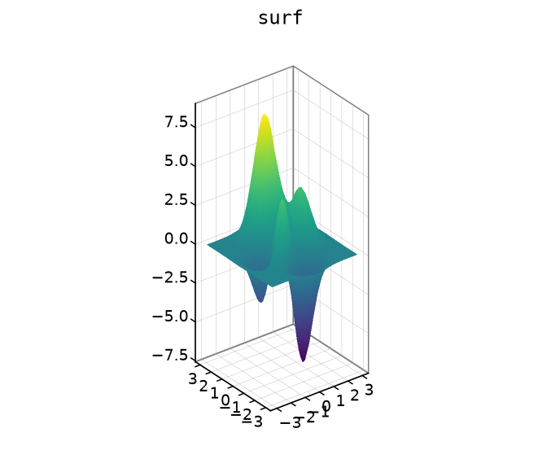 |
| [`surface`](docs/function_reference.md#surface) | 原始曲面图元，支持 XData、YData、ZData、CData 属性。连续调用可直接叠加。返回曲面句柄。 | 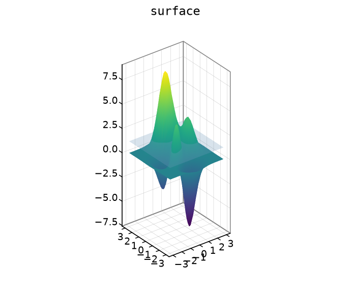 |
| [`surfl`](docs/function_reference.md#surfl) | light 可为方位角和仰角，或三维方向。四个反射系数依次为环境光、漫反射、镜面反射和高光指数。附加字符串 light 可使用场景光源。 | 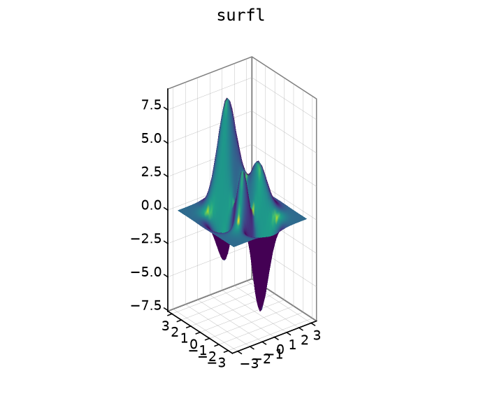 |
| [`surfnorm`](docs/function_reference.md#surfnorm) | 用箭头标出规则网格上的曲面法向。返回曲面和箭头两个句柄。稀疏网格更易观察方向。 | 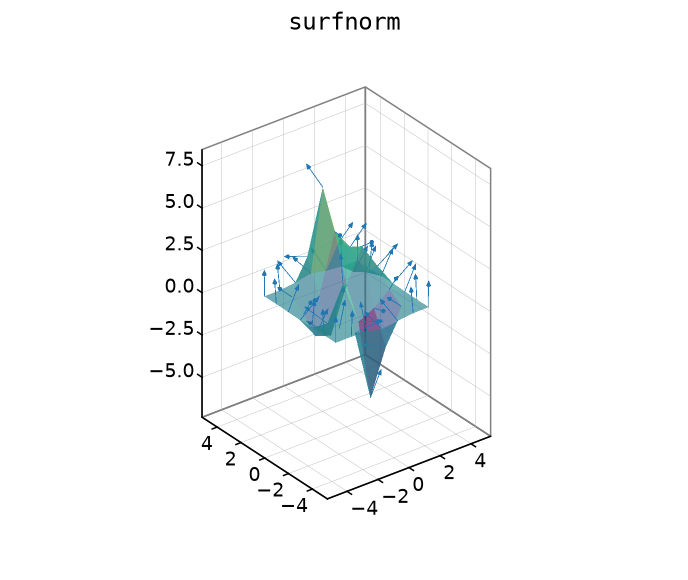 |
| [`mesh`](docs/function_reference.md#mesh) | 绘制随标量变化的网格线。EdgeColor 可指定固定颜色。返回网格句柄。 | 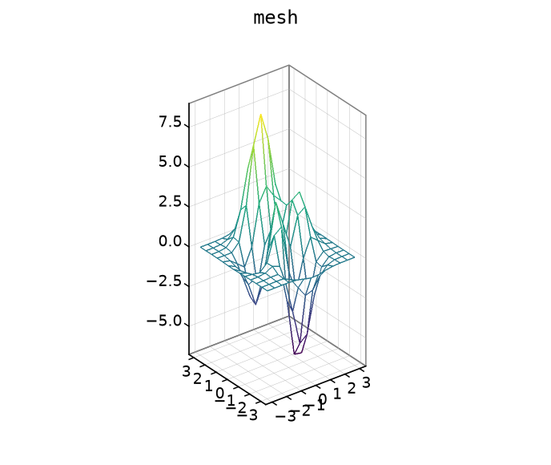 |
| [`surfc`](docs/function_reference.md#surfc) | 在曲面下方画出高度等值线。levels 可为数量或具体高度数组。返回曲面和等高线。 | 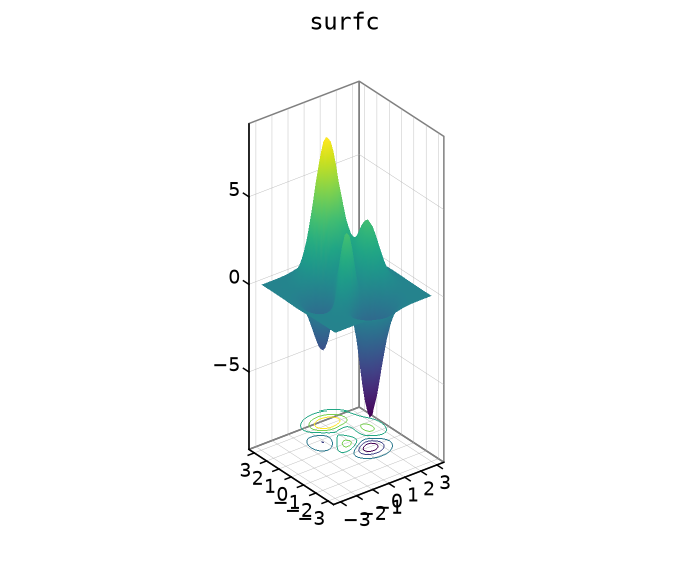 |
| [`meshc`](docs/function_reference.md#meshc) | 在网格下方画出等高线。返回网格和等高线。 | 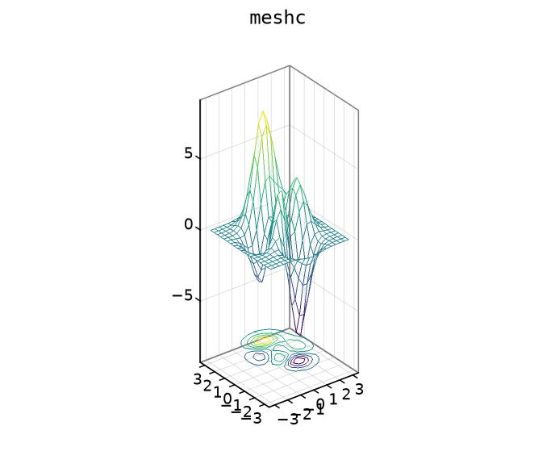 |
| [`meshz`](docs/function_reference.md#meshz) | 把边界垂直延伸到 base。默认底部略低于数据最小值。返回网格和边界帘幕。 | 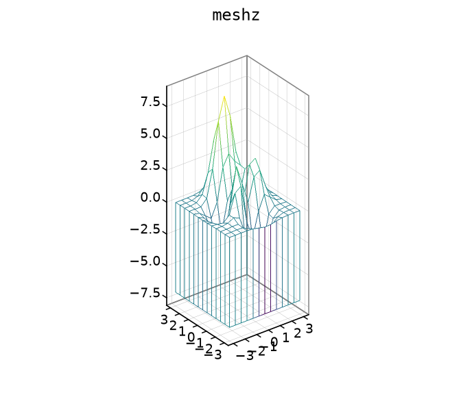 |
| [`waterfall`](docs/function_reference.md#waterfall) | 逐行绘制曲线和向下延伸的帘幕。返回帘幕和曲线。 | 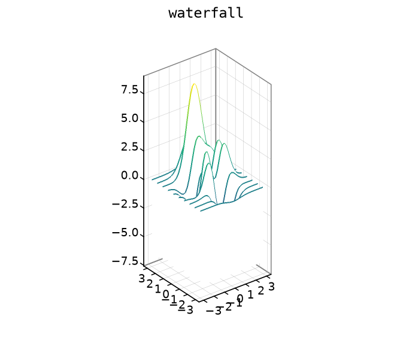 |
| [`ribbon`](docs/function_reference.md#ribbon) | Z 的每列是一条带，Y 给出纵向参数。width 默认 0.75。返回带状曲面列表。 | 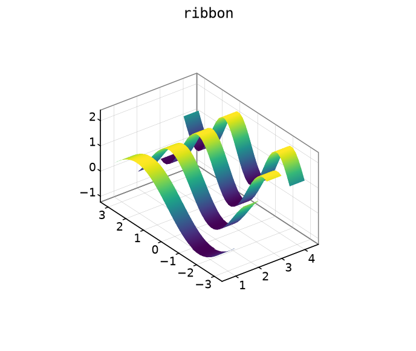 |
| [`contour3`](docs/function_reference.md#contour3) | 每条等高线位于对应的高度。标量 levels 指级别数量，数组给出具体高度。用 return_matrix=True 同时取矩阵。 | 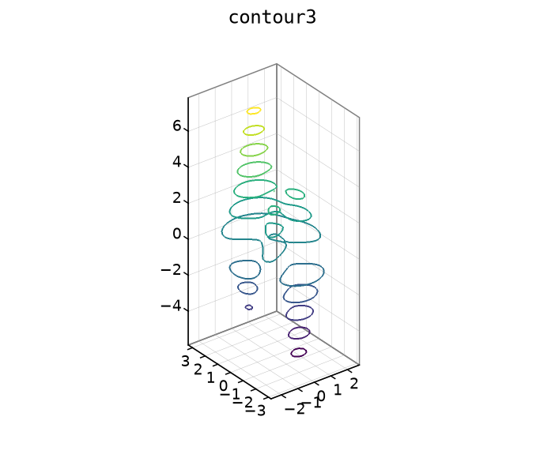 |
| [`clabel`](docs/function_reference.md#clabel) | 在等高线连通段上添加值标签。levels 可只标特定高度。返回 Matplotlib 3D 文字列表。 | 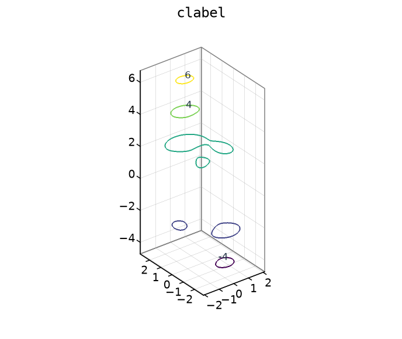 |
| [`fsurf`](docs/function_reference.md#fsurf) | 函数接收 NumPy 数组。bounds 可设一组共用区间或分别设两个区间。MeshDensity 控制规则采样。 | 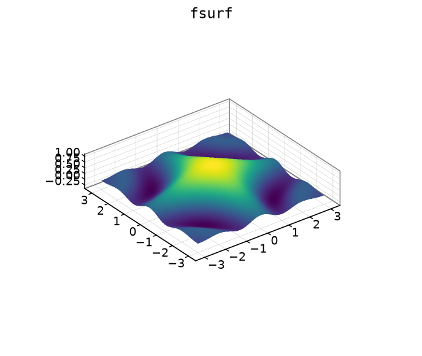 |
| [`fmesh`](docs/function_reference.md#fmesh) | 对显式或参数曲面做规则采样，然后绘制网格。ShowContour 可附加等高线。 | 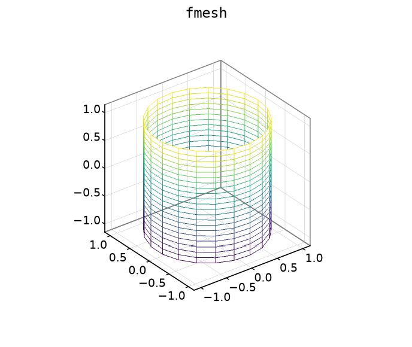 |
| [`fimplicit3`](docs/function_reference.md#fimplicit3) | f 接收 X、Y、Z 数组，绘制 f=0。bounds 可为两端值或三个轴各自的一对端值。 | 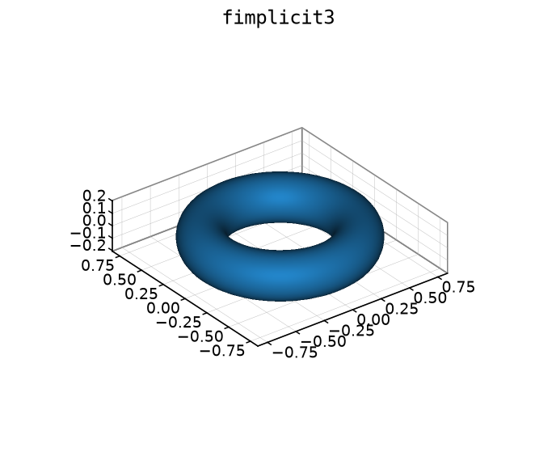 |
| [`pcolor`](docs/function_reference.md#pcolor) | 把矩阵映射到 XY 平面上的有色网格。颜色与网格顶点对应，默认展示顶视图。 | 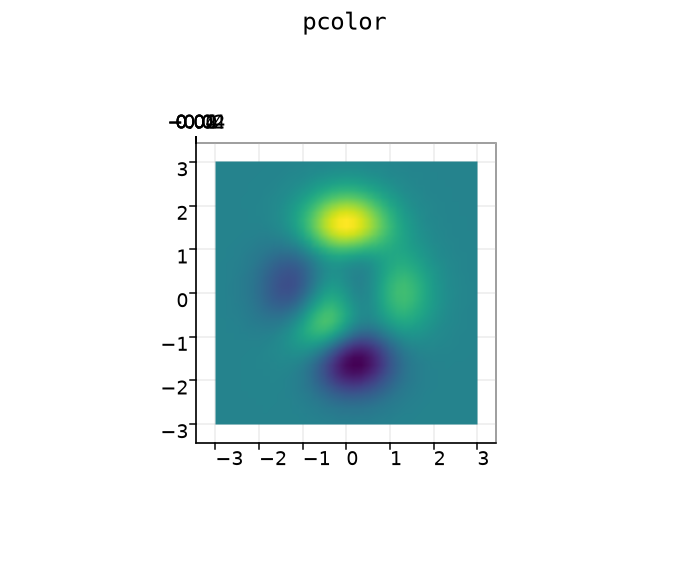 |

</details>

<details>
<summary>三角网格、多边形和几何（13）</summary>

| 接口 | 用途 | 示例 |
| --- | --- | --- |
| [`trisurf`](docs/function_reference.md#trisurf) | TRI 有三列，每行是一个三角形的顶点索引。也可传带 ConnectivityList、Points 或 simplices、points 的三维剖分对象。C 可为逐顶点或逐三角形颜色。 | 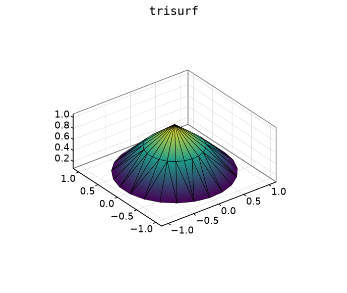 |
| [`trimesh`](docs/function_reference.md#trimesh) | 接收相同的三角网格或剖分对象并绘制网格边。省略 Z 时，网格位于 XY 平面。 | 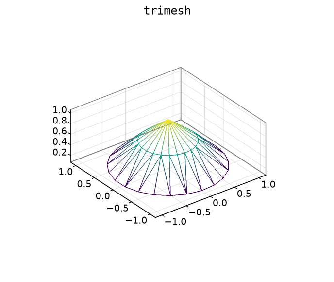 |
| [`tetramesh`](docs/function_reference.md#tetramesh) | T 的每行包含四个顶点索引。XYZ 每行是三维位置。也可传入带四面体连接关系的剖分对象。C 为逐四面体标量，透明面可查看内部结构。 | 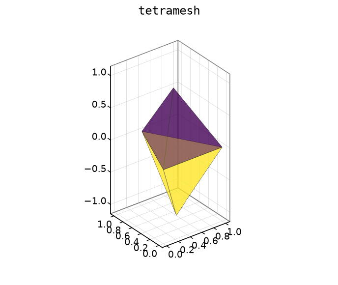 |
| [`patch`](docs/function_reference.md#patch) | 面可以不等长，允许用 NaN 填充。颜色可按面、按顶点或使用固定 FaceColor。 | 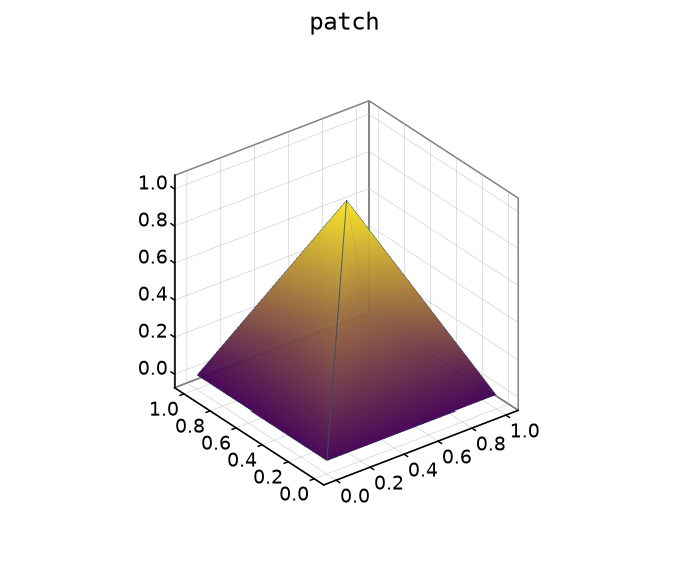 |
| [`fill3`](docs/function_reference.md#fill3) | 每列给出一个封闭多边形。C 可为颜色名或映射到颜色的数据。返回面句柄。 | 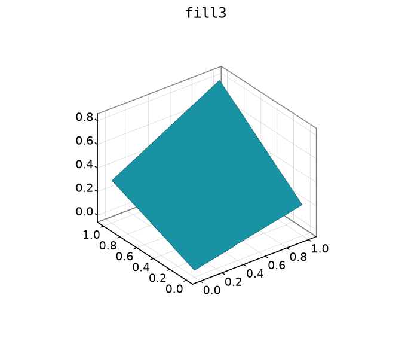 |
| [`surf2patch`](docs/function_reference.md#surf2patch) | 把曲面转换成 faces、vertices、facevertexcdata 字典，用 triangles=True 得到三角面。 | 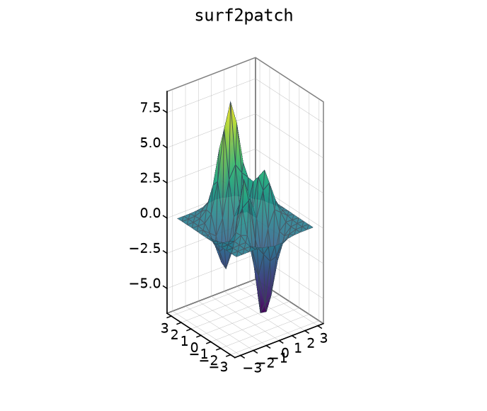 |
| [`reducepatch`](docs/function_reference.md#reducepatch) | reduction 在 0 到 1 之间时是保留比例，也可给保留面数。返回简化几何字典。 | 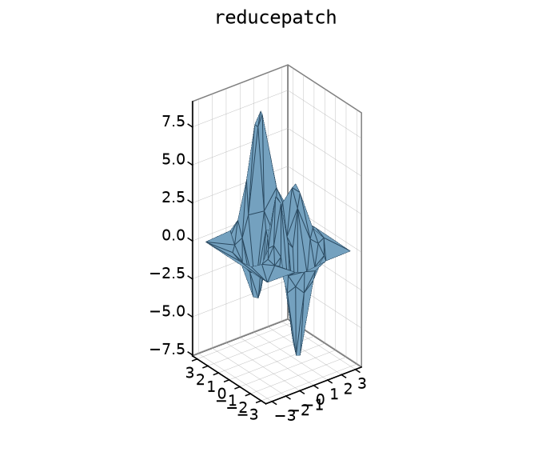 |
| [`shrinkfaces`](docs/function_reference.md#shrinkfaces) | 向各自中心收缩图元并返回拆开的面。factor 默认 0.3。 | 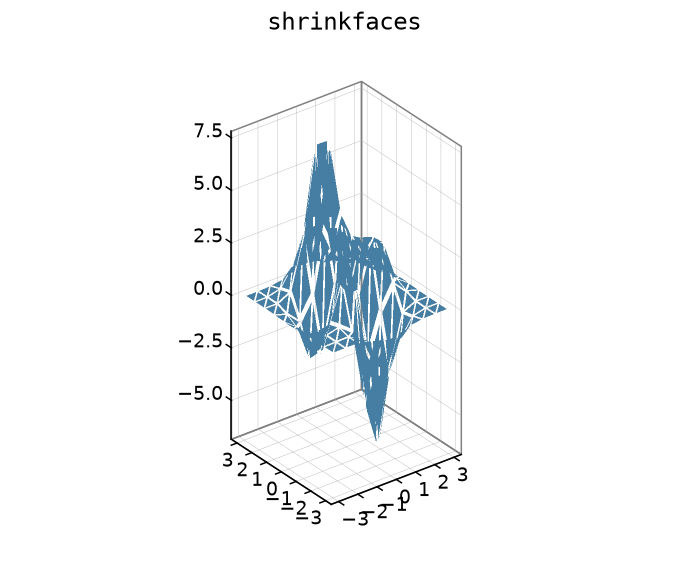 |
| [`alphashape`](docs/function_reference.md#alphashape) | points 为 N×3 数组，alpha 控制三维 Alpha 复形的外形。此 Python 入口直接绘制边界。返回面句柄。 | 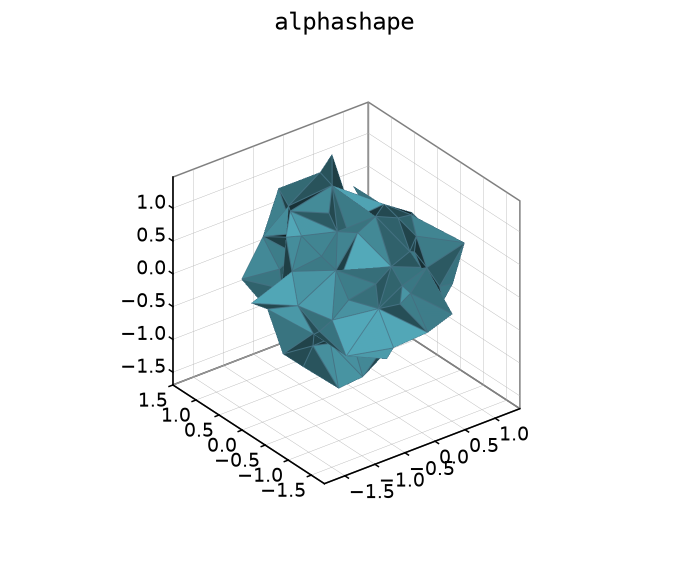 |
| [`peaks`](docs/function_reference.md#peaks) | 评估二维峰谷测试函数。grid=True 返回 X、Y 和 Z，便于直接传给 surf。 | 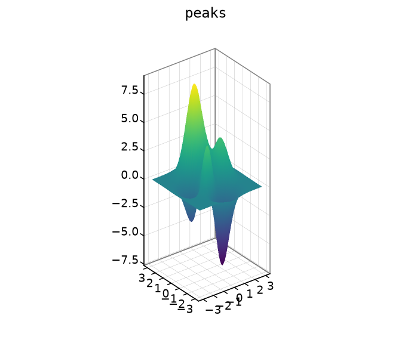 |
| [`sphere`](docs/function_reference.md#sphere) | 返回三个 (n+1)×(n+1) 的单位球面坐标数组。使用 surf 或 mesh 显示。 | 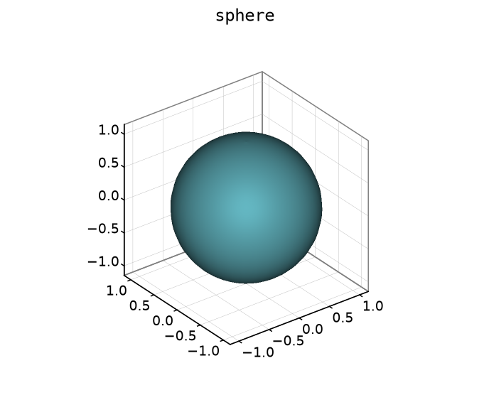 |
| [`cylinder`](docs/function_reference.md#cylinder) | 返回沿 z 轴的旋转曲面坐标。r 可为单个半径或沿高度排列的半径数组。 | 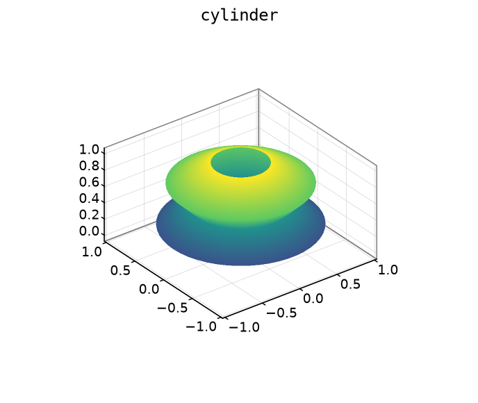 |
| [`ellipsoid`](docs/function_reference.md#ellipsoid) | 前三项为球心，接下来三项为半轴。返回网格坐标。 | 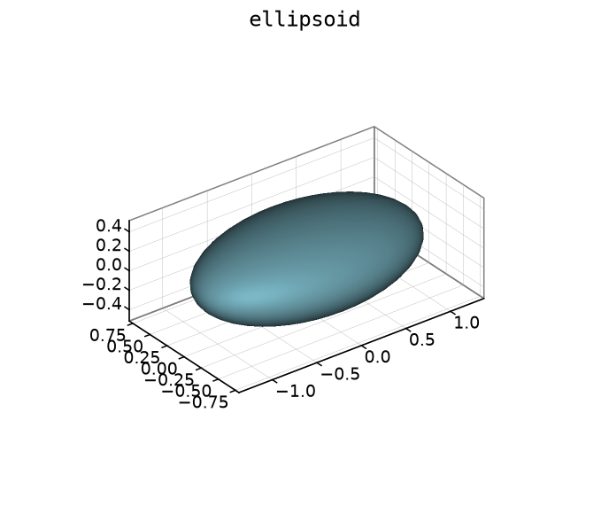 |

</details>

<details>
<summary>三维曲线、散点、统计与动画（13）</summary>

| 接口 | 用途 | 示例 |
| --- | --- | --- |
| [`plot3`](docs/function_reference.md#plot3) | 绘制三维坐标序列。可追加多组 XYZ，或传矩阵系列、带列名的表。NaN 断开线段。 | 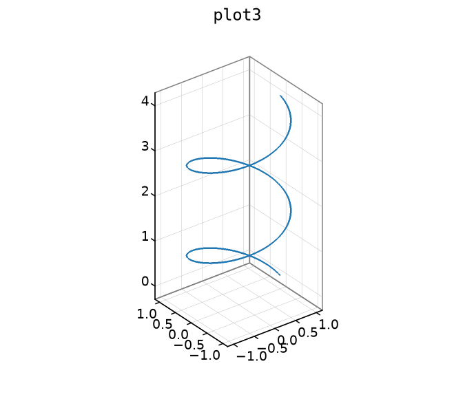 |
| [`line`](docs/function_reference.md#line) | 低级线图元，保留当前场景。线宽、颜色、标记属性与 plot3 共用。 | 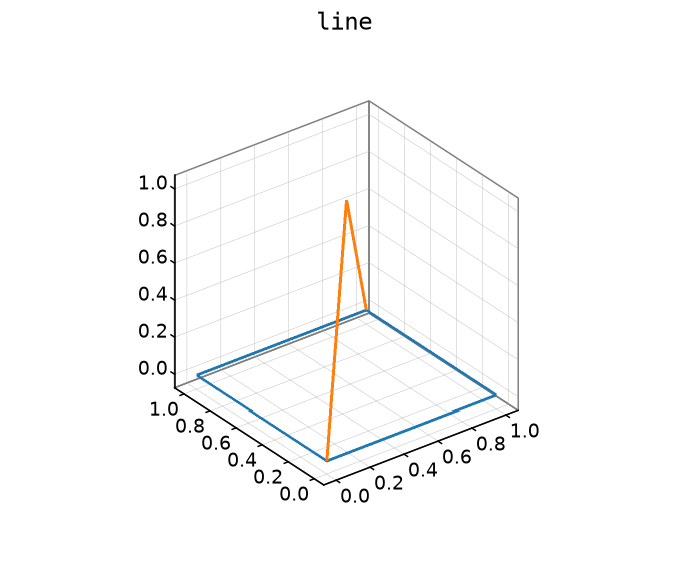 |
| [`fplot3`](docs/function_reference.md#fplot3) | 对三个参数函数共用一个参数区间。返回按采样点组成的曲线。 | 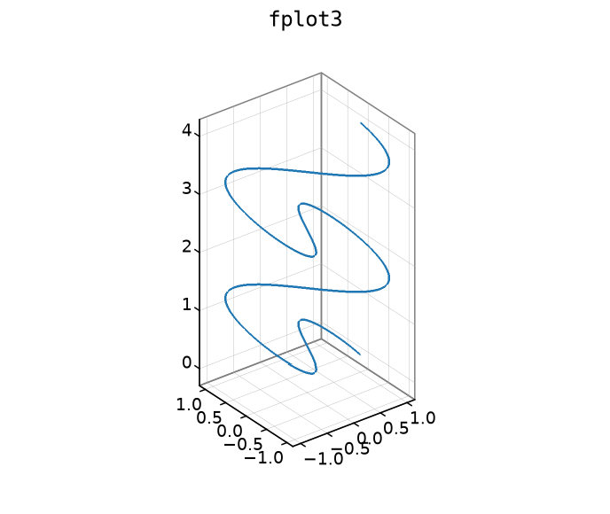 |
| [`scatter3`](docs/function_reference.md#scatter3) | S 为标记面积或逐点面积，C 可为颜色名、标量或 RGB(A) 数组。返回散点句柄。 | 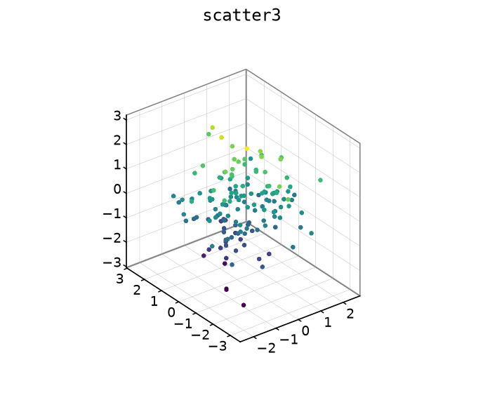 |
| [`bubblechart3`](docs/function_reference.md#bubblechart3) | sizes 映射到气泡大小，C 映射到颜色。示例取独立数值和垂直坐标分别控制大小和颜色。 | 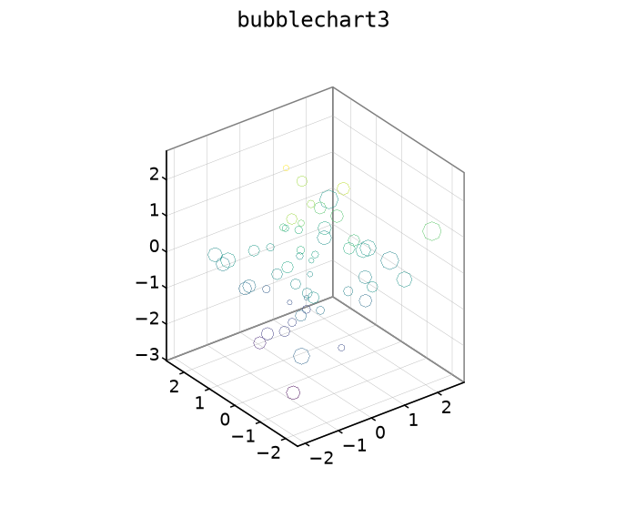 |
| [`swarmchart3`](docs/function_reference.md#swarmchart3) | 同一 X 分组内，在 YZ 平面邻近的点沿 X 偏移。width 控制偏移宽度。 | 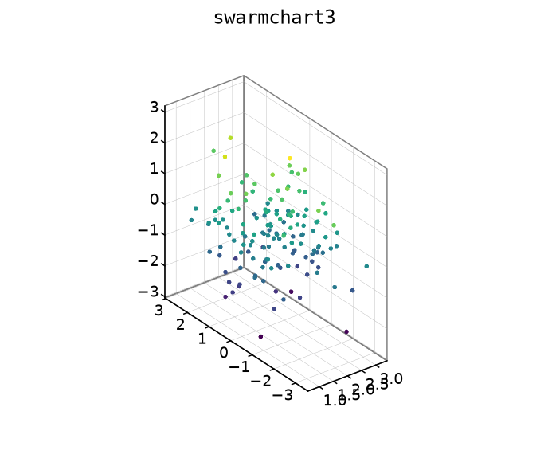 |
| [`stem3`](docs/function_reference.md#stem3) | 用竖直线段连接 BaseValue 与每个采样点。默认基线为零。带标记时返回茎和标记句柄。 | 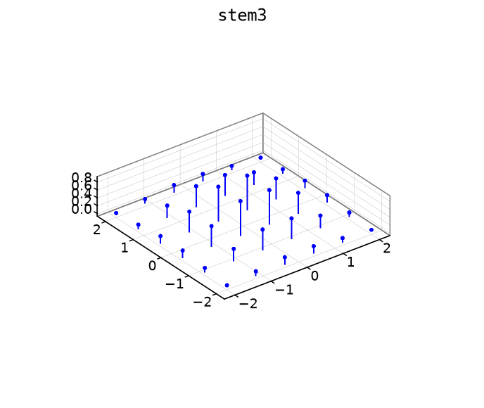 |
| [`bar3`](docs/function_reference.md#bar3) | 按矩阵行列放置竖柱。style 可选 detached、grouped、stacked。正负值分别向两个方向堆叠。 | 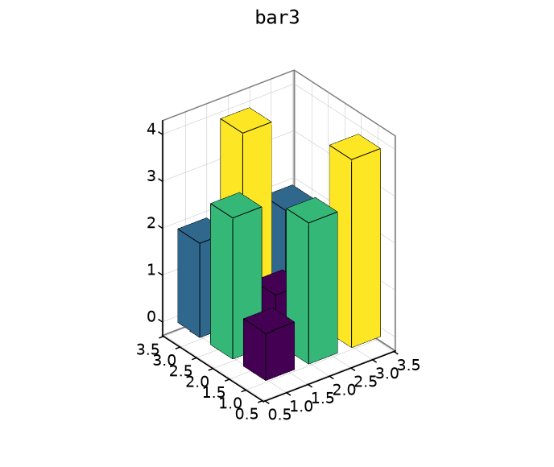 |
| [`bar3h`](docs/function_reference.md#bar3h) | 把柱高度映射到水平方向。支持独立、分组、堆叠。 | 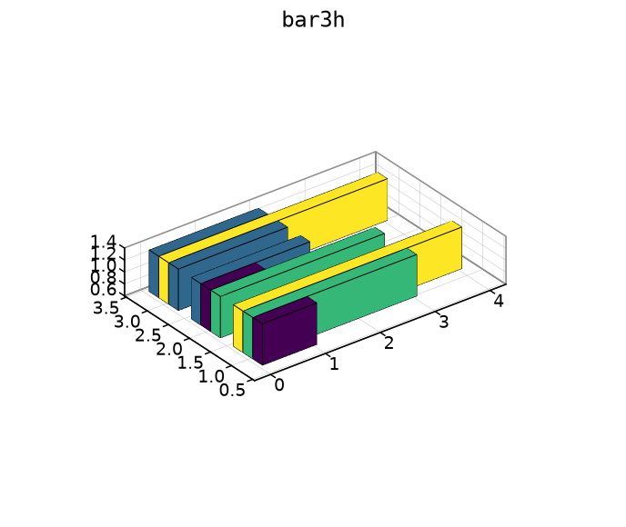 |
| [`histogram2`](docs/function_reference.md#histogram2) | 双变量直方图。NumBins 或 XBinEdges、YBinEdges 可控制分箱。图元 values 包含归一化结果。 | 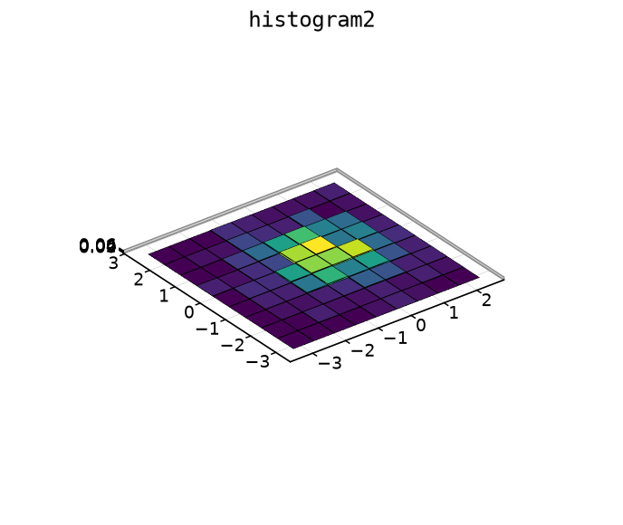 |
| [`pie3`](docs/function_reference.md#pie3) | 绘制有厚度的扇区，explode 指定需要偏移的项。labels 可由第二个或第三个参数给出。 | 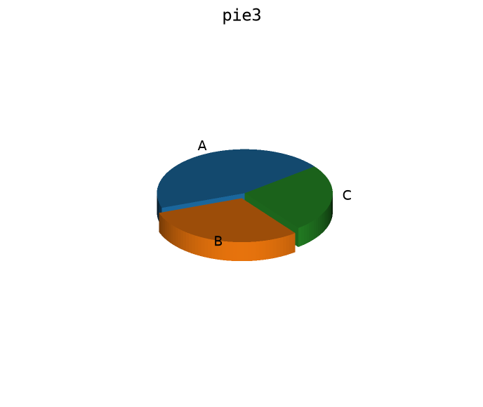 |
| [`comet3`](docs/function_reference.md#comet3) | 返回定时动画。tail 是高亮尾部占轨迹的比例。离屏出图使用 set_frame 选定一帧。 | 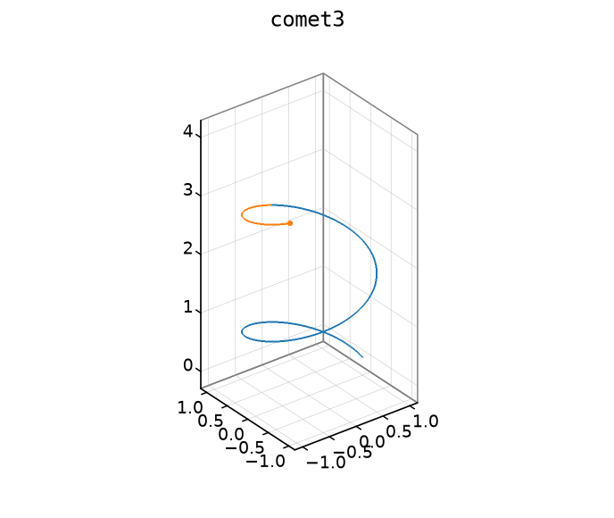 |
| [`animatedline`](docs/function_reference.md#animatedline) | addpoints 分批追加坐标，getpoints 读回数据，clearpoints 清空。MaximumNumPoints 限制保留长度。 | 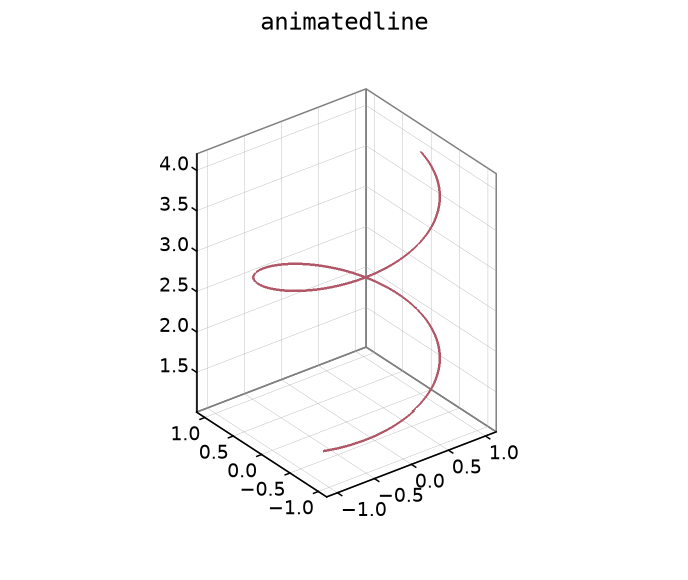 |

</details>

<details>
<summary>标量体与向量场（24）</summary>

| 接口 | 用途 | 示例 |
| --- | --- | --- |
| [`isosurface`](docs/function_reference.md#isosurface) | 提取指定等值，可用 colors 设置独立颜色体。noshare 展开面顶点。规则均匀体采用 Flying Edges。 | 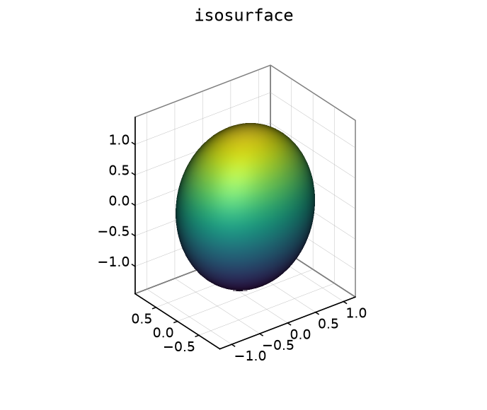 |
| [`isosurface_geometry`](docs/function_reference.md#isosurface_geometry) | 计算面索引、顶点和可选颜色。返回字典，可直接交给 patch。 | 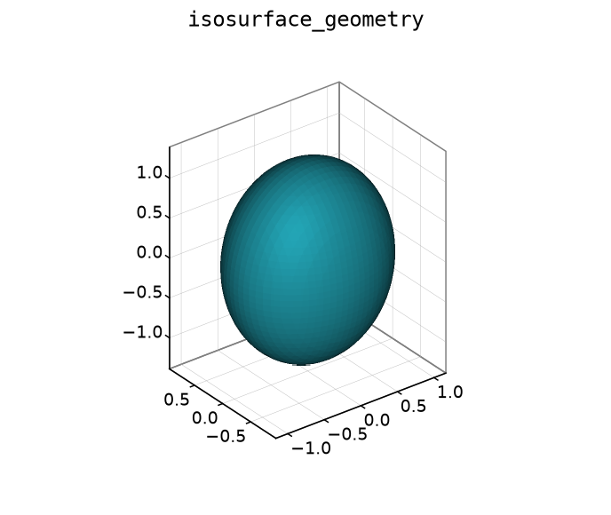 |
| [`slice`](docs/function_reference.md#slice) | xs、ys、zs 指各轴的切片位置，可用空列表跳过，或传三个曲面坐标矩阵。插值可用 linear、nearest、cubic。 | 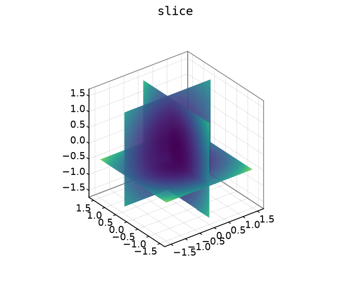 |
| [`contourslice`](docs/function_reference.md#contourslice) | 在各切片上绘制等值线。levels 可为自动级别数量或具体数组。返回各切片的曲线。 | 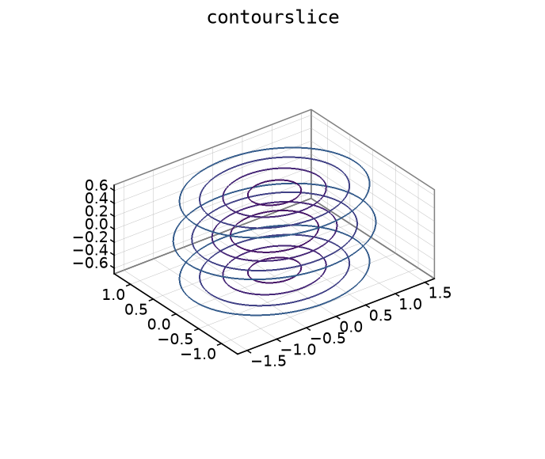 |
| [`isocaps`](docs/function_reference.md#isocaps) | 用 above 或 below 选取阈值一侧；whichplane 为 xmin 等边界名或 all。返回端盖面。 | 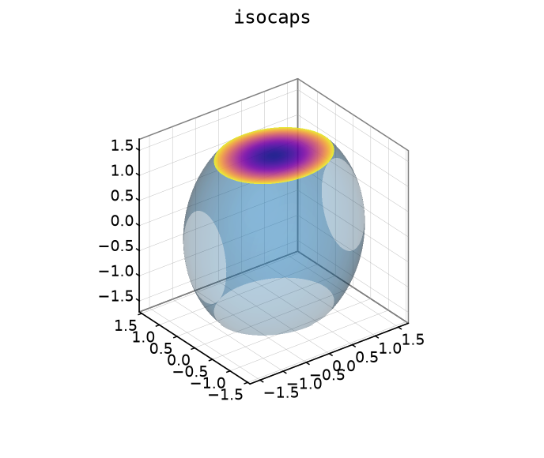 |
| [`isocolors`](docs/function_reference.md#isocolors) | 对顶点位置采样颜色体。也可传 R、G、B 三个体。传入图形句柄时同时更新颜色。 | 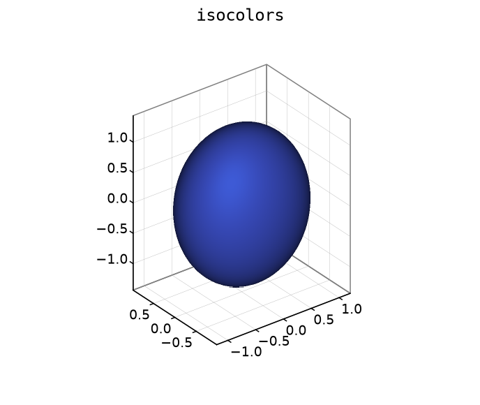 |
| [`isonormals`](docs/function_reference.md#isonormals) | 用标量体的梯度估计等值面顶点法向。negate 翻转方向。传入句柄时更新渲染法向。 | 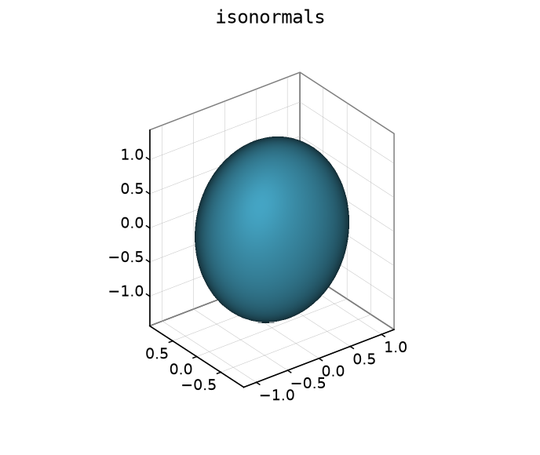 |
| [`flow`](docs/function_reference.md#flow) | 生成管状标量场示例。grid=True 同时给出坐标和标量体，默认尺寸为 N×2N×N。 | 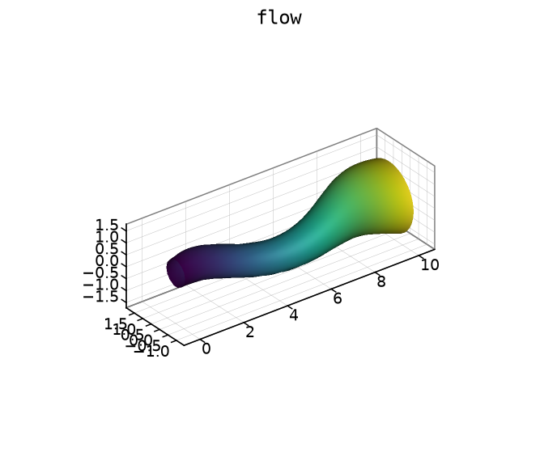 |
| [`smooth3`](docs/function_reference.md#smooth3) | 对体数据做盒式或高斯平滑。size 为奇数窗口，sigma 为高斯标准差。此图显示平滑后零等值面。 |  |
| [`reducevolume`](docs/function_reference.md#reducevolume) | 按规则步长减少数据。step 可统一指定，也可给出 x、y、z 三个轴的步长。 |  |
| [`subvolume`](docs/function_reference.md#subvolume) | 从规则网格提取子体。limits 顺序为 xmin、xmax、ymin、ymax、zmin、zmax，NaN 表示相应方向无限制。 |  |
| [`volumebounds`](docs/function_reference.md#volumebounds) | 返回坐标边界。标量体额外返回最小最大标量值，可直接传给 axis 设置边界和颜色范围。 |  |
| [`quiver3`](docs/function_reference.md#quiver3) | 每个箭头由位置和分量决定。scale=0 保留实际长度。ShowArrowHead、MaxHeadSize 控制箭头。 |  |
| [`coneplot`](docs/function_reference.md#coneplot) | 在给定采样位置绘制插值得到的向量。可用颜色体、nearest 或 cubic、quiver 和 nointerp 等选项。 |  |
| [`stream2`](docs/function_reference.md#stream2) | 计算二维流线顶点，options 为步长和最大步数。数组列表可交给 streamline 绘图。 |  |
| [`stream3`](docs/function_reference.md#stream3) | 从种子积分得到三维路径数组。可用 direction 指定 forward、backward 或 both。可传给 streamline、streamtube 等。 |  |
| [`streamline`](docs/function_reference.md#streamline) | 绘制已有路径，或在图中从指定种子计算并画出路径。 |  |
| [`streamslice`](docs/function_reference.md#streamslice) | 沿选定平面上的切向场积分。density 调节种子密度，可以用 noarrows 关闭箭头。 |  |
| [`streamtube`](docs/function_reference.md#streamtube) | 把轨迹扩展为管面。可直接给向量场及种子点，或给路径及逐点管宽、散度场。radius 设置固定半径。 |  |
| [`streamribbon`](docs/function_reference.md#streamribbon) | 把三维路径扩展成带。twistangle 单位为弧度。也可用向量场以及种子点，由角速度和流速计算扭转。 |  |
| [`streamparticles`](docs/function_reference.md#streamparticles) | 沿已有流线均匀放置粒子，后续帧沿点索引移动。用 set_frame 导出指定帧。 |  |
| [`curl`](docs/function_reference.md#curl) | 返回三个旋度分量以及速度方向上的角速度。图中对旋度做稀疏采样并绘制箭头。 |  |
| [`divergence`](docs/function_reference.md#divergence) | 返回向量场的散度矩阵。图中取径向变化的场并显示一个散度切片。 |  |
| [`interpstreamspeed`](docs/function_reference.md#interpstreamspeed) | 按沿轨迹积分得到的流动时间重采样。图中用标记显示新采样点。 |  |

</details>

<details>
<summary>三维网络图和图像平面（4）</summary>

| 接口 | 用途 | 示例 |
| --- | --- | --- |
| [`plot`](docs/function_reference.md#plot) | 绘制三维网络图。edges 每行是一条边的两个节点索引，xyz 每行是节点坐标。也可给 XData、YData、ZData，或省略坐标让 VTK 求解 force3 布局。用 directed=True 显示箭头。 |  |
| [`graphplot`](docs/function_reference.md#graphplot) | 从零基边列表绘制三维图。可显式传入节点位置、边颜色和标签，也可由 VTK 计算布局。 |  |
| [`image`](docs/function_reference.md#image) | 将 RGB(A) 或索引色图像放在 XY 平面。X、Y 的首尾值定义首尾像素中心。z 指平面高度，AlphaData 可为逐像素矩阵。 |  |
| [`imagesc`](docs/function_reference.md#imagesc) | 把标量矩阵映射到当前色图。clims 指定数值范围，z 改变平面位置。返回可供 colorbar 使用的图元。 |  |

</details>

<details>
<summary>场景、样式和导出（25）</summary>

| 接口 | 用途 | 示例 |
| --- | --- | --- |
| [`text`](docs/function_reference.md#text) | 把 Matplotlib 文字锚定在三维坐标处，支持数学公式。返回 Text3D。 |  |
| [`axis`](docs/function_reference.md#axis) | 可传 auto、tight、equal、vis3d、on、off 或六个坐标边界，八个元素时包含色标上下限。 |  |
| [`daspect`](docs/function_reference.md#daspect) | 按当前轴跨度设置数据单位的显示比例。示例将三个轴的单位长度设为一致。 |  |
| [`pbaspect`](docs/function_reference.md#pbaspect) | 指定三维坐标框三边的显示比例。相同数据可用更低的框显示。 |  |
| [`view`](docs/function_reference.md#view) | 用方位角和仰角或视线向量设置视角，方位角从负 y 轴起算。2 为顶视图，3 为默认三维视角。 |  |
| [`camproj`](docs/function_reference.md#camproj) | 选择 perspective 或 orthographic。省略 mode 返回当前投影类型。 |  |
| [`hidden`](docs/function_reference.md#hidden) | 控制 VTK 网格背面与被几何遮挡的部分线条是否隐藏。 |  |
| [`shading`](docs/function_reference.md#shading) | 在 flat、interp、faceted 间切换。faceted 保留边线。对已经创建的图元生效。 |  |
| [`lighting`](docs/function_reference.md#lighting) | 为已有表面选择 none、flat、gouraud 或 phong。表面法向会随规则网格更新。 |  |
| [`camlight`](docs/function_reference.md#camlight) | 添加跟随相机的光源，支持 left、right 或 headlight。返回 VTK 光源。 |  |
| [`light`](docs/function_reference.md#light) | 在世界坐标中放置光源。style 可为 infinite 或 local。返回 VTK 光源。 |  |
| [`lightangle`](docs/function_reference.md#lightangle) | 以方位角和仰角设置一个固定方向光，方位角从负 y 轴起算。可用 color 指定光色。 |  |
| [`material`](docs/function_reference.md#material) | 设置 dull、shiny、metal 材质或四个光照系数。四个值依次为环境、漫反射、镜面反射、高光指数。 |  |
| [`colormap`](docs/function_reference.md#colormap) | 更新场景色表，可传 Matplotlib 色表名或 RGB(A) 数组。 |  |
| [`colorbar`](docs/function_reference.md#colorbar) | 创建原生 Matplotlib 色条。默认取当前场景最后一个图元。可传 ticks、label 和 shrink。 |  |
| [`clim`](docs/function_reference.md#clim) | 为当前场景设定颜色映射范围。传 auto 恢复按数据映射，省略参数返回当前范围。caxis 为同义入口。 |  |
| [`alim`](docs/function_reference.md#alim) | 在 AlphaDataMapping 为 scaled 时设置透明度映射区间。省略参数返回当前区间。 |  |
| [`hold`](docs/function_reference.md#hold) | 控制连续高层绘图调用是否叠加。示例将半透明参考平面与等值面画在同一轴。 |  |
| [`set`](docs/function_reference.md#set) | 修改绘图句柄的可写属性。可使用属性名与值组成的位置参数对或 Python 关键字。 |  |
| [`grid`](docs/function_reference.md#grid) | 切换 Matplotlib 原生三维网格线。更精细的设置可以在 ax.grid 或轴对象上完成。 |  |
| [`title`](docs/function_reference.md#title) | 设置子图标题。返回原生 Matplotlib Text，可以调整字体、颜色和位置。 |  |
| [`xlabel`](docs/function_reference.md#xlabel) | 设置 x 轴标签，接受数学文本和 Matplotlib 文本属性。 |  |
| [`ylabel`](docs/function_reference.md#ylabel) | 设置 y 轴标签，接受数学文本和 Matplotlib 文本属性。 |  |
| [`zlabel`](docs/function_reference.md#zlabel) | 设置 z 轴标签，接受数学文本和 Matplotlib 文本属性。 |  |
| [`caxis`](docs/function_reference.md#caxis) | 设置场景的颜色映射范围，是 clim 的别名。示例把两端颜色锁定在 −2 和 2。 |  |

</details>

<details>
<summary>图窗、动画更新和导出（12）</summary>

| 接口 | 用途 | 示例 |
| --- | --- | --- |
| [`figure`](docs/function_reference.md#figure) | 创建或激活 Matplotlib Figure。num 可为编号或名称，figsize、dpi 和 layout 沿用 Matplotlib。 |  |
| [`subplot`](docs/function_reference.md#subplot) | 按 Matplotlib 的位置参数创建 vtk3d 子图。示例在同一 Figure 中并排绘制曲面和网格。 |  |
| [`gca`](docs/function_reference.md#gca) | 返回当前 vtk3d 坐标轴。当前 Figure 没有活动的 vtk3d 轴时，创建一个三维子图。 |  |
| [`drawnow`](docs/function_reference.md#drawnow) | 立即重绘坐标轴所属 Figure，并让 Matplotlib 后端处理事件。可用于交互循环中刷新更新的数据。 |  |
| [`show`](docs/function_reference.md#show) | 通过 Matplotlib 的交互后端显示打开的图窗。可传 block 控制阻塞。下图为窗口中的三维场景。 |  |
| [`savefig`](docs/function_reference.md#savefig) | 保存当前 Figure，支持 Matplotlib 的格式、dpi 和透明背景参数。示例把 PNG 写入内存，文件名也可用作目标。 |  |
| [`close`](docs/function_reference.md#close) | 关闭图窗并释放其 VTK 窗口。可传 Figure、图窗编号或 all。示例关闭临时图窗后继续在原图窗中出图。 |  |
| [`addpoints`](docs/function_reference.md#addpoints) | 向 animatedline 追加一批样本，允许标量或数组。多次追加的数据会在绘制时合并。 |  |
| [`getpoints`](docs/function_reference.md#getpoints) | 读取 animatedline 当前保留的三个坐标数组副本。示例用散点标出读回的采样位置。 |  |
| [`clearpoints`](docs/function_reference.md#clearpoints) | 清空 animatedline 中已有和待追加的样本，保留句柄。示例清空旧轨迹后，用同一条线开始新轨迹。 |  |
| [`Graphic`](docs/function_reference.md#graphic) | 常见 VTK 图元的返回类型，兼容 Matplotlib Artist 与 ScalarMappable。通过绘图函数取得句柄后可调颜色范围、透明度和可见性。 |  |
| [`VtkAxes`](docs/function_reference.md#vtkaxes) | 注册为 vtk3d 的 Matplotlib Axes3D 子类，自动应用三维默认外观。用 Figure 或 pyplot 的子图方法创建。 |  |

</details>

<details>
<summary>附加的点云、位姿与体绘制接口（4）</summary>

| 接口 | 用途 | 示例 |
| --- | --- | --- |
| [`pcshow`](docs/function_reference.md#pcshow) | 显示点云。可传末维为 3 的坐标数组或 PLY/VTP 路径，颜色可按点指定，默认使用高度。 |  |
| [`pcshowpair`](docs/function_reference.md#pcshowpair) | 以两种固定颜色在同一坐标轴显示两个点云，返回两个绘图句柄。 |  |
| [`plotTransforms`](docs/function_reference.md#plottransforms) | 绘制位姿的三根坐标箭头。使用齐次 4×4 矩阵，或平移量与旋转矩阵或 wxyz 四元数。 |  |
| [`volshow`](docs/function_reference.md#volshow) | 对均匀直角网格上的有限标量进行 VTK 体绘制。可指定色图和透明度表，或切换最大、最小或平均强度投影。 |  |

</details>

<!-- END ILLUSTRATED API -->

## 开发与批量导出

```sh
python -m venv .venv
# Windows PowerShell: .venv\Scripts\Activate.ps1
# macOS / Linux: source .venv/bin/activate
python -m pip install -e ".[test]"
python -m pytest -q
python examples/plot_catalog.py --render
```

批量任务可在导入 `pyplot` 和 `mpl3d_vtk` 前设置 `matplotlib.use("Agg")`。Linux 无显示服务器时，使用能创建 EGL 或 OSMesa 上下文的 VTK 环境。循环出图后用 `m.close(fig)` 释放窗口资源。PDF/SVG 中，坐标轴、文字和二维图元按 Matplotlib 的矢量格式输出，VTK 视口按指定 `dpi` 嵌入位图。 [示例与验证](docs/examples.md)

```sh
python benchmarks/benchmark.py --surface 128 256 512 --volume 40 80 128 --frames 15
python -m pip install build twine
python -m build
python -m twine check dist/*
```

## 版本与性能

0.5.0 统一了三维子图的默认坐标轴。此前 0.4.0 减少了视口合成的转换和重采样。在当时的测试中，307,708 面网格的旋转重绘中位耗时由 46.21 ms 降至 21.23 ms，PNG 导出由 267.00 ms 降至 128.37 ms。 [复测条件与原始数据](benchmarks/results/viewport_optimization/README.md)

## 示例

### 指数曲面与二维截线

$u=\exp(x\sin y)$ 在 $[-2,2]^2$ 上的三维曲面，与两条二维截线共用同一个 Matplotlib Figure。 [示例源码](examples/exp_surface.py)


### 封闭三角曲面

`trisurf` 在闭合环面上绘制 $f(\theta,\phi)=\cos(3\theta)\cos\phi$。网格在周期接缝处共享顶点，表面按标量插值着色。 [示例源码](examples/closed_surface.py)


### 随机标量场的零等值面

在 $[-1,1]^3$ 的 $19^3$ 个网格点上，从 $[-1,1]$ 独立均匀采样。提取标量值为零的曲面，使用顶点高度着色。 [示例源码](examples/random_isosurface.py)


### 体数据切片

`slice` 将同一个三维标量场采样到多张正交切片，共享一套颜色范围。 [调用代码与参数](docs/function_reference.md#slice)


## 第三方声明

投影刻度代码附有原作者的 MIT 许可和版权声明。 [第三方许可](mpl3d_vtk/_my_mpl_style_license.txt)
