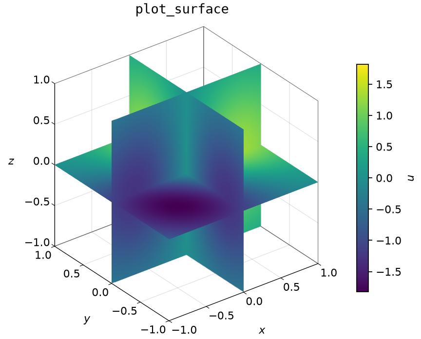
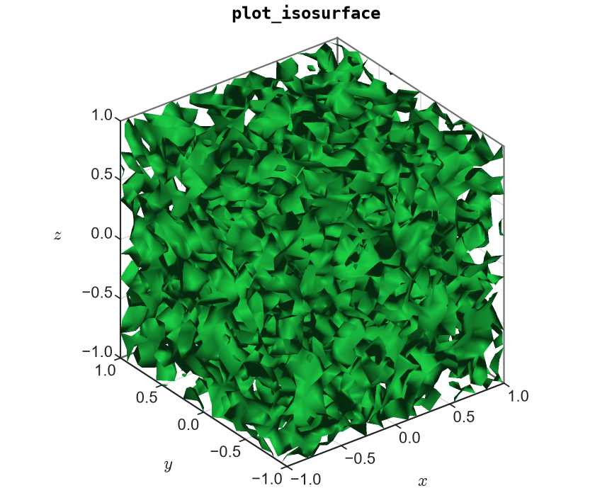

# mpl-depth-style

[English](README.md)

`mpl-depth-style` 为 Matplotlib 添加由 VTK 渲染的 `vtk3d` 投影。可将 NumPy 数据绘制为网格曲面、三角网格、等值面、线和散点。坐标轴、视角、色条、布局和导出沿用 Matplotlib。

## 安装

从源码安装时，在仓库根目录运行 `python -m pip install .`。

从 PyPI 安装已发布版本时，运行 `python -m pip install mpl-depth-style`。

运行需要 Python 3.11+、NumPy 1.25+、Matplotlib 3.11.x、VTK 9.4–9.x 和可用的 OpenGL 上下文。无显示环境的配置见[导出指南](docs/examples.md#export-and-cleanup)。

## 快速开始

导入 `mpl_depth_style` 注册 `vtk3d` 投影。创建图形前调用 `mpl_depth_style.plot_rc()`，设置字体、二维图样式和七色循环。参见[样式示例](docs/scene.md#plot_rc)。

```python
import matplotlib.pyplot as plt
import numpy as np
import mpl_depth_style

mpl_depth_style.plot_rc()
t = np.linspace(-2, 2, 201)
x, y = np.meshgrid(t, t)
z = np.exp(x * np.sin(y))

fig = plt.figure(figsize=(9, 4), layout="constrained")
ax = fig.add_subplot(121, projection="vtk3d")
surface = ax.plot_surface(x, y, z, cmap=plt.get_cmap())
mpl_depth_style.ax3D_setting(ax)
ax.set(xlabel="x", ylabel="y", zlabel="u")
fig.colorbar(surface, ax=ax, shrink=.7)

profile = fig.add_subplot(122)
profile.plot(t, np.exp(t))
profile.set(xlabel="x", ylabel="u", title=r"$y=\pi/2$")

fig.savefig("surface.png", dpi=180)
plt.show()
```

用 `ax.view_init()` 调整视角，用 `surface.set_heights()` 或 `surface.set_values()` 更新数据。同一个坐标轴上的多个 VTK 图元共用深度缓冲区。

`ax3D_setting` 为三维子图设置等比例、正交视角和常规字重刻度。省略范围或刻度位置时使用坐标轴的当前设置。传入 `grid=False` 可以关闭该子图的网格。

## 绘图示例

| 三张相交的标量切片 | 随机场的零等值面 |
| --- | --- |
|  |  |
| [文档](docs/api.md#plot_surface) · [源代码](examples/intersecting_scalar_slices.py) | [文档](docs/api.md#plot_isosurface) · [源代码](examples/random_field_isosurface.py) |

## 文档

详细文档采用英文。

- [图集](docs/plot_catalog.md) · 每张图都附有 API 文档和可运行的 Python 源代码链接。
- [示例与导出](docs/examples.md) · 运行完整脚本或保存图形。
- [示例数据](data/README.md) · 查看三角网格和 NumPy 文件格式。
- API 参考 · [绘图](docs/api.md)和[样式和图元句柄](docs/scene.md)。
- [性能测试](docs/examples.md#tests-and-benchmarks) · 查看建图耗时和与 mplot3d 的渲染对比。
