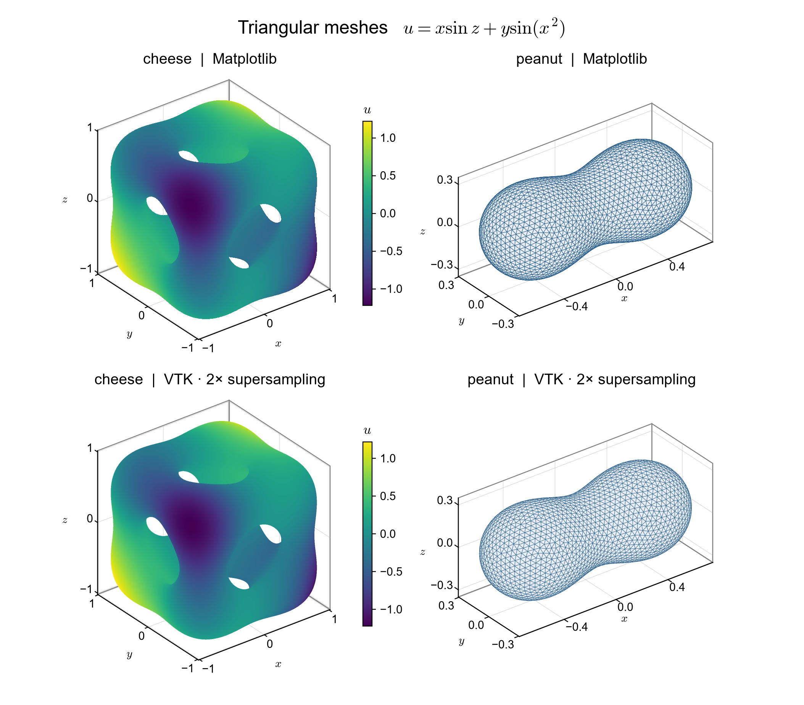

# my-mpl-style 三角曲面与等值面复画

数据来自 `guessable/my-mpl-style` 的 `d3ab92f`。三角曲面沿用仓库的网格、`cheese` 的逐三角面平均值和 `viridis` 色域，以及 `peanut` 的蓝色边线。两行使用原仓库的坐标轴样式和正交视角。把 `peanut` 原示例里重复的负端刻度改为一负一正。 [三角曲面原脚本](https://github.com/guessable/my-mpl-style/blob/d3ab92fcaef3852701dfc2cccd22c90b5c0ecb2c/examples/tri_surface.py)



三组等值面都读取原始 `u_t3000`，按原示例提取 \(\phi=0\)。VTK 输入按本库的 `(y,x,z)` 约定交换体数组前两轴。三组数据的三角面数分别为 179,402、138,060 和 107,440，两种实现的包围盒也通过了 \(10^{-4}\) 的绝对容差检查。Matplotlib 使用逐面光照，VTK 使用顶点法向和光照插值，因此明暗过渡有所不同。 [等值面原脚本](https://github.com/guessable/my-mpl-style/blob/d3ab92fcaef3852701dfc2cccd22c90b5c0ecb2c/examples/isosurface.py) · [空间范围与面数](isosurface_geometry.json)


## trisurf 实测

所有耗时以毫秒计，使用中位数。旋转同时列出第 95 百分位。加粗条目沿用原脚本的 Matplotlib 抗锯齿设置，并和本库默认 2 倍超采样配对。

| 网格 | 渲染与抗锯齿 | 构造 | 首次完整出图 | 旋转 | 旋转 P95 | PNG |
| --- | --- | ---: | ---: | ---: | ---: | ---: |
| 307,708 面 `cheese` | **Matplotlib 关闭** | 27.39 | 995.40 | 1095.41 | 1458.49 | 1082.62 |
| | Matplotlib 开启 | 28.41 | 1007.04 | 1018.32 | 1580.17 | 1683.34 |
| | VTK 1× | 25.35 | 171.09 | 47.85 | 60.98 | 203.66 |
| | **VTK 2×** | 21.04 | 107.23 | 41.46 | 52.30 | 230.95 |
| 4,872 面 `peanut` | Matplotlib 关闭 | 0.57 | 51.99 | 43.09 | 48.87 | 97.77 |
| | **Matplotlib 开启** | 0.59 | 53.15 | 45.05 | 49.26 | 102.75 |
| | VTK 1× | 0.87 | 72.52 | 33.25 | 33.99 | 135.66 |
| | **VTK 2×** | 0.88 | 71.74 | 35.25 | 36.71 | 143.50 |

`cheese` 的默认 VTK 设置把旋转中位耗时由 1095.41 ms 降到 41.46 ms，约为 **26.4 倍提速**。首次完整出图和 PNG 分别约快 **9.3 倍**和 **4.7 倍**。`peanut` 的旋转约快 **1.28 倍**，Matplotlib 在首次出图和 PNG 导出上用时更少。两个抗锯齿开关使用各自后端的实现，观感和计算成本会随场景变化。单轮测量中 VTK 1× 和 2× 的非单调差别会受到运行波动影响。

## 测试条件

- Windows 11，Intel Core i7-14650HX，NVIDIA GeForce RTX 4060 Laptop GPU。Python 3.13.5、Matplotlib 3.11.0、VTK 9.7.2、mpl3d-vtk 0.3.1。
- 单个三维子图，使用相同完整网格、正交视角、轴范围、逐面颜色和 800×600 Agg 画布。PNG 输出 1600×1200，包含编码到内存。线框边宽以仓库的 0.35 pt 为准，VTK 按输出 DPI 换算为像素。
- 每组测 5 个新图的构造和首次绘制、20 个不同角度的强制重绘、5 次改角度后的 PNG 导出。首次完整出图包含构造与第一次 canvas draw。耗时排除了读取 NPZ、首次导入、文件写盘和 GUI 事件处理。
- 两组网格分别计时。旋转数字是离屏重绘时延。完整单次样本见 [原始计时](trisurf_timings.json)。

## 复现

在已安装 scikit-image 的环境中运行。checkout 参数指向上面的仓库版本。

```powershell
python benchmarks/my_mpl_style.py <checkout> <output> --mode all --rotations 20 --fresh-figures 5 --exports 5
```
