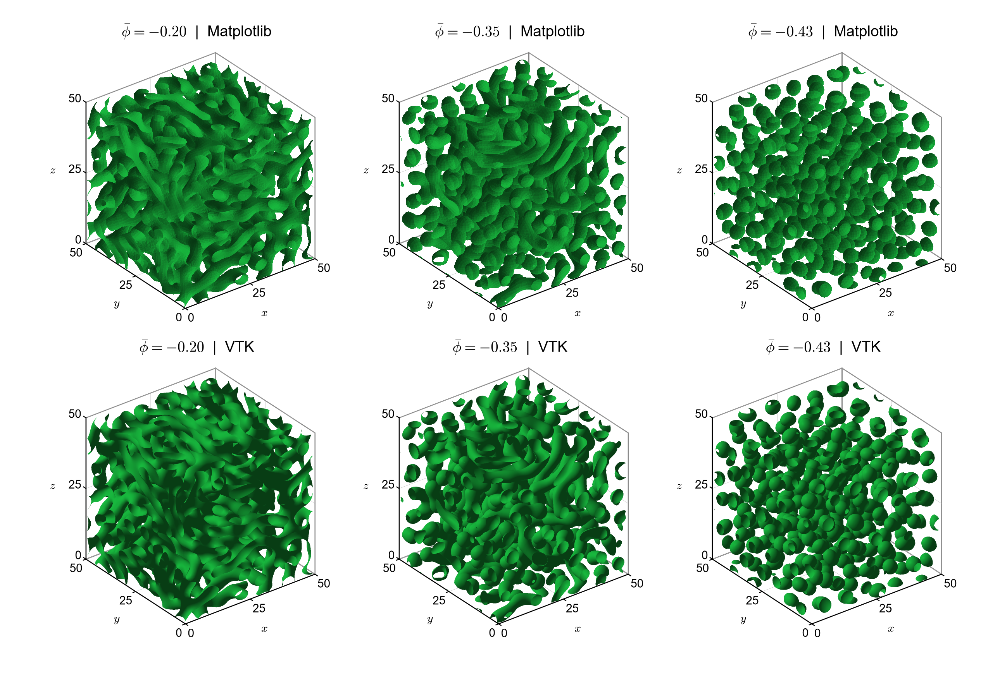

# Triangle mesh and isosurface benchmarks

These comparisons use the original datasets from [my-mpl-style at `d3ab92f`](https://github.com/guessable/my-mpl-style/tree/d3ab92fcaef3852701dfc2cccd22c90b5c0ecb2c) and the current `mpl3d-vtk` 0.5.0 implementation. The upper row of each image uses the built-in Matplotlib `mplot3d` projection. The lower row uses `vtk3d`.

## Triangle meshes

Both renderers receive the complete meshes and the same orthographic view. The `cheese` mesh uses the original per-face averages and Viridis normalization. The `peanut` mesh keeps the blue edges and light faces, with the duplicated negative X tick corrected to show the positive endpoint. [Original triangle mesh example](https://github.com/guessable/my-mpl-style/blob/d3ab92fcaef3852701dfc2cccd22c90b5c0ecb2c/examples/tri_surface.py)


[Source code for the comparison](../../my_mpl_style.py#L105).

### Rendering time

All times are in milliseconds. Columns show medians except for rotation P95. Bold rows pair each original Matplotlib antialiasing setting with the default `vtk3d` 2× supersampling.

| Mesh | Triangles | Renderer | Build | First image | Rotation | Rotation P95 | PNG |
| --- | ---: | --- | ---: | ---: | ---: | ---: | ---: |
| `cheese` | 307,708 | **mplot3d, AA off** | 25.37 | 879.35 | 820.03 | 882.70 | 960.62 |
| `cheese` | 307,708 | mplot3d, AA on | 25.92 | 877.90 | 824.67 | 882.20 | 996.11 |
| `cheese` | 307,708 | **vtk3d, 2× supersampling** | 12.37 | 77.97 | 25.09 | 30.89 | 133.49 |
| `peanut` | 4,872 | mplot3d, AA off | 0.51 | 45.90 | 39.54 | 43.54 | 101.90 |
| `peanut` | 4,872 | **mplot3d, AA on** | 0.60 | 47.86 | 39.76 | 41.58 | 110.35 |
| `peanut` | 4,872 | **vtk3d, 2× supersampling** | 0.49 | 50.85 | 23.99 | 28.34 | 102.10 |

The large `cheese` mesh rotates 32.7× faster with `vtk3d` on this host. The smaller `peanut` mesh rotates 1.66× faster, with a slightly longer first draw. Compare the matched rows before applying these results to a different mesh or output size. [Raw samples and environment](trisurf_timings.json)

## Zero isosurfaces

Both pipelines extract `φ = 0` from three original 64×64×64 `u_t3000` fields. The original script uses scikit-image marching cubes followed by `plot_trisurf`. The VTK pipeline transposes the first two array axes to `(ny, nx, nz)` and extracts the surfaces with Flying Edges.

The paired meshes have identical triangle counts and axis-aligned bounds in this run. Matplotlib shades individual triangle faces. VTK interpolates lighting across vertex normals, which produces smoother lighting in the lower row. [Original isosurface example](https://github.com/guessable/my-mpl-style/blob/d3ab92fcaef3852701dfc2cccd22c90b5c0ecb2c/examples/isosurface.py) · [Geometry checks](isosurface_geometry.json)

| Mean φ in the source example | Triangles in either renderer |
| --- | ---: |
| −0.20 | 179,402 |
| −0.35 | 138,060 |
| −0.43 | 107,440 |



[Source code for the comparison](../../my_mpl_style.py#L128).

## Benchmark setup

- Windows 11 with an NVIDIA GeForce RTX 2080 Ti. Python 3.13.5, NumPy 2.3.0, Matplotlib 3.11.0, VTK 9.6.1, scikit-image 0.26.0, and `mpl3d-vtk` 0.5.0.
- One subplot with an 800×600 Agg canvas, the upstream axes style, matched ranges, and identical view angles. PNG export renders at 1600×1200 and encodes to memory.
- Each variant uses five fresh figures, 20 rotation redraws, and five PNG exports. First image time combines plot construction and its first canvas draw. Rotation measures redraw time. Loading data, importing libraries, writing files, and processing GUI events are outside those intervals.

## Reproduce the comparison

Install the local package and scikit-image. Clone the upstream data repository next to this checkout and select the recorded revision.

```sh
python -m pip install . scikit-image
git clone https://github.com/guessable/my-mpl-style.git ../my-mpl-style
git -C ../my-mpl-style checkout d3ab92fcaef3852701dfc2cccd22c90b5c0ecb2c
python benchmarks/my_mpl_style.py ../my-mpl-style benchmark-output --mode all --source-style --rotations 20 --fresh-figures 5 --exports 5 --vtk-aa 2
```

The output directory receives both PNGs, the triangle timing samples, and the isosurface geometry checks.
