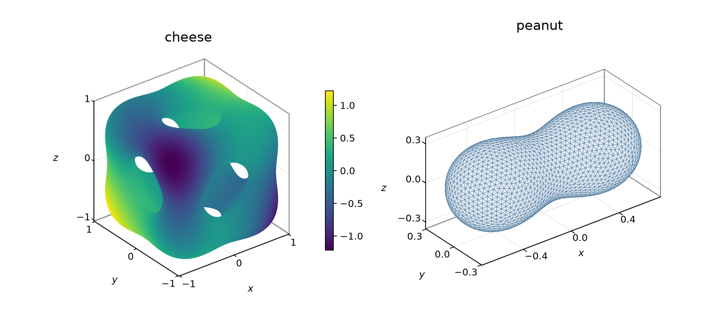

# 三维渲染性能复测

这次优化让已经抗锯齿的 VTK RGBA 缓冲直接进入 Matplotlib 后端，省去了通用图像 Artist 的浮点转换和再次重采样。VTK 优先直接读回 RGBA，后台不支持时使用原来的 VTK 抓帧过滤器。

固定 my-mpl-style 坐标轴、视角和 2 倍超采样，从本地安装的 0.3.1 对比 0.4.0。测试使用原始完整网格。三角曲面对照图有 99.9985% 的像素逐通道完全相同，等值面对照图为 99.9929%，其余像素的最大通道差值为 1/255。

| 网格和版本 | 首次完整出图 | 旋转中位 | 旋转 P95 | PNG 中位 |
| --- | ---: | ---: | ---: | ---: |
| cheese · 0.3.1 | 101.70 ms | 46.21 ms | 55.60 ms | 267.00 ms |
| cheese · 0.4.0 | 87.43 ms | 21.23 ms | 22.73 ms | 128.37 ms |
| peanut · 0.3.1 | 139.04 ms | 58.06 ms | 68.20 ms | 227.40 ms |
| peanut · 0.4.0 | 84.45 ms | 30.27 ms | 43.30 ms | 110.29 ms |

cheese 使用 307,708 个面，peanut 使用 4,872 个面。每组测 7 个新图、30 次不同角度的重绘和 7 次 PNG 导出。旋转用 800×600 Agg 画布，PNG 为 1600×1200，编码到内存。本轮测试使用 Windows 11、i7-14650HX、RTX 4060 Laptop GPU、Matplotlib 3.11.0、VTK 9.7.2。离屏重绘耗时适合比较渲染路径。 [优化前样本](before/trisurf_timings.json) · [优化后样本](after/trisurf_timings.json)

## 默认坐标轴

0.4.0 的 vtk3d 子图默认应用 my-mpl-style 的轴框和刻度样式。在相同范围下用 Agg 验证，坐标轴图像与仓库的 ax_setting3D 逐像素一致。 [参考仓库](https://github.com/guessable/my-mpl-style/tree/d3ab92fcaef3852701dfc2cccd22c90b5c0ecb2c)



分别在两个版本的环境中运行同一个复测脚本。checkout 为仓库路径。

```powershell
python benchmarks/my_mpl_style.py <checkout> <output> --mode benchmark --renderer vtk --vtk-aa 2 --source-style --rotations 30 --fresh-figures 7 --exports 7
```
