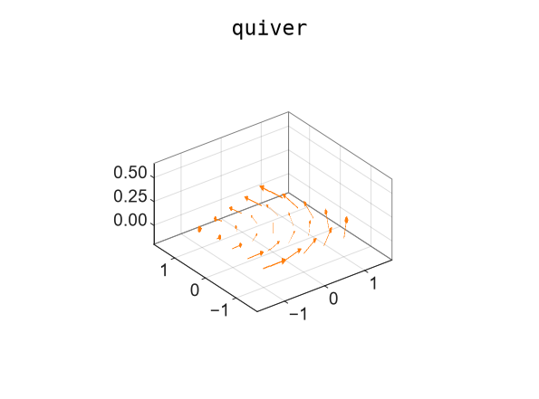
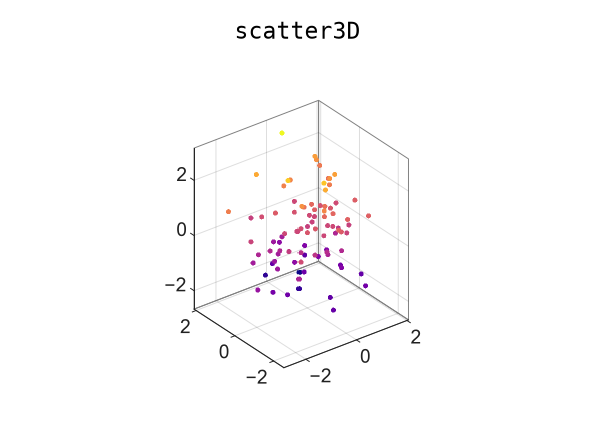

# Plotting API

Choose a method by the data you want to draw.

| Task | Methods |
| --- | --- |
| Surfaces and contours | [`plot_surface`](#plot_surface), [`plot_wireframe`](#plot_wireframe), [`plot_trisurf`](#plot_trisurf), [`contour`](#contour) |
| Lines, points, and charts | [`plot`](#plot), [`scatter`](#scatter), [`quiver`](#quiver), [`bar3d`](#bar3d), [`stem`](#stem) |
| Matplotlib aliases | [`plot3D`](#plot3d), [`scatter3D`](#scatter3d), [`quiver3D`](#quiver3d), [`contour3D`](#contour3d) |

For volume and vector fields, use the [VTK reference](function_reference.md). For styling, cameras, and updates to existing plots, use [Scene and handles](scene.md).

## Run the examples

The examples below share this setup. Start each example with a fresh copy of it. The gallery scripts use `plot_rc()` before creating figures and `ax_setting()` to style their 3D axes. [Gallery](plot_catalog.md) · [Plot styles](scene.md#plot_rc)

```python
import matplotlib.pyplot as plt
import numpy as np
import mpl3d_vtk

fig, ax = plt.subplots(subplot_kw={"projection": "vtk3d"})
t = np.linspace(-2, 2, 61)
x, y = np.meshgrid(t, t)
z = np.exp(x * np.sin(y))
```

For the triangle mesh example, use `from pathlib import Path` and set `data_dir = Path("data")` from the repository root. The [example datasets](../data/README.md) are in that directory.

## Common style options

The defaults below apply to a directly constructed [`Graphic`](scene.md#graphic). Individual plotting methods describe their overrides and any additional keywords.

- **`color`** (Matplotlib color or `None`, default `None`)

  Uniform object color. Many plotting methods choose the next axes-cycle color when neither a fixed color nor scalar colors are supplied.

- **`facecolor`** (Matplotlib color, `"none"`, or `None`, default `None`)

  Fixed face fill that overrides `color` and mapped values. `"none"` draws a wireframe.

- **`edgecolor`** (Matplotlib color, `"none"`, or `None`, default `"none"`)

  Polygon boundary color. `"none"` or `None` hides the lines.

- **`linewidth`** (float, default `1`)

  Nominal width of lines and polygon edges in output pixels.

- **`linestyle`** (str, default `"-"`)

  One of `"-"`, `"--"`, `":"`, `"-."`, or `"none"`. VTK line stipple support depends on the renderer.

- **`alpha`** (float or `None`, default `None`)

  Uniform opacity in `[0, 1]`. `None` uses full actor opacity.

- **`vertex_alpha`** (scalar, `array_like`, or `None`, default `None`)

  Local opacity in `[0, 1]`, broadcast to one value per vertex or face according to `association`. When supplied, it replaces the alpha channel of the mapped or direct color data.

- **`edge_alpha`** (float or `None`, default `None`)

  Opacity of polygon edges in `[0, 1]`. `None` uses the VTK default.

- **`point_size`** (float, default `5`)

  Nominal size in pixels for primitive VTK points. Marker methods such as `scatter` derive point or glyph sizes from `s`.

- **`wireframe`** (bool, default `False`)

  Draw polygons as wireframe edges.

- **`lighting`** (bool or str, default `False`)

  `True` selects Phong lighting. Use `False` or choose `"flat"`, `"gouraud"`, or `"phong"`. Some plotting methods set a different default.

- **`ambient`** (float, default `0.22`)

  Ambient contribution to the lit material, from 0 to 1.

- **`diffuse`** (float, default `0.78`)

  Diffuse contribution to the lit material, from 0 to 1.

- **`specular`** (float, default `0.12`)

  Specular strength for the lit material, from 0 to 1.

- **`specular_power`** (float, default `18`)

  VTK highlight exponent. Larger values narrow the highlight.

- **`cmap`** (colormap, str, RGB(A) table, or `None`, default `None`)

  Scalar-to-color map. `None` uses the Matplotlib default if scalar mapping is active.

- **`norm`** (Matplotlib normalization, scale name, or `None`, default `None`)

  Converts data scalars to colormap positions. `None` uses linear normalization.

- **`vmin`** (float or `None`, default `None`)

  Lower scalar color limit. `None` leaves the bound to the normalization or the data.

- **`vmax`** (float or `None`, default `None`)

  Upper scalar color limit. `None` leaves the bound to the normalization or the data.

- **`label`** (str or `None`, default `None`)

  Matplotlib label for legends. An underscore prefix hides an entry from automatic legend selection.

- **`visible`** (bool, default `True`)

  Whether the VTK object is drawn.

## Surfaces and contours

### `plot_surface`

```text
ax.plot_surface(x, y, z, *, values=None, rcount=None, ccount=None,
                rstride=None, cstride=None, facecolors=None, shade=None, **style)
```

Draw a regular height grid. A cell is skipped if any of its vertices have nonfinite coordinates.

**Parameters**

- **`x`** (`array_like`)

  X coordinates. Supply a vector of length `nx` with a 1D `y`, or a grid broadcastable with `z`.

- **`y`** (`array_like`)

  Y coordinates. Supply a vector of length `ny` with a 1D `x`, or a grid broadcastable with `z`.

- **`z`** (2D array)

  Vertex heights. The broadcast grid must have at least two rows and two columns.

- **`values`** (`array_like` or `None`, default `None`)

  Vertex colors on the full broadcast grid. Use shape `(ny, nx)` for scalars or `(ny, nx, 3)` or `(ny, nx, 4)` for RGB(A). The height grid supplies values when omitted.

- **`rcount`** (int or `None`, default `None`)

  Maximum number of rows to retain. Use at least 2 and omit `rstride`. Both boundary rows are retained.

- **`ccount`** (int or `None`, default `None`)

  Maximum number of columns to retain. Use at least 2 and omit `cstride`. Both boundary columns are retained.

- **`rstride`** (int or `None`, default `None`)

  Positive step between retained rows. Omit `rcount`. The final row is always retained.

- **`cstride`** (int or `None`, default `None`)

  Positive step between retained columns. Omit `ccount`. The final column is always retained.

- **`facecolors`** (`array_like` or `None`, default `None`)

  Alias for `values` with the same vertex shape. Supply just one of these two arguments.

- **`shade`** (bool or `None`, default `None`)

  Enable or disable lighting. The default enables lighting when both `cmap` and `values` are omitted. An explicit `lighting` style takes precedence.

- __`**style`__ (keyword arguments)

  See [common style options](#common-style-options). An uncolored surface uses the axes color cycle.

**Returns**

- **`surface`** ([`Graphic`](scene.md#graphic))

  The gridded surface. Use `set_heights()` for new heights and `set_values()` for new colors.

**Raises**

- **`ValueError`**

  If the height grid or color shape is invalid, or a count and stride are supplied for the same direction.

- **`TypeError`**

  If both `values` and `facecolors` are supplied.

**Examples**

```python
surface = ax.plot_surface(t, t, z, cmap="viridis", vmin=0, vmax=8)
fig.colorbar(surface, ax=ax)
surface.set_heights(z + .2)
```


[Source code](../examples/reference/plot_surface.py).

### `plot_wireframe`

```text
ax.plot_wireframe(x, y, z, *, rcount=None, ccount=None, rstride=None, cstride=None, **style)
```

Draw the lines of a regular height grid. The combined grid must have at least two rows and columns.

**Parameters**

- **`x`** (`array_like`)

  X vector of length `nx` or broadcastable X grid, as in [`plot_surface`](#plot_surface).

- **`y`** (`array_like`)

  Y vector of length `ny` or broadcastable Y grid, as in [`plot_surface`](#plot_surface).

- **`z`** (2D array)

  Vertex heights of the grid.

- **`rcount`** (int or `None`, default `None`)

  Maximum rows retained, at least 2. Leave `rstride` unset.

- **`ccount`** (int or `None`, default `None`)

  Maximum columns retained, at least 2. Leave `cstride` unset.

- **`rstride`** (int or `None`, default `None`)

  Positive row step. Leave `rcount` unset.

- **`cstride`** (int or `None`, default `None`)

  Positive column step. Leave `ccount` unset.

- __`**style`__ (keyword arguments)

  See [common style options](#common-style-options). `color` sets a uniform line color. `cmap` maps the grid heights to color. Sampling retains the boundary for counts and strides.

**Returns**

- **`wireframe`** ([`Graphic`](scene.md#graphic))

  The grid lines. Use `set_heights()` to update the sampled grid.

**Raises**

- **`ValueError`**

  If the grid is invalid or both a count and a stride are supplied for the same direction.

**Examples**

```python
wireframe = ax.plot_wireframe(x, y, z, rstride=4, cstride=4, color="0.25", linewidth=1)
```


[Source code](../examples/reference/plot_wireframe.py).

### `plot_trisurf`

```text
ax.plot_trisurf(x, y=None, z=None, *, triangles=None,
                values=None, association="point", shade=None, **style)
```

Draw a triangular surface. Pass explicit connectivity for a known mesh or let Matplotlib triangulate the XY coordinates.

**Parameters**

- **`x`** (1D array or `Triangulation`)

  Vertex X coordinates, or a Matplotlib triangulation that already contains the X and Y inputs, faces, and optional face mask.

- **`y`** (1D array or `None`, default `None`)

  Vertex Y coordinates when `x` is an array. With a `Triangulation`, the second positional argument can supply heights.

- **`z`** (1D array or `None`, default `None`)

  One height per vertex. Required unless heights were supplied as the second positional argument with a triangulation.

- **`triangles`** (integer array or `None`, default `None`)

  Zero-based triangle indices, shape `(n_faces, 3)`. Omit with a `Triangulation`. For coordinate inputs, `None` triangulates XY.

- **`values`** (`array_like` or `None`, default `None`)

  One scalar or RGB(A) row per vertex or per retained face, according to `association`. With `cmap` and no values, maps vertex heights or mean face heights.

- **`association`** (str, default `"point"`)

  `"point"` interpolates vertex colors. `"cell"` gives each retained triangle one color, in unmasked face order. See [mesh color interpolation](function_reference.md#mesh-color-interpolation).

- **`shade`** (bool or `None`, default `None`)

  Enable or disable lighting. With both `shade` and `lighting` omitted, lighting is enabled when `cmap` is omitted.

- __`**style`__ (keyword arguments)

  See [common style options](#common-style-options). A numeric `values` array can be used with `fig.colorbar()`.

**Returns**

- **`surface`** ([`Graphic`](scene.md#graphic))

  The rendered triangles and their associated color data.

**Raises**

- **`TypeError`**

  If explicit `triangles` or both height arguments are supplied with a `Triangulation`.

- **`ValueError`**

  If the height array does not have one entry per vertex or the color array does not match its association.

**Notes**

Use [`plot_mesh`](function_reference.md#plot_mesh) when your mesh already supplies XYZ vertices and face indices. See [mesh color interpolation](function_reference.md#mesh-color-interpolation) for the effect of each color association.

**Examples**

The example evaluates `u = x sin(z) + y sin(x²)` on the Cheese mesh. It uses one mean value per triangle and gives the colorbar the full range of `u`. For a continuous color gradient on the same mesh, pass `values=u, association="point"`.

```python
fig.set_size_inches(6.2, 5.0)
with np.load(data_dir / "cheese.npz", allow_pickle=False) as data:
    x, y, z = data["vertices"].T
    faces = data["elements"]
u = x * np.sin(z) + y * np.sin(x**2)
surface = ax.plot_trisurf(x, y, z, triangles=faces, values=u[faces].mean(axis=1),
                          association="cell", cmap="viridis", vmin=u.min(), vmax=u.max(),
                          shade=False)
ax.set_title(f"cheese · {len(faces):,} triangles")
ax.set(xlabel="x", ylabel="y", zlabel="z")
mpl3d_vtk.ax_setting(ax)
fig.colorbar(surface, ax=ax, shrink=.7, pad=.06, label=r"$u=x\sin z+y\sin(x^2)$")
```


[Source code](../examples/reference/plot_trisurf.py).

### `contour`

```text
ax.contour(x, y, z, *, levels=10, offset=None, **style)
```

Draw level curves on a height grid. The input shapes follow [`plot_surface`](#plot_surface).

**Parameters**

- **`x`** (`array_like`)

  X vector of length `nx` or broadcastable X grid.

- **`y`** (`array_like`)

  Y vector of length `ny` or broadcastable Y grid.

- **`z`** (2D array)

  Vertex heights used as the scalar field to contour.

- **`levels`** (int or `array_like`, default `10`)

  Positive number of evenly spaced interior levels or an explicit sequence of scalar heights.

- **`offset`** (float or `None`, default `None`)

  Z coordinate of the plane onto which to project the curves. By default each curve keeps its contour height.

- __`**style`__ (keyword arguments)

  See [common style options](#common-style-options). Use `color` for uniform lines or `cmap` for contour values.

**Returns**

- **`lines`** ([`Graphic`](scene.md#graphic))

  The contour geometry. `lines.contour_levels` stores the unique requested levels.

**Raises**

- **`ValueError`**

  If the height grid is invalid or an integer level count is below one.

**Examples**

```python
surface = ax.plot_surface(t, t, z, cmap="viridis", alpha=.65)
lines = ax.contour(t, t, z, levels=[1, 2, 4], offset=0, color="0.2")
```


[Source code](../examples/reference/contour.py).

## Lines, points, and charts

### `plot`

```text
ax.plot(x, y, z=0, *, zdir="z", color=None, linestyle="-", marker=None, markersize=6, **style)
```

Draw one or more polylines and optional markers. Compatible coordinate arrays broadcast together. A 2D input supports multiple series.

**Parameters**

- **`x`** (`array_like`)

  X positions before the optional `zdir` remapping. Matrix columns normally define separate lines.

- **`y`** (`array_like`)

  Y positions, with dimensions compatible with `x` and `z`.

- **`z`** (scalar or `array_like`, default `0`)

  Third coordinate for each point. A scalar broadcasts across the other coordinates.

- **`zdir`** (str, default `"z"`)

  Axis receiving the third input. `"x"` maps `(x, y, z)` to `(z, x, y)`, `"y"` to `(y, z, x)`, and `"z"` leaves the order unchanged.

- **`color`** (Matplotlib color or `None`, default `None`)

  Color for lines and their markers. The default advances the axes color cycle per series.

- **`linestyle`** (str or `None`, default `"-"`)

  Line pattern. Use `None`, `""`, or `"none"` to suppress the line.

- **`marker`** (str or `None`, default `None`)

  Marker for the sample locations. See the supported markers under [`scatter`](#scatter).

- **`markersize`** (float, default `6`)

  Nominal marker diameter. The scatter marker area is its square.

- __`**style`__ (keyword arguments)

  See [common style options](#common-style-options) for the line. Marker visibility and opacity follow those settings when a marker is drawn.

**Returns**

- **`handles`** (list of [`Graphic`](scene.md#graphic))

  One handle for each line and any separate marker artists.

**Examples**

```python
theta = np.linspace(0, 4*np.pi, 140)
line, = ax.plot(np.cos(theta), np.sin(theta), np.linspace(-1, 1, len(theta)),
                color="tab:blue", linewidth=2, label="helix")
ax.legend()
```


[Source code](../examples/reference/plot.py).

### `scatter`

```text
ax.scatter(x, y, z=0, *, s=20, c=None, zdir="z", marker="o", filled=True, **style)
```

Draw points with scalar colors, direct colors, or a uniform color. Rows with nonfinite positions are skipped.

**Parameters**

- **`x`** (scalar or `array_like`)

  X coordinate before `zdir` remapping.

- **`y`** (scalar or `array_like`)

  Y coordinate, broadcastable with `x` and `z`.

- **`z`** (scalar or `array_like`, default `0`)

  Third coordinate. A scalar broadcasts across the other inputs.

- **`s`** (scalar or `array_like`, default `20`)

  Nonnegative nominal marker area. Supply one value or one per point. Uniform circle and dot sizes use a pixel-based fast path. Other glyphs are scaled in scene coordinates.

- **`c`** (color, `array_like`, or `None`, default `None`)

  A single Matplotlib color, one scalar per point, or color rows with three or four channels. Use a tuple or color string for one fixed color. The default uses the axes color cycle.

- **`zdir`** (str, default `"z"`)

  Axis receiving the third coordinate. See [`plot`](#plot) for the coordinate permutations.

- **`marker`** (str, default `"o"`)

  Supported forms include `o`, `.`, `+`, `x`, `*`, `s`, `square`, `d`, `diamond`, `^`, `v`, `<`, `>`, `p`, and `h`.

- **`filled`** (bool, default `True`)

  Fill the interiors of suitable glyph markers. The uniform sphere/dot fast path retains its standard appearance.

- __`**style`__ (keyword arguments)

  See [common style options](#common-style-options). `cmap` and `norm` control numeric colors.

**Returns**

- **`points`** ([`Graphic`](scene.md#graphic))

  The point artist. Numeric `c` supports a colorbar.

**Raises**

- **`ValueError`**

  If point colors have the wrong length, marker areas are nonfinite or negative, or the marker name is unsupported.

**Examples**

```python
theta = np.linspace(0, 4*np.pi, 56)
heights = np.linspace(-1, 1, len(theta))
points = ax.scatter(np.cos(theta), np.sin(theta), heights, s=24, c=heights, cmap="viridis")
fig.colorbar(points, ax=ax)
```


[Source code](../examples/reference/scatter.py).

### `quiver`

```text
ax.quiver(x, y, z, u, v, w, *, length=1., normalize=False,
          arrow_length_ratio=.2, show_heads=True, **style)
```

Draw VTK arrows. Positions and vector components broadcast to a common shape. Nonfinite positions and vectors are skipped.

**Parameters**

- **`x`** (scalar or `array_like`)

  X coordinates of arrow tails.

- **`y`** (scalar or `array_like`)

  Y coordinates of arrow tails.

- **`z`** (scalar or `array_like`)

  Z coordinates of arrow tails.

- **`u`** (scalar or `array_like`)

  X components of the vectors.

- **`v`** (scalar or `array_like`)

  Y components of the vectors.

- **`w`** (scalar or `array_like`)

  Z components of the vectors.

- **`length`** (float, default `1.0`)

  Finite, nonnegative multiplier applied to the vector lengths.

- **`normalize`** (bool, default `False`)

  Scale every nonzero vector to unit length before applying `length`.

- **`arrow_length_ratio`** (float, default `0.2`)

  Tip length as a fraction of the arrow length, in `[0, 1]`.

- **`show_heads`** (bool, default `True`)

  Draw arrowheads. Use `False` for shafts alone.

- __`**style`__ (keyword arguments)

  See [common style options](#common-style-options). Use `cmap` to map the scaled vector magnitudes or `color` for a uniform color.

**Returns**

- **`arrows`** ([`Graphic`](scene.md#graphic))

  One glyph artist for all arrows.

**Raises**

- **`ValueError`**

  If `length` is negative or nonfinite, or `arrow_length_ratio` is outside `[0, 1]`.

**Examples**

```python
a, b = np.meshgrid(np.linspace(-1, 1, 5), np.linspace(-1, 1, 5))
arrows = ax.quiver(a, b, 0, -b, a, .35, length=.32, color="tab:orange")
mpl3d_vtk.ax_setting(ax, zlim=(-.2, .65), box_aspect=(1, 1, .55))
```



[Source code](../examples/reference/quiver.py).

### `bar3d`

```text
ax.bar3d(x, y, z, dx, dy, dz, *, shade=True, **style)
```

Draw cuboid bars. All six geometry inputs broadcast together. Entries with nonfinite geometry are skipped.

**Parameters**

- **`x`** (scalar or `array_like`)

  X coordinate of the bar's base corner.

- **`y`** (scalar or `array_like`)

  Y coordinate of the bar's base corner.

- **`z`** (scalar or `array_like`)

  Z coordinate of the base.

- **`dx`** (scalar or `array_like`)

  Width along X, in data units.

- **`dy`** (scalar or `array_like`)

  Depth along Y, in data units.

- **`dz`** (scalar or `array_like`)

  Height offset along Z. The top is `z + dz`.

- **`shade`** (bool, default `True`)

  Enable lighting. An explicit `lighting` style takes precedence.

- __`**style`__ (keyword arguments)

  See [common style options](#common-style-options). Bar faces carry the top Z value as a scalar, and edges default to black.

**Returns**

- **`bars`** ([`Graphic`](scene.md#graphic))

  The polygon geometry for the bars.

**Examples**

```python
bars = ax.bar3d([0, 1, 2], [0, .5, 1], 0, .65, .65, [2, 5, 3], cmap="plasma")
mpl3d_vtk.ax_setting(ax, box_aspect=(2.6, 1.65, 3))
```


[Source code](../examples/reference/bar3d.py).

### `stem`

```text
ax.stem(x, y, z, *, bottom=0, marker="o", markersize=6, **style)
```

Draw vertical stems from a shared baseline to sample positions.

**Parameters**

- **`x`** (scalar or `array_like`)

  X positions of the samples.

- **`y`** (scalar or `array_like`)

  Y positions of the samples.

- **`z`** (scalar or `array_like`)

  Z positions of the tips. The position arrays broadcast together.

- **`bottom`** (float, default `0`)

  Z coordinate of the baseline.

- **`marker`** (str or `None`, default `"o"`)

  Tip marker, with the same marker names as [`scatter`](#scatter). Use `None` to omit markers.

- **`markersize`** (float, default `6`)

  Nominal marker diameter. The marker area is its square.

- __`**style`__ (keyword arguments)

  See [common style options](#common-style-options). `color` sets the stems and the default tip color.

**Returns**

- **`stems`** ([`Graphic`](scene.md#graphic))

  The only return value when markers are disabled.

- **`stems`, `markers`** (tuple of [`Graphic`](scene.md#graphic))

  The stems and separate tip markers when markers are enabled.

**Examples**

```python
stems, markers = ax.stem(t[::8], np.sin(t[::8]), np.cos(t[::8]),
                        bottom=-1, color="tab:green")
```


[Source code](../examples/reference/stem.py).

## Matplotlib aliases

### `plot3D`

```text
ax.plot3D(x, y, z=0, *, zdir="z", color=None, linestyle="-", marker=None, markersize=6, **style)
```

Alias for [`plot`](#plot).

**See also**

[`plot`](#plot) describes every parameter and the return value.

**Examples**

```python
theta = np.linspace(0, 3*np.pi, 120)
ax.plot3D(np.cos(theta), np.sin(theta), theta/np.pi, color="tab:purple", linewidth=2)
```


[Source code](../examples/reference/plot3d.py).

### `scatter3D`

```text
ax.scatter3D(x, y, z=0, *, s=20, c=None, zdir="z", marker="o", filled=True, **style)
```

Alias for [`scatter`](#scatter).

**See also**

[`scatter`](#scatter) describes every parameter and the return value.

**Examples**

```python
points = np.random.default_rng(6).normal(size=(90, 3))
ax.scatter3D(*points.T, s=24, c=points[:, 2], cmap="plasma")
```



[Source code](../examples/reference/scatter3d.py).

### `quiver3D`

```text
ax.quiver3D(x, y, z, u, v, w, *, length=1., normalize=False,
          arrow_length_ratio=.2, show_heads=True, **style)
```

Alias for [`quiver`](#quiver).

**See also**

[`quiver`](#quiver) describes every parameter and the return value.

**Examples**

```python
a, b = np.meshgrid(np.linspace(-1, 1, 4), np.linspace(-1, 1, 4))
ax.quiver3D(a, b, 0, -b, a, .35, length=.42, color="tab:green")
ax.set(zlim=(-.2, .5))
```


[Source code](../examples/reference/quiver3d.py).

### `contour3D`

```text
ax.contour3D(x, y, z, *, levels=10, offset=None, **style)
```

Alias for [`contour`](#contour).

**See also**

[`contour`](#contour) describes every parameter and the return value.

**Examples**

```python
ax.contour3D(x, y, z, levels=[.5, 1, 2, 4], cmap="viridis", linewidth=2)
```


[Source code](../examples/reference/contour3d.py).

## VtkAxes

Create a [`VtkAxes`](scene.md#vtkaxes) and look up its scene controls.

## Axes controls

See [Axes controls](scene.md#axes-controls) for projection settings, antialiasing, and export to an RGBA array.

## Graphic

See [Graphic handles](scene.md#graphic) for geometry properties and updates to existing plots.
