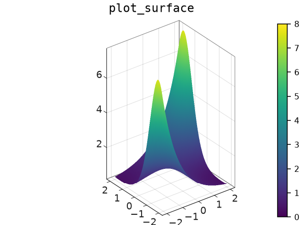
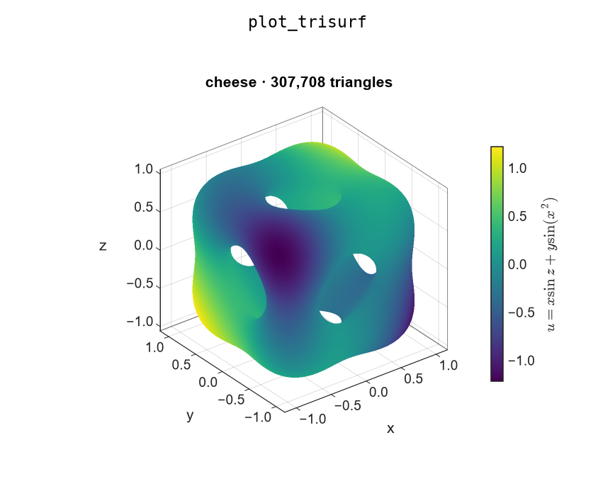
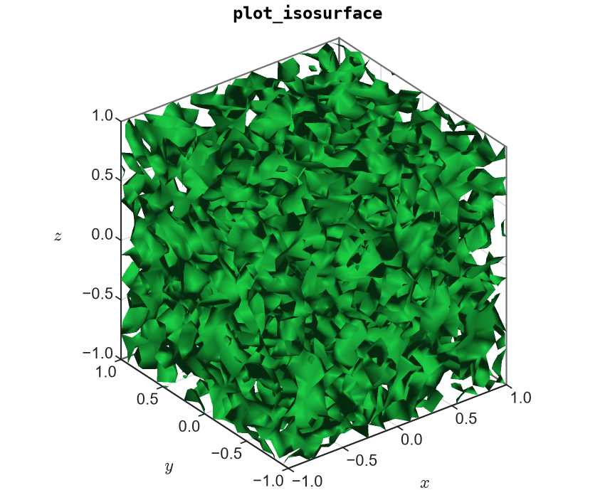
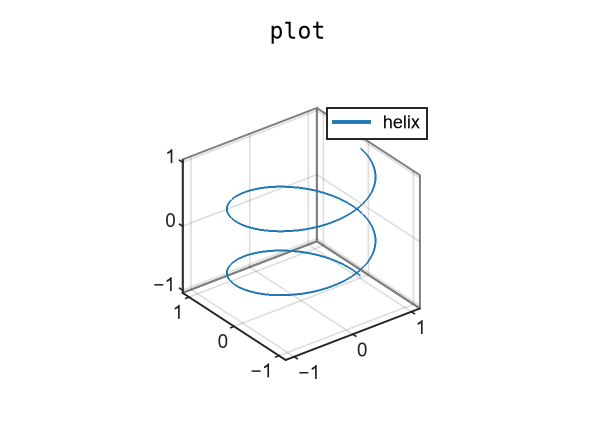
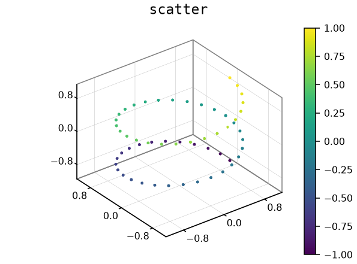

# Plotting API

Import `mpl_depth_style` to register the `vtk3d` Matplotlib projection. The plotted objects share a VTK depth buffer.

| Data | Method |
| --- | --- |
| Structured coordinate grids | [`plot_surface`](#plot_surface) |
| Triangles and vertex coordinates | [`plot_trisurf`](#plot_trisurf) |
| Sampled 3D scalar fields | [`plot_isosurface`](#plot_isosurface) |
| Connected samples | [`plot`](#plot) |
| Individual samples | [`scatter`](#scatter) |

For styling and updates to existing plots, see [Styles and plot handles](scene.md).

## Run the examples

The plot examples use the following setup. Start each example in a fresh figure. The gallery scripts use `plot_rc()` before creating figures and `ax3D_setting()` to style their 3D axes. [Gallery](plot_catalog.md) · [Plot styles](scene.md#plot_rc)

```python
import matplotlib.pyplot as plt
import numpy as np
import mpl_depth_style

fig, ax = plt.subplots(subplot_kw={"projection": "vtk3d"})
t = np.linspace(-2, 2, 61)
x, y = np.meshgrid(t, t)
z = np.exp(x * np.sin(y))
```

For the triangle mesh example, use `from pathlib import Path` and set `data_dir = Path("data")` from the repository root. The [example datasets](../data/README.md) are in that directory.

## Plotting methods

### `plot_surface`

```text
ax.plot_surface(x, y, z, *, values=None, rcount=None, ccount=None,
                rstride=None, cstride=None, facecolors=None, shade=None, **style)
```

Draw a regular height grid. A cell is skipped if any of its vertices have nonfinite coordinates.

**Parameters**

- **`x`** (`array_like`)

  X coordinates. Supply a vector of length `nx` with a 1D `y`, or a grid broadcastable with `z`.

- **`y`** (`array_like`)

  Y coordinates. Supply a vector of length `ny` with a 1D `x`, or a grid broadcastable with `z`.

- **`z`** (2D array)

  Vertex heights. The broadcast grid must have at least two rows and two columns.

- **`values`** (`array_like` or `None`, default `None`)

  Vertex colors on the full broadcast grid. Use shape `(ny, nx)` for scalars or `(ny, nx, 3)` or `(ny, nx, 4)` for RGB(A). The height grid supplies values when omitted.

- **`rcount`** (int or `None`, default `None`)

  Maximum number of rows to retain. Use at least 2 and omit `rstride`. Both boundary rows are retained.

- **`ccount`** (int or `None`, default `None`)

  Maximum number of columns to retain. Use at least 2 and omit `cstride`. Both boundary columns are retained.

- **`rstride`** (int or `None`, default `None`)

  Positive step between retained rows. Omit `rcount`. The final row is always retained.

- **`cstride`** (int or `None`, default `None`)

  Positive step between retained columns. Omit `ccount`. The final column is always retained.

- **`facecolors`** (`array_like` or `None`, default `None`)

  Alias for `values` with the same vertex shape. Supply just one of these two arguments.

- **`shade`** (bool or `None`, default `None`)

  Enable or disable lighting. The default enables lighting when both `cmap` and `values` are omitted. An explicit `lighting` style takes precedence.

- __`**style`__ (keyword arguments)

  See [common style options](#common-style-options). An uncolored surface uses the axes color cycle.

**Returns**

- **`surface`** ([`Graphic`](scene.md#graphic))

  The gridded surface. Use `set_heights()` for new heights and `set_values()` for new colors.

**Raises**

- **`ValueError`**

  If the height grid or color shape is invalid, or a count and stride are supplied for the same direction.

- **`TypeError`**

  If both `values` and `facecolors` are supplied.

**Examples**

```python
surface = ax.plot_surface(t, t, z, cmap="viridis", vmin=0, vmax=8)
fig.colorbar(surface, ax=ax)
surface.set_heights(z + .2)
```



[Source code](../examples/reference/plot_surface.py).

### `plot_trisurf`

```text
ax.plot_trisurf(x, y=None, z=None, *, triangles=None,
                values=None, association="point", shade=None, **style)
```

Draw a triangular surface. Pass explicit connectivity for a known mesh or let Matplotlib triangulate the XY coordinates.

**Parameters**

- **`x`** (1D array or `Triangulation`)

  Vertex X coordinates, or a Matplotlib triangulation that already contains the X and Y inputs, faces, and optional face mask.

- **`y`** (1D array or `None`, default `None`)

  Vertex Y coordinates when `x` is an array. With a `Triangulation`, the second positional argument can supply heights.

- **`z`** (1D array or `None`, default `None`)

  One height per vertex. Required unless heights were supplied as the second positional argument with a triangulation.

- **`triangles`** (integer array or `None`, default `None`)

  Zero-based triangle indices, shape `(n_faces, 3)`. Omit with a `Triangulation`. For coordinate inputs, `None` triangulates XY.

- **`values`** (`array_like` or `None`, default `None`)

  One scalar or RGB(A) row per vertex or per retained face, according to `association`. With `cmap` and no values, maps vertex heights or mean face heights.

- **`association`** (str, default `"point"`)

  `"point"` interpolates vertex colors. `"cell"` gives each retained triangle one color, in unmasked face order.

- **`shade`** (bool or `None`, default `None`)

  Enable or disable lighting. With both `shade` and `lighting` omitted, lighting is enabled when `cmap` is omitted.

- __`**style`__ (keyword arguments)

  See [common style options](#common-style-options). A numeric `values` array can be used with `fig.colorbar()`.

**Returns**

- **`surface`** ([`Graphic`](scene.md#graphic))

  The rendered triangles and their associated color data.

**Raises**

- **`TypeError`**

  If explicit `triangles` or both height arguments are supplied with a `Triangulation`.

- **`ValueError`**

  If vertex coordinates or triangle indices are invalid, or the color array does not match its association.

**Notes**

Supply explicit indices for meshes that overlap when projected onto XY, such as closed surfaces. Automatic Delaunay triangulation uses XY only. Choose point colors for a continuous gradient or cell colors for flat, per-triangle color.

**Examples**

The example evaluates `u = x sin(z) + y sin(x²)` on the Cheese mesh. It uses one mean value per triangle and gives the colorbar the full range of `u`. For a continuous color gradient on the same mesh, pass `values=u, association="point"`.

```python
fig.set_size_inches(6.2, 5.0)
with np.load(data_dir / "cheese.npz", allow_pickle=False) as data:
    x, y, z = data["vertices"].T
    faces = data["elements"]
u = x * np.sin(z) + y * np.sin(x**2)
surface = ax.plot_trisurf(x, y, z, triangles=faces, values=u[faces].mean(axis=1),
                          association="cell", cmap="viridis", vmin=u.min(), vmax=u.max(),
                          shade=False)
ax.set_title(f"cheese · {len(faces):,} triangles")
ax.set(xlabel="x", ylabel="y", zlabel="z")
mpl_depth_style.ax3D_setting(ax)
fig.colorbar(surface, ax=ax, shrink=.7, pad=.06, label=r"$u=x\sin z+y\sin(x^2)$")
```



[Source code](../examples/reference/plot_trisurf.py).

### `plot_isosurface`

```text
ax.plot_isosurface(values, *, level=None, coordinates=None,
                   color_values=None, share_vertices=True, **style)
```

Extract and draw an isosurface. The example draws the zero level of a seeded random field.

**Parameters**

- **`values`** (3D array)

  Sampled field with shape `(ny, nx, nz)` and at least two samples per axis.

- **`level`** (float or `None`, default `None`)

  Target scalar level. The default is the midpoint of the NaN-ignoring range in `values`.

- **`coordinates`** (three arrays or `None`, default `None`)

  Coordinate vectors `(x, y, z)` of lengths `(nx, ny, nz)` or three full grids matching `values`. Use `np.meshgrid(x, y, z, indexing="xy")` to construct full grids from vectors. When omitted, each axis uses zero-based indices.

- **`color_values`** (3D array or `None`, default `None`)

  Second field with the same shape as `values`. Its samples are interpolated onto the isosurface vertices. With no color field, use `color` for a uniform fill.

- **`share_vertices`** (bool, default `True`)

  Keep shared vertices. `False` gives each triangle independent points.

- __`**style`__ (keyword arguments)

  See [common style options](#common-style-options). Lighting defaults to `"gouraud"`. `alpha` controls surface opacity.

**Returns**

- **`surface`** ([`Graphic`](scene.md#graphic))

  The extracted triangle geometry and any interpolated color data.

**Raises**

- **`ValueError`**

  If grid dimensions or coordinates are incompatible or `color_values` has a different shape from `values`.

**Notes**

Uniform ascending coordinate vectors use VTK Flying Edges. Nonuniform vectors and curvilinear grids use VTK's general contour filter. When using a colorbar for a second field, pass the returned handle to `fig.colorbar()`.

**Examples**

```python
coords = np.linspace(-1, 1, 20)
values = np.random.default_rng(42).uniform(-1, 1, size=(20,) * 3)
ax.plot_isosurface(values, coordinates=(coords,) * 3, level=0, facecolor="#18b83e")
limits = (-1, 1)
ticks = np.linspace(*limits, 5)
mpl_depth_style.ax3D_setting(ax, limits, limits, limits, xticks=ticks, yticks=ticks, zticks=ticks)
```



[Source code](../examples/random_field_isosurface.py).

### `plot`

```text
ax.plot(x, y, z=0, *, zdir="z", color=None, linestyle="-", marker=None, markersize=6, **style)
```

Draw one or more polylines and optional markers. Compatible coordinate arrays broadcast together. A 2D input supports multiple series. Masked or nonfinite coordinates split the line.

**Parameters**

- **`x`** (`array_like`)

  X positions before the optional `zdir` remapping. Matrix columns normally define separate lines.

- **`y`** (`array_like`)

  Y positions, with dimensions compatible with `x` and `z`.

- **`z`** (scalar or `array_like`, default `0`)

  Third coordinate for each point. A scalar broadcasts across the other coordinates.

- **`zdir`** (str, default `"z"`)

  Axis receiving the third input. `"x"` maps `(x, y, z)` to `(z, x, y)`, `"y"` to `(x, z, y)`, and `"z"` leaves the order unchanged.

- **`color`** (Matplotlib color or `None`, default `None`)

  Color for lines and their markers. The default advances the axes color cycle per series.

- **`linestyle`** (str or `None`, default `"-"`)

  Line pattern. Use `None`, `""`, or `"none"` to suppress the line.

- **`marker`** (str or `None`, default `None`)

  Marker for the sample locations. See the supported markers under [`scatter`](#scatter).

- **`markersize`** (float, default `6`)

  Nominal marker diameter. The scatter marker area is its square.

- __`**style`__ (keyword arguments)

  See [common style options](#common-style-options) for the line. Marker visibility and opacity follow those settings when a marker is drawn.

**Returns**

- **`handles`** (list of [`Graphic`](scene.md#graphic))

  One handle for each line and any separate marker artists.

**Examples**

```python
theta = np.linspace(0, 4*np.pi, 140)
line, = ax.plot(np.cos(theta), np.sin(theta), np.linspace(-1, 1, len(theta)),
                color="tab:blue", linewidth=2, label="helix")
ax.legend()
```



[Source code](../examples/reference/plot.py).

### `scatter`

```text
ax.scatter(x, y, z=0, *, s=20, c=None, zdir="z", marker="o", filled=True, **style)
```

Draw points with scalar colors, direct colors, or a uniform color. Rows with nonfinite positions are skipped.

**Parameters**

- **`x`** (scalar or `array_like`)

  X coordinate before `zdir` remapping.

- **`y`** (scalar or `array_like`)

  Y coordinate, broadcastable with `x` and `z`.

- **`z`** (scalar or `array_like`, default `0`)

  Third coordinate. A scalar broadcasts across the other inputs.

- **`s`** (scalar or `array_like`, default `20`)

  Nonnegative nominal marker area. Supply one value or one per point. Uniform circle and dot sizes use a pixel-based fast path. Other glyphs are scaled in scene coordinates.

- **`c`** (color, `array_like`, or `None`, default `None`)

  A single Matplotlib color, one scalar per point, or color rows with three or four channels. Use a tuple or color string for one fixed color. The default uses the axes color cycle.

- **`zdir`** (str, default `"z"`)

  Axis receiving the third coordinate. See [`plot`](#plot) for the coordinate permutations.

- **`marker`** (str, default `"o"`)

  Supported forms include `o`, `.`, `+`, `x`, `*`, `s`, `square`, `d`, `diamond`, `^`, `v`, `<`, `>`, `p`, and `h`.

- **`filled`** (bool, default `True`)

  Fill the interiors of suitable glyph markers. The uniform sphere/dot fast path retains its standard appearance.

- __`**style`__ (keyword arguments)

  See [common style options](#common-style-options). `cmap` and `norm` control numeric colors.

**Returns**

- **`points`** ([`Graphic`](scene.md#graphic))

  The point artist. Numeric `c` supports a colorbar.

**Raises**

- **`ValueError`**

  If point colors have the wrong length, marker areas are nonfinite or negative, or the marker name is unsupported.

**Examples**

```python
theta = np.linspace(0, 4*np.pi, 56)
heights = np.linspace(-1, 1, len(theta))
points = ax.scatter(np.cos(theta), np.sin(theta), heights, s=24, c=heights, cmap="viridis")
fig.colorbar(points, ax=ax)
```



[Source code](../examples/reference/scatter.py).

## Common style options

The defaults below apply to a directly constructed [`Graphic`](scene.md#graphic). Individual plotting methods describe their overrides and any additional keywords.

- **`color`** (Matplotlib color or `None`, default `None`)

  Uniform object color. Many plotting methods choose the next axes-cycle color when neither a fixed color nor scalar colors are supplied.

- **`facecolor`** (Matplotlib color, `"none"`, or `None`, default `None`)

  Fixed face fill that overrides `color` and mapped values. `"none"` draws a wireframe.

- **`edgecolor`** (Matplotlib color, `"none"`, or `None`, default `"none"`)

  Polygon boundary color. `"none"` or `None` hides the lines.

- **`linewidth`** (float, default `1`)

  Nominal width of lines and polygon edges in output pixels.

- **`linestyle`** (str, default `"-"`)

  One of `"-"`, `"--"`, `":"`, `"-."`, or `"none"`. VTK line stipple support depends on the renderer.

- **`alpha`** (float or `None`, default `None`)

  Uniform opacity in `[0, 1]`. `None` uses full actor opacity.

- **`vertex_alpha`** (scalar, `array_like`, or `None`, default `None`)

  Local opacity in `[0, 1]`, broadcast to one value per vertex or face according to `association`. When supplied, it replaces the alpha channel of the mapped or direct color data.

- **`edge_alpha`** (float or `None`, default `None`)

  Opacity of polygon edges in `[0, 1]`. `None` uses the VTK default.

- **`point_size`** (float, default `5`)

  Nominal size in pixels for primitive VTK points. Marker methods such as `scatter` derive point or glyph sizes from `s`.

- **`wireframe`** (bool, default `False`)

  Draw polygons as wireframe edges.

- **`lighting`** (bool or str, default `False`)

  `True` selects Phong lighting. Use `False` or choose `"flat"`, `"gouraud"`, or `"phong"`. Some plotting methods set a different default.

- **`ambient`** (float, default `0.22`)

  Ambient contribution to the lit material, from 0 to 1.

- **`diffuse`** (float, default `0.78`)

  Diffuse contribution to the lit material, from 0 to 1.

- **`specular`** (float, default `0.12`)

  Specular strength for the lit material, from 0 to 1.

- **`specular_power`** (float, default `18`)

  VTK highlight exponent. Larger values narrow the highlight.

- **`cmap`** (colormap, str, RGB(A) table, or `None`, default `None`)

  Scalar-to-color map. `None` uses the Matplotlib default if scalar mapping is active.

- **`norm`** (Matplotlib normalization, scale name, or `None`, default `None`)

  Converts data scalars to colormap positions. `None` uses linear normalization.

- **`vmin`** (float or `None`, default `None`)

  Lower scalar color limit. `None` leaves the bound to the normalization or the data.

- **`vmax`** (float or `None`, default `None`)

  Upper scalar color limit. `None` leaves the bound to the normalization or the data.

- **`label`** (str or `None`, default `None`)

  Matplotlib label for legends. An underscore prefix hides an entry from automatic legend selection.

- **`visible`** (bool, default `True`)

  Whether the VTK object is drawn.
