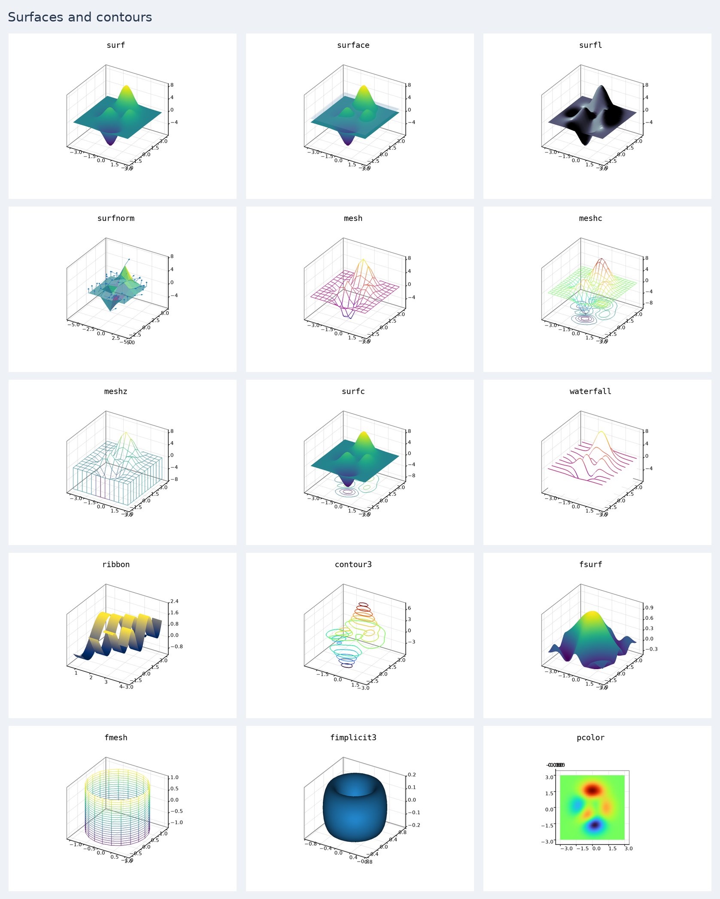
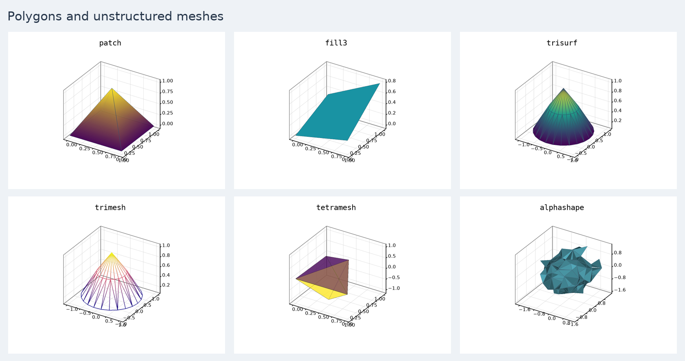
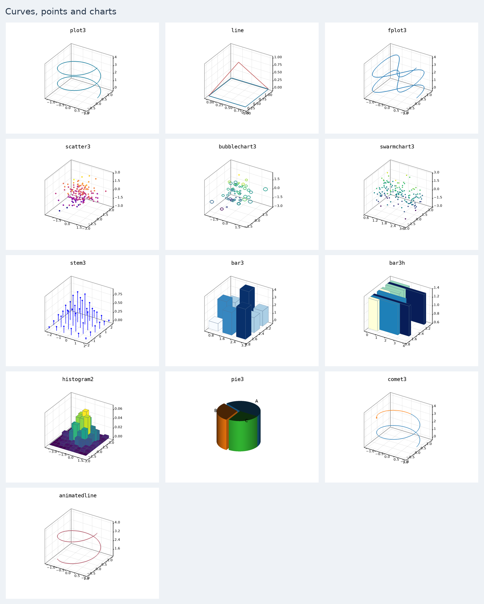
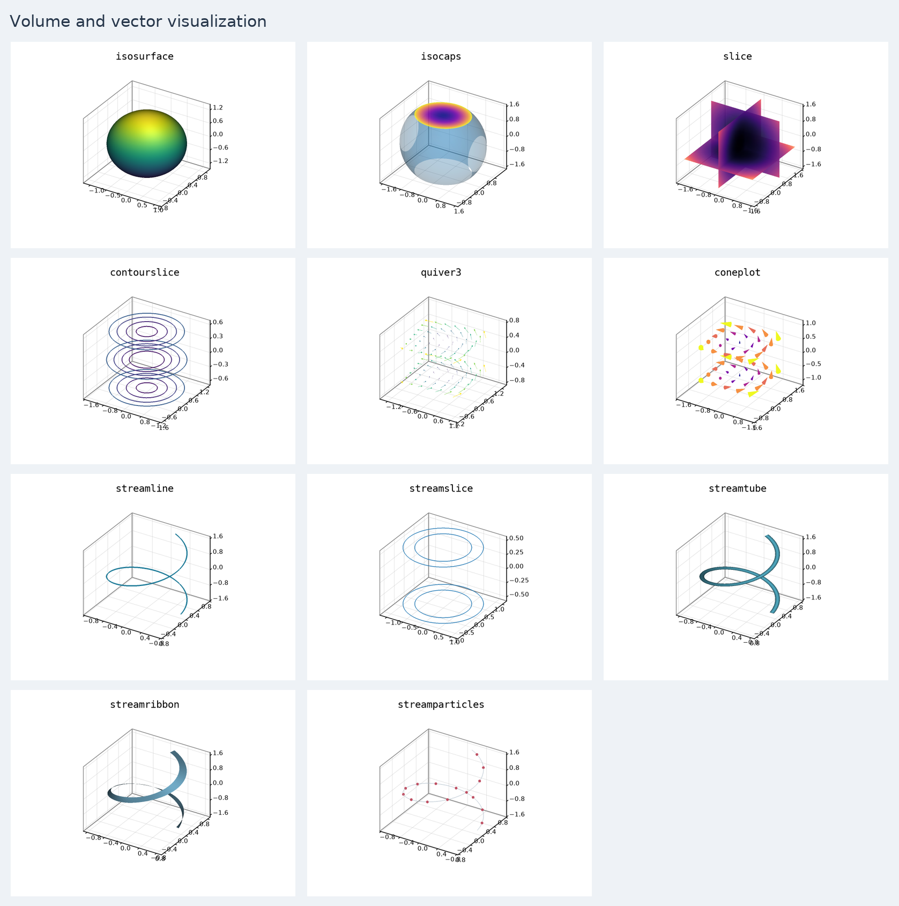
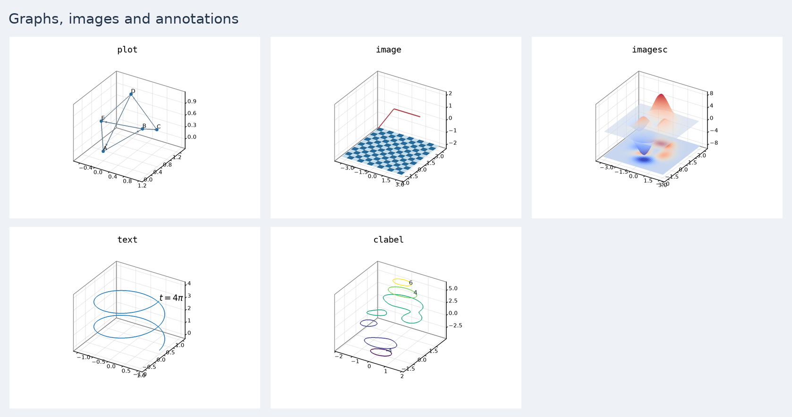

# 基础 MATLAB 三维绘图清单

核对范围为基础 MATLAB R2026b 的绘图目录及三维图元用法。清单列出 **50 个绘图和标注入口**，以及 **19 个数据与几何辅助函数**。图中数据由 NumPy 生成，VTK 负责三维渲染，Matplotlib 负责坐标轴和排版。

函数名链接到 [逐函数参考](function_reference.md) 中的签名、参数、可运行代码和独立原图。子图、照明、色标和导出见 [API 参考](api.md)。

## 规则曲面与等高线（15）

[`surf`](function_reference.md#surf) · [`surface`](function_reference.md#surface) · [`surfl`](function_reference.md#surfl) · [`surfnorm`](function_reference.md#surfnorm) · [`mesh`](function_reference.md#mesh) · [`meshc`](function_reference.md#meshc) · [`meshz`](function_reference.md#meshz) · [`surfc`](function_reference.md#surfc) · [`waterfall`](function_reference.md#waterfall) · [`ribbon`](function_reference.md#ribbon) · [`contour3`](function_reference.md#contour3) · [`fsurf`](function_reference.md#fsurf) · [`fmesh`](function_reference.md#fmesh) · [`fimplicit3`](function_reference.md#fimplicit3) · [`pcolor`](function_reference.md#pcolor)

## 多边形和非规则网格（6）

[`patch`](function_reference.md#patch) · [`fill3`](function_reference.md#fill3) · [`trisurf`](function_reference.md#trisurf) · [`trimesh`](function_reference.md#trimesh) · [`tetramesh`](function_reference.md#tetramesh) · [`alphashape`](function_reference.md#alphashape)

## 曲线、散点、统计和动画（13）

[`plot3`](function_reference.md#plot3) · [`line`](function_reference.md#line) · [`fplot3`](function_reference.md#fplot3) · [`scatter3`](function_reference.md#scatter3) · [`bubblechart3`](function_reference.md#bubblechart3) · [`swarmchart3`](function_reference.md#swarmchart3) · [`stem3`](function_reference.md#stem3) · [`bar3`](function_reference.md#bar3) · [`bar3h`](function_reference.md#bar3h) · [`histogram2`](function_reference.md#histogram2) · [`pie3`](function_reference.md#pie3) · [`comet3`](function_reference.md#comet3) · [`animatedline`](function_reference.md#animatedline)

## 体数据与流线（11）

[`isosurface`](function_reference.md#isosurface) · [`isocaps`](function_reference.md#isocaps) · [`slice`](function_reference.md#slice) · [`contourslice`](function_reference.md#contourslice) · [`quiver3`](function_reference.md#quiver3) · [`coneplot`](function_reference.md#coneplot) · [`streamline`](function_reference.md#streamline) · [`streamslice`](function_reference.md#streamslice) · [`streamtube`](function_reference.md#streamtube) · [`streamribbon`](function_reference.md#streamribbon) · [`streamparticles`](function_reference.md#streamparticles)

## 三维网络图、图像和标注（5）

[`plot`](function_reference.md#plot) · [`image`](function_reference.md#image) · [`imagesc`](function_reference.md#imagesc) · [`text`](function_reference.md#text) · [`clabel`](function_reference.md#clabel)

## 数据与几何辅助函数

- 网格与示例数据　[`peaks`](function_reference.md#peaks) · [`sphere`](function_reference.md#sphere) · [`cylinder`](function_reference.md#cylinder) · [`ellipsoid`](function_reference.md#ellipsoid) · [`flow`](function_reference.md#flow)

- 几何转换　[`surf2patch`](function_reference.md#surf2patch) · [`reducepatch`](function_reference.md#reducepatch) · [`shrinkfaces`](function_reference.md#shrinkfaces)

- 体数据分析　[`isocolors`](function_reference.md#isocolors) · [`isonormals`](function_reference.md#isonormals) · [`smooth3`](function_reference.md#smooth3) · [`reducevolume`](function_reference.md#reducevolume) · [`subvolume`](function_reference.md#subvolume) · [`volumebounds`](function_reference.md#volumebounds)

- 流线与向量场计算　[`stream2`](function_reference.md#stream2) · [`stream3`](function_reference.md#stream3) · [`curl`](function_reference.md#curl) · [`divergence`](function_reference.md#divergence) · [`interpstreamspeed`](function_reference.md#interpstreamspeed)

## 输入与兼容范围

MATLAB 的 `plot(G)` 三维网络图对应 Python 的 `plot(edges, xyz)`，另有 `graphplot` 同义入口。MATLAB 的 `plot(alphaShape(...))` 对应 `alphashape(points, alpha)`。`sphere`、`cylinder`、`ellipsoid` 返回网格数组，可交给 `surf` 或 `mesh` 绘制。

本清单的覆盖口径为基础 MATLAB 的入口及表中给出的代表性用法。完整 Handle Graphics 属性、表重载、上下文菜单、编辑器和三维查看器行为仍有实现差异。工具箱函数无需纳入基础清单。

官方索引　[绘图类型](https://www.mathworks.com/help/matlab/creating_plots/types-of-matlab-plots.html) · [曲面和网格](https://www.mathworks.com/help/matlab/surface-and-mesh-plots-1.html) · [多边形](https://www.mathworks.com/help/matlab/geometry.html) · [体可视化](https://www.mathworks.com/help/matlab/volume-visualization.html) · [三角剖分绘图](https://www.mathworks.com/help/matlab/referencelist.html?category=mathematics&listtype=cat&type=function) · [图和有向图](https://www.mathworks.com/help/matlab/ref/graph.plot.html) · [Alpha Shape 绘图](https://www.mathworks.com/help/matlab/ref/alphashape.plot.html) · [三维轴上的图像](https://www.mathworks.com/help/matlab/ref/image.html)
