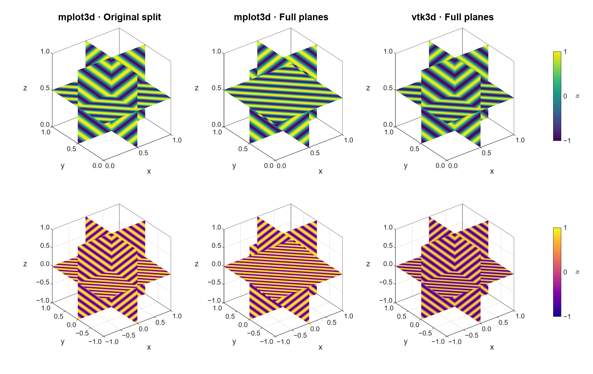

# Examples and figure export

Run these commands from the root of an installed checkout. The export examples render through Matplotlib and an offscreen VTK window. The [README quickstart](../README.md#quickstart) also shows a 3D surface and a 2D cross-section in one figure.

| Example | What it demonstrates | Command |
| --- | --- | --- |
| [Closed triangle mesh](../examples/closed_surface.py) | A torus with scalar coloring and custom vertex normals | `python examples/closed_surface.py torus.png --antialiasing 4` |
| [Intersecting planes](../examples/intersecting_planes.py) | Three perpendicular slices and their occlusion | `python examples/intersecting_planes.py slices.png` |
| [Intersecting scalar slices](../examples/intersecting_scalar_slices.py) | Three slices of a scalar field with a shared colorbar | `python examples/intersecting_scalar_slices.py slices.png` |
| [Random-field zero isosurface](../examples/random_field_isosurface.py) | A uniformly colored isosurface of a seeded random field | `python examples/random_field_isosurface.py zero.png` |

See the [API gallery](plot_catalog.md) to browse individual methods. Each figure has a **Documentation** link to the matching reference and a **Source code** link to its runnable script.

## Three intersecting planes

The comparison reproduces the [my-mpl-style example](https://github.com/guessable/my-mpl-style/blob/d3ab92fcaef3852701dfc2cccd22c90b5c0ecb2c/examples/Intersecting_planes.py) for the field `sin(10π(x + y + z))`. Each row uses three midplane slices, an orthographic view, equal data-unit lengths, and a shared color range. The upper row spans `[0, 1]` on all axes and the lower row spans `[-1, 1]`.

The left column shows the original workaround, which draws four parts of each slice separately. In the center column, the horizontal plane hides regions of the vertical planes that should be visible in front of it. The right column draws three full planes with per-pixel depth testing in VTK.



[Documentation](function_reference.md#plot_volume_slices) · [Source code](../examples/intersecting_planes_comparison.py)

### Evaluate an analytic field on each plane

Use `plot_surface` when you can evaluate the field directly on the slices or already have 2D samples. The example samples 100×100 points per plane. It passes the coordinates and color values separately.

```python
import matplotlib.pyplot as plt
import numpy as np
import mpl3d_vtk

fig, ax = plt.subplots(subplot_kw={"projection": "vtk3d"})
t = np.linspace(0, 1, 100)
a, b = np.meshgrid(t, t)
c = np.full_like(a, 0.5)
for x, y, z in ((c, a, b), (a, c, b), (a, b, c)):
    u = np.sin(10 * np.pi * (x + y + z))
    surface = ax.plot_surface(x, y, z, values=u, cmap="viridis", vmin=-1, vmax=1)
fig.colorbar(surface, ax=ax)
```

This is the default `--method surface` in [intersecting_planes.py](../examples/intersecting_planes.py).

### Slice an existing scalar volume

Pass a `(ny, nx, nz)` array and the three coordinate vectors to `plot_volume_slices`. This example creates a sample volume with the midpoint on the grid. The returned handles follow X, Y, Z order and share a color range.

```python
import matplotlib.pyplot as plt
import numpy as np
import mpl3d_vtk

fig, ax = plt.subplots(subplot_kw={"projection": "vtk3d"})
t = np.linspace(0, 1, 101)
x, y, z = np.meshgrid(t, t, t, sparse=True)
volume = np.sin(10 * np.pi * (x + y + z))
slices = ax.plot_volume_slices(volume, coordinates=(t, t, t), x=.5, y=.5, z=.5,
                              cmap="viridis", vmin=-1, vmax=1)
fig.colorbar(slices[0], ax=ax)
```

Run the [example script](../examples/intersecting_planes.py) with `--method volume` to generate both sets of slices with this method. See [`plot_volume_slices`](function_reference.md#plot_volume_slices) for interpolation options.

## Export and cleanup

Use `fig.savefig("plot.png", dpi=200)` for raster output. PDF and SVG embed the VTK viewport as an RGBA image at the output DPI. Matplotlib axes, text, and ordinary 2D plots can remain vector elements. A headless host needs an offscreen OpenGL implementation supported by its VTK build, such as EGL or OSMesa.

Closing an interactive figure releases its VTK windows. With Agg, call `ax.remove()` after saving to release that subplot's VTK window immediately, then call `plt.close(fig)`. Repeat `remove()` for each VTK subplot in a batch figure.

## Regenerate the reference figures

Each [gallery](plot_catalog.md) image links to its API entry and its own runnable Python script. The gallery builder generates the reference scripts and PNGs from the API snippets. Run the standalone scripts to regenerate the two README figures.

```sh
python examples/render_reference.py
python examples/intersecting_scalar_slices.py docs/gallery/intersecting_scalar_slices.png
python examples/random_field_isosurface.py docs/gallery/random_field_isosurface.png
```

To render a single figure, run the script linked below its thumbnail and pass the output filename.

```sh
python examples/reference/plot_surface.py surface.png
python examples/reference/plot_trisurf.py cheese.png
```

## Example datasets

The Cheese and Peanut meshes are in [`data/`](../data/README.md). The mesh scripts read this directory by default. Pass `--data-dir` to use another copy of the files. See [mesh color interpolation](function_reference.md#mesh-color-interpolation) to choose between per-vertex and per-face values.

The [benchmark comparisons](../benchmarks/results/my_mpl_style/README.md) include their own instructions for obtaining the upstream PFC volumes.

## Tests and benchmarks

```sh
python -m pip install ".[test]"
python -m pytest -q
python benchmarks/benchmark.py --surface 128 256 512 --volume 40 80 128 --segments 20000 --frames 20
```

The benchmark reports geometry construction, a full first draw, rotation redraws, height and color updates, and VTK isosurface extraction. It reports medians and 95th percentiles for repeated operations. Match the device, canvas, dataset, and antialiasing when comparing runs. For measurements on upstream data, see the [triangle mesh and isosurface comparisons](../benchmarks/results/my_mpl_style/README.md).
