# VTK plotting and geometry

Choose a method by your input or by the geometry you need. The [plotting API](api.md) covers regular plots and style keywords. [Scene and handles](scene.md) covers lights and incrementally updated lines.

| Task | Methods |
| --- | --- |
| Meshes and scalar fields | [`plot_mesh`](#plot_mesh), [`extract_isosurface`](#extract_isosurface), [`plot_isosurface`](#plot_isosurface), [`plot_volume_slices`](#plot_volume_slices), [`plot_slice_contours`](#plot_slice_contours), [`plot_volume`](#plot_volume) |
| Vector fields and streamlines | [`trace_streamlines`](#trace_streamlines), [`plot_vector_samples`](#plot_vector_samples), [`plot_streamlines`](#plot_streamlines), [`plot_streamtubes`](#plot_streamtubes), [`plot_streamribbons`](#plot_streamribbons) |
| Point clouds and other geometry | [`plot_point_cloud`](#plot_point_cloud), [`plot_alpha_shape`](#plot_alpha_shape), [`plot_coordinate_frames`](#plot_coordinate_frames), [`plot_graph`](#plot_graph), [`plot_image_plane`](#plot_image_plane) |

## Coordinate conventions

A scalar volume has shape `(ny, nx, nz)`. A vector field has shape `(ny, nx, nz, 3)` with XYZ components in the last dimension. Supply `coordinates=(x, y, z)` as three coordinate vectors or as full arrays with the corresponding shape. Without explicit coordinates, each axis starts at zero and advances in unit steps. Uniform ascending axes can use VTK image data. Isosurface extraction and linear sampling also support nonuniform or curvilinear grids.

The examples share these imports, data, and axes. Call `ax.clear_scene()` when starting a new plot on the same axes.

```python
import matplotlib.pyplot as plt
import numpy as np
import mpl3d_vtk as vtkplot

fig, ax = plt.subplots(subplot_kw={"projection": "vtk3d"})
t = np.linspace(-1, 1, 31)
coordinates = (t, t, t)
x, y, z = np.meshgrid(*coordinates, indexing="xy")
volume = x*x + y*y + z*z
vectors = np.stack((-y, x, np.full_like(z, .2)), axis=-1)
seeds = [[.3, 0, -.8], [.6, 0, -.8]]
```

## Meshes and scalar fields

### `plot_mesh`

```text
ax.plot_mesh(vertices, faces, *, values=None, association="point", **style)
```

Draw an arbitrary polygon mesh. `vertices` is an `(n, 3)` array of XYZ points. Each entry in `faces` contains at least three zero-based vertex indices. Use a 2D array for equal-size faces or nested lists for mixed polygons.

`values` can contain scalars or RGB(A) colors. Use one entry per vertex by default or one entry per face with `association="cell"`. Returns a `Graphic` with `vertices` and `faces` properties. Scalar values can drive a colorbar.

```python
mesh = ax.plot_mesh([[0, 0, 0], [1, 0, 0], [0, 1, 1]], [[0, 1, 2]],
                    values=[0., .2, 1.], cmap="viridis")
fig.colorbar(mesh, ax=ax)
```

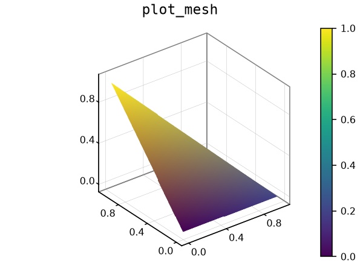

### `extract_isosurface`

```text
vtkplot.extract_isosurface(values, *, level=None, coordinates=None,
                           color_values=None, share_vertices=True)
```

Extract a triangle mesh at `level` from a scalar volume. The default level is halfway between the minimum and maximum of the field, ignoring NaNs. Set `color_values` to a second scalar volume with the same shape to interpolate its values onto the output vertices. Set `share_vertices=False` to give each triangle its own vertices.

Returns a dictionary with `vertices`, zero-based triangular `faces`, and optional interpolated `values`. An absent intersection returns empty geometry. Pass the dictionary to `ax.plot_mesh(**mesh)` to draw it.

```python
mesh = vtkplot.extract_isosurface(volume, level=.6, coordinates=coordinates, color_values=z)
ax.plot_mesh(**mesh, cmap="coolwarm", vmin=-1, vmax=1)
```

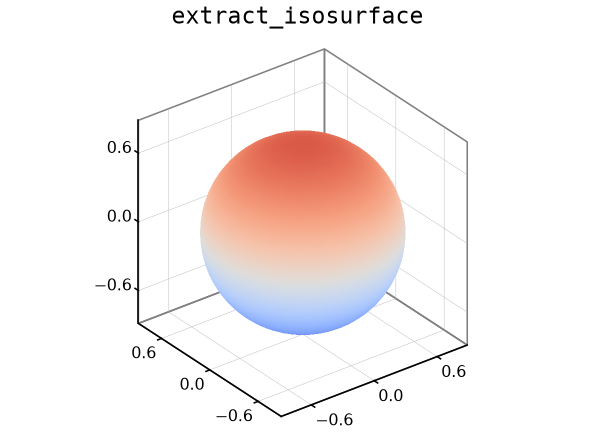

### `plot_isosurface`

```text
ax.plot_isosurface(values, *, level=None, coordinates=None,
                   color_values=None, share_vertices=True, **style)
```

Extract and draw an isosurface. Inputs follow [`extract_isosurface`](#extract_isosurface). Use `color` for a uniform color or `color_values` to map an independent scalar field. Use `alpha` to set opacity. Gouraud lighting is enabled by default. Returns a `Graphic` that exposes the extracted geometry.

```python
shell = ax.plot_isosurface(volume, level=.6, coordinates=coordinates,
                           color="tab:blue", alpha=.5)
```

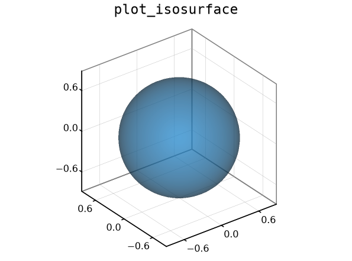

### `plot_volume_slices`

```text
ax.plot_volume_slices(values, *, coordinates=None, x=(), y=(), z=(),
                      sample_surface=None, interpolation="linear", **style)
```

Sample a scalar volume on one or more planes. Pass each of `x`, `y`, and `z` as a location or a sequence of locations. Use `sample_surface=(X, Y, Z)` to sample on a custom 2D grid instead. The arrays in that tuple must broadcast to one another.

Linear interpolation is the default. Nearest-neighbor and cubic interpolation require strictly monotonic rectilinear coordinates. Slice colors share the input volume's scalar range. Override this with `norm` or `vmin` and `vmax`.

Returns a list of `Graphic` objects in X, Y, Z order. See the [intersecting planes example](examples.md#three-intersecting-planes) for a complete figure.

```python
slices = ax.plot_volume_slices(volume, coordinates=coordinates, x=0, y=0, z=0,
                               cmap="plasma")
fig.colorbar(slices[0], ax=ax)
```

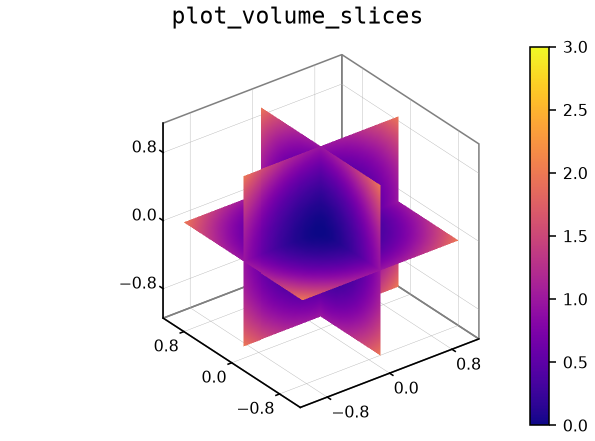

### `plot_slice_contours`

```text
ax.plot_slice_contours(values, *, coordinates=None, x=(), y=(), z=(), levels=10, **style)
```

Extract contour lines on axis-aligned slices. `levels` can be a positive count or a sequence of scalar levels. The line geometry lies in the slice plane. The positions, shared color range, and order follow [`plot_volume_slices`](#plot_volume_slices). Returns one `Graphic` per plane.

```python
lines = ax.plot_slice_contours(volume, coordinates=coordinates, z=[-.3, .3],
                               levels=[.3, .6, .9], linewidth=2)
```

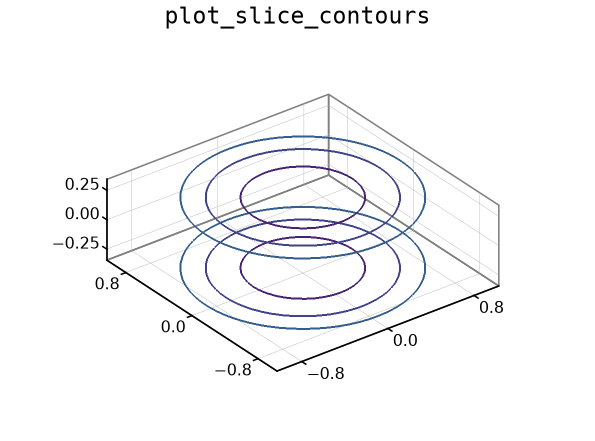

### `plot_volume`

```text
ax.plot_volume(values, *, coordinates=None, cmap="gray", norm=None,
               vmin=None, vmax=None, opacity=(0., 0., .45, .9),
               blend_mode="composite", label=None)
```

Ray-cast a uniformly spaced scalar volume. Values must be finite, coordinates must increase, and the axes must use linear scales. `opacity` contains at least two values between 0 and 1, spaced uniformly across the scalar range. `blend_mode` accepts `"composite"`, `"maximum"`, `"minimum"`, and `"average"` for compositing or intensity projection.

Returns a volume handle with native `actor`, `mapper`, and `data` attributes. The handle works with `fig.colorbar()`, `set_cmap()`, `set_clim()`, `set_visible()`, and `remove()`.

```python
cloud = ax.plot_volume(np.exp(-4*volume), coordinates=coordinates, cmap="magma",
                       opacity=[0, .05, .45, .9], blend_mode="maximum")
fig.colorbar(cloud, ax=ax)
```

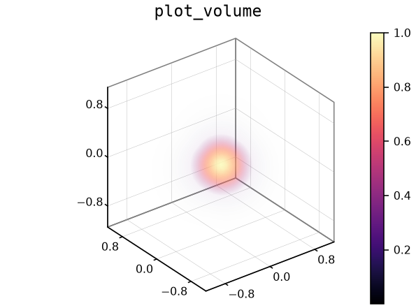

## Vector fields and streamlines

### `trace_streamlines`

```text
vtkplot.trace_streamlines(vectors, seeds, *, coordinates=None, step=.1,
                          max_steps=10000, direction="forward")
```

Integrate a 3D vector field from seed points with VTK's fourth-order Runge–Kutta integrator. Provide one `(3,)` seed or an `(n, 3)` array. `step` is a positive integration step in local cell-length units. `max_steps` caps the number of steps per path. Use `direction="forward"`, `"backward"`, or `"both"`.

Returns a list of `(m, 3)` paths. Seeds outside the usable domain or at stationary points may produce no path.

```python
paths = vtkplot.trace_streamlines(vectors, seeds, coordinates=coordinates, step=.15)
ax.plot_streamlines(paths, color="tab:blue", linewidth=2)
ax.scatter(*np.asarray(seeds).T, c="tab:orange", s=28, label="Seeds")
ax.legend()
```


### `plot_vector_samples`

```text
ax.plot_vector_samples(vectors, points, *, coordinates=None, color_values=None,
                       interpolation="linear", glyph="cone", length=1., **style)
```

Interpolate vectors at a single XYZ point or an `(n, 3)` array. `glyph` selects cones or arrows with `"cone"` or `"arrow"`. `length` multiplies the sampled magnitudes. Linear interpolation is the default. Nearest-neighbor and cubic interpolation require strictly monotonic rectilinear coordinates.

An optional `color_values` scalar grid supplies colors at the same positions. Vectors outside the grid are skipped. Returns a `Graphic`. With a colormap and no separate field, colors encode the scaled vector magnitude.

```python
a, b = np.meshgrid(np.linspace(-.8, .8, 6), np.linspace(-.8, .8, 6))
sample_points = np.column_stack((a.ravel(), b.ravel(), np.zeros(a.size)))
glyphs = ax.plot_vector_samples(vectors, sample_points, coordinates=coordinates,
                                color_values=volume, glyph="arrow", length=.4)
```

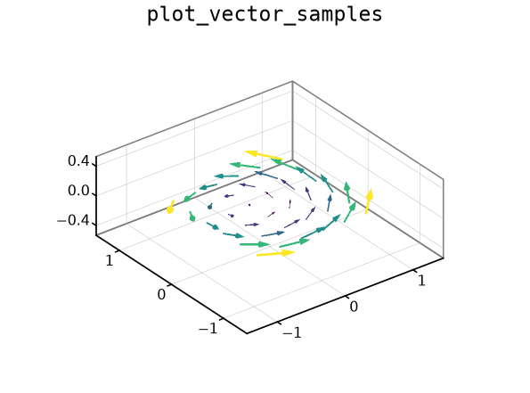

### `plot_streamlines`

```text
ax.plot_streamlines(paths, **style)
```

Draw a single `(n, 3)` NumPy path, a sequence of paths, or the line data from an existing streamline handle. Nonfinite points split paths, and runs with fewer than two points are skipped. Returns one `Graphic` for all lines.

```python
paths = vtkplot.trace_streamlines(vectors, seeds, coordinates=coordinates)
lines = ax.plot_streamlines(paths, color="tab:blue", linewidth=2.5)
```


### `plot_streamtubes`

```text
ax.plot_streamtubes(paths, *, radius=None, radii=None, sides=20, **style)
```

Build capped tubes around paths. Supply a uniform `radius` in data units or one positive entry in `radii` for each retained path vertex. The default radius is estimated from the extent of the paths. `sides` sets the polygonal cross-section and must be at least three. Returns one lit `Graphic`.

```python
paths = vtkplot.trace_streamlines(vectors, seeds, coordinates=coordinates)
tube = ax.plot_streamtubes(paths, radius=.035, sides=14, color="tab:orange")
```

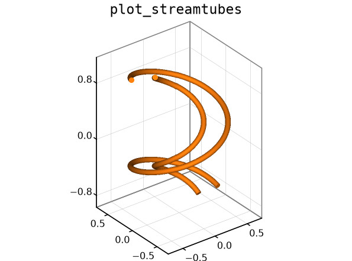

### `plot_streamribbons`

```text
ax.plot_streamribbons(paths, *, width=None, twists=None, **style)
```

Generate a surface strip along each path. `width` is in data units and defaults to a value based on the path bounds. `twists` optionally provides an angle in radians or an array of angles for each path. The angles rotate the ribbon about the local tangent. Returns one `Graphic` containing all ribbons.

```python
paths = vtkplot.trace_streamlines(vectors, seeds, coordinates=coordinates)
twists = [np.linspace(0, np.pi, len(path)) for path in paths]
ribbons = ax.plot_streamribbons(paths, width=.11, twists=twists, color="tab:purple")
```

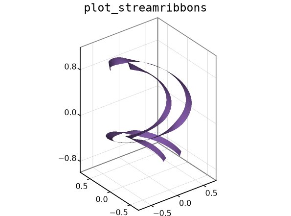

## Point clouds and other geometry

### `plot_point_cloud`

```text
ax.plot_point_cloud(points, *, c=None, s=25, **style)
```

Draw points from an array with trailing dimension 3 or from a PLY or VTP file. The leading array dimensions are flattened into a point list. `c` and `s` follow [`scatter`](api.md#scatter). Omit `c` to use the file's colors or the Z coordinate when file colors are unavailable. Returns one `Graphic`.

```python
points = np.random.default_rng(12).normal(size=(140, 3))
cloud = ax.plot_point_cloud(points, c=points[:, 2], s=28, cmap="viridis")
```

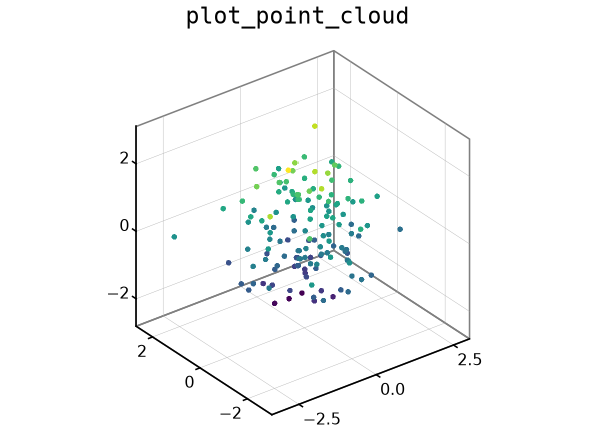

### `plot_alpha_shape`

```text
ax.plot_alpha_shape(points, *, radius, **style)
```

Plot the boundary of a three-dimensional alpha shape from a Delaunay tetrahedralization. `radius` is a positive threshold in data units. A smaller radius rejects more tetrahedra. Use `np.inf` for the full Delaunay boundary. `points` accepts the same inputs as [`plot_point_cloud`](#plot_point_cloud). Returns a `Graphic` with the boundary faces.

```python
points = np.random.default_rng(12).normal(size=(300, 3))
boundary = ax.plot_alpha_shape(points, radius=1.1, color="tab:blue", alpha=.6)
```

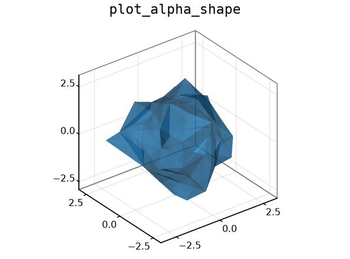

### `plot_coordinate_frames`

```text
ax.plot_coordinate_frames(translations, *, rotations=None,
                          frame_size=1., show_labels=False, **style)
```

Draw XYZ triads for one or more poses. Pass homogeneous matrices of shape `(n, 4, 4)`, or pass `(n, 3)` translations with rotations. Rotations accept `(n, 3, 3)` matrices or `(n, 4)` quaternions ordered `(w, x, y, z)`. A single transformation or rotation can omit the batch dimension.

`frame_size` sets the axis-arrow length. Set `show_labels=True` for zero-based pose labels. Returns three `Graphic` objects in XYZ order.

```python
frames = ax.plot_coordinate_frames([[0, 0, 0], [.5, .5, .5]],
                                  rotations=np.eye(3), frame_size=.25, show_labels=True)
```

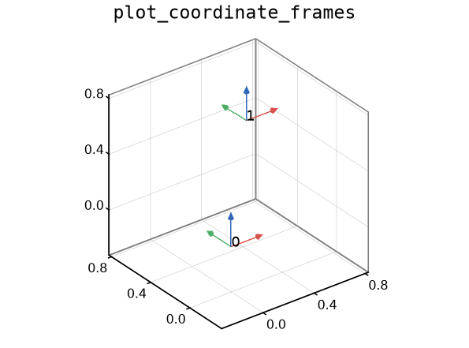

### `plot_graph`

```text
ax.plot_graph(edges, *, positions=None, node_count=None, directed=False,
              show_arrows=None, seed=0, node_labels=None, node_color="#296c9c",
              edge_color="#617a8d", node_size=49, **style)
```

Draw a graph from `(n, 2)` edges containing zero-based node indices. Provide `(m, 3)` node positions or let VTK compute a force-directed layout seeded by `seed`. Use `node_count` to account for isolated nodes. Directed graphs draw arrows by default, and `show_arrows` overrides this. Provide one `node_labels` value per node. `node_size` sets the marker area.

Returns an edge `Graphic` with a `nodes` handle and optional `arrows` handle. Removing it also removes the nodes, arrows, and labels.

```python
graph = ax.plot_graph([[0, 1], [1, 2], [2, 0]],
                      positions=[[0, 0, 0], [1, 0, 1], [0, 1, 0]],
                      directed=True, node_labels=["A", "B", "C"])
```

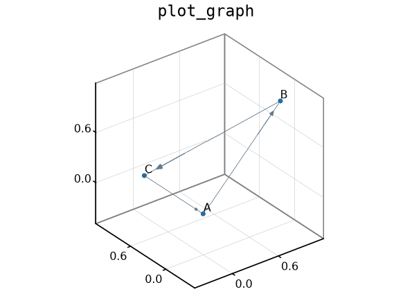

### `plot_image_plane`

```text
ax.plot_image_plane(image, *, extent=None, z=0., origin="lower",
                    interpolation="nearest", pixel_alpha=None, **style)
```

Place a scalar, RGB, or RGBA image on an XY plane at height `z`. By default the first pixel is centered at `(0, 0)`. Use `extent=(left, right, bottom, top)` to set the outer image edges. Set `origin="upper"` to put the first row at the top. `interpolation` accepts `"nearest"` or `"linear"`. `pixel_alpha` specifies opacity factors from 0 to 1 that broadcast to the image size.

Returns a `Graphic` with `set_values(new_image)` to update pixels of the same dimensions. Scalar inputs support colorbars and the usual colormap and normalization arguments.

```python
pixels = np.sin(5*x[:, :, 0]) * np.cos(5*y[:, :, 0])
image = ax.plot_image_plane(pixels, extent=(-1, 1, -1, 1), z=-.6,
                            cmap="coolwarm", vmin=-1, vmax=1)
ax.set(zlim=(-.5, .5))
ax.set_box_aspect((1, 1, .6))
fig.colorbar(image, ax=ax)
```

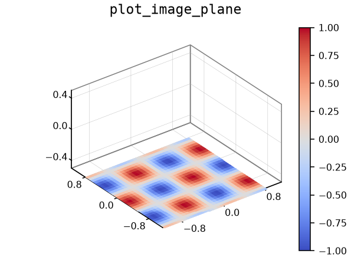

## add_streaming_line

See [`add_streaming_line`](scene.md#add_streaming_line) for updating line points between draws.

## add_light

See [`add_light`](scene.md#add_light) for adding a world-space light.
