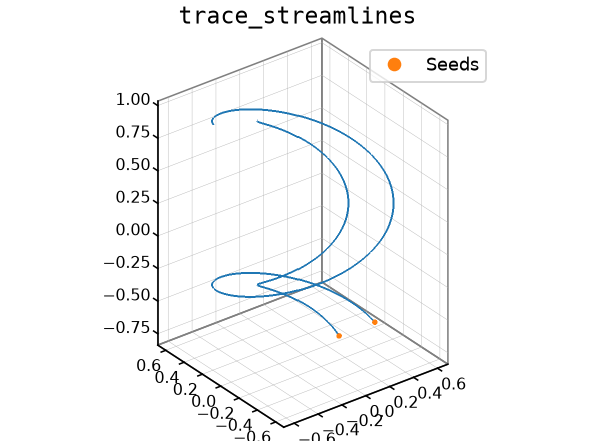
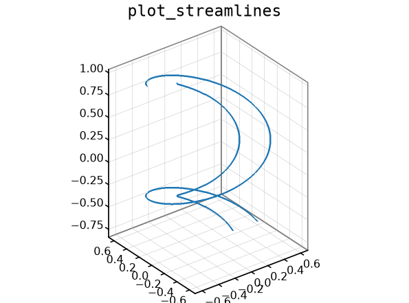

# VTK plotting and geometry

Choose a method by your input or by the geometry you need. The [plotting API](api.md) covers regular plots and style keywords. [Scene and handles](scene.md) covers lights and incrementally updated lines.

| Task | Methods |
| --- | --- |
| Meshes and scalar fields | [`plot_mesh`](#plot_mesh), [`extract_isosurface`](#extract_isosurface), [`plot_isosurface`](#plot_isosurface), [`plot_volume_slices`](#plot_volume_slices), [`plot_slice_contours`](#plot_slice_contours), [`plot_volume`](#plot_volume) |
| Vector fields and streamlines | [`trace_streamlines`](#trace_streamlines), [`plot_vector_samples`](#plot_vector_samples), [`plot_streamlines`](#plot_streamlines), [`plot_streamtubes`](#plot_streamtubes), [`plot_streamribbons`](#plot_streamribbons) |
| Point clouds and other geometry | [`plot_point_cloud`](#plot_point_cloud), [`plot_alpha_shape`](#plot_alpha_shape), [`plot_coordinate_frames`](#plot_coordinate_frames), [`plot_graph`](#plot_graph), [`plot_image_plane`](#plot_image_plane) |

## Coordinate conventions

A scalar volume has shape `(ny, nx, nz)`. A vector field has shape `(ny, nx, nz, 3)` with XYZ components in the last dimension. Supply `coordinates=(x, y, z)` as three coordinate vectors or as full arrays with the corresponding shape. Without explicit coordinates, each axis starts at zero and advances in unit steps. Uniform ascending axes can use VTK image data. Isosurface extraction and linear sampling also support nonuniform or curvilinear grids.

The examples share these imports, data, and axes. Call `ax.clear_scene()` when starting a new plot on the same axes.

```python
import matplotlib.pyplot as plt
import numpy as np
import mpl3d_vtk as vtkplot

fig, ax = plt.subplots(subplot_kw={"projection": "vtk3d"})
t = np.linspace(-1, 1, 31)
coordinates = (t, t, t)
x, y, z = np.meshgrid(*coordinates, indexing="xy")
volume = x*x + y*y + z*z
vectors = np.stack((-y, x, np.full_like(z, .2)), axis=-1)
seeds = [[.3, 0, -.8], [.6, 0, -.8]]
```

For `plot_mesh`, use `from pathlib import Path` and set `data_dir = Path("data")` from the repository root. See the [example datasets](../data/README.md) for the archive format.

## Mesh color interpolation

[`plot_mesh`](#plot_mesh) and [`plot_trisurf`](api.md#plot_trisurf) can use one value per vertex or one value per face. Choose the association that matches the location of the samples.

| Association | Array | Rendered color |
| --- | --- | --- |
| `"point"` (default) | One scalar or RGB(A) row per vertex, in vertex order. | The colormap maps each scalar to a vertex color. VTK interpolates the vertex colors across each face. Shared vertices give neighboring faces matching colors along their common edge. |
| `"cell"` | One scalar or RGB(A) row per rendered face, in face order. | Each face uses a single color. Averaging vertex values into face values produces visible steps where neighboring averages differ. |

Use `"point"` for fields sampled at vertices and `"cell"` for one value per face. The `shade` and `lighting` options control the lighting of the geometry. `edgecolor` controls visible mesh edges.

```python
with np.load(data_dir / "cheese.npz", allow_pickle=False) as mesh:
    vertices, faces = mesh["vertices"], mesh["elements"]
x, y, z = vertices.T
u = x * np.sin(z) + y * np.sin(x**2)

ax.plot_mesh(vertices, faces, values=u, association="point", cmap="viridis")
```

For constant colors within each triangle, pass `values=u[faces].mean(axis=1)` and `association="cell"`. The [`plot_trisurf` example](api.md#plot_trisurf) uses this approach with the same mesh and scalar field.

## Meshes and scalar fields

### `plot_mesh`

```text
ax.plot_mesh(vertices, faces, *, values=None, association="point", **style)
```

Draw indexed polygons using fully specified XYZ vertices. Use this entry point for closed surfaces and other meshes with known connectivity.

**Parameters**

- **`vertices`** (`array_like`)

  XYZ coordinates with shape `(n_vertices, 3)`.

- **`faces`** (integer array or sequence)

  Zero-based vertex indices. Supply a 2D array for same-size faces or a sequence of rows for mixed polygons. Each face contains at least three indices.

- **`values`** (`array_like` or `None`, default `None`)

  One scalar or RGB(A) row per vertex or face, depending on `association`. Use shape `(n,)`, `(n, 3)`, or `(n, 4)` for the corresponding count.

- **`association`** (str, default `"point"`)

  `"point"` interpolates vertex colors. `"cell"` assigns a single color to each face, in input order. See [mesh color interpolation](#mesh-color-interpolation).

- __`**style`__ (keyword arguments)

  See [common style options](api.md#common-style-options). Defaults to the axes color cycle when `values`, `cmap`, and fixed colors are omitted.

**Returns**

- **`mesh`** ([`Graphic`](scene.md#graphic))

  The polygon artist. Use `mesh.vertices` and `mesh.faces` to inspect the geometry. Scalar colors support a colorbar.

**Raises**

- **`ValueError`**

  If the mesh faces are invalid or the number of scalar or color rows does not match `association`.

**Examples**

```python
with np.load(data_dir / "peanut.npz", allow_pickle=False) as data:
    mesh = ax.plot_mesh(data["vertices"], data["elements"], color="#e8eef5",
                        edgecolor="#2b5f8a", linewidth=.75)
ax.set_title("peanut · indexed triangle mesh")
vtkplot.ax_setting(ax)
```


[Source code](../examples/reference/plot_mesh.py).

### `extract_isosurface`

```text
vtkplot.extract_isosurface(values, *, level=None, coordinates=None,
                           color_values=None, share_vertices=True)
```

Extract an indexed triangle mesh at a scalar level. Use [`plot_isosurface`](#plot_isosurface) to draw the same field.

**Parameters**

- **`values`** (3D array)

  Samples of the field with shape `(ny, nx, nz)` and at least two samples per axis.

- **`level`** (float or `None`, default `None`)

  Scalar level to extract. The default is halfway between the NaN-ignoring minimum and maximum.

- **`coordinates`** (three arrays or `None`, default `None`)

  XYZ coordinate vectors or full grids, as described in [coordinate conventions](#coordinate-conventions).

- **`color_values`** (3D array or `None`, default `None`)

  Optional second field with the same shape as `values`. Its interpolated samples are returned with the mesh.

- **`share_vertices`** (bool, default `True`)

  Use the extractor's shared vertices. Set to `False` to expand each triangle to three independent vertices.

**Returns**

- **`mesh`** (dict)

  Contains `vertices` of shape `(n_vertices, 3)` and integer `faces` of shape `(n_faces, 3)`. If `color_values` is supplied, `values` contains one interpolated scalar per output vertex. All arrays are copies.

**Raises**

- **`ValueError`**

  If grid dimensions or coordinates are incompatible or `color_values` has a different shape from `values`.

**Notes**

An out-of-range level returns empty geometry. Pass the result to `ax.plot_mesh(**mesh)` to draw it.

**Examples**

```python
coords = np.linspace(-1, 1, 20)
values = np.random.default_rng(42).uniform(-1, 1, size=(20,) * 3)
height = np.broadcast_to(coords, values.shape)
mesh = vtkplot.extract_isosurface(values, level=0, coordinates=(coords,) * 3,
                                 color_values=height)
print(f"{len(mesh['faces']):,} triangles")
```

See [`plot_isosurface`](#plot_isosurface) for a plot of the same field.

### `plot_isosurface`

```text
ax.plot_isosurface(values, *, level=None, coordinates=None,
                   color_values=None, share_vertices=True, **style)
```

Extract and draw an isosurface. The example draws the zero level of a seeded random field.

**Parameters**

- **`values`** (3D array)

  Sampled field with shape `(ny, nx, nz)` and at least two samples per axis.

- **`level`** (float or `None`, default `None`)

  Target scalar level. The default is the midpoint of the NaN-ignoring range in `values`.

- **`coordinates`** (three arrays or `None`, default `None`)

  XYZ coordinate vectors or full grids. See [coordinate conventions](#coordinate-conventions).

- **`color_values`** (3D array or `None`, default `None`)

  Second field with the same shape as `values`. Its samples are interpolated onto the isosurface vertices. With no color field, use `color` for a uniform fill.

- **`share_vertices`** (bool, default `True`)

  Keep shared vertices. `False` gives each triangle independent points.

- __`**style`__ (keyword arguments)

  See [common style options](api.md#common-style-options). Lighting defaults to `"gouraud"`. `alpha` controls surface opacity.

**Returns**

- **`surface`** ([`Graphic`](scene.md#graphic))

  The extracted triangle geometry and any interpolated color data.

**Raises**

- **`ValueError`**

  If grid dimensions or coordinates are incompatible or `color_values` has a different shape from `values`.

**Examples**

```python
coords = np.linspace(-1, 1, 20)
values = np.random.default_rng(42).uniform(-1, 1, size=(20,) * 3)
ax.plot_isosurface(values, coordinates=(coords,) * 3, level=0, facecolor="#18b83e")
limits = (-1, 1)
ticks = np.linspace(*limits, 5)
vtkplot.ax_setting(ax, limits, limits, limits, xticks=ticks, yticks=ticks, zticks=ticks)
```


[Source code](../examples/random_field_isosurface.py).

### `plot_volume_slices`

```text
ax.plot_volume_slices(values, *, coordinates=None, x=(), y=(), z=(),
                      sample_surface=None, interpolation="linear", **style)
```

Cut axis-aligned planes or sample a custom surface through a scalar volume.

**Parameters**

- **`values`** (3D array)

  Field with shape `(ny, nx, nz)` and at least two samples per axis.

- **`coordinates`** (three arrays or `None`, default `None`)

  XYZ coordinates. See [coordinate conventions](#coordinate-conventions).

- **`x`** (float or `array_like`, default `()`)

  Finite X cut locations for planes perpendicular to X. The empty sequence skips X cuts.

- **`y`** (float or `array_like`, default `()`)

  Finite Y cut locations for planes perpendicular to Y.

- **`z`** (float or `array_like`, default `()`)

  Finite Z cut locations for planes perpendicular to Z.

- **`sample_surface`** (three arrays or `None`, default `None`)

  XYZ coordinates broadcastable to one 2D surface grid. Keep `x`, `y`, and `z` empty when using this option. Samples outside the volume are NaN.

- **`interpolation`** (str, default `"linear"`)

  `"linear"`, `"nearest"`, or `"cubic"`. Nearest and cubic require strictly monotonic rectilinear axes.

- __`**style`__ (keyword arguments)

  See [common style options](api.md#common-style-options). The default color limits use the entire scalar volume and are shared by all slices.

**Returns**

- **`slices`** (list of [`Graphic`](scene.md#graphic))

  One handle per cut, in X, Y, Z order and input order within each axis. A custom sample surface gives a one-element list.

**Raises**

- **`ValueError`**

  If axis cut locations and `sample_surface` are supplied together, an interpolation mode is unsupported, or the grid is incompatible with the requested interpolation.

**Examples**

```python
slices = ax.plot_volume_slices(volume, coordinates=coordinates, x=0, y=0, z=0,
                               cmap="plasma")
fig.colorbar(slices[0], ax=ax)
```


[Source code](../examples/reference/plot_volume_slices.py).

### `plot_slice_contours`

```text
ax.plot_slice_contours(values, *, coordinates=None, x=(), y=(), z=(), levels=10, **style)
```

Draw contour lines on axis-aligned slices. The scalar field is linearly sampled on each cut plane.

**Parameters**

- **`values`** (3D array)

  Scalar field with shape `(ny, nx, nz)`.

- **`coordinates`** (three arrays or `None`, default `None`)

  XYZ coordinates. See [coordinate conventions](#coordinate-conventions).

- **`x`** (float or `array_like`, default `()`)

  Finite locations of planes perpendicular to X.

- **`y`** (float or `array_like`, default `()`)

  Finite locations of planes perpendicular to Y.

- **`z`** (float or `array_like`, default `()`)

  Finite locations of planes perpendicular to Z.

- **`levels`** (int or `array_like`, default `10`)

  Number of evenly spaced interior levels over the full volume range, or explicit level values.

- __`**style`__ (keyword arguments)

  See [common style options](api.md#common-style-options). Colors default to the full volume range.

**Returns**

- **`contours`** (list of [`Graphic`](scene.md#graphic))

  One handle per plane in X, Y, Z order.

**Examples**

```python
lines = ax.plot_slice_contours(volume, coordinates=coordinates, z=[-.3, .3],
                               levels=[.3, .6, .9], linewidth=2)
```


[Source code](../examples/reference/plot_slice_contours.py).

### `plot_volume`

```text
ax.plot_volume(values, *, coordinates=None, cmap="gray", norm=None,
               vmin=None, vmax=None, opacity=(0., 0., .45, .9),
               blend_mode="composite", label=None)
```

Ray-cast a uniformly spaced scalar volume on linear axes.

**Parameters**

- **`values`** (3D array)

  Finite samples with shape `(ny, nx, nz)` and at least two samples per axis.

- **`coordinates`** (three arrays or `None`, default `None`)

  XYZ coordinates. The grid must be rectilinear with uniformly spaced, increasing coordinates on every axis.

- **`cmap`** (colormap, default `"gray"`)

  Scalar-to-color map. Accepts a Matplotlib colormap name or object or a table of RGB(A) colors.

- **`norm`** (normalization or `None`, default `None`)

  Matplotlib scalar normalization. The default is linear.

- **`vmin`** (float or `None`, default `None`)

  Lower color limit. An unspecified limit uses the normalization's lower limit or is inferred from the samples.

- **`vmax`** (float or `None`, default `None`)

  Upper color limit. An unspecified limit uses the normalization's upper limit or is inferred from the samples.

- **`opacity`** (`array_like`, default `(0., 0., .45, .9)`)

  At least two opacity values in `[0, 1]`, placed at evenly spaced scalar levels between the color limits.

- **`blend_mode`** (str, default `"composite"`)

  `"composite"` combines opacity and color along each ray. `"maximum"`, `"minimum"`, and `"average"` select the corresponding intensity projection.

- **`label`** (str or `None`, default `None`)

  Matplotlib label stored on the artist.

**Returns**

- **`cloud`** ([`VolumeGraphic`](scene.md#specialized-handles))

  Volume artist exposing `actor`, `mapper`, and `data`. It supports colorbars, `set_cmap()`, `set_clim()`, and `set_visible()`.

**Raises**

- **`ValueError`**

  If scalar samples are nonfinite, the grid is not uniform and ascending, the axes are nonlinear, or the opacity or blend-mode setting is invalid.

**Notes**

The viewing axes must use linear scales. Use [`plot_volume_slices`](#plot_volume_slices) to draw selected planes from a volume.

**Examples**

```python
cloud = ax.plot_volume(np.exp(-4*volume), coordinates=coordinates, cmap="magma",
                       opacity=[0, .05, .45, .9], blend_mode="maximum")
fig.colorbar(cloud, ax=ax)
```


[Source code](../examples/reference/plot_volume.py).

## Vector fields and streamlines

### `trace_streamlines`

```text
vtkplot.trace_streamlines(vectors, seeds, *, coordinates=None, step=.1,
                          max_steps=10000, direction="forward")
```

Integrate streamlines through a sampled 3D vector field using fourth-order Runge–Kutta.

**Parameters**

- **`vectors`** (4D array)

  Shape `(ny, nx, nz, 3)`, with the X, Y, and Z vector components along the last axis.

- **`seeds`** (`array_like`)

  Finite start points of shape `(n_seeds, 3)` or a single XYZ point.

- **`coordinates`** (three arrays or `None`, default `None`)

  XYZ coordinates of the vector grid. Omitted coordinates use unit spacing.

- **`step`** (float, default `0.1`)

  Positive, finite initial integration step passed to VTK in cell-length units.

- **`max_steps`** (int, default `10000`)

  Positive upper bound on the number of integration steps.

- **`direction`** (str, default `"forward"`)

  `"forward"` follows the field, `"backward"` traces in reverse, and `"both"` traces in both directions.

**Returns**

- **`paths`** (list of ndarray)

  One copied `(n_points, 3)` array per traced path. Seeds that produce no line are absent.

**Raises**

- **`ValueError`**

  If vector or seed shapes are incompatible, the step size or step count is nonpositive, or the integration direction is unsupported.

**Examples**

```python
paths = vtkplot.trace_streamlines(vectors, seeds, coordinates=coordinates, step=.15)
ax.plot_streamlines(paths, color="tab:blue", linewidth=2)
ax.scatter(*np.asarray(seeds).T, c="tab:orange", s=28, label="Seeds")
ax.legend()
```



[Source code](../examples/reference/trace_streamlines.py).

### `plot_vector_samples`

```text
ax.plot_vector_samples(vectors, points, *, coordinates=None, color_values=None,
                       interpolation="linear", glyph="cone", length=1., **style)
```

Sample a vector grid at specified points and draw the sampled vectors as glyphs.

**Parameters**

- **`vectors`** (4D array)

  Shape `(ny, nx, nz, 3)`, with XYZ vector components in the last dimension.

- **`points`** (`array_like`)

  Finite XYZ sample points of shape `(n_points, 3)` or a single XYZ point. Invalid probe locations are skipped.

- **`coordinates`** (three arrays or `None`, default `None`)

  XYZ coordinates of the vector grid, using [coordinate conventions](#coordinate-conventions).

- **`color_values`** (3D array or `None`, default `None`)

  A scalar field of shape `(ny, nx, nz)` sampled with the vectors. If omitted, `cmap` can map the scaled magnitudes.

- **`interpolation`** (str, default `"linear"`)

  Use `"linear"`, `"nearest"`, or `"cubic"`. The last two require strictly monotonic rectilinear axes.

- **`glyph`** (str, default `"cone"`)

  Glyph shape, either `"cone"` or `"arrow"`.

- **`length`** (float, default `1.0`)

  Finite, nonnegative scale factor for glyph lengths.

- __`**style`__ (keyword arguments)

  See [common style options](api.md#common-style-options). `color` supplies a uniform glyph color.

**Returns**

- **`glyphs`** ([`Graphic`](scene.md#graphic))

  One glyph artist for the valid samples. Points outside the grid or with nonfinite sampled vectors are skipped.

**Raises**

- **`ValueError`**

  If the vector grid, point coordinates, color grid, glyph, interpolation, or length is invalid.

**Examples**

```python
a, b = np.meshgrid(np.linspace(-.8, .8, 6), np.linspace(-.8, .8, 6))
sample_points = np.column_stack((a.ravel(), b.ravel(), np.zeros(a.size)))
glyphs = ax.plot_vector_samples(vectors, sample_points, coordinates=coordinates,
                                color_values=volume, glyph="arrow", length=.4)
```


[Source code](../examples/reference/plot_vector_samples.py).

### `plot_streamlines`

```text
ax.plot_streamlines(paths, **style)
```

Draw paths as lines.

**Parameters**

- **`paths`** (array, sequence, or `Graphic`)

  One `(n, 3)` NumPy path, a sequence of such paths such as the output of `trace_streamlines`, or a line `Graphic` whose VTK geometry can be reused.

- __`**style`__ (keyword arguments)

  See [common style options](api.md#common-style-options). `linewidth` and `color` control the lines. The default color comes from the axes cycle.

**Returns**

- **`lines`** ([`Graphic`](scene.md#graphic))

  The polyline artist.

**Examples**

```python
paths = vtkplot.trace_streamlines(vectors, seeds, coordinates=coordinates)
lines = ax.plot_streamlines(paths, color="tab:blue", linewidth=2.5)
```



[Source code](../examples/reference/plot_streamlines.py).

### `plot_streamtubes`

```text
ax.plot_streamtubes(paths, *, radius=None, radii=None, sides=20, **style)
```

Draw circular tubes along paths.

**Parameters**

- **`paths`** (array, sequence, or `Graphic`)

  Paths as accepted by [`plot_streamlines`](#plot_streamlines).

- **`radius`** (float or `None`, default `None`)

  Positive base radius in data units. The default uses 1.2% of the path bounds' diagonal, with a minimum diagonal of `1e-12`.

- **`radii`** (`array_like` or `None`, default `None`)

  One finite, positive absolute radius per path vertex in geometry order. Use `None` for a uniform tube radius.

- **`sides`** (int, default `20`)

  Number of sides per circular cross-section, at least 3.

- __`**style`__ (keyword arguments)

  See [common style options](api.md#common-style-options). Lighting is enabled by default.

**Returns**

- **`tubes`** ([`Graphic`](scene.md#graphic))

  One artist containing all capped tubes.

**Raises**

- **`ValueError`**

  If a radius is nonpositive or nonfinite, `radii` has the wrong length, or the number of sides is below three.

**Examples**

```python
paths = vtkplot.trace_streamlines(vectors, seeds, coordinates=coordinates)
tube = ax.plot_streamtubes(paths, radius=.035, sides=14, color="tab:orange")
```


[Source code](../examples/reference/plot_streamtubes.py).

### `plot_streamribbons`

```text
ax.plot_streamribbons(paths, *, width=None, twists=None, **style)
```

Draw a strip centered on each path.

**Parameters**

- **`paths`** (array, sequence, or `Graphic`)

  Paths as accepted by [`plot_streamlines`](#plot_streamlines).

- **`width`** (float or `None`, default `None`)

  Positive total strip width in data units. The default uses 3% of the bounds' diagonal, with a minimum diagonal of `1e-12`.

- **`twists`** (sequence or `None`, default `None`)

  One scalar angle or one sequence of angles per path. Per-vertex angles use radians and rotate the strip about its tangent. Defaults to zero on every path.

- __`**style`__ (keyword arguments)

  See [common style options](api.md#common-style-options). Lighting is enabled by default.

**Returns**

- **`ribbons`** ([`Graphic`](scene.md#graphic))

  One artist containing all strips.

**Raises**

- **`ValueError`**

  If the width is nonpositive or nonfinite or twists do not match the paths.

**Examples**

```python
paths = vtkplot.trace_streamlines(vectors, seeds, coordinates=coordinates)
twists = [np.linspace(0, np.pi, len(path)) for path in paths]
ribbons = ax.plot_streamribbons(paths, width=.11, twists=twists, color="tab:purple")
```


[Source code](../examples/reference/plot_streamribbons.py).

## Point clouds and other geometry

### `plot_point_cloud`

```text
ax.plot_point_cloud(points, *, c=None, s=25, **style)
```

Render sample positions as a 3D point cloud.

**Parameters**

- **`points`** (`array_like` or path)

  Array of shape `(..., 3)` in XYZ order, or a path to an existing `.ply` or `.vtp` file. Array positions are flattened to one point list.

- **`c`** (color, `array_like`, or `None`, default `None`)

  One fixed color, one scalar per point, or RGB(A). Uses file point scalars when available, then Z coordinates, unless a fixed `color` is supplied.

- **`s`** (scalar or `array_like`, default `25`)

  Nonnegative nominal marker area, either uniform or one value per point. See [`scatter`](api.md#scatter).

- __`**style`__ (keyword arguments)

  Forwarded to [`scatter`](api.md#scatter), including `marker` and [common style options](api.md#common-style-options).

**Returns**

- **`cloud`** ([`Graphic`](scene.md#graphic))

  The point artist returned by [`scatter`](api.md#scatter).

**Examples**

```python
points = np.random.default_rng(12).normal(size=(140, 3))
cloud = ax.plot_point_cloud(points, c=points[:, 2], s=28, cmap="viridis")
```


[Source code](../examples/reference/plot_point_cloud.py).

### `plot_alpha_shape`

```text
ax.plot_alpha_shape(points, *, radius, **style)
```

Construct a tetrahedral alpha complex and draw its boundary surface.

**Parameters**

- **`points`** (`array_like` or path)

  XYZ point array or `.ply` / `.vtp` path as in [`plot_point_cloud`](#plot_point_cloud). Nonfinite points are discarded.

- **`radius`** (float)

  Positive alpha radius in data units. Smaller radii retain tighter features. `np.inf` uses the unconstrained Delaunay boundary.

- __`**style`__ (keyword arguments)

  See [common style options](api.md#common-style-options). Color defaults to `"#5590b1"` and lighting to `"gouraud"`.

**Returns**

- **`boundary`** ([`Graphic`](scene.md#graphic))

  The extracted boundary surface.

**Raises**

- **`ValueError`**

  If the radius is zero, negative, or NaN.

**Examples**

```python
points = np.random.default_rng(12).normal(size=(300, 3))
boundary = ax.plot_alpha_shape(points, radius=1.1, color="tab:blue", alpha=.6)
```


[Source code](../examples/reference/plot_alpha_shape.py).

### `plot_coordinate_frames`

```text
ax.plot_coordinate_frames(translations, *, rotations=None,
                          frame_size=1., show_labels=False, **style)
```

Draw the local X, Y, and Z axes of one or more poses.

**Parameters**

- **`translations`** (`array_like`)

  XYZ origins of shape `(n, 3)`, or homogeneous transforms of shape `(n, 4, 4)` when `rotations` is omitted. The top-left block gives rotation and the right column gives position.

- **`rotations`** (`array_like` or `None`, default `None`)

  Rotation matrices with shape `(n, 3, 3)` or quaternions with shape `(n, 4)` in `w, x, y, z` order. One rotation can broadcast to all origins. Quaternions must be finite and nonzero.

- **`frame_size`** (float, default `1.0`)

  Nonnegative scale factor for the three axis arrows, in data units.

- **`show_labels`** (bool, default `False`)

  Draw each zero-based pose index at its origin.

- __`**style`__ (keyword arguments)

  Forwarded to [`quiver`](api.md#quiver) for each local axis. The default axis colors are red, green, and blue.

**Returns**

- **`axes`** (list of [`Graphic`](scene.md#graphic))

  Three handles in X, Y, Z order. Each handle contains the corresponding local axis of every pose.

**Examples**

```python
frames = ax.plot_coordinate_frames([[0, 0, 0], [.5, .5, .5]],
                                  rotations=np.eye(3), frame_size=.25, show_labels=True)
```


[Source code](../examples/reference/plot_coordinate_frames.py).

### `plot_graph`

```text
ax.plot_graph(edges, *, positions=None, node_count=None, directed=False,
              show_arrows=None, seed=0, node_labels=None, node_color="#296c9c",
              edge_color="#617a8d", node_size=49, **style)
```

Draw a graph in 3D from indexed edges. Supply node positions or use the built-in layout.

**Parameters**

- **`edges`** (integer array)

  Shape `(n_edges, 2)` with nonnegative, zero-based endpoint indices. Pass an empty sequence for a graph with isolated nodes.

- **`positions`** (`array_like` or `None`, default `None`)

  Finite XYZ array with one row per node, covering all endpoints. The default uses a seeded layout from the edges.

- **`node_count`** (int or `None`, default `None`)

  Total node count, including isolated nodes. Defaults to the largest edge index plus one for automatic layout. Must agree with explicit `positions`, if supplied.

- **`directed`** (bool, default `False`)

  Use a directed graph for layout and enable arrows by default.

- **`show_arrows`** (bool or `None`, default `None`)

  Draw or hide edge arrows. Omitted value follows `directed`.

- **`seed`** (int, default `0`)

  Random seed for the automatic force-directed layout.

- **`node_labels`** (sequence or `None`, default `None`)

  One annotation per node. Values are converted to strings.

- **`node_color`** (Matplotlib color, default `"#296c9c"`)

  Color of the node scatter markers.

- **`edge_color`** (Matplotlib color, default `"#617a8d"`)

  Default color of edge lines and arrow glyphs.

- **`node_size`** (float, default `49`)

  Nonnegative nominal area of each node marker.

- __`**style`__ (keyword arguments)

  See [common style options](api.md#common-style-options) for the edge artist. Visibility on that artist also controls its companion nodes, arrows, and labels.

**Returns**

- **`graph`** ([`Graphic`](scene.md#graphic))

  The edge artist. `graph.nodes` contains the node artist. `graph.arrows` is present when edge arrows are drawn.

**Raises**

- **`ValueError`**

  If edges are not a nonnegative integer array of node pairs or if positions, labels, or node count do not cover the nodes.

**Examples**

```python
graph = ax.plot_graph([[0, 1], [1, 2], [2, 0]],
                      positions=[[0, 0, 0], [1, 0, 1], [0, 1, 0]],
                      directed=True, node_labels=["A", "B", "C"])
```


[Source code](../examples/reference/plot_graph.py).

### `plot_image_plane`

```text
ax.plot_image_plane(image, *, extent=None, z=0., origin="lower",
                    interpolation="nearest", pixel_alpha=None, **style)
```

Place a depth-tested image in the XY plane at a fixed Z.

**Parameters**

- **`image`** (`array_like`)

  Nonempty scalar image of shape `(ny, nx)` or RGB(A) of shape `(ny, nx, 3)` or `(ny, nx, 4)`. Scalars use the colormap. Floats in color images use `[0, 1]`, unsigned integers use their dtype range.

- **`extent`** (four floats or `None`, default `None`)

  Outer pixel edges `(left, right, bottom, top)` in data units. Default is `(-.5, nx-.5, -.5, ny-.5)`. Edges must be finite and span nonzero width and height.

- **`z`** (float, default `0.0`)

  Finite data Z coordinate of the image plane.

- **`origin`** (str, default `"lower"`)

  Place the first image row at the lower edge. `"upper"` places it at the upper edge.

- **`interpolation`** (str, default `"nearest"`)

  `"nearest"` samples discrete pixels. `"linear"` interpolates neighboring pixels in the texture.

- **`pixel_alpha`** (scalar, `array_like`, or `None`, default `None`)

  Opacity multiplier broadcastable to `(ny, nx)` with entries in `[0, 1]`. Multiplies the image's existing alpha.

- __`**style`__ (keyword arguments)

  See [common style options](api.md#common-style-options). `cmap`, `norm`, `vmin`, and `vmax` apply to scalar pixels.

**Returns**

- **`plane`** ([`ImageGraphic`](scene.md#specialized-handles))

  A textured plane with `set_values()` and colorbar support for scalar pixels.

**Raises**

- **`ValueError`**

  If the image shape, extent, origin, interpolation, or pixel alpha is invalid.

**Examples**

```python
pixels = np.sin(5*x[:, :, 0]) * np.cos(5*y[:, :, 0])
image = ax.plot_image_plane(pixels, extent=(-1, 1, -1, 1), z=-.6,
                            cmap="coolwarm", vmin=-1, vmax=1)
vtkplot.ax_setting(ax, (-1, 1), (-1, 1), (-.7, .5), box_aspect=(1, 1, .6))
fig.colorbar(image, ax=ax)
```


[Source code](../examples/reference/plot_image_plane.py).

## add_streaming_line

See [`add_streaming_line`](scene.md#add_streaming_line) for updating line points between draws.

## add_light

See [`add_light`](scene.md#add_light) for adding a world-space light.
