# 带图函数参考

每一图均由下方代码和库中的 VTK 渲染路径生成。参数总表和兼容性范围见 [API 参考](api.md)。

先运行下面的初始化。每个例子都可以使用空的三维坐标轴独立运行。

```python
import numpy as np
import matplotlib.pyplot as plt
import mpl3d_vtk as m
from examples.function_reference import samples
d = samples()
fig, ax = plt.subplots(subplot_kw={"projection": "vtk3d"})
```

每段代码执行后可调用 `fig.savefig("example.png", dpi=160)` 查看图形。

- [规则曲面和等高线](#规则曲面和等高线)
- [三角网格、多边形和几何](#三角网格多边形和几何)
- [三维曲线、散点、统计与动画](#三维曲线散点统计与动画)
- [标量体与向量场](#标量体与向量场)
- [三维网络图和图像平面](#三维网络图和图像平面)
- [场景、样式和导出](#场景样式和导出)
- [图窗、动画更新和导出](#图窗动画更新和导出)
- [附加的点云、位姿与体绘制接口](#附加的点云位姿与体绘制接口)

## 规则曲面和等高线

### `surf`

`surf(Z[, C]) / surf(X, Y, Z[, C])`

Z 为高度矩阵，C 可为独立标量场或逐点 RGB(A)。X、Y 可传坐标向量。返回曲面句柄。

```python
m.surf(ax, d.X, d.Y, d.Z, FaceColor="interp", EdgeColor="none", cmap="viridis")
```

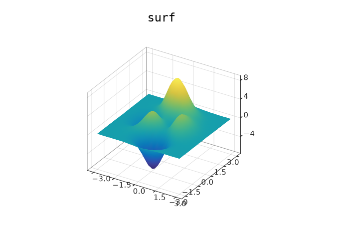

### `surface`

`surface(Z[, C]) / surface(X, Y, Z[, C])`

原始曲面图元，支持 XData、YData、ZData、CData 属性。连续调用可直接叠加。返回曲面句柄。

```python
m.surface(ax, XData=d.X, YData=d.Y, ZData=d.Z, FaceColor="interp", EdgeColor="none")
m.surface(ax, d.X, d.Y, np.full_like(d.Z, 1.2), FaceColor="#739abd", FaceAlpha=.27, EdgeColor="none")
```


### `surfl`

`surfl(Z) / surfl(X, Y, Z[, light[, coefficients]])`

light 可为方位角和仰角，或三维方向。四个反射系数依次为环境光、漫反射、镜面反射和高光指数。附加字符串 light 可使用场景光源。

```python
m.surfl(ax, d.X, d.Y, d.Z, [-45, 35], cmap="bone")
```

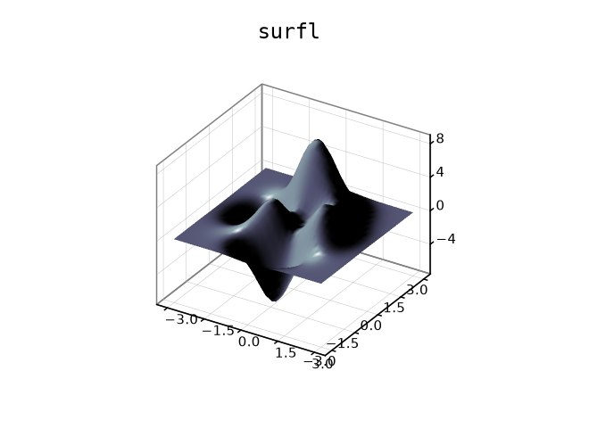

### `surfnorm`

`surfnorm(Z) / surfnorm(X, Y, Z, scale=1)`

用箭头标出规则网格上的曲面法向。返回曲面和箭头两个句柄。稀疏网格更易观察方向。

```python
m.surfnorm(ax, d.X[::6,::6], d.Y[::6,::6], d.Z[::6,::6], scale=.8, FaceAlpha=.65, EdgeColor="none")
```


### `mesh`

`mesh(Z[, C]) / mesh(X, Y, Z[, C])`

绘制随标量变化的网格线。EdgeColor 可指定固定颜色。返回网格句柄。

```python
m.mesh(ax, d.X[::3,::3], d.Y[::3,::3], d.Z[::3,::3], cmap="plasma", LineWidth=1.5)
```

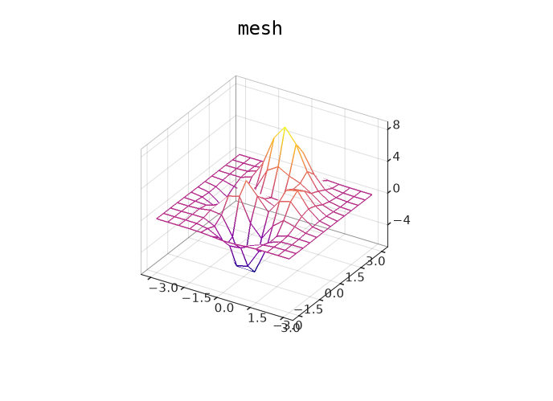

### `surfc`

`surfc(X, Y, Z[, C], levels=10)`

在曲面下方画出高度等值线。levels 可为数量或具体高度数组。返回曲面和等高线。

```python
m.surfc(ax, d.X, d.Y, d.Z, levels=[-5,-3,-1,1,3,5], FaceColor="interp", EdgeColor="none")
```


### `meshc`

`meshc(X, Y, Z[, C], levels=10)`

在网格下方画出等高线。返回网格和等高线。

```python
m.meshc(ax, d.X[::2,::2], d.Y[::2,::2], d.Z[::2,::2], levels=9, cmap="turbo")
```


### `meshz`

`meshz(X, Y, Z[, C], base=None)`

把边界垂直延伸到 base。默认底部略低于数据最小值。返回网格和边界帘幕。

```python
m.meshz(ax, d.X[::3,::3], d.Y[::3,::3], d.Z[::3,::3], base=-7, cmap="viridis")
```

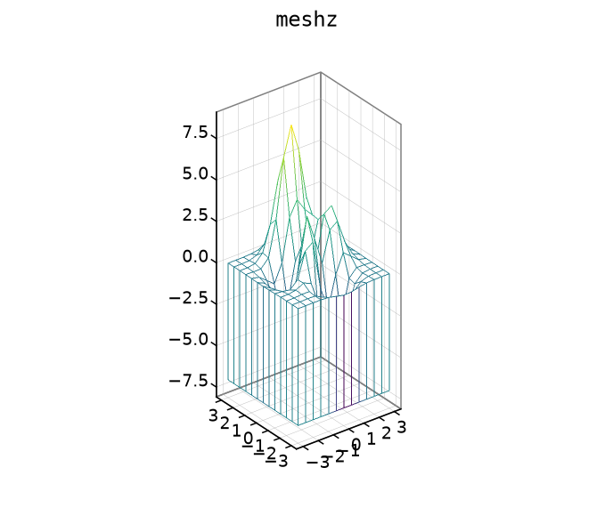

### `waterfall`

`waterfall(Z[, C]) / waterfall(X, Y, Z[, C], base=None)`

逐行绘制曲线和向下延伸的帘幕。返回帘幕和曲线。

```python
m.waterfall(ax, d.X[::4], d.Y[::4], d.Z[::4], cmap="plasma", LineWidth=2)
```

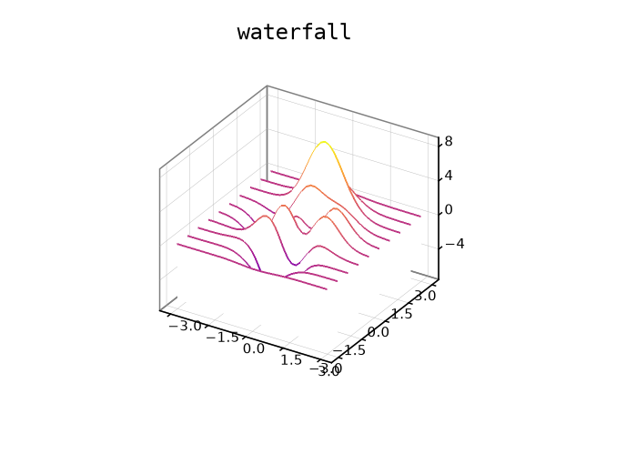

### `ribbon`

`ribbon(Z) / ribbon(Y, Z[, width])`

Z 的每列是一条带，Y 给出纵向参数。width 默认 0.75。返回带状曲面列表。

```python
R = np.sin(d.t[:,None]*[.9, 1.3, 1.7, 2.1]) + [0,.4,.8,1.2]
m.ribbon(ax, d.t, R, .65, FaceColor="interp", EdgeColor="none", cmap="cividis")
```


### `contour3`

`contour3(Z[, levels][, LineSpec]) / contour3(X, Y, Z, ...)`

每条等高线位于对应的高度。标量 levels 指级别数量，数组给出具体高度。用 return_matrix=True 同时取矩阵。

```python
m.contour3(ax, d.X, d.Y, d.Z, np.linspace(-5,7,12), cmap="turbo", LineWidth=2)
```


### `clabel`

`clabel(handle, levels=None) / clabel(matrix, handle, ...)`

在等高线连通段上添加值标签。levels 可只标特定高度。返回 Matplotlib 3D 文字列表。

```python
h = m.contour3(ax, d.X, d.Y, d.Z, [-4, -2, 2, 4, 6], LineWidth=2)
m.clabel(h, levels=[-4, 4, 6], fontsize=9, color="#263749")
```


### `fsurf`

`fsurf(f[, bounds]) / fsurf(fx, fy, fz[, bounds])`

函数接收 NumPy 数组。bounds 可设一组共用区间或分别设两个区间。MeshDensity 控制规则采样。

```python
m.fsurf(ax, lambda x,y: np.cos(x*y)*np.exp(-.2*(x*x+y*y)), [-3,3], MeshDensity=61, FaceColor="interp", EdgeColor="none")
```


### `fmesh`

`fmesh(f[, bounds]) / fmesh(fx, fy, fz[, bounds])`

对显式或参数曲面做规则采样，然后绘制网格。ShowContour 可附加等高线。

```python
m.fmesh(ax, lambda u,v: np.cos(u), lambda u,v: np.sin(u), lambda u,v: v, [0,2*np.pi,-1,1], MeshDensity=22)
```


### `fimplicit3`

`fimplicit3(f[, bounds], samples=51)`

f 接收 X、Y、Z 数组，绘制 f=0。bounds 可为两端值或三个轴各自的一对端值。

```python
m.fimplicit3(ax, lambda x,y,z: (x*x+y*y+z*z+.55**2-.18**2)**2 - 4*.55**2*(x*x+y*y), [-1,1])
```


### `pcolor`

`pcolor(C) / pcolor(X, Y, C)`

把矩阵映射到 XY 平面上的有色网格。颜色与网格顶点对应，默认展示顶视图。

```python
m.pcolor(ax, d.X, d.Y, d.Z, FaceColor="interp", EdgeColor="none", cmap="turbo")
```


## 三角网格、多边形和几何

### `trisurf`

`trisurf(TRI, X, Y, Z[, C], index_base=0)`

TRI 有三列，每行是一个三角形的顶点索引。也可传带 ConnectivityList、Points 或 simplices、points 的三维剖分对象。C 可为逐顶点或逐三角形颜色。

```python
m.trisurf(ax, d.tri, d.px, d.py, d.pz, EdgeColor="#355068", cmap="viridis")
```

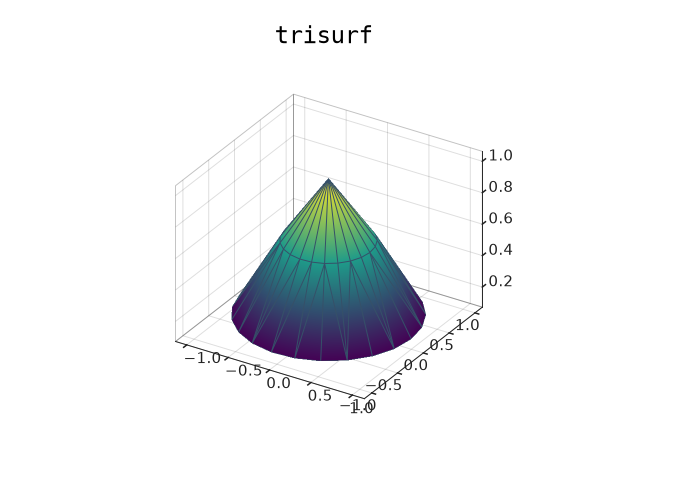

### `trimesh`

`trimesh(TRI, X, Y, Z[, C], index_base=0)`

接收相同的三角网格或剖分对象并绘制网格边。省略 Z 时，网格位于 XY 平面。

```python
m.trimesh(ax, d.tri, d.px, d.py, d.pz, LineWidth=1.5, cmap="plasma")
```


### `tetramesh`

`tetramesh(T, XYZ[, C], index_base=0)`

T 的每行包含四个顶点索引。XYZ 每行是三维位置。也可传入带四面体连接关系的剖分对象。C 为逐四面体标量，透明面可查看内部结构。

```python
xyz = np.array([[0,0,0],[1,0,0],[.4,1,0],[.4,.3,1],[.45,.3,-1]])
m.tetramesh(ax, [[0,1,2,3],[0,1,2,4]], xyz, [0.,1.], FaceAlpha=.55)
```


### `patch`

`patch(Faces=faces, Vertices=xyz, FaceVertexCData=C)`

面可以不等长，允许用 NaN 填充。颜色可按面、按顶点或使用固定 FaceColor。

```python
xyz = np.array([[0,0,0],[1,0,0],[1,1,0],[0,1,0],[.5,.5,1]])
m.patch(ax, Faces=[[0,1,2,3],[0,1,4],[1,2,4],[2,3,4],[3,0,4]], Vertices=xyz, FaceVertexCData=xyz[:,2], EdgeColor="#32516a", FaceAlpha=.82)
```


### `fill3`

`fill3(X, Y, Z[, C])`

每列给出一个封闭多边形。C 可为颜色名或映射到颜色的数据。返回面句柄。

```python
m.fill3(ax, [0,1,1,0], [0,0,1,1], [0,.2,.8,.3], "#1993a3", EdgeColor="#174859")
```

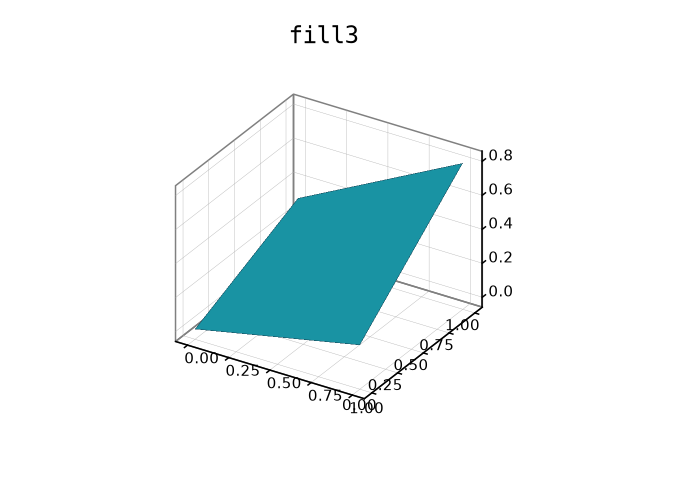

### `surf2patch`

`surf2patch(Z[, C]) / surf2patch(X, Y, Z, ..., triangles=False)`

把曲面转换成 faces、vertices、facevertexcdata 字典，用 triangles=True 得到三角面。

```python
g = m.surf2patch(d.X[::3,::3], d.Y[::3,::3], d.Z[::3,::3], triangles=True)
m.patch(ax, g, EdgeColor="#334653", FaceAlpha=.9)
```


### `reducepatch`

`reducepatch(handle_or_geometry[, reduction])`

reduction 在 0 到 1 之间时是保留比例，也可给保留面数。返回简化几何字典。

```python
g = m.surf2patch(d.X, d.Y, d.Z, triangles=True)
m.patch(ax, m.reducepatch(g, .06), FaceColor="#74a1bf", EdgeColor="#29485f")
```

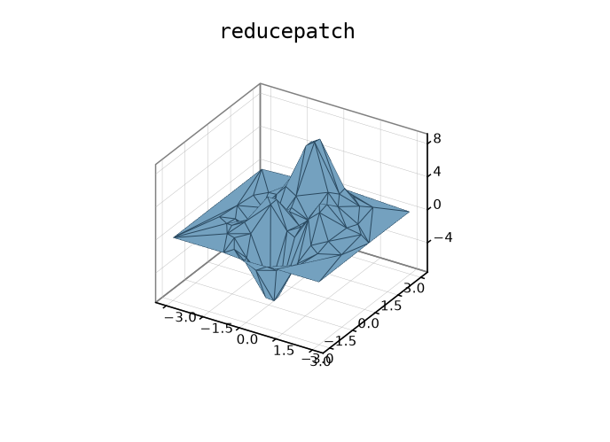

### `shrinkfaces`

`shrinkfaces(handle_or_geometry[, factor])`

向各自中心收缩图元并返回拆开的面。factor 默认 0.3。

```python
g = m.surf2patch(d.X[::4,::4], d.Y[::4,::4], d.Z[::4,::4], triangles=True)
m.patch(ax, m.shrinkfaces(g, .6), FaceColor="#457da3", EdgeColor="none")
```

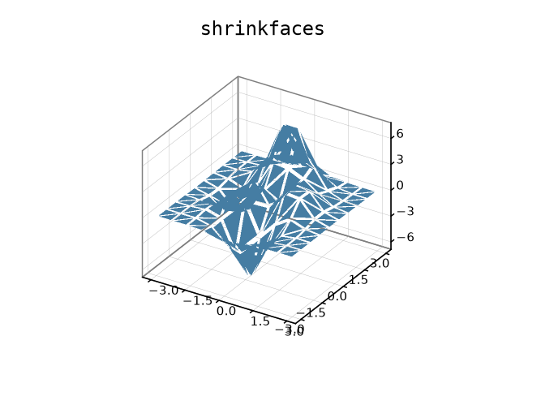

### `alphashape`

`alphashape(points, alpha)`

points 为 N×3 数组，alpha 控制三维 Alpha 复形的外形。此 Python 入口直接绘制边界。返回面句柄。

```python
p = d.cloud / 2
m.alphashape(ax, p, .42, FaceColor="#4b99a8", EdgeColor="#437081")
```


### `peaks`

`peaks(n=49, grid=False) / peaks(X, Y)`

评估二维峰谷测试函数。grid=True 返回 X、Y 和 Z，便于直接传给 surf。

```python
X, Y, Z = m.peaks(49, grid=True)
m.surf(ax, X, Y, Z, FaceColor="interp", EdgeColor="none")
```


### `sphere`

`sphere(n=20)`

返回三个 (n+1)×(n+1) 的单位球面坐标数组。使用 surf 或 mesh 显示。

```python
m.surf(ax, *m.sphere(36), FaceColor="#59a3ad", EdgeColor="none", FaceLighting="gouraud")
```

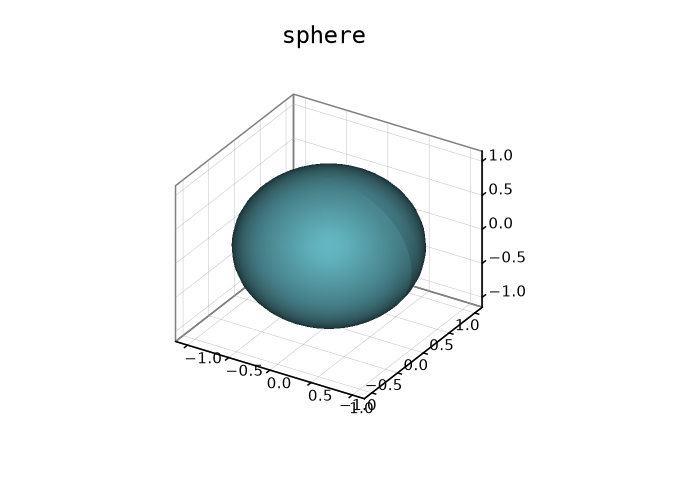

### `cylinder`

`cylinder(r=1, n=20)`

返回沿 z 轴的旋转曲面坐标。r 可为单个半径或沿高度排列的半径数组。

```python
m.surf(ax, *m.cylinder([.45,.9,.55,.8,.32], 50), FaceColor="interp", EdgeColor="none")
```


### `ellipsoid`

`ellipsoid(xc, yc, zc, xr, yr, zr, n=20)`

前三项为球心，接下来三项为半轴。返回网格坐标。

```python
m.surf(ax, *m.ellipsoid(0,0,0,1.2,.7,.45,40), FaceColor="#6ea4b1", EdgeColor="none", FaceLighting="gouraud")
```


## 三维曲线、散点、统计与动画

### `plot3`

`plot3(X, Y, Z[, LineSpec], ...)`

绘制三维坐标序列。可追加多组 XYZ，或传矩阵系列、带列名的表。NaN 断开线段。

```python
m.plot3(ax, np.cos(d.a), np.sin(d.a), d.a/np.pi, Color="#167c9c", LineWidth=2.5)
```

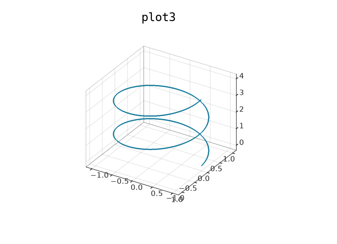

### `line`

`line(X, Y[, Z]) / line(XData=..., YData=..., ZData=...)`

低级线图元，保留当前场景。线宽、颜色、标记属性与 plot3 共用。

```python
m.line(ax, [0,1,1,0,0], [0,0,1,1,0], [0,0,0,0,0], Color="#2a789c", LineWidth=3)
m.line(ax, XData=[0,.5,1], YData=[0,.5,1], ZData=[0,1,0], Color="#be5253", LineWidth=3)
```


### `fplot3`

`fplot3(fx, fy, fz[, interval], samples=201)`

对三个参数函数共用一个参数区间。返回按采样点组成的曲线。

```python
m.fplot3(ax, np.cos, lambda t: np.sin(2*t), lambda t: t/np.pi, [0,4*np.pi], LineWidth=2.4)
```


### `scatter3`

`scatter3(X, Y, Z[, S[, C]][, marker][, filled])`

S 为标记面积或逐点面积，C 可为颜色名、标量或 RGB(A) 数组。返回散点句柄。

```python
p = d.cloud[:150]
m.scatter3(ax, *p.T, 45, p[:,2], "filled", cmap="plasma")
```

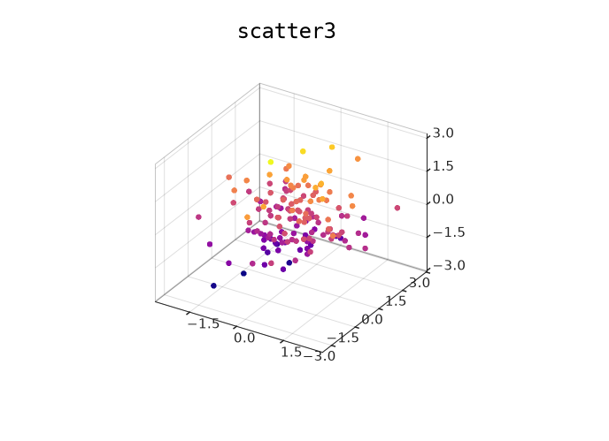

### `bubblechart3`

`bubblechart3(X, Y, Z, sizes[, C])`

sizes 映射到气泡大小，C 映射到颜色。示例取独立数值和垂直坐标分别控制大小和颜色。

```python
p = d.cloud[:55]
m.bubblechart3(ax, *p.T, 1+np.abs(p[:,0]), p[:,2], cmap="viridis")
```


### `swarmchart3`

`swarmchart3(X, Y, Z[, S[, C]], width=.45)`

同一 X 分组内，在 YZ 平面邻近的点沿 X 偏移。width 控制偏移宽度。

```python
p = d.cloud[:150]
m.swarmchart3(ax, np.repeat([1,2,3],50), p[:,1], p[:,2], 30, p[:,2])
```

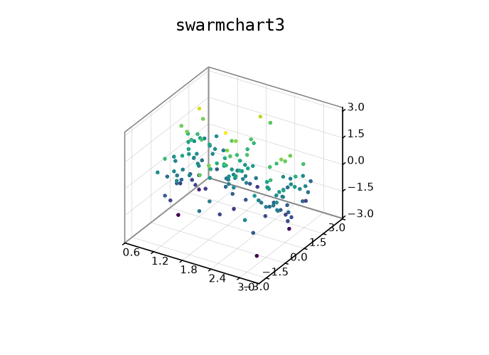

### `stem3`

`stem3(Z[, LineSpec]) / stem3(X, Y, Z[, LineSpec])`

用竖直线段连接 BaseValue 与每个采样点。默认基线为零。带标记时返回茎和标记句柄。

```python
x,y = np.meshgrid(np.linspace(-2,2,6), np.linspace(-2,2,6))
m.stem3(ax,x,y,np.exp(-.4*(x*x+y*y)),"b-o",LineWidth=1.8)
```


### `bar3`

`bar3(Z) / bar3(Y, Z[, width][, style])`

按矩阵行列放置竖柱。style 可选 detached、grouped、stacked。正负值分别向两个方向堆叠。

```python
m.bar3(ax, d.b, .68, "detached", cmap="Blues", EdgeColor="#526d8e")
```


### `bar3h`

`bar3h(Z) / bar3h(Y, Z[, width][, style])`

把柱高度映射到水平方向。支持独立、分组、堆叠。

```python
m.bar3h(ax, d.b, .7, "grouped", cmap="YlGnBu", EdgeColor="#5c7f8e")
```

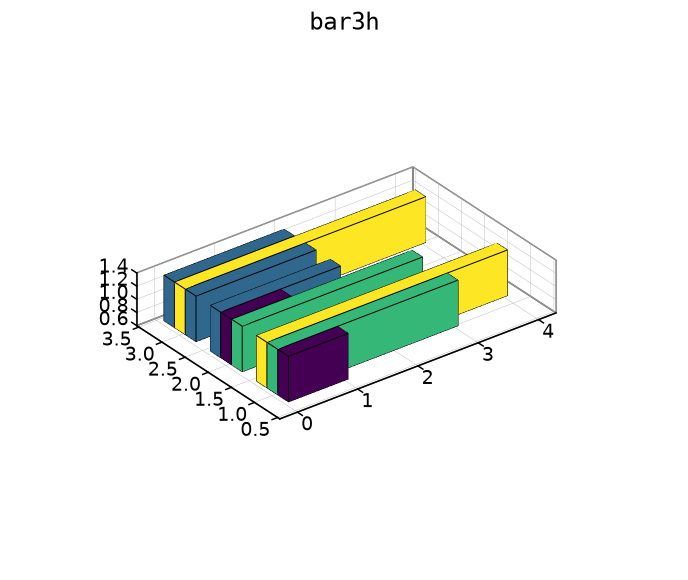

### `histogram2`

`histogram2(X, Y[, bins], Normalization=..., DisplayStyle=...)`

双变量直方图。NumBins 或 XBinEdges、YBinEdges 可控制分箱。图元 values 包含归一化结果。

```python
m.histogram2(ax, *d.cloud[:,:2].T, NumBins=(9,9), Normalization="probability", cmap="viridis", EdgeColor="#445a6b")
```

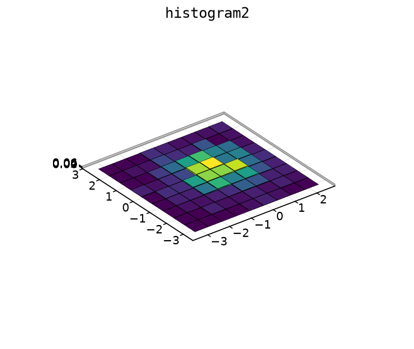

### `pie3`

`pie3(values[, explode][, labels])`

绘制有厚度的扇区，explode 指定需要偏移的项。labels 可由第二个或第三个参数给出。

```python
m.pie3(ax,[.45,.3,.25],[0,1,0],["A","B","C"])
ax.set_axis_off()
```

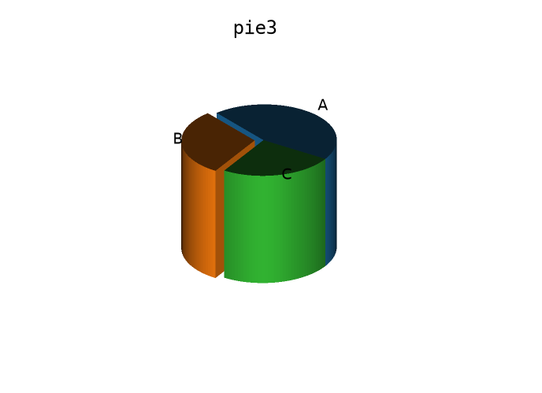

### `comet3`

`comet3(Z) / comet3(X, Y, Z[, tail], interval=30)`

返回定时动画。tail 是高亮尾部占轨迹的比例。离屏出图使用 set_frame 选定一帧。

```python
a = m.comet3(ax,np.cos(d.a),np.sin(d.a),d.a/np.pi,.18,LineWidth=2)
a.set_frame(320)
```


### `animatedline`

`animatedline([X, Y[, Z]], MaximumNumPoints=None)`

addpoints 分批追加坐标，getpoints 读回数据，clearpoints 清空。MaximumNumPoints 限制保留长度。

```python
a = m.animatedline(ax, MaximumNumPoints=280, Color="#b15768", LineWidth=2.5)
for t in np.array_split(d.a,8):
    m.addpoints(a,np.cos(t),np.sin(t),t/np.pi)
x,y,z = m.getpoints(a)
```


## 标量体与向量场

### `isosurface`

`isosurface(V[, level[, colors]]) / isosurface(X, Y, Z, V, ...)`

提取指定等值，可用 colors 设置独立颜色体。noshare 展开面顶点。规则均匀体采用 Flying Edges。

```python
m.isosurface(ax,d.s,d.s,d.s,d.V,1.12,colors=d.C,cmap="viridis",EdgeColor="none")
```


### `isosurface_geometry`

`isosurface_geometry(V[, level[, colors]])`

计算面索引、顶点和可选颜色。返回字典，可直接交给 patch。

```python
g = m.isosurface_geometry(d.s,d.s,d.s,d.V,1.03)
m.patch(ax,g,FaceColor="#1f93a2",EdgeColor="none",FaceLighting="gouraud")
```

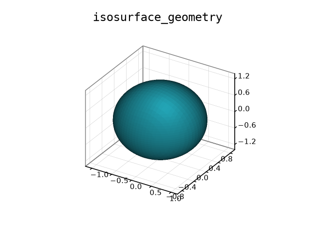

### `slice`

`slice([X, Y, Z,] V, xs, ys, zs[, method])`

xs、ys、zs 指各轴的切片位置，可用空列表跳过，或传三个曲面坐标矩阵。插值可用 linear、nearest、cubic。

```python
m.slice(ax,d.s,d.s,d.s,d.V,[0],[.4],[-.5],"linear",cmap="magma",FaceAlpha=.92)
```


### `contourslice`

`contourslice([X, Y, Z,] V, xs, ys, zs[, levels])`

在各切片上绘制等值线。levels 可为自动级别数量或具体数组。返回各切片的曲线。

```python
m.contourslice(ax,d.s,d.s,d.s,d.V,[],[],[-.6,0,.6],[.4,.8,1.4,2.1],LineWidth=2)
```


### `isocaps`

`isocaps([X, Y, Z,] V, level[, enclose][, whichplane])`

用 above 或 below 选取阈值一侧；whichplane 为 xmin 等边界名或 all。返回端盖面。

```python
m.hold("on",ax=ax)
m.isosurface(ax,d.s,d.s,d.s,d.V,2.8,FaceAlpha=.32)
m.isocaps(ax,d.s,d.s,d.s,d.V,2.8,"below","zmax",FaceAlpha=.85,cmap="plasma")
```


### `isocolors`

`isocolors([X, Y, Z,] C, vertices_or_handle)`

对顶点位置采样颜色体。也可传 R、G、B 三个体。传入图形句柄时同时更新颜色。

```python
h = m.isosurface(ax,d.s,d.s,d.s,d.V,1.1,cmap="coolwarm")
m.isocolors(d.s,d.s,d.s,d.A,h)
```


### `isonormals`

`isonormals([X, Y, Z,] V, vertices_or_handle[, negate])`

用标量体的梯度估计等值面顶点法向。negate 翻转方向。传入句柄时更新渲染法向。

```python
h = m.isosurface(ax,d.s,d.s,d.s,d.V,1.1,FaceColor="#3d93af")
m.isonormals(d.s,d.s,d.s,d.V,h)
```

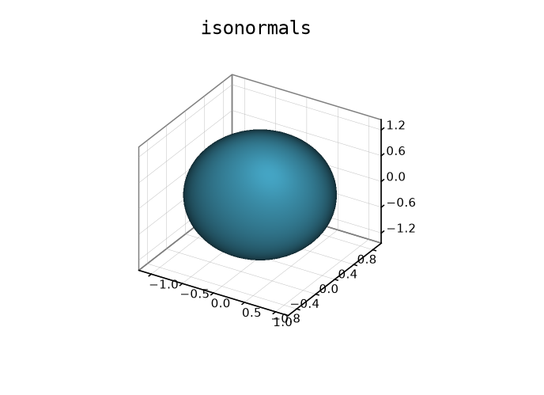

### `flow`

`flow(n=25, grid=False) / flow(X, Y, Z)`

生成管状标量场示例。grid=True 同时给出坐标和标量体，默认尺寸为 N×2N×N。

```python
X,Y,Z,V = m.flow(26,grid=True)
m.isosurface(ax,X,Y,Z,V,4,colors=X,cmap="viridis")
```


### `smooth3`

`smooth3(V[, method[, size[, sigma]]])`

对体数据做盒式或高斯平滑。size 为奇数窗口，sigma 为高斯标准差。此图显示平滑后零等值面。

```python
v = np.random.default_rng(42).uniform(-1,1,(24,24,24))
m.isosurface(ax,m.smooth3(v,"gaussian",5,1.1),0,FaceColor="#58a4ae")
```

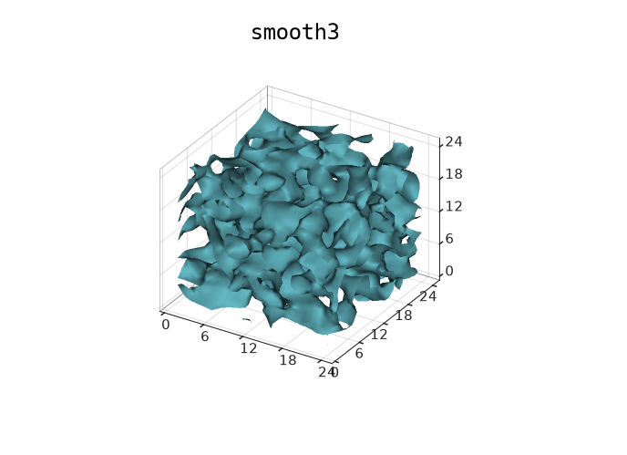

### `reducevolume`

`reducevolume([X, Y, Z,] V, step)`

按规则步长减少数据。step 可统一指定，也可给出 x、y、z 三个轴的步长。

```python
x,y,z,v = m.reducevolume(d.s,d.s,d.s,d.V,[3,3,3])
m.slice(ax,x,y,z,v,[0],[],[.5])
```


### `subvolume`

`subvolume([X, Y, Z,] V, limits)`

从规则网格提取子体。limits 顺序为 xmin、xmax、ymin、ymax、zmin、zmax，NaN 表示相应方向无限制。

```python
x,y,z,v = m.subvolume(d.s,d.s,d.s,d.V,[-.5,1,-1,1,-1,1])
m.isosurface(ax,x,y,z,v,1.1,FaceColor="#4b939a")
```


### `volumebounds`

`volumebounds([X, Y, Z,] V) / volumebounds([X, Y, Z,] U, V, W)`

返回坐标边界。标量体额外返回最小最大标量值，可直接传给 axis 设置边界和颜色范围。

```python
m.isosurface(ax,d.s,d.s,d.s,d.V,.65,FaceColor="#3779a4")
m.axis(m.volumebounds(d.s,d.s,d.s,d.V),ax=ax)
```

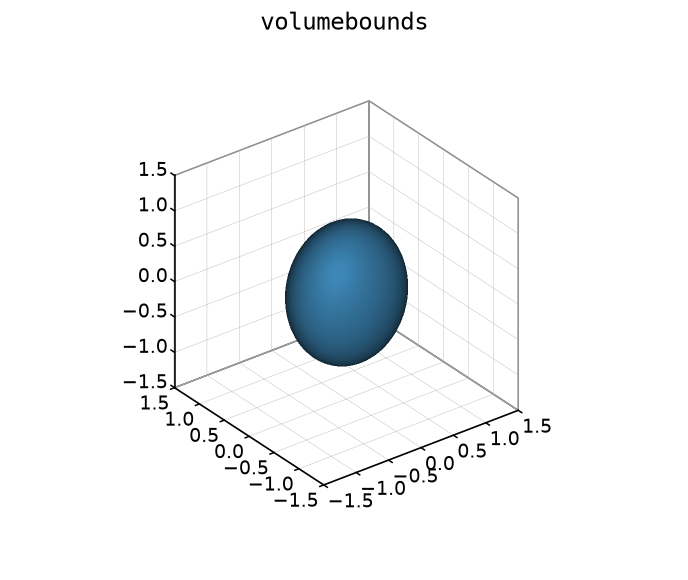

### `quiver3`

`quiver3([X, Y,] Z, U, V, W[, scale][, LineSpec])`

每个箭头由位置和分量决定。scale=0 保留实际长度。ShowArrowHead、MaxHeadSize 控制箭头。

```python
t = np.linspace(-1,1,7)
x,y,z = np.meshgrid(t,t,[-.45,.45])
m.quiver3(ax,x,y,z,-y,x,np.full_like(x,.4),.9,cmap="viridis")
```


### `coneplot`

`coneplot([X, Y, Z,] U, V, W, Cx, Cy, Cz[, scale])`

在给定采样位置绘制插值得到的向量。可用颜色体、nearest 或 cubic、quiver 和 nointerp 等选项。

```python
x,y,z = np.meshgrid(np.linspace(-1,1,5),np.linspace(-1,1,5),[-.6,.6])
m.coneplot(ax,d.s,d.s,d.s,d.U,d.W,d.K,x,y,z,cmap="plasma")
```


### `stream2`

`stream2([X, Y,] U, V, sx, sy[, options])`

计算二维流线顶点，options 为步长和最大步数。数组列表可交给 streamline 绘图。

```python
lines = m.stream2(d.s,d.s,d.U[:,:,0],d.W[:,:,0],[.4,.7,1.],[0,0,0])
m.streamline(ax,lines,LineWidth=2.5)
ax.view_init(elev=90,azim=-90)
```


### `stream3`

`stream3([X, Y, Z,] U, V, W, sx, sy, sz[, options])`

从种子积分得到三维路径数组。可用 direction 指定 forward、backward 或 both。可传给 streamline、streamtube 等。

```python
paths = m.stream3(d.s,d.s,d.s,d.U,d.W,d.K,[.45,.8],[0,0],[-1.4,-1.4])
m.streamline(ax,paths,LineWidth=2.5)
```


### `streamline`

`streamline(paths) / streamline([X, Y, Z,] U, V, W, sx, sy, sz)`

绘制已有路径，或在图中从指定种子计算并画出路径。

```python
m.streamline(ax,d.path,Color="#207c99",LineWidth=3)
```

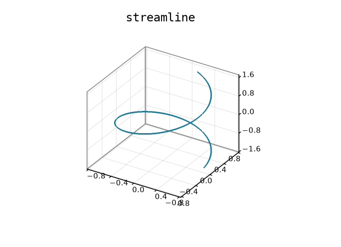

### `streamslice`

`streamslice([X, Y, Z,] U, V, W, xs, ys, zs[, density])`

沿选定平面上的切向场积分。density 调节种子密度，可以用 noarrows 关闭箭头。

```python
m.streamslice(ax,d.s,d.s,d.s,d.U,d.W,d.K,[],[],[-.5,.5],.65,"noarrows",LineWidth=1.7)
```

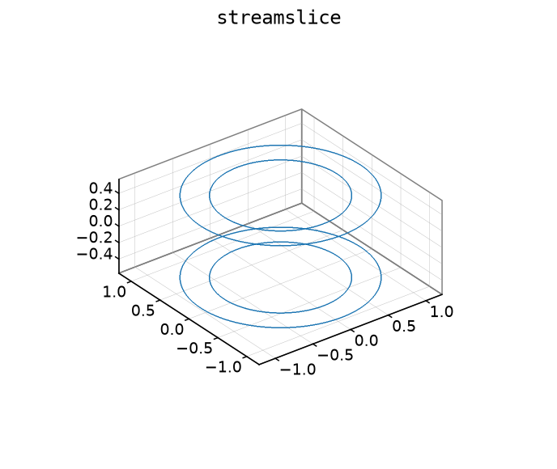

### `streamtube`

`streamtube(paths[, widths][, [scale, sides]])`

把轨迹扩展为管面。可直接给向量场及种子点，或给路径及逐点管宽、散度场。radius 设置固定半径。

```python
m.streamtube(ax,d.path,radius=.045,sides=18,FaceColor="#499aaf")
```

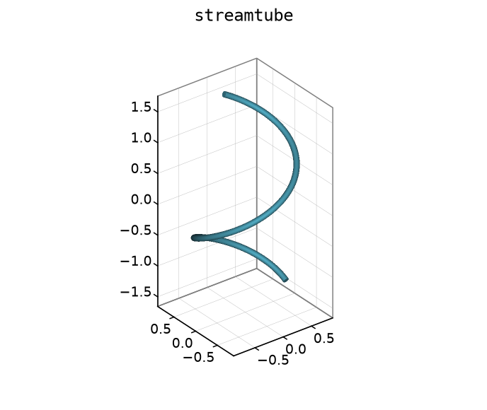

### `streamribbon`

`streamribbon(paths[, twistangle], width=None)`

把三维路径扩展成带。twistangle 单位为弧度。也可用向量场以及种子点，由角速度和流速计算扭转。

```python
p = d.path[0]
m.streamribbon(ax,[p],np.linspace(0,2*np.pi,len(p)),width=.18,FaceColor="#669ab3")
```

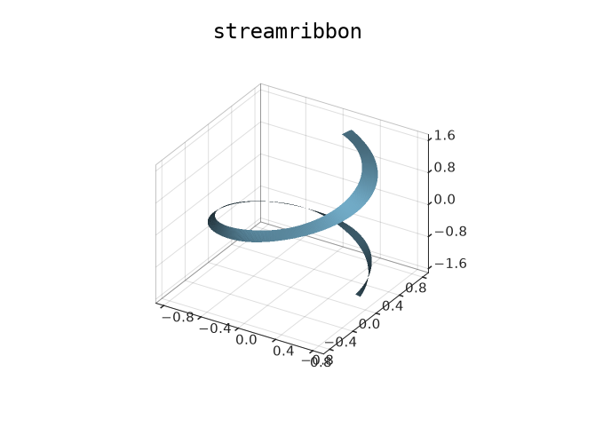

### `streamparticles`

`streamparticles(paths, n=20, interval=30)`

沿已有流线均匀放置粒子，后续帧沿点索引移动。用 set_frame 导出指定帧。

```python
m.hold("on",ax=ax)
m.streamline(ax,d.path,Color="#b2c0cc")
a = m.streamparticles(ax,d.path,15,color="#c05063",s=40)
a.set_frame(18)
```


### `curl`

`curl([X, Y, Z,] U, V, W)`

返回三个旋度分量以及速度方向上的角速度。图中对旋度做稀疏采样并绘制箭头。

```python
cu,cv,cw,_ = m.curl(d.s,d.s,d.s,d.U,d.W,d.K)
idx = np.s_[::9,::9,::12]
m.quiver3(ax,d.A[idx],d.B[idx],d.C[idx],cu[idx],cv[idx],cw[idx],.55)
```

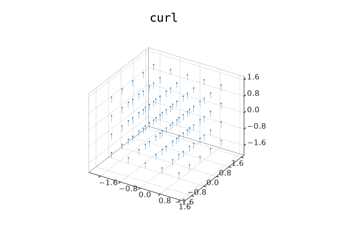

### `divergence`

`divergence([X, Y, Z,] U, V, W)`

返回向量场的散度矩阵。图中取径向变化的场并显示一个散度切片。

```python
q = m.divergence(d.s,d.s,d.s,d.A**3,d.B**3,d.C**3)
m.slice(ax,d.s,d.s,d.s,q,[0],[],[-.4],cmap="magma")
```

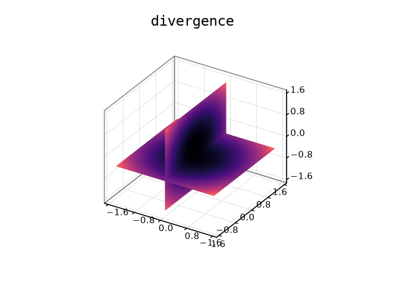

### `interpstreamspeed`

`interpstreamspeed([X, Y, Z,] U, V, W, paths[, scale])`

按沿轨迹积分得到的流动时间重采样。图中用标记显示新采样点。

```python
p, = m.interpstreamspeed(d.s,d.s,d.s,d.U,d.W,d.K,d.path,5)
m.hold("on",ax=ax)
m.streamline(ax,[p],Color="#46758d",LineWidth=2)
m.scatter3(ax,*p.T,35,"#c45967")
```


## 三维网络图和图像平面

### `plot`

`plot(edges, xyz=None) / graphplot(edges, xyz=None)`

对应 MATLAB 的三维 graph 和 digraph 绘图用法。edges 每行是一条边的两个节点索引，xyz 每行是节点坐标。也可给 XData、YData、ZData，或省略坐标让 VTK 求解 force3 布局。用 directed=True 显示箭头。

```python
G = {"edges": [[0,1],[1,2],[2,3],[3,4],[4,0],[1,4],[3,0]], "directed": True}
xyz = [[0,0,0],[1,.1,.8],[.8,1,.3],[.1,1,1],[-.25,.3,.55]]
m.plot(ax,G,xyz,NodeLabel=["A","B","C","D","E"],MarkerSize=9,LineWidth=2)
```


### `graphplot`

`graphplot(edges, xyz=None, **properties)`

从零基边列表绘制三维图。可显式传入节点位置、边颜色和标签，也可由 VTK 计算布局。

```python
edges = [[0, 1], [0, 2], [1, 2], [2, 3]]
xyz = [[0, 0, 0], [1, 0, 0], [.6, 1, .5], [.1, .8, 1]]
m.graphplot(ax, edges, xyz, NodeLabel=["A", "B", "C", "D"])
```


### `image`

`image(C) / image(X, Y, C, z=0)`

将 RGB(A) 或索引色图像放在 XY 平面。X、Y 的首尾值定义首尾像素中心。z 指平面高度，AlphaData 可为逐像素矩阵。

```python
m.hold("on",ax=ax)
C = np.zeros((12,12,3))
C[:] = [.15,.41,.59]
C[(np.indices((12,12)).sum(axis=0) % 2) == 0] = [.77,.87,.92]
m.image(ax,[-3,3],[-3,3],C,z=-2)
m.plot3(ax,[-2,1,2],[1,-1,2],[-1,2,.5],Color="#a8484f",LineWidth=3)
```

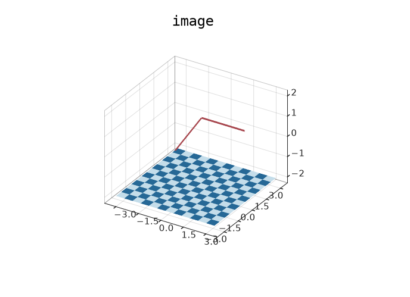

### `imagesc`

`imagesc(C[, clims]) / imagesc(X, Y, C[, clims], z=0)`

把标量矩阵映射到当前色图。clims 指定数值范围，z 改变平面位置。返回可供 colorbar 使用的图元。

```python
m.hold("on",ax=ax)
m.imagesc(ax,d.t,d.t,d.Z,[-6,8],z=-8,cmap="coolwarm")
m.surf(ax,d.X,d.Y,d.Z,FaceAlpha=.62,FaceColor="interp",EdgeColor="none",cmap="coolwarm")
```

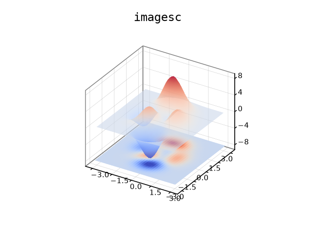

## 场景、样式和导出

### `text`

`text(x, y, z, label, **text_properties)`

把 Matplotlib 文字锚定在三维坐标处，支持数学公式。返回 Text3D。

```python
m.plot3(ax,np.cos(d.a),np.sin(d.a),d.a/np.pi,LineWidth=2)
m.text(1,0,4,r"$t=4\pi$",ax=ax,fontsize=12)
```


### `axis`

`axis(mode_or_limits, ax=ax)`

可传 auto、tight、equal、vis3d、on、off 或六个坐标边界，八个元素时包含色标上下限。

```python
m.surf(ax,d.X,d.Y,d.Z,FaceColor="interp",EdgeColor="none")
m.axis([-4,4,-4,4,-8,10,-6,8],ax=ax)
```

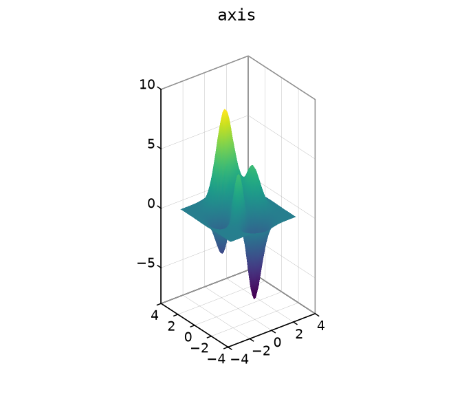

### `daspect`

`daspect((dx, dy, dz), ax=ax)`

按当前轴跨度设置数据单位的显示比例。示例将三个轴的单位长度设为一致。

```python
m.surf(ax,*m.ellipsoid(0,0,0,1,.65,.4,40),FaceColor="interp",EdgeColor="none")
m.daspect((1,1,1),ax=ax)
```


### `pbaspect`

`pbaspect((px, py, pz), ax=ax)`

指定三维坐标框三边的显示比例。相同数据可用更低的框显示。

```python
m.surf(ax,d.X,d.Y,d.Z,FaceColor="interp",EdgeColor="none")
m.pbaspect((1,1,.42),ax=ax)
```


### `view`

`view(az, el) / view([az, el]) / view([x, y, z]) / view(2 or 3)`

使用 MATLAB 方位角和仰角，或传视线方向。2 为顶视图，3 为默认三维视角。

```python
m.surf(ax,d.X,d.Y,d.Z,FaceColor="interp",EdgeColor="none")
m.view(110,47,ax=ax)
```

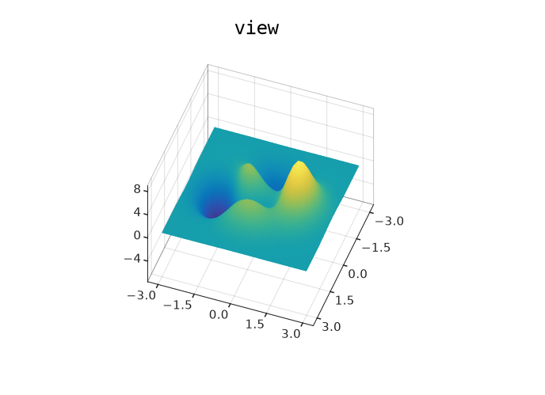

### `camproj`

`camproj(mode=None, ax=ax)`

选择 perspective 或 orthographic。省略 mode 返回当前投影类型。

```python
m.surf(ax,d.X,d.Y,d.Z,FaceColor="interp",EdgeColor="none")
m.camproj("orthographic",ax=ax)
```


### `hidden`

`hidden(state='on', ax=ax)`

控制 VTK 网格背面与被几何遮挡的部分线条是否隐藏。

```python
m.mesh(ax,d.X[::3,::3],d.Y[::3,::3],d.Z[::3,::3],Color="#3c7ca1",LineWidth=1.2)
m.hidden("off",ax=ax)
```

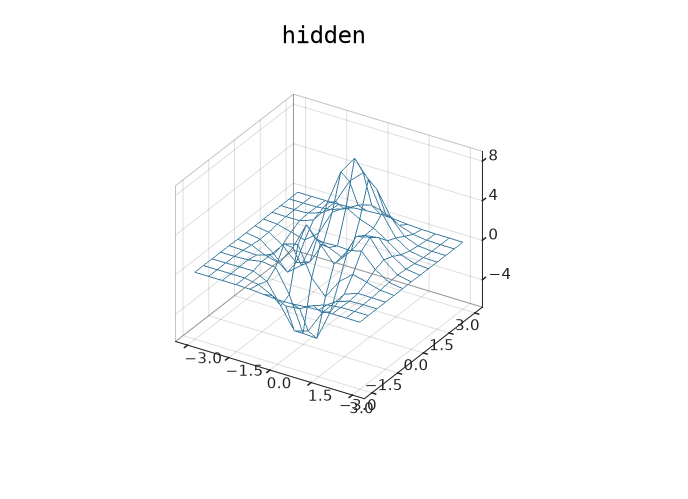

### `shading`

`shading(mode='interp', ax=ax)`

在 flat、interp、faceted 间切换。faceted 保留边线。对已经创建的图元生效。

```python
m.surf(ax,d.X[::4,::4],d.Y[::4,::4],d.Z[::4,::4])
m.shading("faceted",ax=ax)
```

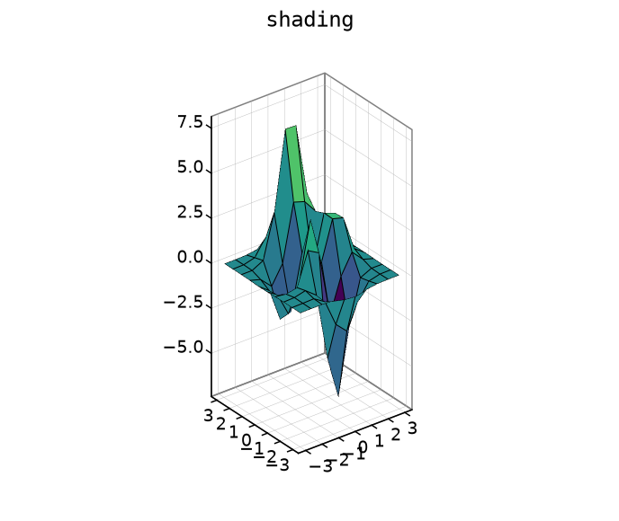

### `lighting`

`lighting(mode='gouraud', ax=ax)`

为已有表面选择 none、flat、gouraud 或 phong。表面法向会随规则网格更新。

```python
m.surf(ax,*m.sphere(30),FaceColor="#62a2af",EdgeColor="none")
m.lighting("gouraud",ax=ax)
```


### `camlight`

`camlight(az=0, el=0, ax=ax)`

添加跟随相机的光源，支持 left、right 或 headlight。返回 VTK 光源。

```python
m.surf(ax,*m.ellipsoid(0,0,0,1,.8,.7,40),FaceColor="#61a5b3",EdgeColor="none",FaceLighting="gouraud")
m.camlight("right",ax=ax)
```

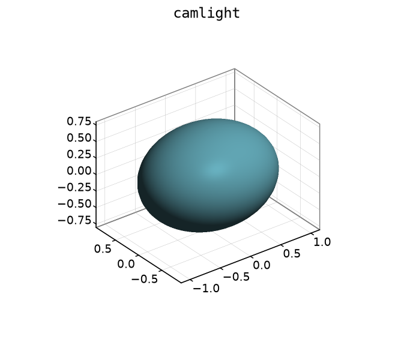

### `light`

`light(position=(1, 0, 1), color='white', style='infinite', ax=ax)`

在世界坐标中放置光源。style 可为 infinite 或 local。返回 VTK 光源。

```python
m.surf(ax,*m.sphere(40),FaceColor="#86a7b8",EdgeColor="none",FaceLighting="gouraud")
m.light((1,-1,2),color="#ffe9c2",style="local",ax=ax)
```


### `lightangle`

`lightangle(az, el, ax=ax)`

以 MATLAB 方位角和仰角设置一个固定方向光。可用 color 指定光色。

```python
m.surf(ax,d.X,d.Y,d.Z,FaceColor="interp",EdgeColor="none",FaceLighting="gouraud",cmap="Greys")
m.lightangle(-40,55,color="#fff0d6",ax=ax)
```

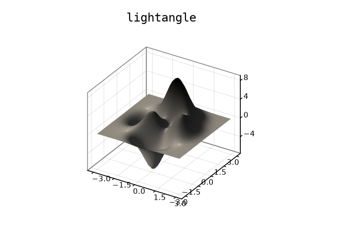

### `material`

`material(style='dull', ax=ax)`

设置 dull、shiny、metal 材质或四个光照系数。四个值依次为环境、漫反射、镜面反射、高光指数。

```python
m.surf(ax,*m.sphere(42),FaceColor="#357f94",EdgeColor="none",FaceLighting="gouraud")
m.material("shiny",ax=ax)
```

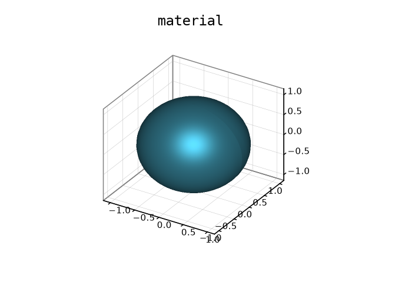

### `colormap`

`colormap(cmap, ax=ax)`

更新场景色表，可传 Matplotlib 色表名或 RGB(A) 数组。

```python
m.surf(ax,d.X,d.Y,d.Z,FaceColor="interp",EdgeColor="none")
m.colormap("magma",ax=ax)
```

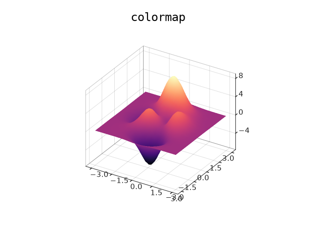

### `colorbar`

`colorbar(handle=None, ax=ax, **kwargs)`

创建原生 Matplotlib 色条。默认取当前场景最后一个图元。可传 ticks、label 和 shrink。

```python
h = m.surf(ax,d.X,d.Y,d.Z,FaceColor="interp",EdgeColor="none")
m.colorbar(h,ticks=[-6,-3,0,3,6],label="Value",shrink=.7)
```


### `clim`

`clim(limits=None, ax=ax)`

为当前场景设定颜色映射范围。传 auto 恢复按数据映射，省略参数返回当前范围。caxis 为同义入口。

```python
h = m.surf(ax,d.X,d.Y,d.Z,FaceColor="interp",EdgeColor="none",cmap="coolwarm")
m.clim((-3,3),ax=ax)
m.colorbar(h,shrink=.7)
```

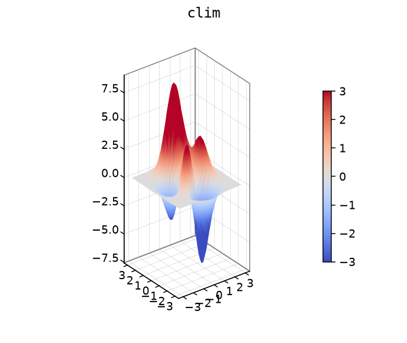

### `alim`

`alim(limits=None, ax=ax)`

在 AlphaDataMapping 为 scaled 时设置透明度映射区间。省略参数返回当前区间。

```python
m.surf(ax,d.X,d.Y,d.Z,FaceColor="#457f9b",EdgeColor="none",FaceAlpha="interp",AlphaData=d.Z,AlphaDataMapping="scaled")
m.alim((-5,6),ax=ax)
```


### `hold`

`hold(state='on', ax=ax)`

控制连续 MATLAB 风格绘图调用是否叠加。示例将半透明参考平面与等值面画在同一轴。

```python
m.hold("on",ax=ax)
m.isosurface(ax,d.s,d.s,d.s,d.V,1.1,FaceColor="#50a1ac")
m.slice(ax,d.s,d.s,d.s,d.V,[],[],[-.45],FaceAlpha=.6,cmap="magma")
```

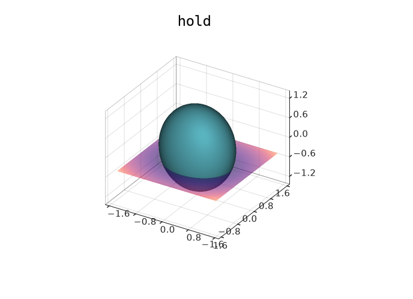

### `set`

`set(handle, Name, Value, ..., **properties)`

修改绘图句柄的可写属性。支持 MATLAB 属性名和相应的 Python Setter。

```python
h = m.surf(ax,d.X,d.Y,d.Z,EdgeColor="none")
m.set(h,"FaceColor","#607d9f",FaceLighting="gouraud",FaceAlpha=.79)
```


### `grid`

`grid(state='on', ax=ax)`

切换 Matplotlib 原生三维网格线。更精细的设置可以在 ax.grid 或轴对象上完成。

```python
m.surf(ax,d.X,d.Y,d.Z,FaceColor="interp",EdgeColor="none")
m.grid("off",ax=ax)
```


### `title`

`title(label, ax=ax, **text_properties)`

设置子图标题。返回原生 Matplotlib Text，可以调整字体、颜色和位置。

```python
m.surf(ax,d.X,d.Y,d.Z,FaceColor="interp",EdgeColor="none")
m.title(r"Peaks: $z=f(x,y)$",ax=ax)
m.xlabel("$x$",ax=ax)
m.ylabel("$y$",ax=ax)
m.zlabel("$z$",ax=ax)
```

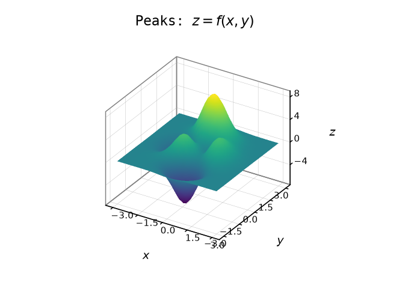

### `xlabel`

`xlabel(label, ax=ax, **text_properties)`

设置 x 轴标签，接受数学文本和 Matplotlib 文本属性。

```python
m.plot3(ax, [0, 1, 2], [0, 1, 0], [0, .5, 1], LineWidth=2)
m.xlabel(r"$x$ (m)", ax=ax, color="#26778a")
```

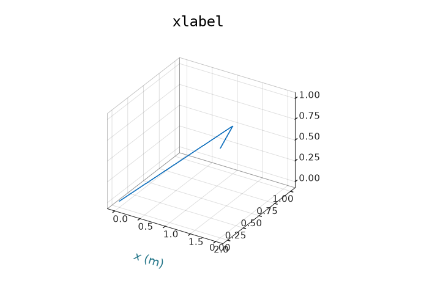

### `ylabel`

`ylabel(label, ax=ax, **text_properties)`

设置 y 轴标签，接受数学文本和 Matplotlib 文本属性。

```python
m.plot3(ax, [0, 1, 2], [0, 1, 0], [0, .5, 1], LineWidth=2)
m.ylabel(r"$y$ (m)", ax=ax, color="#26778a")
```

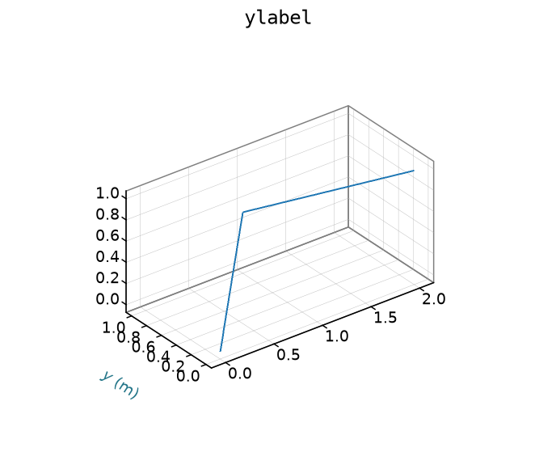

### `zlabel`

`zlabel(label, ax=ax, **text_properties)`

设置 z 轴标签，接受数学文本和 Matplotlib 文本属性。

```python
m.plot3(ax, [0, 1, 2], [0, 1, 0], [0, .5, 1], LineWidth=2)
m.zlabel(r"$z$ (m)", ax=ax, color="#26778a")
```


### `caxis`

`caxis(limits=None, ax=ax)`

MATLAB 风格的色域设置，是 clim 的别名。示例把两端颜色锁定在 −2 和 2。

```python
h = m.surf(ax, d.X, d.Y, d.Z, FaceColor="interp", EdgeColor="none", cmap="coolwarm")
m.caxis((-2, 2), ax=ax)
m.colorbar(h, shrink=.7)
```


## 图窗、动画更新和导出

### `figure`

`figure(*args, **kwargs)`

创建或激活 Matplotlib Figure。num 可为编号或名称，figsize、dpi 和 layout 沿用 Matplotlib。

```python
active = m.figure(fig.number)
active.suptitle("Figure with a VTK scene")
m.surf(ax, d.X, d.Y, d.Z, cmap="viridis", EdgeColor="none")
```

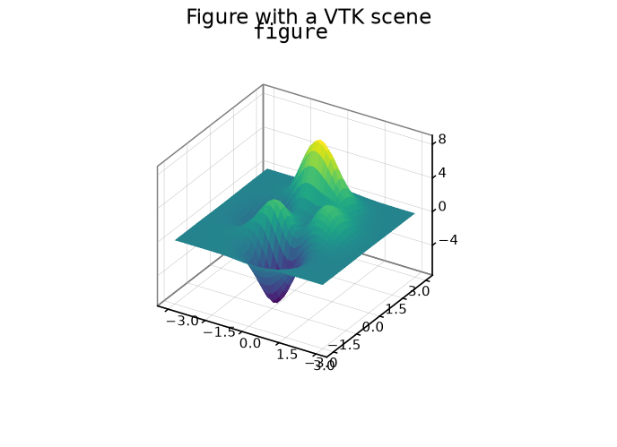

### `subplot`

`subplot(*args, **kwargs)`

按 Matplotlib 的位置参数创建 vtk3d 子图。示例在同一 Figure 中并排绘制曲面和网格。

```python
ax.remove()
left = m.subplot(121)
right = m.subplot(122)
m.surf(left, d.X, d.Y, d.Z, cmap="viridis", EdgeColor="none")
m.mesh(right, d.X[::4, ::4], d.Y[::4, ::4], d.Z[::4, ::4], Color="#306b84")
```

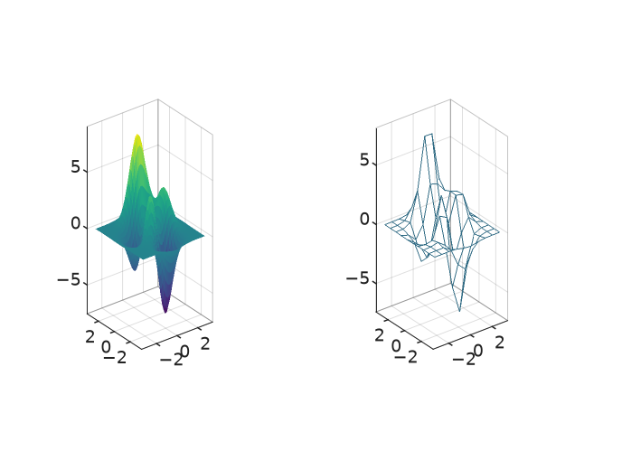

### `gca`

`gca()`

返回当前 vtk3d 坐标轴。当前 Figure 没有活动的 vtk3d 轴时，创建一个三维子图。

```python
current = m.gca()
m.plot3(current, np.cos(d.a), np.sin(d.a), d.a / np.pi, LineWidth=2)
```

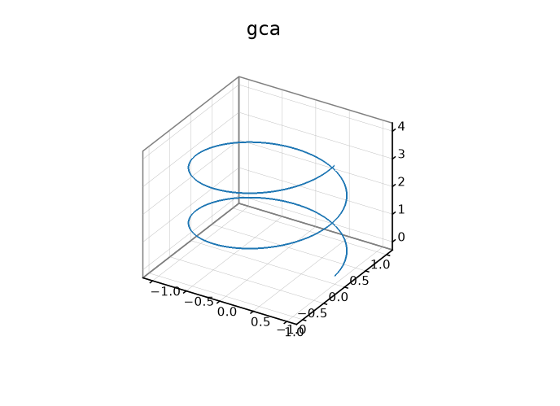

### `drawnow`

`drawnow(ax=ax)`

立即重绘坐标轴所属 Figure，并让 Matplotlib 后端处理事件。可用于交互循环中刷新更新的数据。

```python
h = m.animatedline(ax, LineWidth=2)
m.addpoints(h, np.cos(d.a), np.sin(d.a), d.a / np.pi)
m.drawnow(ax=ax)
```


### `show`

`show(*args, **kwargs)`

通过 Matplotlib 的交互后端显示打开的图窗。可传 block 控制阻塞。下图为窗口中的三维场景。

```python
m.surf(ax, d.X, d.Y, d.Z, EdgeColor="none", cmap="cividis")
if plt.get_backend().lower() != "agg":
    m.show()
```


### `savefig`

`savefig(path_or_buffer, **kwargs)`

保存当前 Figure，支持 Matplotlib 的格式、dpi 和透明背景参数。示例把 PNG 写入内存，文件名也可用作目标。

```python
from io import BytesIO

m.surf(ax, d.X, d.Y, d.Z, EdgeColor="none", cmap="plasma")
image = BytesIO()
m.savefig(image, format="png", dpi=150)
```

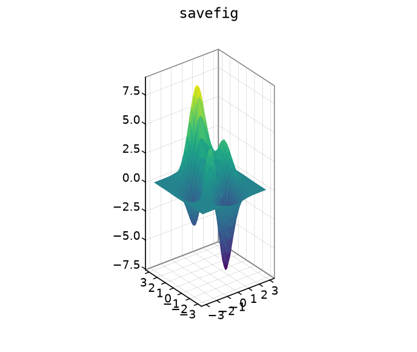

### `close`

`close(fig=None)`

关闭图窗并释放其 VTK 窗口。可传 Figure、图窗编号或 all。示例关闭临时图窗后继续在原图窗中出图。

```python
preview = m.figure()
m.plot3(m.subplot(111), [0, 1], [0, 1], [0, 1])
m.close(preview)
m.figure(fig.number)
m.surf(ax, d.X, d.Y, d.Z, EdgeColor="none", cmap="viridis")
```

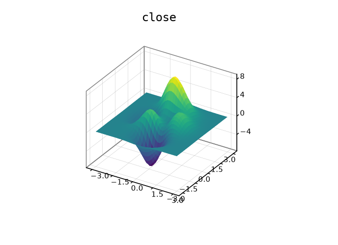

### `addpoints`

`addpoints(handle, x, y, z=0)`

向 animatedline 追加一批样本，允许标量或数组。多次追加的数据会在绘制时合并。

```python
h = m.animatedline(ax, LineWidth=2)
for t in np.array_split(d.a, 4):
    m.addpoints(h, np.cos(t), np.sin(t), t / np.pi)
```


### `getpoints`

`getpoints(handle)`

读取 animatedline 当前保留的三个坐标数组副本。示例用散点标出读回的采样位置。

```python
t = d.a[::18]
h = m.animatedline(ax, np.cos(t), np.sin(t), t / np.pi, LineWidth=2)
x, y, z = m.getpoints(h)
m.hold("on", ax=ax)
m.scatter3(ax, x, y, z, 30, "#bd616c", "filled")
```

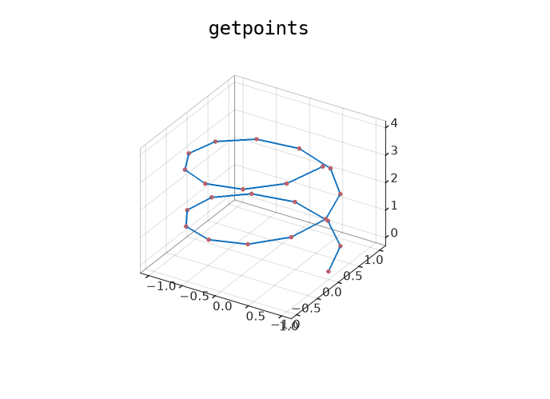

### `clearpoints`

`clearpoints(handle)`

清空 animatedline 中已有和待追加的样本，保留句柄。示例清空旧轨迹后，用同一条线开始新轨迹。

```python
h = m.animatedline(ax, np.cos(d.a), np.sin(d.a), d.a, LineWidth=2)
m.clearpoints(h)
t = d.a[:150]
m.addpoints(h, np.cos(t), np.sin(t), t / np.pi)
```

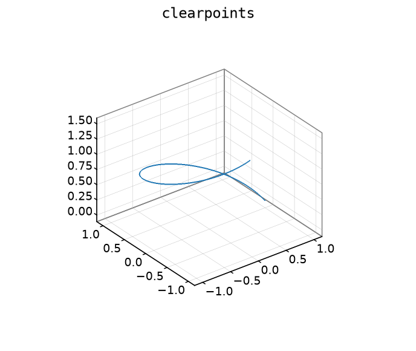

### `Graphic`

`Graphic`

常见 VTK 图元的返回类型，兼容 Matplotlib Artist 与 ScalarMappable。通过绘图函数取得句柄后可调颜色范围、透明度和可见性。

```python
h = m.surf(ax, d.X, d.Y, d.Z, EdgeColor="none", cmap="plasma")
assert isinstance(h, m.Graphic)
h.set_clim(-4, 4)
fig.colorbar(h, ax=ax, shrink=.7)
```


### `VtkAxes`

`VtkAxes`

注册为 vtk3d 的 Matplotlib Axes3D 子类，接收 antialiasing 和 axes_style 参数。用 Figure 或 pyplot 的子图方法创建。

```python
assert isinstance(ax, m.VtkAxes)
ax.set_antialiasing(3)
ax.plot_surface(d.X, d.Y, d.Z, cmap="viridis")
ax.set(xlabel="$x$", ylabel="$y$", zlabel="$z$")
```


## 附加的点云、位姿与体绘制接口

### `pcshow`

`pcshow(points, colors=None, markersize=5)`

显示点云。可传末维为 3 的坐标数组或 PLY/VTP 路径，颜色可按点指定，默认使用高度。

```python
m.pcshow(ax, d.cloud, markersize=4, cmap="viridis")
```


### `pcshowpair`

`pcshowpair(first, second, markersize=5)`

以两种固定颜色在同一坐标轴显示两个点云，返回两个绘图句柄。

```python
m.pcshowpair(ax, d.cloud, d.cloud + [1.6, 0, .35], markersize=3)
```

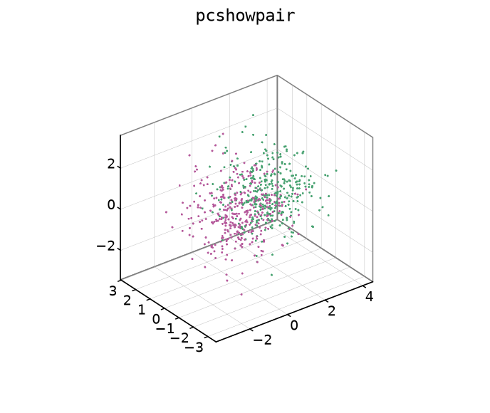

### `plotTransforms`

`plotTransforms(translations, rotations=None, *, frame_size=1, show_frame_labels=False)`

绘制位姿的三根坐标箭头。使用齐次 4×4 矩阵，或平移量与旋转矩阵或 wxyz 四元数。

```python
t = [[0, 0, 0], [1.4, .7, .45]]
q = [[1, 0, 0, 0], [np.cos(.4), 0, 0, np.sin(.4)]]
m.plotTransforms(ax, t, q, frame_size=.75, show_frame_labels=True)
```


### `volshow`

`volshow(v, *, coords=None, cmap='gray', alphamap=(0, 0, .45, .9))`

对均匀直角网格上的有限标量进行 VTK 体绘制。可指定色图和透明度表，或切换最大、最小或平均强度投影。

```python
v = np.exp(-3 * d.V) + .62 * np.exp(-9 * ((d.A - .6)**2 + (d.B + .5)**2 + d.C**2))
m.volshow(ax, v, coords=(d.s, d.s, d.s), cmap="magma", alphamap=(0, .01, .12, .8))
```


