# Gallery

Click a figure to open its API reference. The link below it opens the Python code that draws it.

- **Plot data** · [Isosurfaces and triangle meshes](#isosurfaces-and-triangle-meshes) · [Surfaces](#surfaces-and-contours) · [Charts](#lines-points-and-charts) · [Scalar fields](#meshes-and-scalar-fields) · [Vector fields](#vector-fields-and-streamlines) · [Spatial geometry](#point-clouds-and-other-geometry)
- **Manage the scene** · [Axes](#axes-controls) · [Streaming lines and lights](#streaming-lines-and-lights) · [Renderer integration](#renderer-integration)
- **Work with a handle** · [Inspect geometry and data](#graphic-handles) · [Update data and colors](#update-data-and-colors) · [Style and visibility](#style-and-visibility)

## Isosurfaces and triangle meshes

These figures use the original triangle meshes and all three PFC scalar volumes.
[Get the upstream data](examples.md#upstream-data) · [Compare with mplot3d](../benchmarks/results/my_mpl_style/README.md)

<table>
  <tr>
    <td align="center" width="50%"><a href="function_reference.md#plot_isosurface">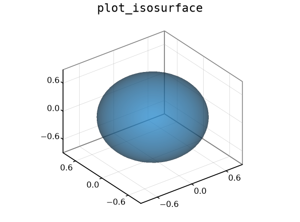</a> <a href="../examples/reference_sources.py#L163">Source code</a></td>
    <td align="center" width="50%"><a href="function_reference.md#extract_isosurface">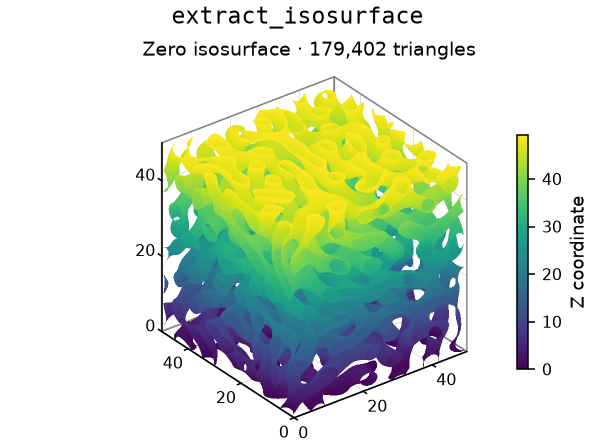</a> <a href="../examples/reference_sources.py#L148">Source code</a></td>
  </tr>
  <tr>
    <td align="center" width="50%"> <a href="../examples/reference_sources.py#L65">Source code</a></td>
    <td align="center" width="50%"><a href="function_reference.md#plot_mesh">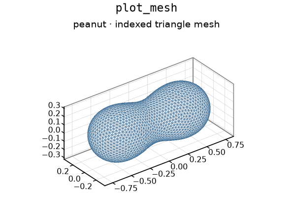</a> <a href="../examples/reference_sources.py#L137">Source code</a></td>
  </tr>
</table>

## Surfaces and contours

<table>
  <tr>
    <td align="center" width="33%"> <a href="../examples/reference_sources.py#L51">Source code</a></td>
    <td align="center" width="33%"><a href="api.md#plot_wireframe">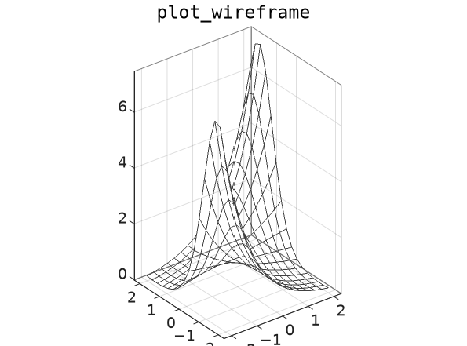</a> <a href="../examples/reference_sources.py#L59">Source code</a></td>
    <td align="center" width="33%"> <a href="../examples/reference_sources.py#L89">Source code</a></td>
  </tr>
</table>

## Lines, points, and charts

<table>
  <tr>
    <td align="center" width="33%"> <a href="../examples/reference_sources.py#L96">Source code</a></td>
    <td align="center" width="33%"><a href="api.md#scatter">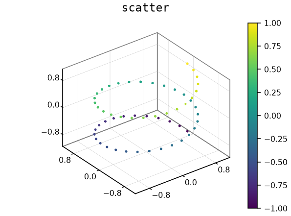</a> <a href="../examples/reference_sources.py#L105">Source code</a></td>
    <td align="center" width="33%"><a href="api.md#quiver">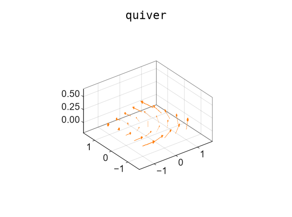</a> <a href="../examples/reference_sources.py#L114">Source code</a></td>
  </tr>
  <tr>
    <td align="center" width="33%"> <a href="../examples/reference_sources.py#L123">Source code</a></td>
    <td align="center" width="33%"> <a href="../examples/reference_sources.py#L130">Source code</a></td>
  </tr>
</table>

## Meshes and scalar fields

<table>
  <tr>
    <td align="center" width="33%"><a href="function_reference.md#plot_volume_slices">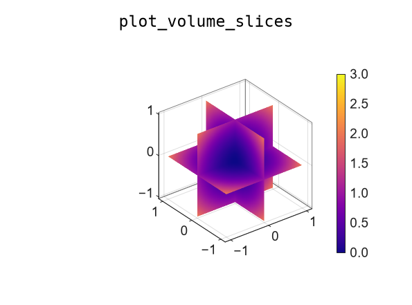</a> <a href="../examples/reference_sources.py#L183">Source code</a></td>
    <td align="center" width="33%"><a href="function_reference.md#plot_slice_contours">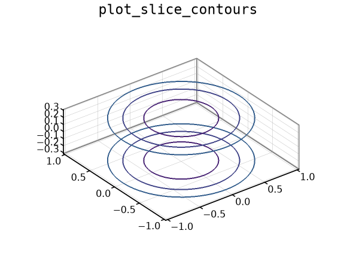</a> <a href="../examples/reference_sources.py#L191">Source code</a></td>
    <td align="center" width="33%"><a href="function_reference.md#plot_volume">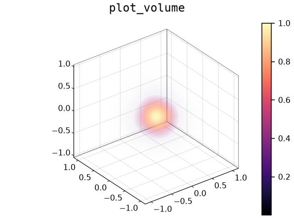</a> <a href="../examples/reference_sources.py#L198">Source code</a></td>
  </tr>
</table>

## Vector fields and streamlines

<table>
  <tr>
    <td align="center" width="33%"><a href="function_reference.md#trace_streamlines">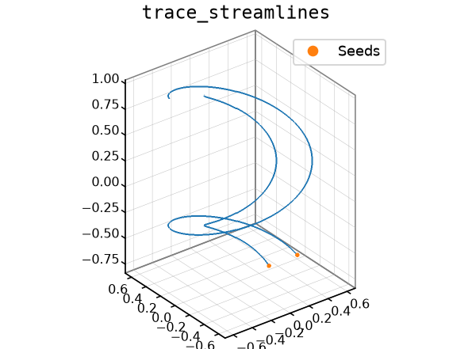</a> <a href="../examples/reference_sources.py#L206">Source code</a></td>
    <td align="center" width="33%"> <a href="../examples/reference_sources.py#L215">Source code</a></td>
    <td align="center" width="33%"><a href="function_reference.md#plot_streamlines">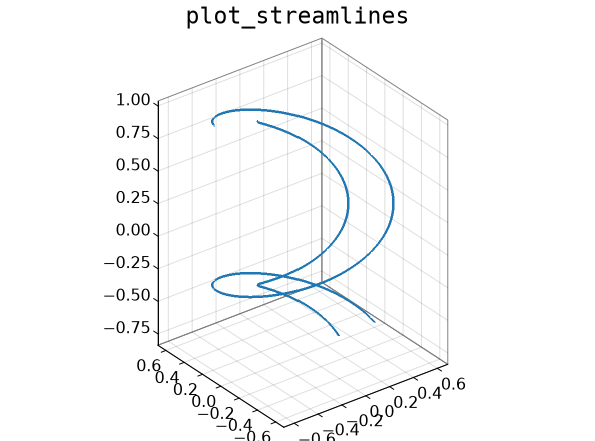</a> <a href="../examples/reference_sources.py#L224">Source code</a></td>
  </tr>
  <tr>
    <td align="center" width="33%"> <a href="../examples/reference_sources.py#L231">Source code</a></td>
    <td align="center" width="33%"><a href="function_reference.md#plot_streamribbons">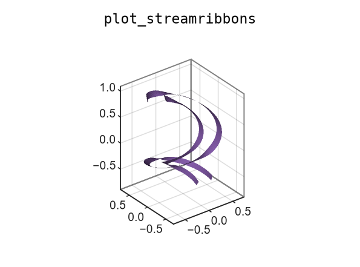</a> <a href="../examples/reference_sources.py#L238">Source code</a></td>
  </tr>
</table>

## Point clouds and other geometry

<table>
  <tr>
    <td align="center" width="33%"> <a href="../examples/reference_sources.py#L246">Source code</a></td>
    <td align="center" width="33%"><a href="function_reference.md#plot_alpha_shape">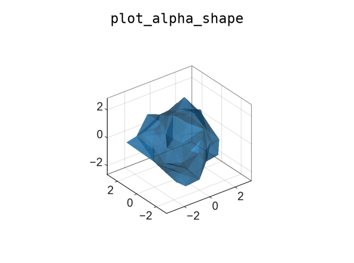</a> <a href="../examples/reference_sources.py#L253">Source code</a></td>
    <td align="center" width="33%"><a href="function_reference.md#plot_coordinate_frames">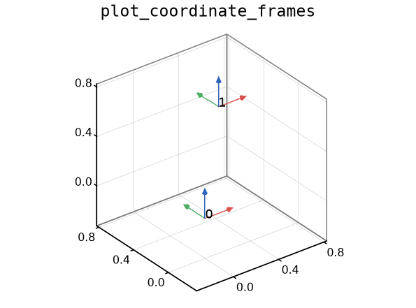</a> <a href="../examples/reference_sources.py#L260">Source code</a></td>
  </tr>
  <tr>
    <td align="center" width="33%"><a href="function_reference.md#plot_graph">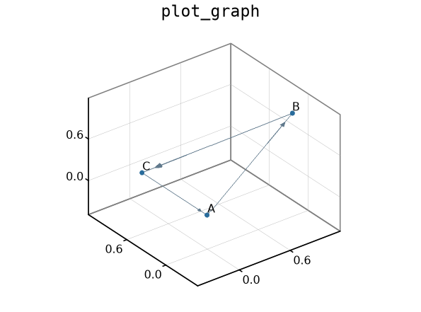</a> <a href="../examples/reference_sources.py#L267">Source code</a></td>
    <td align="center" width="33%"> <a href="../examples/reference_sources.py#L275">Source code</a></td>
  </tr>
</table>

## Axes controls

<table>
  <tr>
    <td align="center" width="33%"><a href="scene.md#vtkaxes">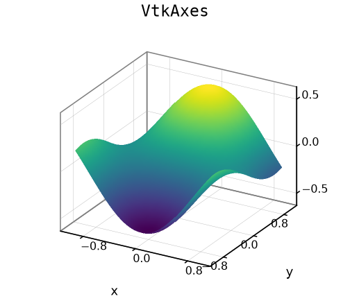</a> <a href="../examples/reference_sources.py#L286">Source code</a></td>
    <td align="center" width="33%"> <a href="../examples/reference_sources.py#L294">Source code</a></td>
    <td align="center" width="33%"><a href="scene.md#get_antialiasing">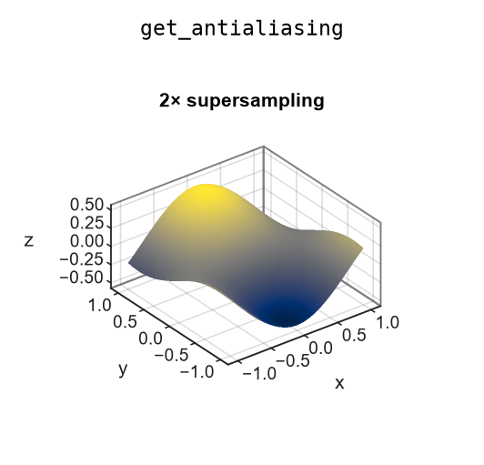</a> <a href="../examples/reference_sources.py#L303">Source code</a></td>
  </tr>
  <tr>
    <td align="center" width="33%"> <a href="../examples/reference_sources.py#L311">Source code</a></td>
    <td align="center" width="33%"><a href="scene.md#set_aspect">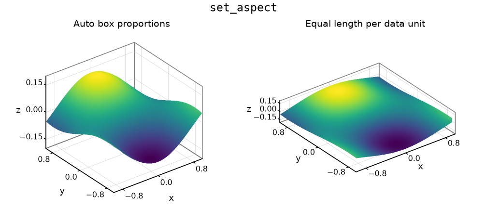</a> <a href="../examples/reference_sources.py#L326">Source code</a></td>
    <td align="center" width="33%"><a href="scene.md#set_box_aspect">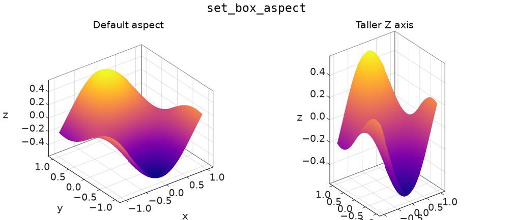</a> <a href="../examples/reference_sources.py#L338">Source code</a></td>
  </tr>
  <tr>
    <td align="center" width="33%"><a href="scene.md#fit">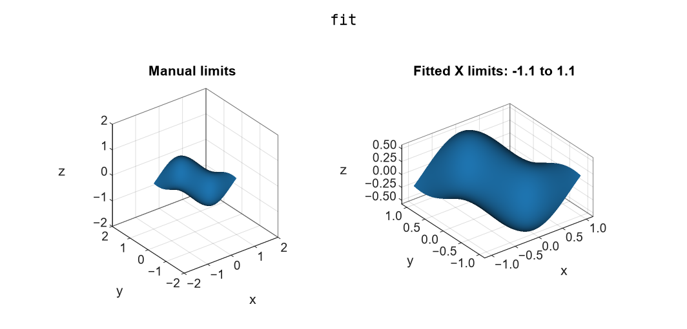</a> <a href="../examples/reference_sources.py#L349">Source code</a></td>
    <td align="center" width="33%"><a href="scene.md#clear_scene">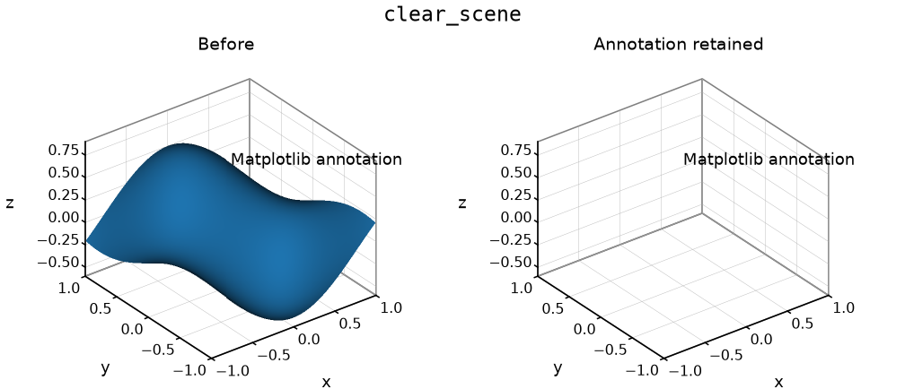</a> <a href="../examples/reference_sources.py#L362">Source code</a></td>
    <td align="center" width="33%"><a href="scene.md#clear">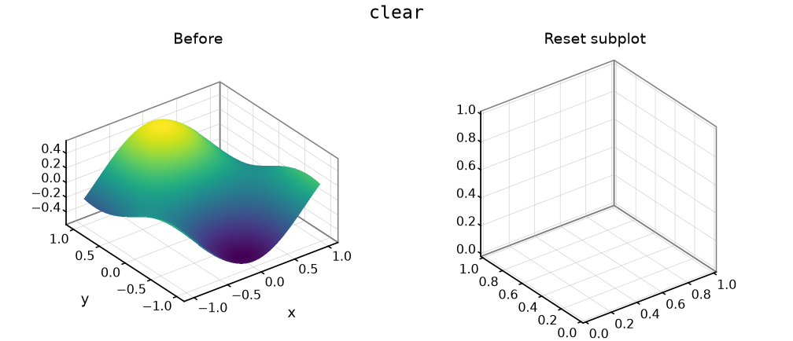</a> <a href="../examples/reference_sources.py#L375">Source code</a></td>
  </tr>
  <tr>
    <td align="center" width="33%"><a href="scene.md#vtkaxesremove">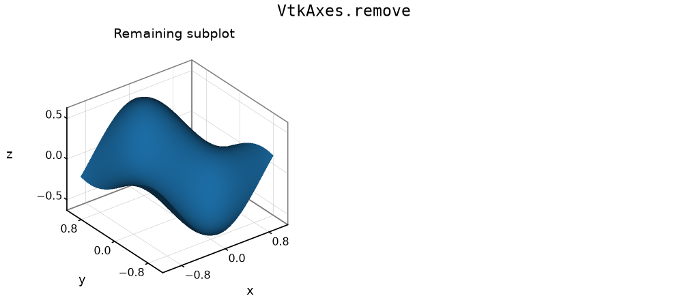</a> <a href="../examples/reference_sources.py#L386">Source code</a></td>
    <td align="center" width="33%"><a href="scene.md#get_legend_handles_labels">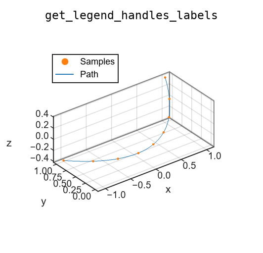</a> <a href="../examples/reference_sources.py#L396">Source code</a></td>
    <td align="center" width="33%"> <a href="../examples/reference_sources.py#L406">Source code</a></td>
  </tr>
  <tr>
    <td align="center" width="33%"><a href="scene.md#pixels">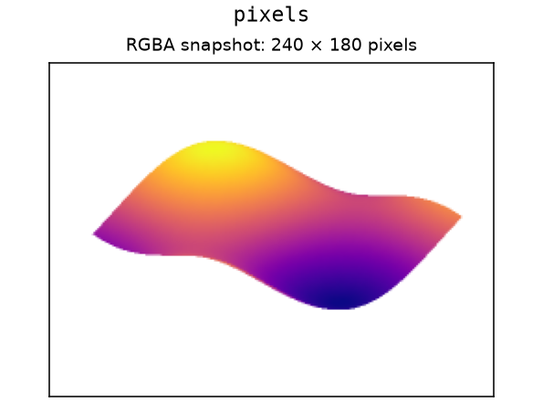</a> <a href="../examples/reference_sources.py#L415">Source code</a></td>
  </tr>
</table>

## Streaming lines and lights

<table>
  <tr>
    <td align="center" width="33%"><a href="scene.md#add_streaming_line">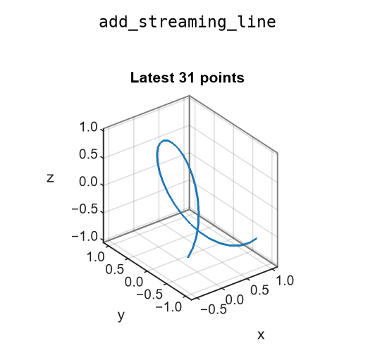</a> <a href="../examples/reference_sources.py#L430">Source code</a></td>
    <td align="center" width="33%"> <a href="../examples/reference_sources.py#L439">Source code</a></td>
    <td align="center" width="33%"> <a href="../examples/reference_sources.py#L451">Source code</a></td>
  </tr>
  <tr>
    <td align="center" width="33%"> <a href="../examples/reference_sources.py#L462">Source code</a></td>
    <td align="center" width="33%"> <a href="../examples/reference_sources.py#L476">Source code</a></td>
  </tr>
</table>

## Graphic handles

<table>
  <tr>
    <td align="center" width="33%"><a href="scene.md#graphic">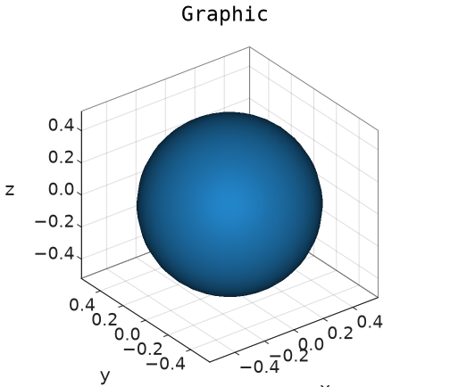</a> <a href="../examples/reference_sources.py#L488">Source code</a></td>
    <td align="center" width="33%"><a href="scene.md#vertices">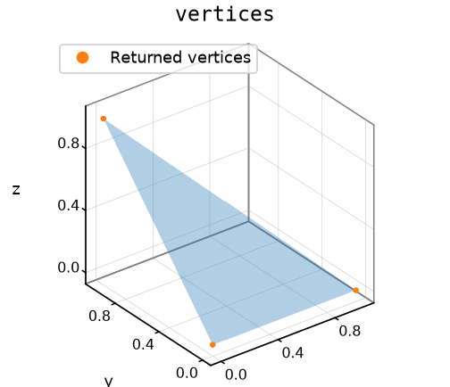</a> <a href="../examples/reference_sources.py#L501">Source code</a></td>
    <td align="center" width="33%"><a href="scene.md#faces">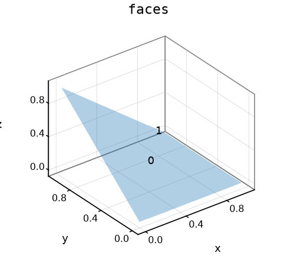</a> <a href="../examples/reference_sources.py#L510">Source code</a></td>
  </tr>
  <tr>
    <td align="center" width="33%"><a href="scene.md#get_array">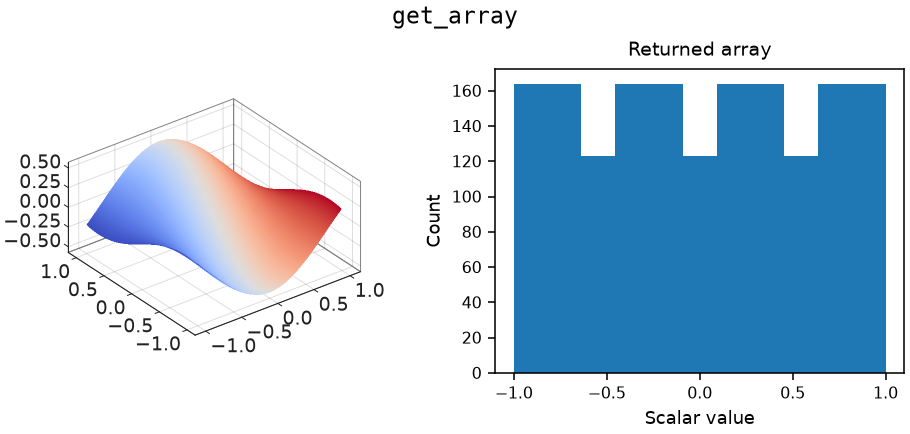</a> <a href="../examples/reference_sources.py#L520">Source code</a></td>
    <td align="center" width="33%"> <a href="../examples/reference_sources.py#L534">Source code</a></td>
    <td align="center" width="33%"><a href="scene.md#get_clim">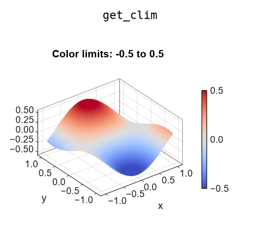</a> <a href="../examples/reference_sources.py#L543">Source code</a></td>
  </tr>
</table>

## Update data and colors

<table>
  <tr>
    <td align="center" width="33%"><a href="scene.md#set_heights">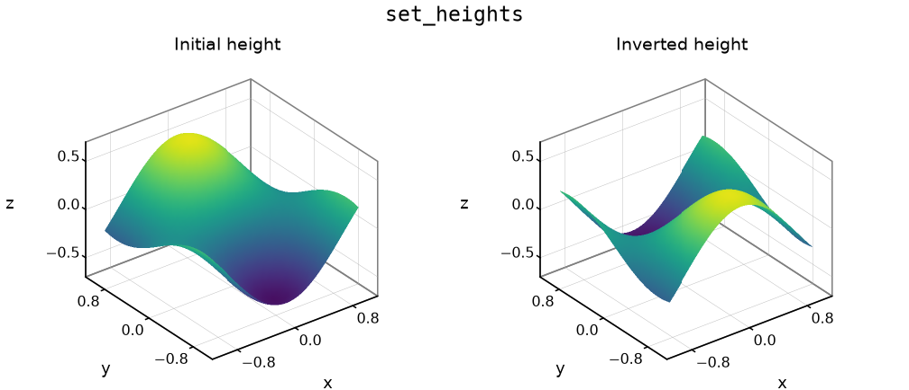</a> <a href="../examples/reference_sources.py#L553">Source code</a></td>
    <td align="center" width="33%"><a href="scene.md#set_values">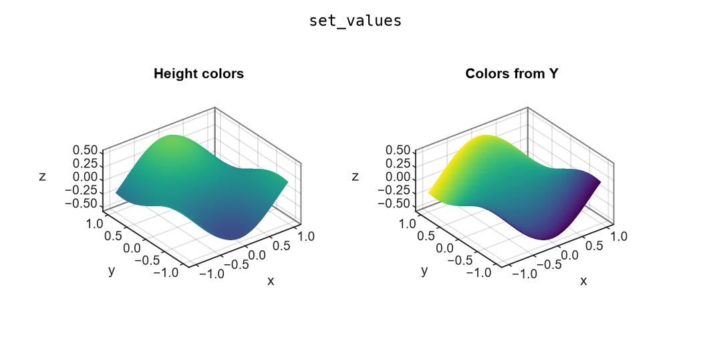</a> <a href="../examples/reference_sources.py#L565">Source code</a></td>
    <td align="center" width="33%"> <a href="../examples/reference_sources.py#L576">Source code</a></td>
  </tr>
  <tr>
    <td align="center" width="33%"> <a href="../examples/reference_sources.py#L585">Source code</a></td>
    <td align="center" width="33%"> <a href="../examples/reference_sources.py#L596">Source code</a></td>
  </tr>
</table>

## Style and visibility

<table>
  <tr>
    <td align="center" width="33%"> <a href="../examples/reference_sources.py#L607">Source code</a></td>
    <td align="center" width="33%"><a href="scene.md#set_color">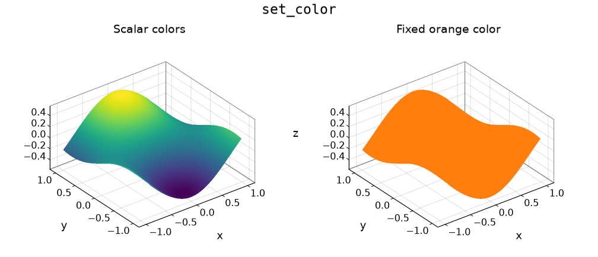</a> <a href="../examples/reference_sources.py#L616">Source code</a></td>
    <td align="center" width="33%"><a href="scene.md#set_facecolor">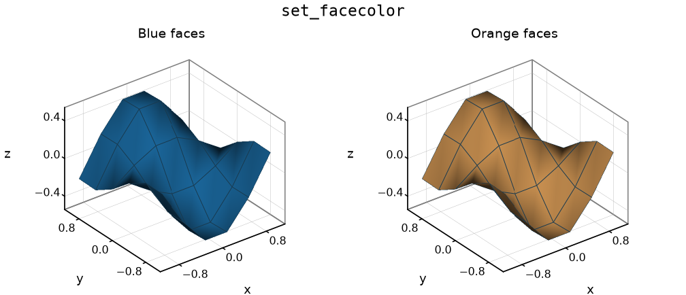</a> <a href="../examples/reference_sources.py#L627">Source code</a></td>
  </tr>
  <tr>
    <td align="center" width="33%"> <a href="../examples/reference_sources.py#L638">Source code</a></td>
    <td align="center" width="33%"><a href="scene.md#set_alpha">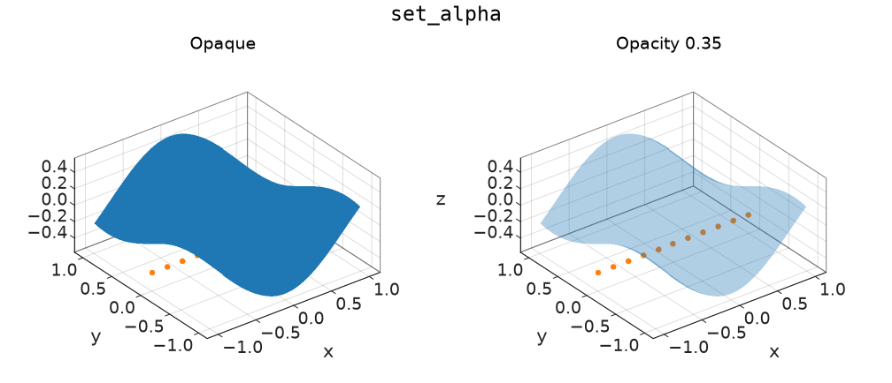</a> <a href="../examples/reference_sources.py#L649">Source code</a></td>
    <td align="center" width="33%"> <a href="../examples/reference_sources.py#L661">Source code</a></td>
  </tr>
  <tr>
    <td align="center" width="33%"><a href="scene.md#set_linewidth">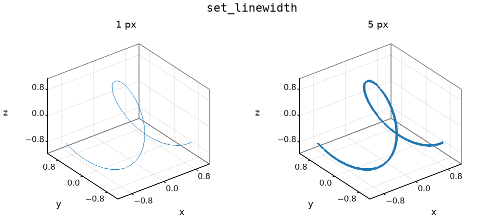</a> <a href="../examples/reference_sources.py#L673">Source code</a></td>
    <td align="center" width="33%"><a href="scene.md#set_linestyle">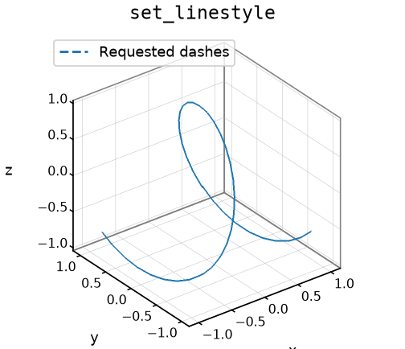</a> <a href="../examples/reference_sources.py#L684">Source code</a></td>
    <td align="center" width="33%"><a href="scene.md#set_lighting">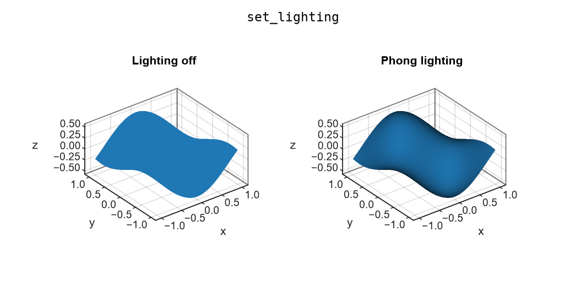</a> <a href="../examples/reference_sources.py#L697">Source code</a></td>
  </tr>
  <tr>
    <td align="center" width="33%"> <a href="../examples/reference_sources.py#L708">Source code</a></td>
  </tr>
</table>

## Renderer integration

<table>
  <tr>
    <td align="center" width="33%"> <a href="../examples/reference_sources.py#L720">Source code</a></td>
    <td align="center" width="33%"><a href="scene.md#graphicdraw">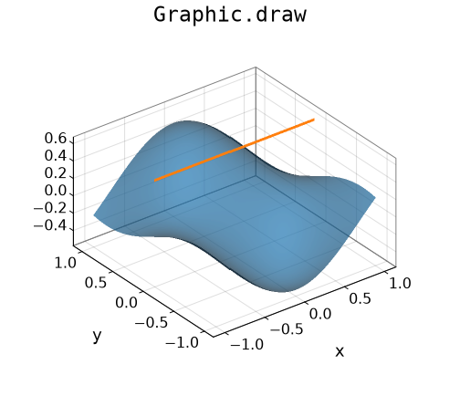</a> <a href="../examples/reference_sources.py#L732">Source code</a></td>
    <td align="center" width="33%"><a href="scene.md#add_collection3d">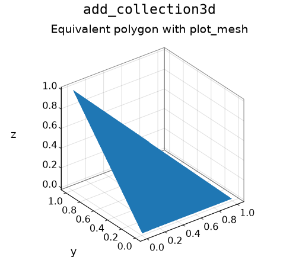</a> <a href="../examples/reference_sources.py#L745">Source code</a></td>
  </tr>
</table>

## More examples

- [Three intersecting planes](examples.md#three-intersecting-planes)
- [Run the examples or regenerate these figures](examples.md#regenerate-the-reference-figures)
