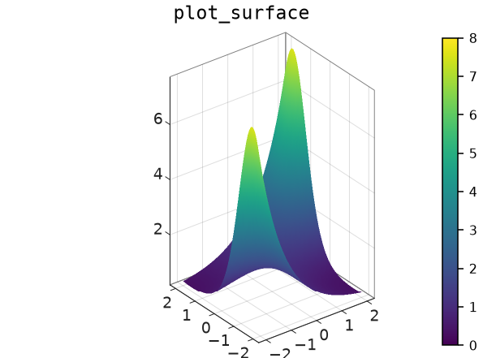
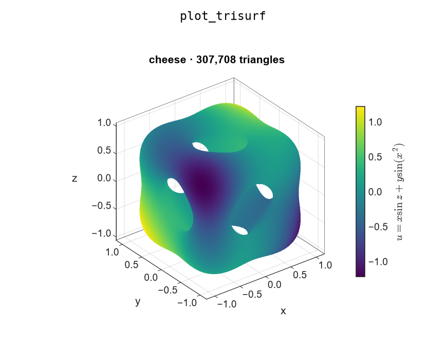

# Gallery

Click a figure to open its API documentation. Each figure has its own runnable Python script.

[Run the examples and regenerate the figures](examples.md)

## Plotting methods

| | | |
| :---: | :---: | :---: |
|  [Documentation](api.md#plot_surface) · [Source code](../examples/reference/plot_surface.py) |  [Documentation](api.md#plot_trisurf) · [Source code](../examples/reference/plot_trisurf.py) |  [Documentation](api.md#plot_isosurface) · [Source code](../examples/random_field_isosurface.py) |
|  [Documentation](api.md#plot) · [Source code](../examples/reference/plot.py) |  [Documentation](api.md#scatter) · [Source code](../examples/reference/scatter.py) |  |

## Style helpers

| | |
| :---: | :---: |
|  [Documentation](scene.md#plot_rc) · [Source code](../examples/reference/plot_rc.py) |  [Documentation](scene.md#ax3d_setting) · [Source code](../examples/reference/ax3D_setting.py) |
