# Gallery

Click a figure to open its API reference. The link below it opens the Python code that draws it.

- **Plot data** · [Isosurfaces and triangle meshes](#isosurfaces-and-triangle-meshes) · [Surfaces](#surfaces-and-contours) · [Charts](#lines-points-and-charts) · [Scalar fields](#meshes-and-scalar-fields) · [Vector fields](#vector-fields-and-streamlines) · [Spatial geometry](#point-clouds-and-other-geometry) · [Matplotlib aliases](#matplotlib-aliases)
- **Manage the scene** · [Axes](#axes-controls) · [Streaming lines and lights](#streaming-lines-and-lights) · [Matplotlib controls](#matplotlib-controls) · [Renderer integration](#renderer-integration)
- **Work with a handle** · [Inspect geometry and data](#graphic-handles) · [Update data and colors](#update-data-and-colors) · [Style and visibility](#style-and-visibility) · [Specialized handles](#specialized-handles)

## Isosurfaces and triangle meshes

These figures use the original triangle meshes and all three PFC scalar volumes.
[Get the upstream data](examples.md#upstream-data) · [Compare with mplot3d](../benchmarks/results/my_mpl_style/README.md)

| | |
| :---: | :---: |
|  [Source code](../examples/reference_sources.py#L185) |  [Source code](../examples/reference_sources.py#L170) |
|  [Source code](../examples/reference_sources.py#L65) |  [Source code](../examples/reference_sources.py#L159) |

### Random isosurface

The zero level of a 19 × 19 × 19 field of uniform random samples in [−1, 1], with seed 42. Colors show vertex height.

[Source code](../examples/random_isosurface.py)

## Surfaces and contours

| | | |
| :---: | :---: | :---: |
|  [Source code](../examples/reference_sources.py#L51) |  [Source code](../examples/reference_sources.py#L59) | [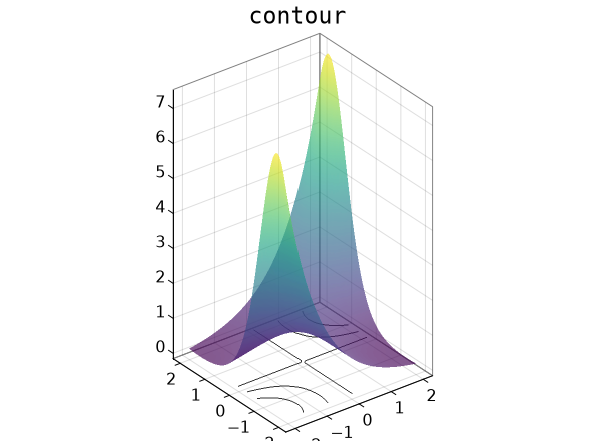](api.md#contour) [Source code](../examples/reference_sources.py#L83) |

## Lines, points, and charts

| | | |
| :---: | :---: | :---: |
| [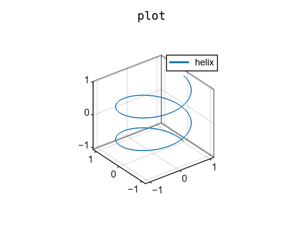](api.md#plot) [Source code](../examples/reference_sources.py#L90) |  [Source code](../examples/reference_sources.py#L99) |  [Source code](../examples/reference_sources.py#L108) |
|  [Source code](../examples/reference_sources.py#L117) | [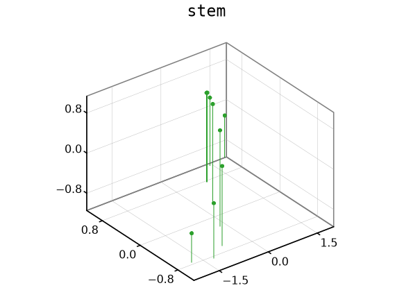](api.md#stem) [Source code](../examples/reference_sources.py#L124) |  |

## Matplotlib aliases

| | | |
| :---: | :---: | :---: |
|  [Source code](../examples/reference_sources.py#L131) |  [Source code](../examples/reference_sources.py#L138) |  [Source code](../examples/reference_sources.py#L145) |
|  [Source code](../examples/reference_sources.py#L153) |  |  |

## Meshes and scalar fields

| | | |
| :---: | :---: | :---: |
|  [Source code](../examples/reference_sources.py#L205) |  [Source code](../examples/reference_sources.py#L213) |  [Source code](../examples/reference_sources.py#L220) |

## Vector fields and streamlines

| | | |
| :---: | :---: | :---: |
|  [Source code](../examples/reference_sources.py#L228) |  [Source code](../examples/reference_sources.py#L237) |  [Source code](../examples/reference_sources.py#L246) |
|  [Source code](../examples/reference_sources.py#L253) |  [Source code](../examples/reference_sources.py#L260) |  |

## Point clouds and other geometry

| | | |
| :---: | :---: | :---: |
|  [Source code](../examples/reference_sources.py#L268) |  [Source code](../examples/reference_sources.py#L275) |  [Source code](../examples/reference_sources.py#L282) |
|  [Source code](../examples/reference_sources.py#L289) | [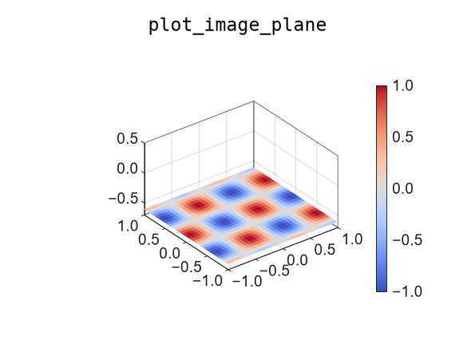](function_reference.md#plot_image_plane) [Source code](../examples/reference_sources.py#L297) |  |

## Axes controls

| | | |
| :---: | :---: | :---: |
|  [Source code](../examples/reference_sources.py#L308) |  [Source code](../examples/reference_sources.py#L316) |  [Source code](../examples/reference_sources.py#L325) |
| [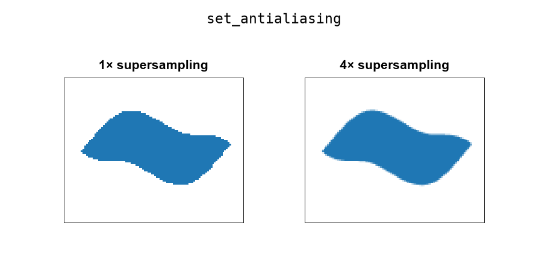](scene.md#set_antialiasing) [Source code](../examples/reference_sources.py#L333) |  [Source code](../examples/reference_sources.py#L348) |  [Source code](../examples/reference_sources.py#L360) |
|  [Source code](../examples/reference_sources.py#L371) |  [Source code](../examples/reference_sources.py#L384) |  [Source code](../examples/reference_sources.py#L397) |
|  [Source code](../examples/reference_sources.py#L408) |  [Source code](../examples/reference_sources.py#L418) |  [Source code](../examples/reference_sources.py#L428) |
|  [Source code](../examples/reference_sources.py#L437) |  |  |

## Streaming lines and lights

| | | |
| :---: | :---: | :---: |
|  [Source code](../examples/reference_sources.py#L452) | [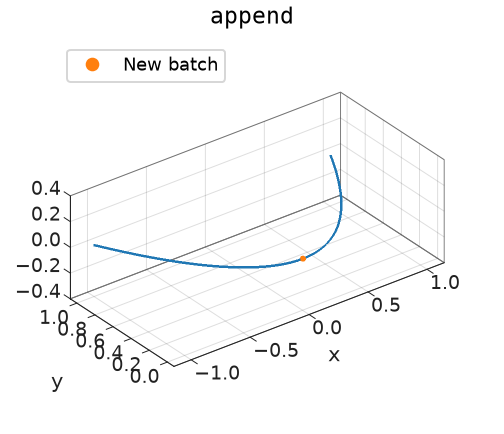](scene.md#append) [Source code](../examples/reference_sources.py#L461) | [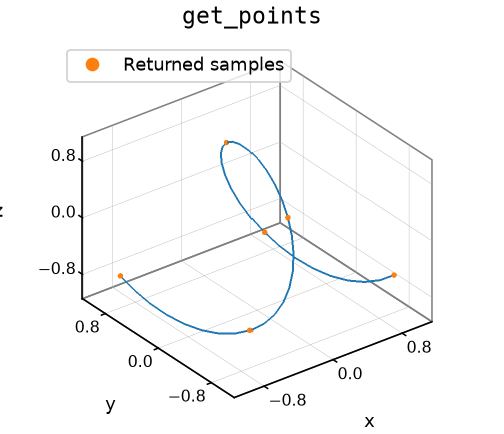](scene.md#get_points) [Source code](../examples/reference_sources.py#L473) |
|  [Source code](../examples/reference_sources.py#L484) | [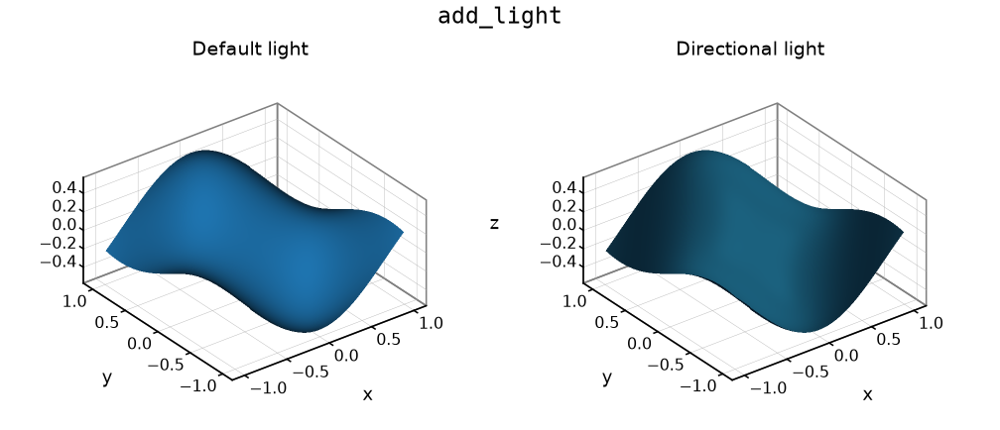](scene.md#add_light) [Source code](../examples/reference_sources.py#L498) |  |

## Graphic handles

| | | |
| :---: | :---: | :---: |
|  [Source code](../examples/reference_sources.py#L510) |  [Source code](../examples/reference_sources.py#L523) |  [Source code](../examples/reference_sources.py#L532) |
|  [Source code](../examples/reference_sources.py#L542) |  [Source code](../examples/reference_sources.py#L556) |  [Source code](../examples/reference_sources.py#L565) |

## Update data and colors

| | | |
| :---: | :---: | :---: |
|  [Source code](../examples/reference_sources.py#L575) |  [Source code](../examples/reference_sources.py#L587) |  [Source code](../examples/reference_sources.py#L598) |
| [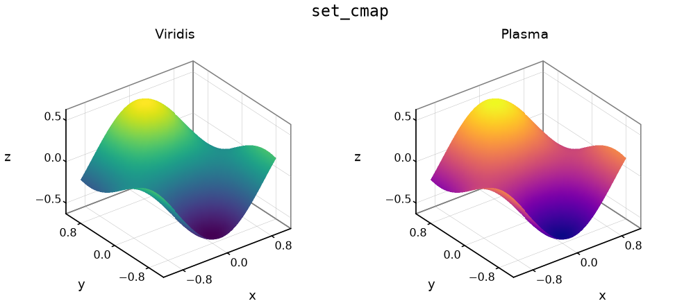](scene.md#set_cmap) [Source code](../examples/reference_sources.py#L607) | [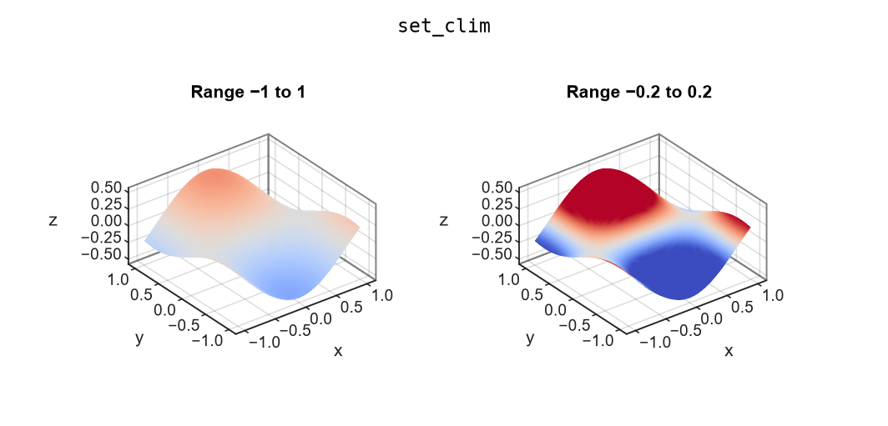](scene.md#set_clim) [Source code](../examples/reference_sources.py#L618) |  |

## Style and visibility

| | | |
| :---: | :---: | :---: |
|  [Source code](../examples/reference_sources.py#L629) |  [Source code](../examples/reference_sources.py#L638) |  [Source code](../examples/reference_sources.py#L649) |
|  [Source code](../examples/reference_sources.py#L660) |  [Source code](../examples/reference_sources.py#L671) |  [Source code](../examples/reference_sources.py#L683) |
|  [Source code](../examples/reference_sources.py#L695) |  [Source code](../examples/reference_sources.py#L706) |  [Source code](../examples/reference_sources.py#L719) |
| [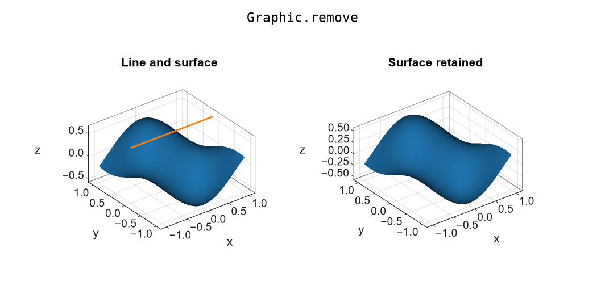](scene.md#graphicremove) [Source code](../examples/reference_sources.py#L730) |  |  |

## Matplotlib controls

| | | |
| :---: | :---: | :---: |
|  [Source code](../examples/reference_sources.py#L742) |  [Source code](../examples/reference_sources.py#L754) |  [Source code](../examples/reference_sources.py#L766) |
|  [Source code](../examples/reference_sources.py#L774) |  [Source code](../examples/reference_sources.py#L786) | [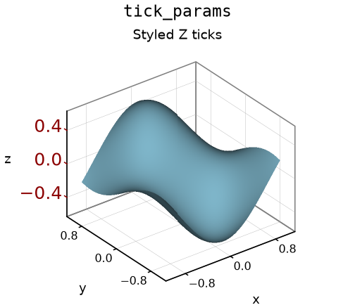](scene.md#tick_params) [Source code](../examples/reference_sources.py#L794) |
|  [Source code](../examples/reference_sources.py#L804) |  [Source code](../examples/reference_sources.py#L818) |  |

## Specialized handles

| | | |
| :---: | :---: | :---: |
|  [Source code](../examples/reference_sources.py#L827) | [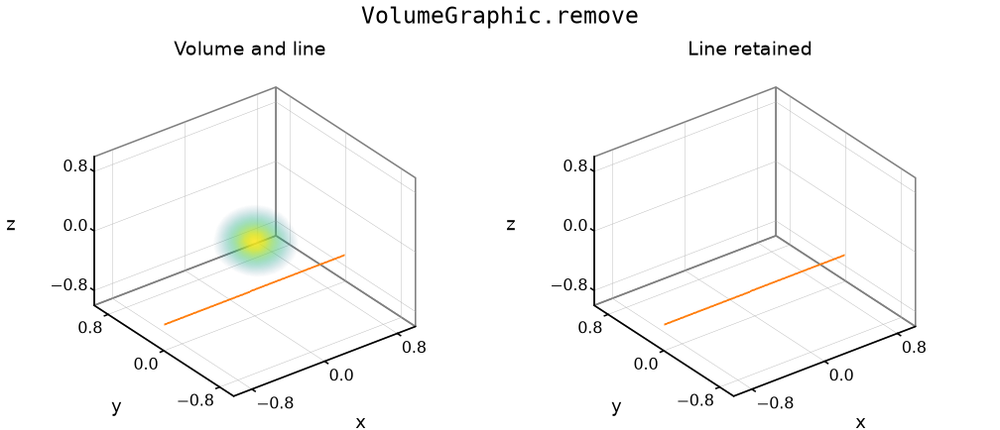](scene.md#volumegraphicremove) [Source code](../examples/reference_sources.py#L844) |  [Source code](../examples/reference_sources.py#L861) |
|  [Source code](../examples/reference_sources.py#L874) |  [Source code](../examples/reference_sources.py#L887) |  [Source code](../examples/reference_sources.py#L900) |
| [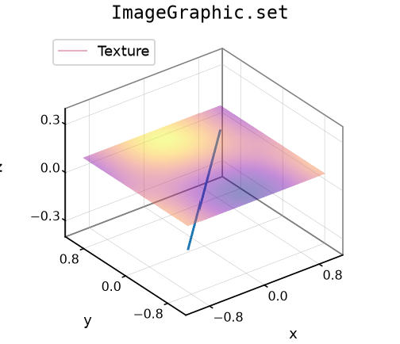](scene.md#imagegraphicset) [Source code](../examples/reference_sources.py#L910) |  [Source code](../examples/reference_sources.py#L921) |  |

## Renderer integration

| | | |
| :---: | :---: | :---: |
|  [Source code](../examples/reference_sources.py#L931) |  [Source code](../examples/reference_sources.py#L943) |  [Source code](../examples/reference_sources.py#L956) |

## More examples

- [Three intersecting planes](examples.md#three-intersecting-planes)
- [Run the examples or regenerate these figures](examples.md#regenerate-the-reference-figures)
