# Gallery

Each figure links to its documentation and has a runnable Python script.

- **Plot data** · [Isosurfaces and triangle meshes](#isosurfaces-and-triangle-meshes) · [Surfaces](#surfaces-and-contours) · [Charts](#lines-points-and-charts) · [Scalar fields](#meshes-and-scalar-fields) · [Vector fields](#vector-fields-and-streamlines) · [Spatial geometry](#point-clouds-and-other-geometry) · [Matplotlib aliases](#matplotlib-aliases)
- **Manage the scene** · [Axes](#axes-controls) · [Streaming lines and lights](#streaming-lines-and-lights) · [Matplotlib controls](#matplotlib-controls) · [Renderer integration](#renderer-integration)
- **Work with a handle** · [Inspect geometry and data](#graphic-handles) · [Update data and colors](#update-data-and-colors) · [Style and visibility](#style-and-visibility) · [Specialized handles](#specialized-handles)

## Isosurfaces and triangle meshes

The triangle mesh figures use the original cheese and peanut datasets.
[Example datasets](../data/README.md) · [Compare with mplot3d](../benchmarks/results/my_mpl_style/README.md)

| | |
| :---: | :---: |
|  [Documentation](api.md#plot_trisurf) · [Source code](../examples/reference/plot_trisurf.py) |  [Documentation](function_reference.md#plot_mesh) · [Source code](../examples/reference/plot_mesh.py) |

### Random isosurface

The zero level of a 20 × 20 × 20 field of uniform random samples in [−1, 1], with seed 42.

[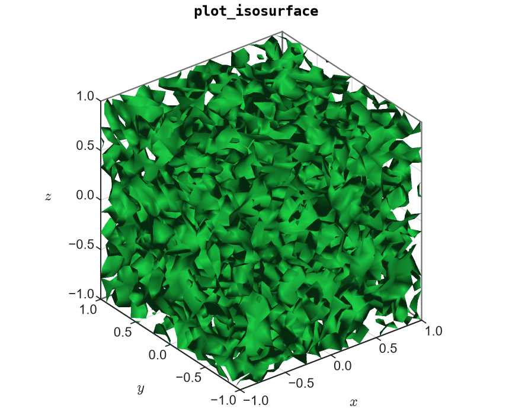](function_reference.md#plot_isosurface)

[Documentation](function_reference.md#plot_isosurface) · [Source code](../examples/random_field_isosurface.py)

## Surfaces and contours

| | | |
| :---: | :---: | :---: |
|  [Documentation](api.md#plot_surface) · [Source code](../examples/reference/plot_surface.py) |  [Documentation](api.md#plot_wireframe) · [Source code](../examples/reference/plot_wireframe.py) |  [Documentation](api.md#contour) · [Source code](../examples/reference/contour.py) |

## Lines, points, and charts

| | | |
| :---: | :---: | :---: |
|  [Documentation](api.md#plot) · [Source code](../examples/reference/plot.py) |  [Documentation](api.md#scatter) · [Source code](../examples/reference/scatter.py) |  [Documentation](api.md#quiver) · [Source code](../examples/reference/quiver.py) |
| [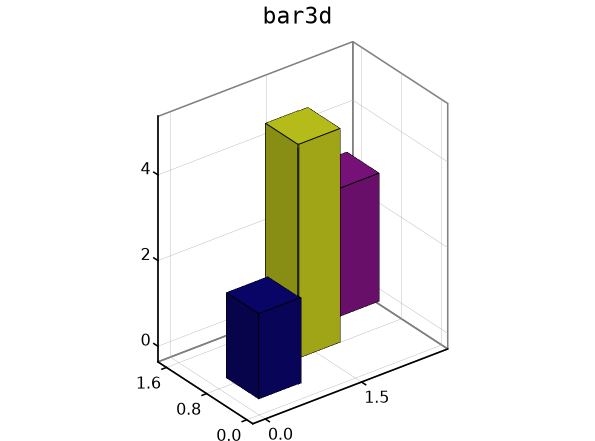](api.md#bar3d) [Documentation](api.md#bar3d) · [Source code](../examples/reference/bar3d.py) |  [Documentation](api.md#stem) · [Source code](../examples/reference/stem.py) |  |

## Matplotlib aliases

| | | |
| :---: | :---: | :---: |
| [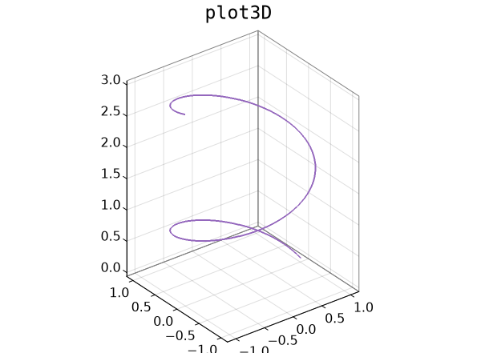](api.md#plot3d) [Documentation](api.md#plot3d) · [Source code](../examples/reference/plot3d.py) |  [Documentation](api.md#scatter3d) · [Source code](../examples/reference/scatter3d.py) | [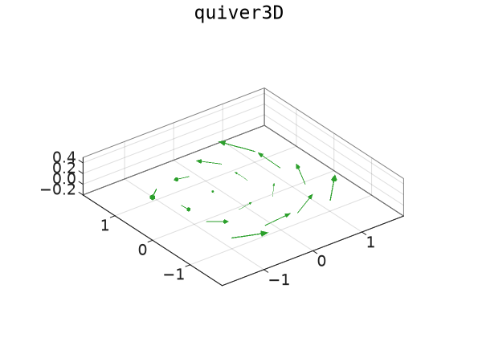](api.md#quiver3d) [Documentation](api.md#quiver3d) · [Source code](../examples/reference/quiver3d.py) |
| [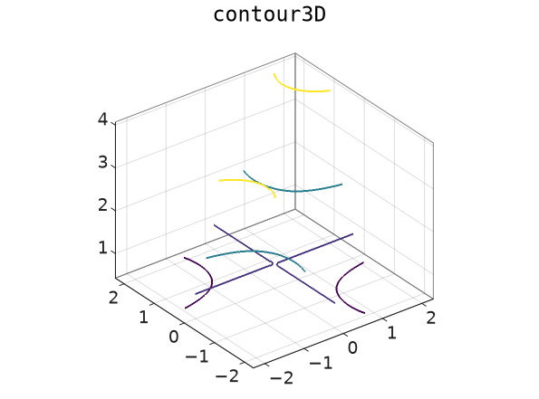](api.md#contour3d) [Documentation](api.md#contour3d) · [Source code](../examples/reference/contour3d.py) |  |  |

## Meshes and scalar fields

| | | |
| :---: | :---: | :---: |
|  [Documentation](function_reference.md#plot_volume_slices) · [Source code](../examples/reference/plot_volume_slices.py) |  [Documentation](function_reference.md#plot_slice_contours) · [Source code](../examples/reference/plot_slice_contours.py) |  [Documentation](function_reference.md#plot_volume) · [Source code](../examples/reference/plot_volume.py) |

## Vector fields and streamlines

| | | |
| :---: | :---: | :---: |
|  [Documentation](function_reference.md#trace_streamlines) · [Source code](../examples/reference/trace_streamlines.py) | [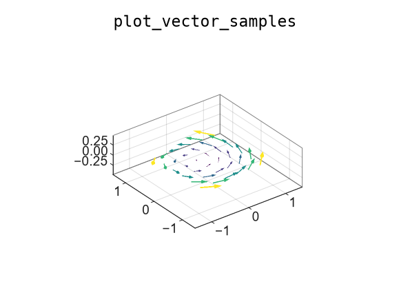](function_reference.md#plot_vector_samples) [Documentation](function_reference.md#plot_vector_samples) · [Source code](../examples/reference/plot_vector_samples.py) |  [Documentation](function_reference.md#plot_streamlines) · [Source code](../examples/reference/plot_streamlines.py) |
| [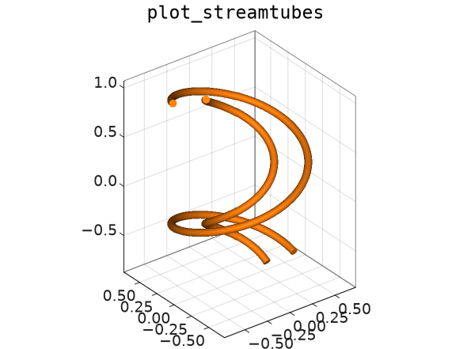](function_reference.md#plot_streamtubes) [Documentation](function_reference.md#plot_streamtubes) · [Source code](../examples/reference/plot_streamtubes.py) |  [Documentation](function_reference.md#plot_streamribbons) · [Source code](../examples/reference/plot_streamribbons.py) |  |

## Point clouds and other geometry

| | | |
| :---: | :---: | :---: |
| [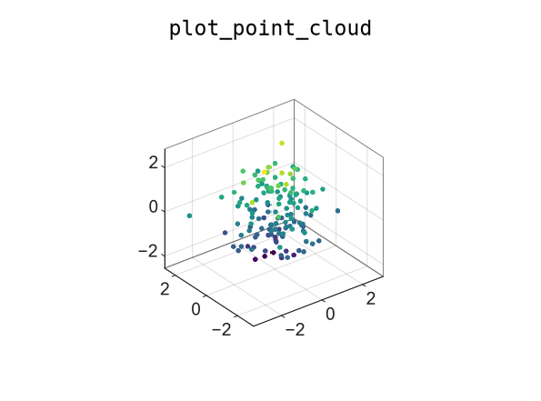](function_reference.md#plot_point_cloud) [Documentation](function_reference.md#plot_point_cloud) · [Source code](../examples/reference/plot_point_cloud.py) |  [Documentation](function_reference.md#plot_alpha_shape) · [Source code](../examples/reference/plot_alpha_shape.py) |  [Documentation](function_reference.md#plot_coordinate_frames) · [Source code](../examples/reference/plot_coordinate_frames.py) |
|  [Documentation](function_reference.md#plot_graph) · [Source code](../examples/reference/plot_graph.py) |  [Documentation](function_reference.md#plot_image_plane) · [Source code](../examples/reference/plot_image_plane.py) |  |

## Axes controls

| | | |
| :---: | :---: | :---: |
|  [Documentation](scene.md#vtkaxes) · [Source code](../examples/reference/vtkaxes.py) | [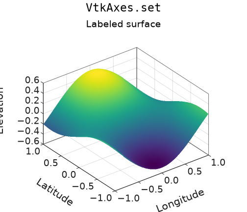](scene.md#vtkaxesset) [Documentation](scene.md#vtkaxesset) · [Source code](../examples/reference/axes_set.py) |  [Documentation](scene.md#get_antialiasing) · [Source code](../examples/reference/get_antialiasing.py) |
|  [Documentation](scene.md#set_antialiasing) · [Source code](../examples/reference/set_antialiasing.py) |  [Documentation](scene.md#set_aspect) · [Source code](../examples/reference/set_aspect.py) |  [Documentation](scene.md#set_box_aspect) · [Source code](../examples/reference/set_box_aspect.py) |
|  [Documentation](scene.md#fit) · [Source code](../examples/reference/fit.py) |  [Documentation](scene.md#clear_scene) · [Source code](../examples/reference/clear_scene.py) |  [Documentation](scene.md#clear) · [Source code](../examples/reference/clear.py) |
|  [Documentation](scene.md#vtkaxesremove) · [Source code](../examples/reference/axes_remove.py) |  [Documentation](scene.md#get_legend_handles_labels) · [Source code](../examples/reference/get_legend_handles_labels.py) | [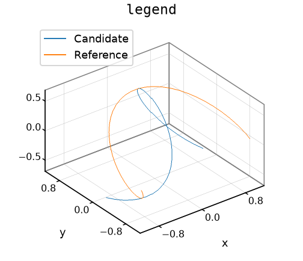](scene.md#legend) [Documentation](scene.md#legend) · [Source code](../examples/reference/legend.py) |
|  [Documentation](scene.md#pixels) · [Source code](../examples/reference/pixels.py) |  |  |

## Streaming lines and lights

| | | |
| :---: | :---: | :---: |
|  [Documentation](scene.md#add_streaming_line) · [Source code](../examples/reference/add_streaming_line.py) |  [Documentation](scene.md#append) · [Source code](../examples/reference/append.py) |  [Documentation](scene.md#get_points) · [Source code](../examples/reference/get_points.py) |
| [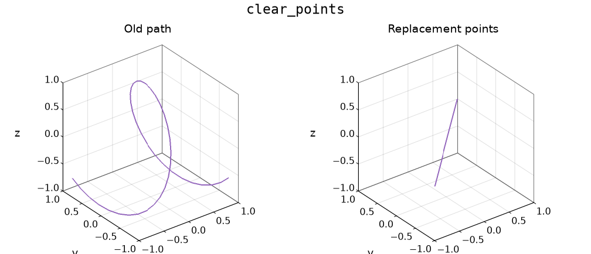](scene.md#clear_points) [Documentation](scene.md#clear_points) · [Source code](../examples/reference/clear_points.py) |  [Documentation](scene.md#add_light) · [Source code](../examples/reference/add_light.py) |  |

## Graphic handles

| | | |
| :---: | :---: | :---: |
|  [Documentation](scene.md#graphic) · [Source code](../examples/reference/graphic.py) |  [Documentation](scene.md#vertices) · [Source code](../examples/reference/vertices.py) |  [Documentation](scene.md#faces) · [Source code](../examples/reference/faces.py) |
|  [Documentation](scene.md#get_array) · [Source code](../examples/reference/get_array.py) | [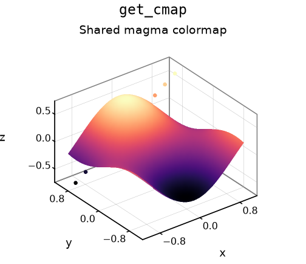](scene.md#get_cmap) [Documentation](scene.md#get_cmap) · [Source code](../examples/reference/get_cmap.py) |  [Documentation](scene.md#get_clim) · [Source code](../examples/reference/get_clim.py) |

## Update data and colors

| | | |
| :---: | :---: | :---: |
|  [Documentation](scene.md#set_heights) · [Source code](../examples/reference/set_heights.py) |  [Documentation](scene.md#set_values) · [Source code](../examples/reference/set_values.py) | [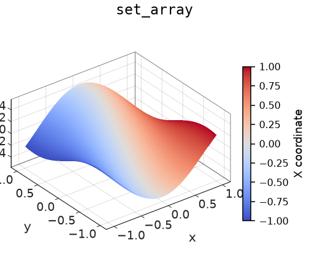](scene.md#set_array) [Documentation](scene.md#set_array) · [Source code](../examples/reference/set_array.py) |
|  [Documentation](scene.md#set_cmap) · [Source code](../examples/reference/set_cmap.py) |  [Documentation](scene.md#set_clim) · [Source code](../examples/reference/set_clim.py) |  |

## Style and visibility

| | | |
| :---: | :---: | :---: |
| [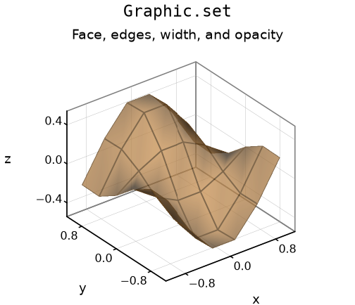](scene.md#graphicset) [Documentation](scene.md#graphicset) · [Source code](../examples/reference/graphic_set.py) |  [Documentation](scene.md#set_color) · [Source code](../examples/reference/set_color.py) |  [Documentation](scene.md#set_facecolor) · [Source code](../examples/reference/set_facecolor.py) |
| [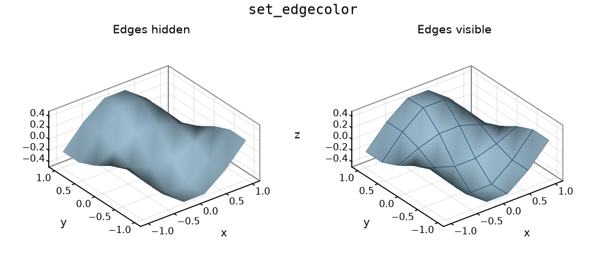](scene.md#set_edgecolor) [Documentation](scene.md#set_edgecolor) · [Source code](../examples/reference/set_edgecolor.py) |  [Documentation](scene.md#set_alpha) · [Source code](../examples/reference/set_alpha.py) | [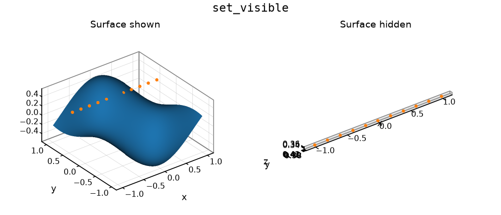](scene.md#set_visible) [Documentation](scene.md#set_visible) · [Source code](../examples/reference/set_visible.py) |
|  [Documentation](scene.md#set_linewidth) · [Source code](../examples/reference/set_linewidth.py) |  [Documentation](scene.md#set_linestyle) · [Source code](../examples/reference/set_linestyle.py) |  [Documentation](scene.md#set_lighting) · [Source code](../examples/reference/set_lighting.py) |
|  [Documentation](scene.md#graphicremove) · [Source code](../examples/reference/graphic_remove.py) |  |  |

## Matplotlib controls

| | | |
| :---: | :---: | :---: |
| [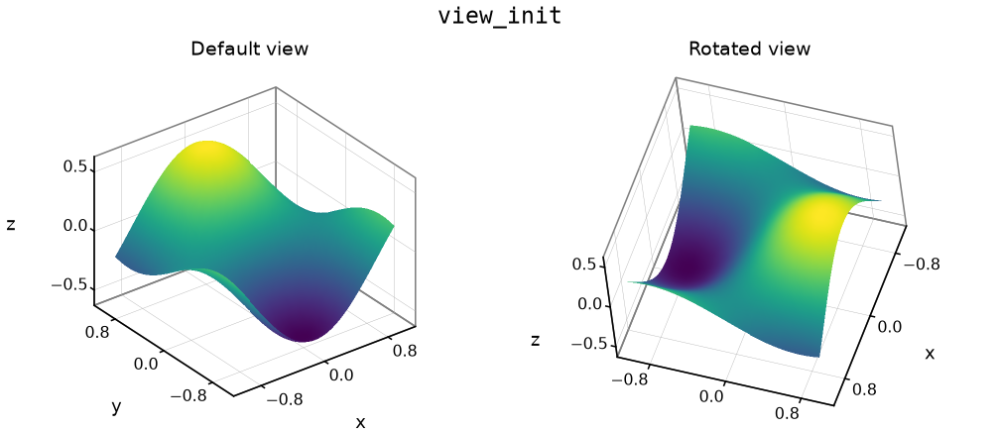](scene.md#view_init) [Documentation](scene.md#view_init) · [Source code](../examples/reference/view_init.py) |  [Documentation](scene.md#set_proj_type) · [Source code](../examples/reference/set_proj_type.py) |  [Documentation](scene.md#figurecolorbar) · [Source code](../examples/reference/figure_colorbar.py) |
| [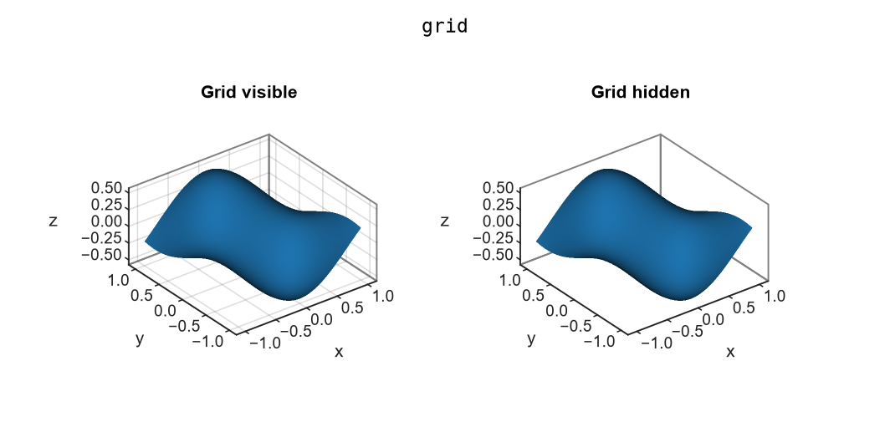](scene.md#grid) [Documentation](scene.md#grid) · [Source code](../examples/reference/grid.py) |  [Documentation](scene.md#text) · [Source code](../examples/reference/text.py) |  [Documentation](scene.md#tick_params) · [Source code](../examples/reference/tick_params.py) |
|  [Documentation](scene.md#set_norm) · [Source code](../examples/reference/set_norm.py) |  [Documentation](scene.md#set_label) · [Source code](../examples/reference/set_label.py) |  |

## Specialized handles

| | | |
| :---: | :---: | :---: |
|  [Documentation](scene.md#volumegraphicset_visible) · [Source code](../examples/reference/volume_set_visible.py) |  [Documentation](scene.md#volumegraphicremove) · [Source code](../examples/reference/volume_remove.py) |  [Documentation](scene.md#volumegraphicdraw) · [Source code](../examples/reference/volume_draw.py) |
|  [Documentation](scene.md#volumegraphicset) · [Source code](../examples/reference/volume_set.py) | [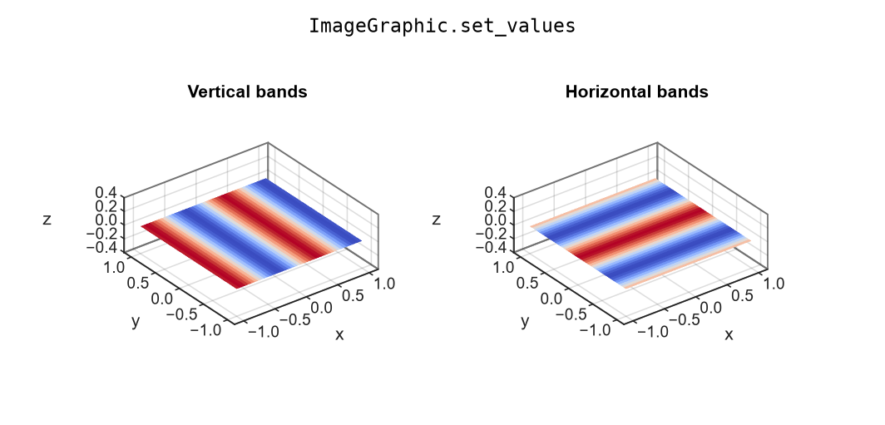](scene.md#imagegraphicset_values) [Documentation](scene.md#imagegraphicset_values) · [Source code](../examples/reference/image_set_values.py) |  [Documentation](scene.md#imagegraphicset_array) · [Source code](../examples/reference/image_set_array.py) |
|  [Documentation](scene.md#imagegraphicset) · [Source code](../examples/reference/image_set.py) |  [Documentation](scene.md#streaminglineset) · [Source code](../examples/reference/streaming_line_set.py) |  |

## Renderer integration

| | | |
| :---: | :---: | :---: |
| [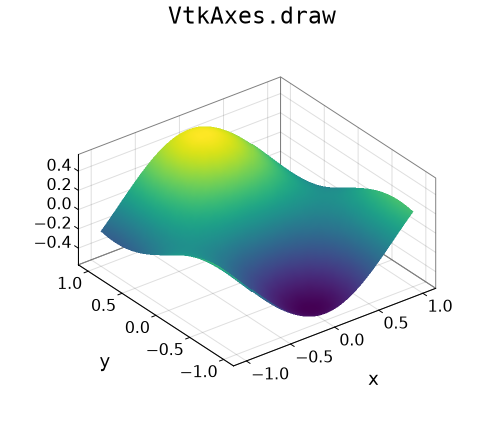](scene.md#vtkaxesdraw) [Documentation](scene.md#vtkaxesdraw) · [Source code](../examples/reference/axes_draw.py) |  [Documentation](scene.md#graphicdraw) · [Source code](../examples/reference/graphic_draw.py) |  [Documentation](scene.md#add_collection3d) · [Source code](../examples/reference/add_collection3d.py) |

## More examples

- [Three intersecting planes](examples.md#three-intersecting-planes)
- [Run the examples or regenerate these figures](examples.md#regenerate-the-reference-figures)
