# Scene and handles

Use these controls to manage a plotted scene and edit its existing geometry. For methods that create new plots, see the [plotting API](api.md) and the [VTK reference](function_reference.md).

| Task | Methods |
| --- | --- |
| Configure or clear an axes | [Axes controls](#axes-controls) |
| Update a live line or add a light | [Streaming lines and lights](#streaming-lines-and-lights) |
| Inspect vertices, faces, or color values | [Graphic handles](#graphic-handles) |
| Update heights or color data | [Update data and colors](#update-data-and-colors) |
| Change style, visibility, or remove a plot | [Style and visibility](#style-and-visibility) |
| Change the view, axes, or color mapping | [Matplotlib controls](#matplotlib-controls) |
| Edit a volume, an image, or a streaming line | [Specialized handles](#specialized-handles) |
| Integrate with the Matplotlib renderer | [Renderer integration](#renderer-integration) |

## Run the examples

Run the shared setup, then run the code under the method you want to try.

```python
import matplotlib.pyplot as plt
import numpy as np
import mpl3d_vtk

t = np.linspace(-1, 1, 41)
x, y = np.meshgrid(t, t)
z = .55 * np.cos(2*x) * np.sin(2*y)


def new_scene(columns=1):
    fig, axes = plt.subplots(1, columns, figsize=(3.6*columns, 3.1), layout="constrained",
                             subplot_kw={"projection": "vtk3d"})
    for ax in np.atleast_1d(axes):
        ax.set(xlabel="x", ylabel="y", zlabel="z")
    return fig, axes


def sample(ax, **style):
    return ax.plot_surface(x, y, z, **style)
```

## Axes controls

[`VtkAxes`](#vtkaxes) · [`VtkAxes.set`](#vtkaxesset) · [`get_antialiasing`](#get_antialiasing) · [`set_antialiasing`](#set_antialiasing) · [`set_aspect`](#set_aspect) · [`set_box_aspect`](#set_box_aspect) · [`fit`](#fit) · [`clear_scene`](#clear_scene) · [`clear`](#clear) · [`VtkAxes.remove`](#vtkaxesremove) · [`get_legend_handles_labels`](#get_legend_handles_labels) · [`legend`](#legend) · [`pixels`](#pixels)

### `VtkAxes`

```text
fig.add_subplot(..., projection="vtk3d", antialiasing=2)
```

Create a Matplotlib subplot that renders geometry with VTK. The default camera is orthographic at elevation 30° and azimuth −127.5°. The default `aspect="auto"` uses the normal Matplotlib box proportions. Pass `antialiasing` from 1 to 4.

```python
fig, ax = new_scene()
sample(ax, cmap="viridis")
ax.view_init(elev=24, azim=-60)
```

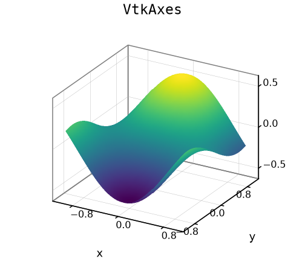

[Source code](../examples/reference_sources.py#L308).

### `VtkAxes.set`

```text
ax.set(**properties)
```

Set several axes properties in one Matplotlib call. Common keywords include `xlabel`, `ylabel`, `zlabel`, `title`, and axis limits.

```python
fig, ax = new_scene()
sample(ax, cmap="viridis")
ax.set(xlabel="Longitude", ylabel="Latitude", zlabel="Elevation", title="Labeled surface",
       xlim=(-1, 1), ylim=(-1, 1), zlim=(-.6, .6))
```


[Source code](../examples/reference_sources.py#L316).

### `get_antialiasing`

```text
ax.get_antialiasing()
```

Return the current integer supersampling scale per image dimension.

```python
fig, ax = new_scene()
sample(ax, cmap="cividis")
ax.set_title(f"{ax.get_antialiasing()}× supersampling")
```


[Source code](../examples/reference_sources.py#L325).

### `set_antialiasing`

```text
ax.set_antialiasing(factor)
```

Set a supersampling scale from 1 to 4. A factor of 1 renders at the output dimensions. A factor of 2 renders at twice the width and height, then downsamples. This example enlarges both low-resolution viewport renders to expose the effect on edges.

```python
source, ax = new_scene()
ax.set_axis_off()
sample(ax, color="tab:blue", shade=False)
source.canvas.draw()

fig, panels = plt.subplots(1, 2, figsize=(6.5, 3.1))
for panel, factor in zip(panels, (1, 4)):
    ax.set_antialiasing(factor)
    panel.imshow(ax.pixels(105, 85), origin="lower", interpolation="nearest")
    panel.set(title=f"{factor}× supersampling", xticks=[], yticks=[])
```


[Source code](../examples/reference_sources.py#L333).

### `set_aspect`

```text
ax.set_aspect(aspect, adjustable=None)
```

Use `"auto"` for the display box's usual proportions or `"equal"` to give one data unit the same length on every axis. The modes `"equalxy"`, `"equalxz"`, and `"equalyz"` match units on two axes. Matplotlib adjusts the box by default. Pass `adjustable="datalim"` to adjust the data limits instead.

```python
fig, (auto, equal) = new_scene(2)
for ax in (auto, equal):
    ax.plot_surface(x, y, .25*z, cmap="viridis")
    ax.set(xlim=(-1, 1), ylim=(-1, 1), zlim=(-.2, .2))
auto.set_title("Auto box proportions")
equal.set_aspect("equal")
equal.set_title("Equal length per data unit")
```

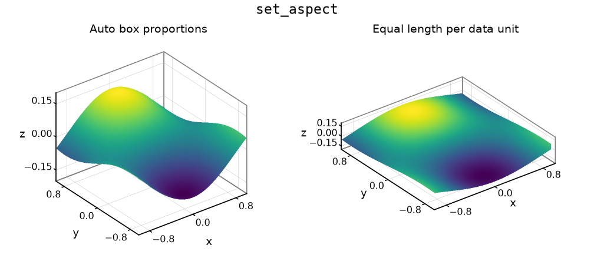

[Source code](../examples/reference_sources.py#L348).

### `set_box_aspect`

```text
ax.set_box_aspect(aspect, *, zoom=1)
```

Set the display box's three axis ratios and its zoom. The input coordinates are unchanged. Pass `None` for Matplotlib's default box ratios.

```python
fig, (auto, fixed) = new_scene(2)
for ax in (auto, fixed):
    sample(ax, cmap="plasma")
auto.set_title("Default aspect")
fixed.set_box_aspect((1, 1, 1.8))
fixed.set_title("Taller Z axis")
```

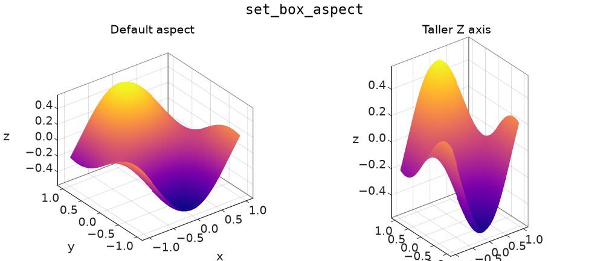

[Source code](../examples/reference_sources.py#L360).

### `fit`

```text
ax.fit()
```

Update data bounds from the VTK geometry and apply enabled autoscaling. A normal draw runs this after geometry changes. Call fit explicitly when you need the updated limits before drawing.

```python
fig, (fixed, fitted) = new_scene(2)
for ax in (fixed, fitted):
    sample(ax, color="tab:blue")
    ax.set(xlim=(-2, 2), ylim=(-2, 2), zlim=(-2, 2))
fixed.set_title("Manual limits")
fitted.set_autoscale_on(True)
fitted.fit()
fitted.set_title(f"Fitted X limits: {fitted.get_xlim()[0]:.1f} to {fitted.get_xlim()[1]:.1f}")
```


[Source code](../examples/reference_sources.py#L371).

### `clear_scene`

```text
ax.clear_scene()
```

Remove VTK plots and their dependent artists. Retain axes settings and independently added Matplotlib artists.

```python
fig, (before, after) = new_scene(2)
for ax in (before, after):
    sample(ax, color="tab:blue")
    ax.set(xlim=(-1, 1), ylim=(-1, 1), zlim=(-.6, .9))
    ax.text(0, 0, .75, "Matplotlib annotation")
before.set_title("Before")
after.clear_scene()
after.set_title("Annotation retained")
```

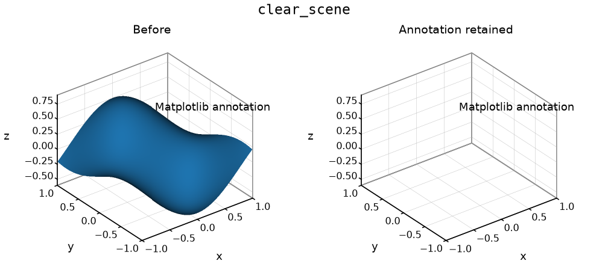

[Source code](../examples/reference_sources.py#L384).

### `clear`

```text
ax.clear()
```

Reset the axes and reapply the vtk3d style. The subplot stays in its figure, ready for another plot.

```python
fig, (before, after) = new_scene(2)
for ax in (before, after):
    sample(ax, cmap="viridis")
before.set_title("Before")
after.clear()
after.set_title("Reset subplot")
```


[Source code](../examples/reference_sources.py#L397).

### `VtkAxes.remove`

```text
ax.remove()
```

Remove the subplot from its figure and release the VTK window. This is useful after saving an offscreen figure.

```python
fig, (keep, discard) = new_scene(2)
sample(keep, color="tab:blue")
sample(discard, color="tab:orange")
discard.remove()
keep.set_title("Remaining subplot")
```


[Source code](../examples/reference_sources.py#L408).

### `get_legend_handles_labels`

```text
ax.get_legend_handles_labels()
```

Return a pair of lists containing Matplotlib proxy handles and their labels. Use the result when selecting or reordering legend entries.

```python
fig, ax = new_scene()
ax.plot(t, t**2, .4*t, color="tab:blue", label="Path")
ax.scatter(t[::5], t[::5]**2, .4*t[::5], c="tab:orange", label="Samples")
handles, labels = ax.get_legend_handles_labels()
ax.legend(handles[::-1], labels[::-1], loc="upper left")
```


[Source code](../examples/reference_sources.py#L418).

### `legend`

```text
ax.legend(*args, **kwargs)
```

Create a Matplotlib legend from labeled plots. Pass explicit handles and labels to choose specific entries. The method returns a Matplotlib Legend.

```python
fig, ax = new_scene()
ax.plot(t, np.sin(3*t), .6*np.cos(3*t), color="tab:blue", label="Candidate")
ax.plot(t, np.cos(3*t), .6*np.sin(3*t), color="tab:orange", label="Reference")
ax.legend(loc="upper left")
```


[Source code](../examples/reference_sources.py#L428).

### `pixels`

```text
ax.pixels(width, height)
```

Render the current VTK viewport to a uint8 RGBA array of shape `(height, width, 4)`. The first row is the bottom of the viewport. Copy the result before editing a cached frame.

```python
source, ax = new_scene()
ax.set_axis_off()
sample(ax, cmap="plasma")
source.canvas.draw()
rgba = ax.pixels(240, 180)

fig, preview = plt.subplots()
preview.imshow(rgba, origin="lower")
preview.set(title=f"RGBA snapshot: {rgba.shape[1]} × {rgba.shape[0]} pixels",
            xticks=[], yticks=[])
```


[Source code](../examples/reference_sources.py#L437).

## Streaming lines and lights

[`add_streaming_line`](#add_streaming_line) · [`append`](#append) · [`get_points`](#get_points) · [`clear_points`](#clear_points) · [`add_light`](#add_light)

### `add_streaming_line`

```text
ax.add_streaming_line(*, max_points=None, **style)
```

Create an initially empty Graphic that accepts incremental updates. A positive max_points retains the latest points. With no limit, the handle retains the full history. Pending updates are combined on the next draw.

```python
fig, ax = new_scene()
line = ax.add_streaming_line(max_points=31, color="tab:blue", linewidth=3)
line.append(t, np.sin(4*t), np.cos(4*t))
ax.set_title("Latest 31 points")
```


[Source code](../examples/reference_sources.py#L452).

### `append`

```text
line.append(x, y, z=0)
```

Queue broadcastable XYZ coordinates on a streaming line. The visible path updates on the next draw.

```python
fig, ax = new_scene()
line = ax.add_streaming_line(color="tab:blue", linewidth=2.5)
line.append(t[:20], t[:20]**2, 0)
line.append(t[20:], t[20:]**2, 0)
ax.set(zlim=(-.4, .4))
ax.scatter(t[20], t[20]**2, 0, c="tab:orange", s=35, label="New batch")
ax.legend(loc="upper left")
```


[Source code](../examples/reference_sources.py#L461).

### `get_points`

```text
line.get_points()
```

Apply pending updates and return copies of the three coordinate arrays in X, Y, Z order.

```python
fig, ax = new_scene()
line = ax.add_streaming_line(color="tab:blue", linewidth=2)
line.append(t, np.sin(4*t), np.cos(4*t))
points = line.get_points()
ax.scatter(*(v[::8] for v in points), c="tab:orange", s=32, label="Returned samples")
ax.legend(loc="upper left")
```


[Source code](../examples/reference_sources.py#L473).

### `clear_points`

```text
line.clear_points()
```

Discard the visible points and pending updates. The line handle keeps its style and accepts new points.

```python
fig, (before, after) = new_scene(2)
for ax in (before, after):
    line = ax.add_streaming_line(color="tab:purple", linewidth=2)
    line.append(t, np.sin(4*t), np.cos(4*t))
    ax.set(xlim=(-1, 1), ylim=(-1, 1), zlim=(-1, 1))
before.set_title("Old path")
line.clear_points()
line.append(t, t, 0)
after.set_title("Replacement points")
```


[Source code](../examples/reference_sources.py#L484).

### `add_light`

```text
ax.add_light(position, *, focal_point=(0., 0., 0.), color="white", positional=False)
```

Add a light with a world-space position and focal point. Set positional=True for a point light. The method returns a vtkLight, whose intensity and other settings you can change. Set lighting on a plot to use the light.

```python
fig, (left, right) = new_scene(2)
sample(left, color="tab:blue", lighting=True)
sample(right, color="tab:blue", lighting=True)
left.set_title("Default light")
light = right.add_light((3, -4, 5), color="wheat")
light.SetIntensity(.85)
right.set_title("Directional light")
```


[Source code](../examples/reference_sources.py#L498).

## Graphic handles

[`Graphic`](#graphic) · [`vertices`](#vertices) · [`faces`](#faces) · [`get_array`](#get_array) · [`get_cmap`](#get_cmap) · [`get_clim`](#get_clim)

### `Graphic`

```text
mpl3d_vtk.Graphic(ax, data, values=None, *, association="point", mapper=None, **style)
```

A Graphic is both a Matplotlib artist and scalar mappable. Plotting methods return these handles. You can also wrap an existing vtkPolyData directly. Bind values per point or per cell with association and pass a custom mapper when needed. Use the data, mapper, and actor attributes for VTK access. Call Modified() on VTK objects changed directly.

```python
import vtk

fig, ax = new_scene()
sphere = vtk.vtkSphereSource()
sphere.SetThetaResolution(30)
sphere.SetPhiResolution(30)
sphere.Update()
handle = mpl3d_vtk.Graphic(ax, sphere.GetOutput(), color="tab:blue", lighting=True)
```


[Source code](../examples/reference_sources.py#L510).

### `vertices`

```text
handle.vertices
```

Return a copy of the geometry's XYZ vertices as an (n, 3) array.

```python
fig, ax = new_scene()
handle = ax.plot_mesh([[0,0,0], [1,0,0], [0,1,1]], [[0,1,2]], color="tab:blue", alpha=.35)
ax.scatter(*handle.vertices.T, c="tab:orange", s=45, label="Returned vertices")
ax.legend(loc="upper left")
```

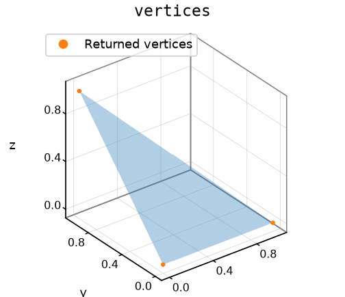

[Source code](../examples/reference_sources.py#L523).

### `faces`

```text
handle.faces
```

Return copies of the zero-based face indices. Equal-size faces use a 2D array. Mixed polygon sizes return a list of arrays.

```python
fig, ax = new_scene()
handle = ax.plot_mesh([[0,0,0], [1,0,0], [0,1,1], [1,1,0]], [[0,1,2], [1,3,2]],
                      color="tab:blue", alpha=.35, edgecolor="tab:blue")
for number, face in enumerate(handle.faces):
    ax.text(*handle.vertices[face].mean(axis=0), str(number), color="black")
```

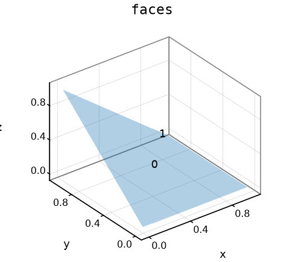

[Source code](../examples/reference_sources.py#L532).

### `get_array`

```text
handle.get_array()
```

Return the scalar array used as input to the handle's normalization.

```python
fig, panels = plt.subplots(1, 2, figsize=(6.5, 3.1),
                            subplot_kw={"projection": "vtk3d"})
surface, values = panels
handle = sample(surface, cmap="coolwarm", vmin=-1, vmax=1)
handle.set_array(x.ravel())
values.remove()
histogram = fig.add_subplot(122)
histogram.hist(handle.get_array(), bins=11, color="tab:blue")
histogram.set(xlabel="Scalar value", ylabel="Count", title="Returned array")
```

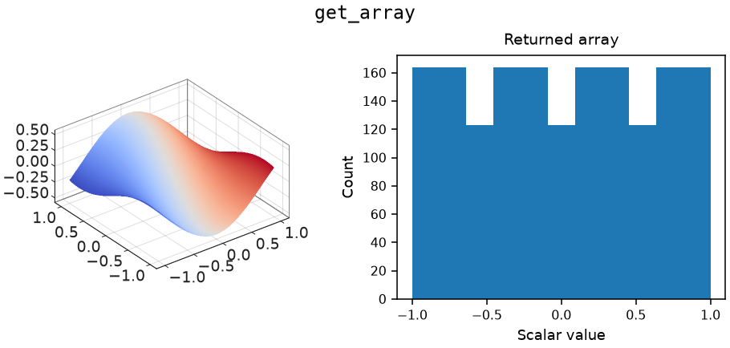

[Source code](../examples/reference_sources.py#L542).

### `get_cmap`

```text
handle.get_cmap()
```

Return the Matplotlib colormap used by the handle.

```python
fig, ax = new_scene()
first = sample(ax, cmap="magma")
ax.scatter(t[::4], .8, .65*t[::4], c=t[::4], s=40, cmap=first.get_cmap())
ax.set_title(f"Shared {first.get_cmap().name} colormap")
```


[Source code](../examples/reference_sources.py#L556).

### `get_clim`

```text
handle.get_clim()
```

Return the lower and upper bounds of the current scalar mapping.

```python
fig, ax = new_scene()
handle = sample(ax, cmap="coolwarm", vmin=-.5, vmax=.5)
limits = handle.get_clim()
fig.colorbar(handle, ax=ax, shrink=.65, ticks=[limits[0], 0, limits[1]])
ax.set_title(f"Color limits: {limits[0]:.1f} to {limits[1]:.1f}")
```

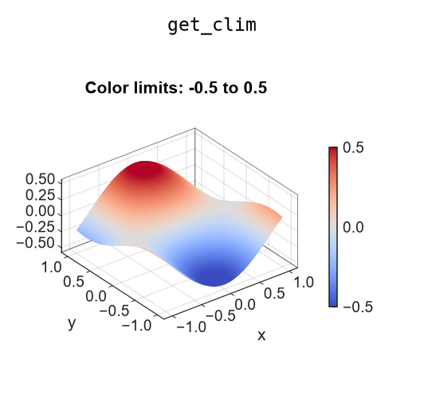

[Source code](../examples/reference_sources.py#L565).

## Update data and colors

[`set_heights`](#set_heights) · [`set_values`](#set_values) · [`set_array`](#set_array) · [`set_cmap`](#set_cmap) · [`set_clim`](#set_clim)

### `set_heights`

```text
handle.set_heights(z)
```

Update a gridded surface in place using the shape of the original grid. Finite-coordinate changes update face connectivity. Height-based colors follow the new data. Explicit color values keep their original association. Returns the same handle.

```python
fig, (before, after) = new_scene(2)
for ax in (before, after):
    handle = sample(ax, cmap="viridis", vmin=-.6, vmax=.6)
    ax.set_zlim(-.7, .7)
before.set_title("Initial height")
handle.set_heights(-z)
after.set_title("Inverted height")
```

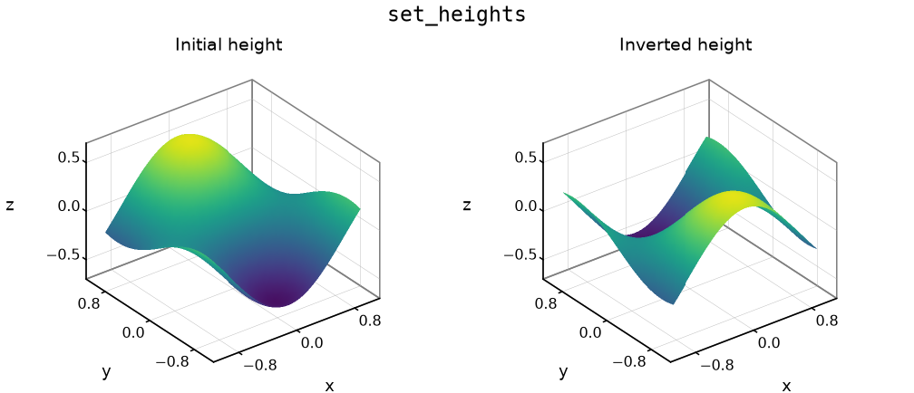

[Source code](../examples/reference_sources.py#L575).

### `set_values`

```text
handle.set_values(values)
```

Replace scalar or RGB(A) data for existing vertices or cells and return the handle. Pass None to clear scalar values on ordinary meshes. For image planes, pass new pixels of the same dimensions.

```python
fig, (before, after) = new_scene(2)
for ax in (before, after):
    handle = sample(ax, cmap="viridis", vmin=-1, vmax=1)
before.set_title("Height colors")
handle.set_values(y)
after.set_title("Colors from Y")
```

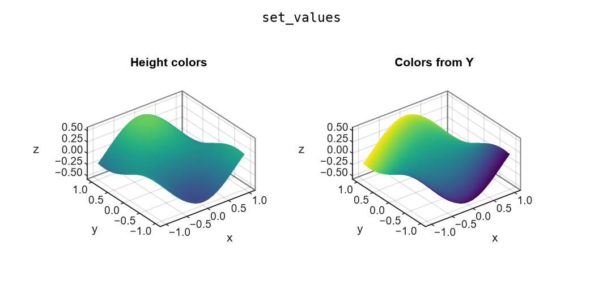

[Source code](../examples/reference_sources.py#L587).

### `set_array`

```text
handle.set_array(values)
```

Set the Matplotlib scalar array used for normalization and colorbars. Use set_values for RGB(A) data.

```python
fig, ax = new_scene()
handle = sample(ax, cmap="coolwarm", vmin=-1, vmax=1)
handle.set_array(x.ravel())
fig.colorbar(handle, ax=ax, shrink=.65, label="X coordinate")
```


[Source code](../examples/reference_sources.py#L598).

### `set_cmap`

```text
handle.set_cmap(cmap)
```

Replace the colormap while keeping geometry and scalar values. Attached colorbars update with the mappable.

```python
fig, (before, after) = new_scene(2)
for ax in (before, after):
    handle = sample(ax, cmap="viridis")
before.set_title("Viridis")
handle.set_cmap("plasma")
after.set_title("Plasma")
```


[Source code](../examples/reference_sources.py#L607).

### `set_clim`

```text
handle.set_clim(vmin, vmax)
```

Set the lower and upper limits of the scalar color mapping. Attached colorbars track the new range.

```python
fig, (before, after) = new_scene(2)
for ax in (before, after):
    handle = sample(ax, cmap="coolwarm", vmin=-1, vmax=1)
before.set_title("Range −1 to 1")
handle.set_clim(-.2, .2)
after.set_title("Range −0.2 to 0.2")
```


[Source code](../examples/reference_sources.py#L618).

## Style and visibility

[`Graphic.set`](#graphicset) · [`set_color`](#set_color) · [`set_facecolor`](#set_facecolor) · [`set_edgecolor`](#set_edgecolor) · [`set_alpha`](#set_alpha) · [`set_visible`](#set_visible) · [`set_linewidth`](#set_linewidth) · [`set_linestyle`](#set_linestyle) · [`set_lighting`](#set_lighting) · [`Graphic.remove`](#graphicremove)

### `Graphic.set`

```text
handle.set(**properties)
```

Update several supported artist properties in one call. Each keyword uses the matching `set_*` method on the handle.

```python
fig, ax = new_scene()
handle = sample(ax, color="tab:blue", rstride=8, cstride=8)
handle.set(facecolor="#eaa85e", edgecolor="#563610", linewidth=2, alpha=.75)
ax.set_title("Face, edges, width, and opacity")
```


[Source code](../examples/reference_sources.py#L629).

### `set_color`

```text
handle.set_color(color)
```

Use a uniform Matplotlib color for the object. This takes precedence over scalar coloring.

```python
fig, (before, after) = new_scene(2)
for ax in (before, after):
    handle = sample(ax, cmap="viridis")
before.set_title("Scalar colors")
handle.set_color("tab:orange")
after.set_title("Fixed orange color")
```

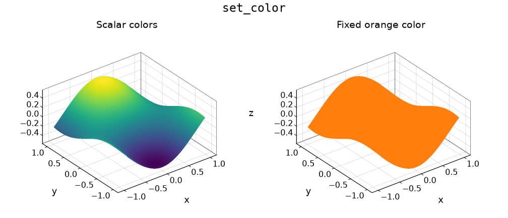

[Source code](../examples/reference_sources.py#L638).

### `set_facecolor`

```text
handle.set_facecolor(color)
```

Set the face color. Pass None to restore the underlying color choice of the handle.

```python
fig, (before, after) = new_scene(2)
for ax in (before, after):
    handle = sample(ax, color="tab:blue", edgecolor="#18394e", rstride=8, cstride=8)
before.set_title("Blue faces")
handle.set_facecolor("#eaa85e")
after.set_title("Orange faces")
```


[Source code](../examples/reference_sources.py#L649).

### `set_edgecolor`

```text
handle.set_edgecolor(color)
```

Set the polygon edge color. Pass "none" to hide the edges.

```python
fig, (before, after) = new_scene(2)
for ax in (before, after):
    handle = sample(ax, color="#aacfe4", rstride=8, cstride=8)
before.set_title("Edges hidden")
handle.set_edgecolor("#204865")
after.set_title("Edges visible")
```


[Source code](../examples/reference_sources.py#L660).

### `set_alpha`

```text
handle.set_alpha(alpha)
```

Set overall opacity between 0 and 1. Pass None to restore default opacity.

```python
fig, (before, after) = new_scene(2)
for ax in (before, after):
    ax.scatter(t[::4], 0, -.35, c="tab:orange", s=45)
    handle = sample(ax, color="tab:blue", shade=False)
before.set_title("Opaque")
handle.set_alpha(.35)
after.set_title("Opacity 0.35")
```


[Source code](../examples/reference_sources.py#L671).

### `set_visible`

```text
handle.set_visible(visible)
```

Show or hide a Graphic and its dependent artists. The handle remains available for later updates.

```python
fig, (before, after) = new_scene(2)
for ax in (before, after):
    ax.scatter(t[::4], .4, .35, c="tab:orange", s=45)
    handle = sample(ax, color="tab:blue")
before.set_title("Surface shown")
handle.set_visible(False)
after.set_title("Surface hidden")
```


[Source code](../examples/reference_sources.py#L683).

### `set_linewidth`

```text
handle.set_linewidth(width)
```

Change the thickness of rendered lines using output pixel units.

```python
fig, (before, after) = new_scene(2)
for ax in (before, after):
    line, = ax.plot(t, np.sin(4*t), np.cos(4*t), linewidth=1, color="tab:blue")
before.set_title("1 px")
line.set_linewidth(5)
after.set_title("5 px")
```


[Source code](../examples/reference_sources.py#L695).

### `set_linestyle`

```text
handle.set_linestyle(style)
```

Request a line pattern from "-", "--", ":", "-.", or "none". VTK backends can display line stippling differently. This example uses a Matplotlib legend proxy to show the requested pattern.

```python
from matplotlib.lines import Line2D

fig, ax = new_scene()
line, = ax.plot(t, np.sin(4*t), np.cos(4*t), linewidth=2, color="tab:blue")
style = "--"
line.set_linestyle(style)
proxy = Line2D([], [], color="tab:blue", linestyle=style, label="Requested dashes")
ax.legend(handles=[proxy], loc="upper left")
```


[Source code](../examples/reference_sources.py#L706).

### `set_lighting`

```text
handle.set_lighting(lighting)
```

Enable or disable lighting, or choose "flat", "gouraud", or "phong" interpolation.

```python
fig, (before, after) = new_scene(2)
for ax in (before, after):
    handle = sample(ax, color="tab:blue", shade=False)
before.set_title("Lighting off")
handle.set_lighting("phong")
after.set_title("Phong lighting")
```

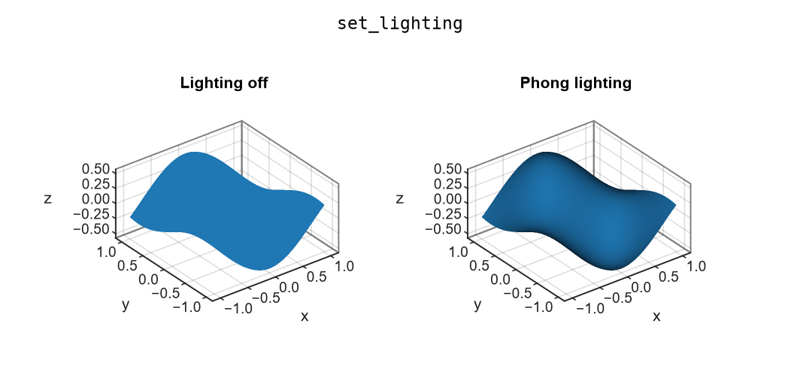

[Source code](../examples/reference_sources.py#L719).

### `Graphic.remove`

```text
handle.remove()
```

Remove the Graphic and its dependent artists while keeping the axes and other plots.

```python
fig, (before, after) = new_scene(2)
for ax in (before, after):
    sample(ax, color="tab:blue")
    line, = ax.plot(t, np.zeros_like(t), .66, linewidth=3, color="tab:orange")
before.set_title("Line and surface")
line.remove()
after.set_title("Surface retained")
```


[Source code](../examples/reference_sources.py#L730).

## Matplotlib controls

[`view_init`](#view_init) · [`set_proj_type`](#set_proj_type) · [`Figure.colorbar`](#figurecolorbar) · [`grid`](#grid) · [`text`](#text) · [`tick_params`](#tick_params) · [`set_norm`](#set_norm) · [`set_label`](#set_label)

### `view_init`

```text
ax.view_init(elev=None, azim=None, roll=None)
```

Choose the elevation, azimuth, and roll of the Matplotlib camera. Angles are in degrees.

```python
fig, (front, side) = new_scene(2)
for ax in (front, side):
    sample(ax, cmap="viridis")
front.view_init(elev=30, azim=-127.5)
front.set_title("Default view")
side.view_init(elev=54, azim=25, roll=8)
side.set_title("Rotated view")
```


[Source code](../examples/reference_sources.py#L742).

### `set_proj_type`

```text
ax.set_proj_type(proj_type, focal_length=None)
```

Choose "ortho" for orthographic projection or "persp" for perspective. focal_length controls the perspective lens.

```python
fig, (ortho, perspective) = new_scene(2)
for ax in (ortho, perspective):
    sample(ax, color="tab:blue", edgecolor="#264e6c", rstride=8, cstride=8)
ortho.set_proj_type("ortho")
ortho.set_title("Orthographic")
perspective.set_proj_type("persp", focal_length=.25)
perspective.set_title("Perspective")
```

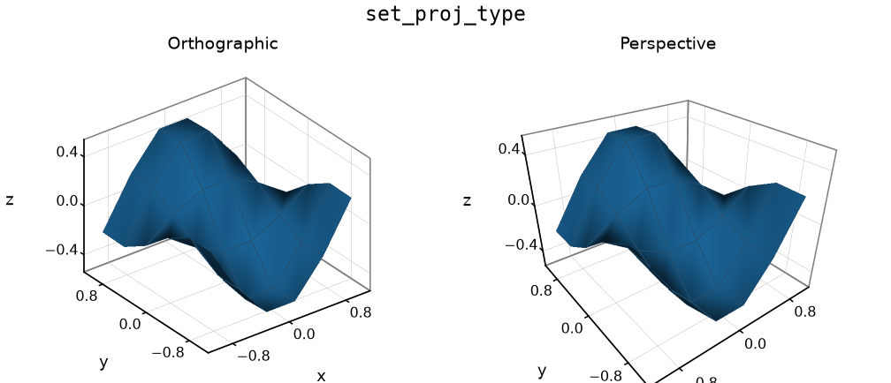

[Source code](../examples/reference_sources.py#L754).

### `Figure.colorbar`

```text
fig.colorbar(mappable, *, ax=..., **kwargs)
```

Display the scalar range of a mappable. Pass the handle returned by a vtk3d plot so the colorbar tracks its normalization and colormap.

```python
fig, ax = new_scene()
surface = sample(ax, cmap="plasma", vmin=-.6, vmax=.6)
fig.colorbar(surface, ax=ax, shrink=.7, label="Height", ticks=[-.6, 0, .6])
```


[Source code](../examples/reference_sources.py#L766).

### `grid`

```text
ax.grid(visible=None, **kwargs)
```

Show or hide the Matplotlib axes grid around the VTK scene.

```python
fig, (with_grid, without_grid) = new_scene(2)
for ax in (with_grid, without_grid):
    sample(ax, color="tab:blue")
with_grid.grid(True)
with_grid.set_title("Grid visible")
without_grid.grid(False)
without_grid.set_title("Grid hidden")
```


[Source code](../examples/reference_sources.py#L774).

### `text`

```text
ax.text(x, y, z, s, **kwargs)
```

Annotate an XYZ location with a Matplotlib text artist. Pass Matplotlib text style options as keywords.

```python
fig, ax = new_scene()
sample(ax, cmap="viridis")
ax.text(.2, .65, .58, "Sample region", color="black")
```

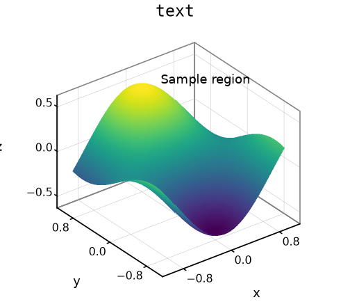

[Source code](../examples/reference_sources.py#L786).

### `tick_params`

```text
ax.tick_params(axis='both', **kwargs)
```

Set tick and tick-label appearance. Choose x, y, or z to style one axis independently.

```python
fig, ax = new_scene()
sample(ax, color="#8ac6dc")
ax.tick_params(axis="z", colors="darkred", labelsize=13)
ax.set_zticks([-.4, 0, .4])
ax.set_title("Styled Z ticks")
```


[Source code](../examples/reference_sources.py#L794).

### `set_norm`

```text
handle.set_norm(norm)
```

Replace the Matplotlib normalization used to map values to color. The geometry and its original scalar values stay in place.

```python
from matplotlib.colors import LogNorm

fig, (linear, logarithmic) = new_scene(2)
values = np.exp(3*x)
sample(linear, values=values, cmap="plasma")
linear.set_title("Linear colors")
handle = sample(logarithmic, values=values, cmap="plasma")
handle.set_norm(LogNorm(vmin=values.min(), vmax=values.max()))
logarithmic.set_title("Logarithmic colors")
```

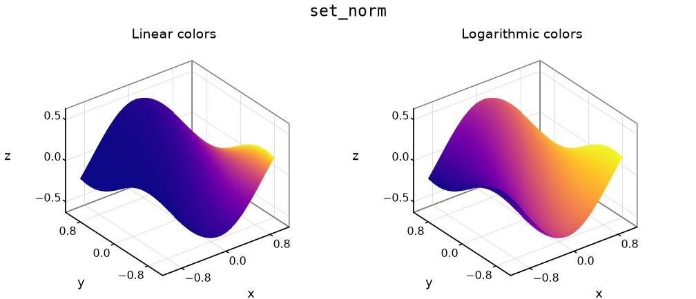

[Source code](../examples/reference_sources.py#L804).

### `set_label`

```text
handle.set_label(label)
```

Change the label used for the handle in a legend. Create a legend after setting the label.

```python
fig, ax = new_scene()
line, = ax.plot(t, np.sin(4*t), np.cos(4*t), color="tab:purple", linewidth=2)
line.set_label("Measured path")
ax.legend(loc="upper left")
```

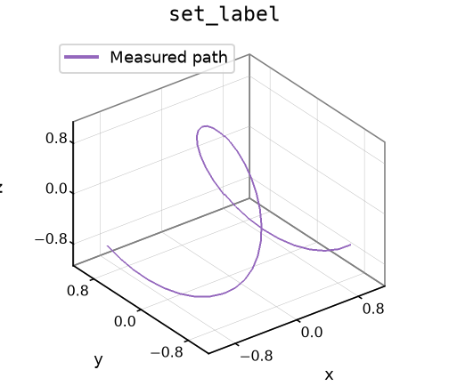

[Source code](../examples/reference_sources.py#L818).

## Specialized handles

[`VolumeGraphic.set_visible`](#volumegraphicset_visible) · [`VolumeGraphic.remove`](#volumegraphicremove) · [`VolumeGraphic.draw`](#volumegraphicdraw) · [`VolumeGraphic.set`](#volumegraphicset) · [`ImageGraphic.set_values`](#imagegraphicset_values) · [`ImageGraphic.set_array`](#imagegraphicset_array) · [`ImageGraphic.set`](#imagegraphicset) · [`StreamingLine.set`](#streaminglineset)

### `VolumeGraphic.set_visible`

```text
cloud.set_visible(visible)
```

Show or hide the volume returned by plot_volume. The volume handle can be shown again after it is hidden.

```python
fig, (before, after) = new_scene(2)
coordinates = np.linspace(-1, 1, 25)
a, b, c = np.meshgrid(coordinates, coordinates, coordinates, sparse=True)
values = np.exp(-5*(a*a+b*b+c*c))
for ax in (before, after):
    cloud = ax.plot_volume(values, coordinates=(coordinates,)*3,
                           cmap="magma", blend_mode="maximum")
    ax.scatter([.65], [.65], [.65], c="tab:blue", s=35)
    ax.set(xlim=(-1, 1), ylim=(-1, 1), zlim=(-1, 1))
before.set_title("Volume shown")
cloud.set_visible(False)
after.set_title("Volume hidden")
```


[Source code](../examples/reference_sources.py#L827).

### `VolumeGraphic.remove`

```text
cloud.remove()
```

Remove the volume from both the Matplotlib axes and the VTK renderer. Other artists stay on the subplot.

```python
fig, (before, after) = new_scene(2)
coordinates = np.linspace(-1, 1, 25)
a, b, c = np.meshgrid(coordinates, coordinates, coordinates, sparse=True)
values = np.exp(-5*(a*a+b*b+c*c))
for ax in (before, after):
    cloud = ax.plot_volume(values, coordinates=(coordinates,)*3,
                           cmap="viridis", blend_mode="maximum")
    ax.plot(t, np.zeros_like(t), -.65, color="tab:orange", linewidth=2)
    ax.set(xlim=(-1, 1), ylim=(-1, 1), zlim=(-1, 1))
before.set_title("Volume and line")
cloud.remove()
after.set_title("Line retained")
```


[Source code](../examples/reference_sources.py#L844).

### `VolumeGraphic.draw`

```text
cloud.draw(renderer)
```

Matplotlib calls this artist hook during a figure draw. The VTK viewport composites the volume into the full scene.

```python
fig, ax = new_scene()
coordinates = np.linspace(-1, 1, 29)
a, b, c = np.meshgrid(coordinates, coordinates, coordinates, sparse=True)
values = np.exp(-8*((a-.3)**2+b*b+c*c))
cloud = ax.plot_volume(values, coordinates=(coordinates,)*3, cmap="magma",
                       blend_mode="maximum")
fig.canvas.draw()
cloud.draw(fig.canvas.get_renderer())
```

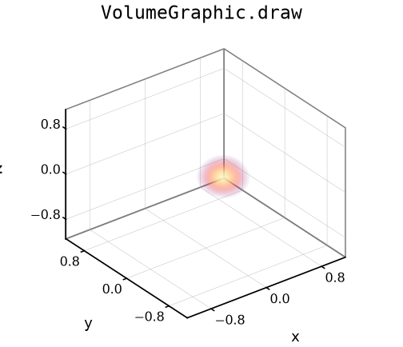

[Source code](../examples/reference_sources.py#L861).

### `VolumeGraphic.set`

```text
cloud.set(**properties)
```

Update supported artist properties on a volume handle, such as its label and visibility.

```python
fig, ax = new_scene()
coordinates = np.linspace(-1, 1, 25)
a, b, c = np.meshgrid(coordinates, coordinates, coordinates, sparse=True)
values = np.exp(-6*(a*a+b*b+c*c))
cloud = ax.plot_volume(values, coordinates=(coordinates,)*3, cmap="plasma",
                       blend_mode="maximum")
cloud.set(label="Scalar volume", visible=True)
ax.legend(loc="upper left")
```


[Source code](../examples/reference_sources.py#L874).

### `ImageGraphic.set_values`

```text
image.set_values(values)
```

Update pixels on a textured plane returned by plot_image_plane. Use the same width and height and supply either scalar, RGB, or RGBA values.

```python
fig, (before, after) = new_scene(2)
for ax in (before, after):
    image = ax.plot_image_plane(np.sin(5*x), extent=(-1, 1, -1, 1),
                                cmap="coolwarm", vmin=-1, vmax=1)
    ax.set(zlim=(-.4, .4))
before.set_title("Vertical bands")
image.set_values(np.cos(5*y))
after.set_title("Horizontal bands")
```


[Source code](../examples/reference_sources.py#L887).

### `ImageGraphic.set_array`

```text
image.set_array(values)
```

Replace the scalar pixel array of an image plane without changing the plane's dimensions.

```python
fig, ax = new_scene()
image = ax.plot_image_plane(z, extent=(-1, 1, -1, 1), cmap="viridis", vmin=0, vmax=2)
image.set_array(x*x+y*y)
ax.set(zlim=(-.4, .4))
fig.colorbar(image, ax=ax, shrink=.7, label="Radial value")
```

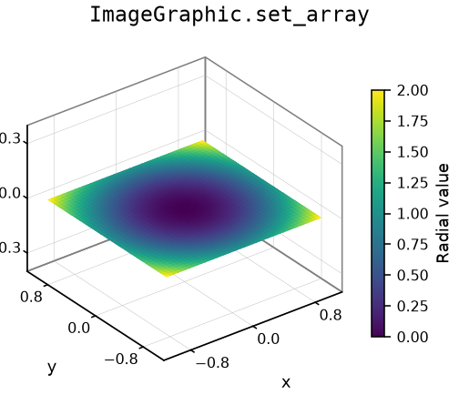

[Source code](../examples/reference_sources.py#L900).

### `ImageGraphic.set`

```text
image.set(**properties)
```

Update artist properties on an image plane. This example sets its opacity and legend label together.

```python
fig, ax = new_scene()
image = ax.plot_image_plane(z, extent=(-1, 1, -1, 1), z=.1, cmap="plasma")
ax.plot(t, t, -.05, color="tab:blue", linewidth=3)
image.set(alpha=.45, label="Texture")
ax.set(zlim=(-.4, .4))
ax.legend(loc="upper left")
```


[Source code](../examples/reference_sources.py#L910).

### `StreamingLine.set`

```text
line.set(**properties)
```

Update supported artist properties on the handle returned by add_streaming_line.

```python
fig, ax = new_scene()
line = ax.add_streaming_line()
line.append(t, np.sin(4*t), np.cos(4*t))
line.set(color="tab:purple", linewidth=4, label="Streaming path")
ax.legend(loc="upper left")
```

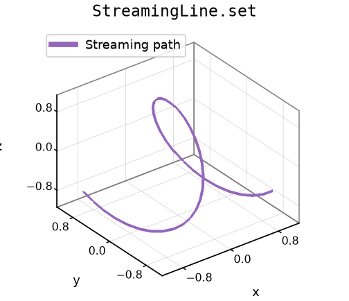

[Source code](../examples/reference_sources.py#L921).

## Renderer integration

[`VtkAxes.draw`](#vtkaxesdraw) · [`Graphic.draw`](#graphicdraw) · [`add_collection3d`](#add_collection3d)

### `VtkAxes.draw`

```text
ax.draw(renderer)
```

Matplotlib calls this integration hook with its backend renderer. It synchronizes the axes and composites the VTK viewport. Trigger it through fig.canvas.draw() when you need a synchronous frame.

```python
from matplotlib.backends.backend_agg import FigureCanvasAgg

fig, ax = new_scene()
sample(ax, cmap="viridis")
FigureCanvasAgg(fig)
fig.canvas.draw()
ax.draw(fig.canvas.get_renderer())
```


[Source code](../examples/reference_sources.py#L931).

### `Graphic.draw`

```text
handle.draw(renderer)
```

Matplotlib calls this artist hook during drawing. The VTK viewport renders all Graphic actors together so they share a depth buffer. A Figure draw displays the complete scene.

```python
from matplotlib.backends.backend_agg import FigureCanvasAgg

fig, ax = new_scene()
handle = sample(ax, color="tab:blue", alpha=.7)
ax.plot(t, np.zeros_like(t), .65, color="tab:orange", linewidth=3)
FigureCanvasAgg(fig)
fig.canvas.draw()
handle.draw(fig.canvas.get_renderer())
```


[Source code](../examples/reference_sources.py#L943).

### `add_collection3d`

```text
ax.add_collection3d(...)
```

On VtkAxes this Matplotlib entry point raises NotImplementedError. Use plot_mesh for polygons or plot for lines so the geometry participates in the VTK depth test.

```python
from mpl_toolkits.mplot3d.art3d import Poly3DCollection

fig, ax = new_scene()
triangle = [[0,0,0], [1,0,0], [0,1,1]]
try:
    ax.add_collection3d(Poly3DCollection([triangle]))
except NotImplementedError:
    ax.plot_mesh(triangle, [[0,1,2]], color="tab:blue")
ax.set_title("Equivalent polygon with plot_mesh")
```


[Source code](../examples/reference_sources.py#L956).
