# Scene and handles

Use these controls to manage a plotted scene and edit its existing geometry. For methods that create new plots, see the [plotting API](api.md) and the [VTK reference](function_reference.md).

| Task | Methods |
| --- | --- |
| Configure or clear an axes | [Axes controls](#axes-controls) |
| Update a live line or add a light | [Streaming lines and lights](#streaming-lines-and-lights) |
| Inspect vertices, faces, or color values | [Graphic handles](#graphic-handles) |
| Update heights or color data | [Update data and colors](#update-data-and-colors) |
| Change style, visibility, or remove a plot | [Style and visibility](#style-and-visibility) |
| Change the view, axes, or color mapping | [Matplotlib controls](#matplotlib-controls) |
| Edit a volume, an image, or a streaming line | [Specialized handles](#specialized-handles) |
| Integrate with the Matplotlib renderer | [Renderer integration](#renderer-integration) |
| Set several properties at once | [Axes property keywords](#axes-property-keywords), [Handle property keywords](#handle-property-keywords) |

## Run the examples

Run the shared setup, then run the code under the method you want to try.

```python
import matplotlib.pyplot as plt
import numpy as np
import mpl3d_vtk

t = np.linspace(-1, 1, 41)
x, y = np.meshgrid(t, t)
z = .55 * np.cos(2*x) * np.sin(2*y)


def new_scene(columns=1):
    fig, axes = plt.subplots(1, columns, figsize=(3.6*columns, 3.1), layout="constrained",
                             subplot_kw={"projection": "vtk3d"})
    for ax in np.atleast_1d(axes):
        ax.set(xlabel="x", ylabel="y", zlabel="z")
    return fig, axes


def sample(ax, **style):
    return ax.plot_surface(x, y, z, **style)
```

## Axes controls

[`VtkAxes`](#vtkaxes) · [`ax_setting`](#ax_setting) · [`VtkAxes.set`](#vtkaxesset) · [`get_antialiasing`](#get_antialiasing) · [`set_antialiasing`](#set_antialiasing) · [`set_aspect`](#set_aspect) · [`set_box_aspect`](#set_box_aspect) · [`fit`](#fit) · [`clear_scene`](#clear_scene) · [`clear`](#clear) · [`VtkAxes.remove`](#vtkaxesremove) · [`get_legend_handles_labels`](#get_legend_handles_labels) · [`legend`](#legend) · [`pixels`](#pixels)

### `VtkAxes`

```text
fig.add_subplot(..., projection="vtk3d", antialiasing=2)
```

Create a Matplotlib 3D subplot that renders geometry with VTK. Use `fig.add_subplot(..., projection="vtk3d")` or `plt.subplots(subplot_kw={"projection": "vtk3d"})`.

The projection uses Matplotlib's default axes appearance and camera. The gallery applies [`ax_setting`](#ax_setting) to set a common view and tick style.

Axis titles follow Matplotlib's `axes.labelpad` setting. Pass `labelpad` to `set_xlabel()`, `set_ylabel()`, or `set_zlabel()` to override it for one axis.

**Parameters**

- **`fig`** (Matplotlib `Figure`, required for direct construction)

  Parent figure. Subplot factories supply it.

- **`rect`** (four floats or `None`, default `None`)

  Axes rectangle `(left, bottom, width, height)` in figure fractions for direct construction. Subplot factories position the axes via the subplot specification.

- **`antialiasing`** (int, default `2`)

  VTK supersampling factor per output dimension, from 1 to 4.

- **`elev`** (float, default `30`)

  Camera elevation in degrees.

- **`azim`** (float, default `-60`)

  Camera azimuth in degrees.

- **`roll`** (float, default `0`)

  Camera roll in degrees about the viewing direction.

- **`shareview`** (`Axes3D` or `None`, default `None`)

  Share view angles with another 3D axes.

- **`sharez`** (`Axes3D` or `None`, default `None`)

  Share Z-axis limits and scale with another 3D axes.

- **`proj_type`** (str, default `"persp"`)

  Use `"ortho"` for orthographic projection or `"persp"` for perspective.

- **`focal_length`** (float or `None`, default `None`)

  Camera focal length, as described under [`set_proj_type`](#set_proj_type).

- **`aspect`** (str, default `"auto"`)

  Data aspect mode, as described under [`set_aspect`](#set_aspect).

- **`box_aspect`** (three floats or `None`, default `None`)

  Display lengths ratio of the three box axes. `None` starts with Matplotlib's default `4:4:3`.

- **`computed_zorder`** (bool, default `True`)

  Controls Matplotlib's automatic ordering of its supported artists. VTK geometry shares VTK's depth buffer.

- __`**kwargs`__ (keyword arguments)

  Additional Matplotlib axes options, such as `xlabel` or `facecolor`. See [`Axes3D`](https://matplotlib.org/stable/api/toolkits/mplot3d/axes3d.html).

**Returns**

- **`ax`** (`VtkAxes`)

  The axes object returned by a Matplotlib subplot factory when using the `"vtk3d"` projection.

**Examples**

```python
fig, ax = new_scene()
sample(ax, cmap="viridis")
mpl3d_vtk.ax_setting(ax)
ax.view_init(elev=24, azim=-60)
```


[Source code](../examples/reference/vtkaxes.py).

### `ax_setting`

```text
mpl3d_vtk.ax_setting(ax=None, xlim=None, ylim=None, zlim=None, *,
                     xticks=None, yticks=None, zticks=None, aspect="equal",
                     box_aspect=None, xticks_pad=-5, yticks_pad=-5,
                     zticks_pad=0, box_on=False, xtick_length=0.02,
                     ytick_length=0.02, ztick_length=0.02)
```

Apply the [my-mpl-style 3D axes style](https://github.com/guessable/my-mpl-style#3d-axes). The view is orthographic at elevation 30° and azimuth −127.5°. Grid lines are thin, pane fills are transparent, and tick lengths follow the longest projected axis.

**Parameters**

- **`ax`** (`Axes3D` or `None`, default `None`)

  The `3d` or `vtk3d` subplot to style. Omit it to use the current pyplot axes, which must already be three-dimensional.

- **`xlim`, `ylim`, `zlim`** (two finite floats or `None`, default `None`)

  Axis bounds in data units. A pair sets manual limits. `None` uses the axis's current limits and preserves its autoscaling mode.

- **`xticks`, `yticks`, `zticks`** (one-dimensional array or `None`, default `None`)

  Tick locations in data units. `None` keeps the current locator. An empty sequence hides the ticks for that axis.

- **`aspect`** (`"auto"` or `"equal"`, default `"equal"`)

  `"equal"` gives each data unit the same display length in all three directions. `"auto"` uses the axes box proportions.

- **`box_aspect`** (three positive floats or `None`, default `None`)

  Display-length ratios of the X, Y, and Z box edges. A triple overrides the box proportions set by `aspect`.

- **`xticks_pad`, `yticks_pad`** (float, default `-5`)

  Padding in points for the X and Y tick labels.

- **`zticks_pad`** (float, default `0`)

  Extra padding for Z tick labels beyond the 2-point gap from the tick endpoint. The total gap is clamped at zero.

- **`box_on`** (bool, default `False`)

  Draw pane outlines in the axis line colors when `True`. The default color is gray.

- **`xtick_length`, `ytick_length`, `ztick_length`** (float, default `0.02`)

  Non-negative tick lengths as fractions of the longest projected axis. Lengths adjust to the view and figure size.

**Returns**

`None`. The selected axes is modified in place.

**Examples**

```python
fig, (native, styled) = new_scene(2)
fig.set_size_inches(8.2, 3.75)
fig.get_layout_engine().set(w_pad=.17, h_pad=.12, wspace=.12)
for ax in (native, styled):
    sample(ax, cmap="viridis")
native.set_title("Matplotlib defaults")
mpl3d_vtk.ax_setting(styled)
styled.set_title("Styled axes")
```

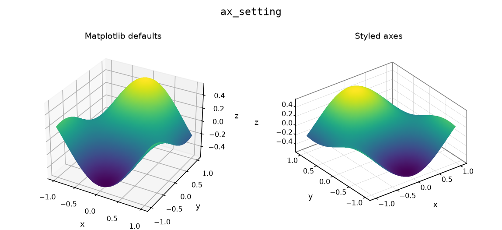

[Source code](../examples/reference/ax_setting.py).

### `VtkAxes.set`

```text
ax.set(**properties)
```

Set several axes properties with a single call.

**Parameters**

- __`**properties`__ (keyword arguments)

  Each name selects its Matplotlib or VTK axes setter. See [axes property keywords](#axes-property-keywords) for valid names and their meanings.

**Returns**

- **`results`** (list)

  The results from the selected setters.

**Examples**

```python
fig, ax = new_scene()
sample(ax, cmap="viridis")
ax.set(xlabel="Longitude", ylabel="Latitude", zlabel="Elevation", title="Labeled surface",
       xlim=(-1, 1), ylim=(-1, 1), zlim=(-.6, .6))
```


[Source code](../examples/reference/axes_set.py).

### `get_antialiasing`

```text
ax.get_antialiasing()
```

Get the current VTK supersampling factor.

**Returns**

- **`factor`** (int)

  The current supersampling factor per output dimension.

**Examples**

```python
fig, ax = new_scene()
sample(ax, cmap="cividis")
ax.set_title(f"{ax.get_antialiasing()}× supersampling")
```

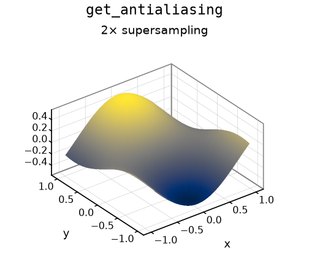

[Source code](../examples/reference/get_antialiasing.py).

### `set_antialiasing`

```text
ax.set_antialiasing(factor)
```

Set the supersampling factor for the VTK layer.

**Parameters**

- **`factor`** (int)

  Factor from 1 to 4. At 1 the scene uses the output dimensions. At 2 the VTK raster doubles both dimensions before downsampling. Run-time and raster memory can increase at larger factors.

**Returns**

`None`

**Raises**

- **`ValueError`**

  If `factor` is outside the integer range 1 through 4.

**Examples**

Compare enlarged viewport edges at two supersampling factors.

```python
source, ax = new_scene()
ax.set_axis_off()
sample(ax, color="tab:blue", shade=False)
mpl3d_vtk.ax_setting(ax)
source.canvas.draw()

fig, panels = plt.subplots(1, 2, figsize=(6.5, 3.1))
for panel, factor in zip(panels, (1, 4)):
    ax.set_antialiasing(factor)
    panel.imshow(ax.pixels(105, 85), origin="lower", interpolation="nearest")
    panel.set(title=f"{factor}× supersampling", xticks=[], yticks=[])
```


[Source code](../examples/reference/set_antialiasing.py).

### `set_aspect`

```text
ax.set_aspect(aspect, adjustable=None, anchor=None, share=False)
```

Set the scale of data units.

**Parameters**

- **`aspect`** (str)

  `"auto"` uses automatic proportions. `"equal"` gives the same display length to one data unit on every axis. `"equalxy"`, `"equalxz"`, and `"equalyz"` apply this to the named pair of axes.

- **`adjustable`** (str or `None`, default `None`)

  `"box"` changes display box proportions. `"datalim"` adjusts the coordinate limits. `None` uses Matplotlib's default `"box"`.

- **`anchor`** (deprecated, default `None`)

  Legacy Matplotlib compatibility argument with no effect on this 3D method.

- **`share`** (deprecated, default `False`)

  Legacy Matplotlib compatibility argument with no effect on this 3D method.

**Returns**

`None`

**Notes**

Equal modes are reapplied when VTK fits new or updated geometry. An explicit call to `set_box_aspect()` takes precedence during subsequent fits.

**Examples**

```python
fig, (auto, equal) = new_scene(2)
for ax in (auto, equal):
    ax.plot_surface(x, y, .25*z, cmap="viridis")
    mpl3d_vtk.ax_setting(ax, (-1, 1), (-1, 1), (-.2, .2), zticks=[-.2, 0, .2], aspect="auto")
auto.set_title("Auto box proportions")
equal.set_aspect("equal")
equal.set_title("Equal length per data unit")
```


[Source code](../examples/reference/set_aspect.py).

### `set_box_aspect`

```text
ax.set_box_aspect(aspect, *, zoom=1)
```

Set the display box's proportions independently of the data coordinates.

**Parameters**

- **`aspect`** (three floats or `None`)

  Relative display lengths along X, Y, and Z. `None` restores Matplotlib's default `4:4:3`.

- **`zoom`** (float, default `1`)

  Positive multiplier for the overall size of the axes box.

**Returns**

`None`

**Examples**

```python
fig, (auto, fixed) = new_scene(2)
for ax in (auto, fixed):
    sample(ax, cmap="plasma")
    mpl3d_vtk.ax_setting(ax, aspect="auto")
auto.set_title("Default aspect")
fixed.set_box_aspect((1, 1, 1.8))
fixed.set_title("Taller Z axis")
```


[Source code](../examples/reference/set_box_aspect.py).

### `fit`

```text
ax.fit()
```

Update data bounds from the visible VTK geometry and apply Matplotlib's autoscaling and margins. Adding, updating, hiding, or removing plots updates these bounds. A constant coordinate uses a small nonzero span so the axis can still be drawn.

Explicit limits set with `set_xlim()`, `set_ylim()`, or `set_zlim()` remain in effect on that axis. Use `ax.autoscale(axis="x")` to return X to automatic scaling, or `ax.margins(0.05)` to add a 5% margin around automatic limits.

**Returns**

`None`

**Notes**

A normal draw fits the scene after geometry changes. Call `fit()` explicitly when you need the current limits before drawing.

**Examples**

```python
fig, (fixed, fitted) = new_scene(2)
for ax in (fixed, fitted):
    sample(ax, color="tab:blue")
    mpl3d_vtk.ax_setting(ax, (-2, 2), (-2, 2), (-2, 2))
fixed.set_title("Manual limits")
fitted.set_autoscale_on(True)
fitted.fit()
fitted.set_title(f"Fitted X limits: {fitted.get_xlim()[0]:.1f} to {fitted.get_xlim()[1]:.1f}")
```

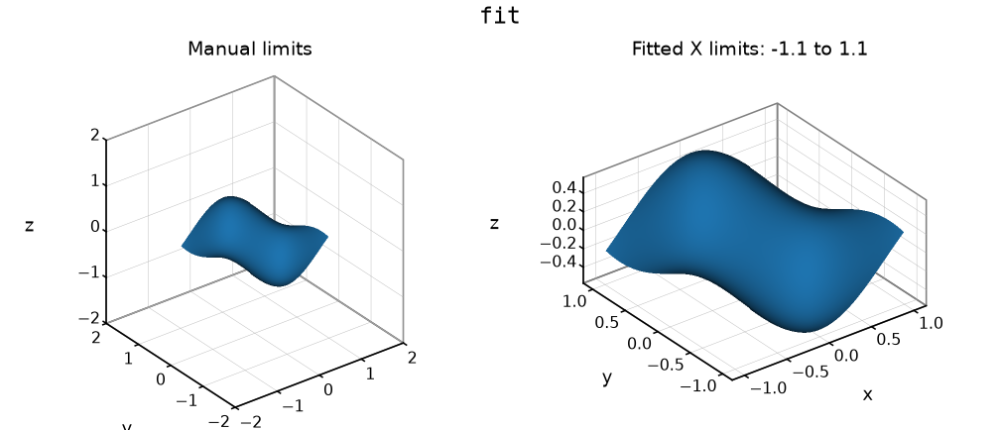

[Source code](../examples/reference/fit.py).

### `clear_scene`

```text
ax.clear_scene()
```

Remove VTK plots and their dependent artists. Retain axes settings and independently added Matplotlib artists.

**Returns**

`None`

**Examples**

```python
fig, (before, after) = new_scene(2)
for ax in (before, after):
    sample(ax, color="tab:blue")
    mpl3d_vtk.ax_setting(ax, (-1, 1), (-1, 1), (-.6, .9))
    ax.text(0, 0, .75, "Matplotlib annotation")
before.set_title("Before")
after.clear_scene()
after.set_title("Annotation retained")
```


[Source code](../examples/reference/clear_scene.py).

### `clear`

```text
ax.clear()
```

Clear the VTK plots and reset the Matplotlib axes. The subplot stays in its figure, ready for another plot.

**Returns**

`None`

**Examples**

```python
fig, (before, after) = new_scene(2)
for ax in (before, after):
    sample(ax, cmap="viridis")
before.set_title("Before")
after.clear()
after.set_title("Reset subplot")
```


[Source code](../examples/reference/clear.py).

### `VtkAxes.remove`

```text
ax.remove()
```

Remove the subplot from its figure and release the VTK window. This is useful after saving an offscreen figure.

**Returns**

`None`

**Examples**

```python
fig, (keep, discard) = new_scene(2)
sample(keep, color="tab:blue")
sample(discard, color="tab:orange")
discard.remove()
keep.set_title("Remaining subplot")
```


[Source code](../examples/reference/axes_remove.py).

### `get_legend_handles_labels`

```text
ax.get_legend_handles_labels(legend_handler_map=None)
```

Get the entries available for a legend.

**Parameters**

- **`legend_handler_map`** (mapping or `None`, default `None`)

  Optional Matplotlib legend handlers for native artists. Mapping keys can be artist instances or types, with handlers as values.

**Returns**

- **`handles`** (list of Matplotlib artists)

  Handles eligible for a legend, including proxies for VTK plots.

- **`labels`** (list of str)

  Labels in the same order as `handles`.

**Examples**

```python
fig, ax = new_scene()
ax.plot(t, t**2, .4*t, color="tab:blue", label="Path")
ax.scatter(t[::5], t[::5]**2, .4*t[::5], c="tab:orange", label="Samples")
handles, labels = ax.get_legend_handles_labels()
ax.legend(handles[::-1], labels[::-1], loc="upper left")
```

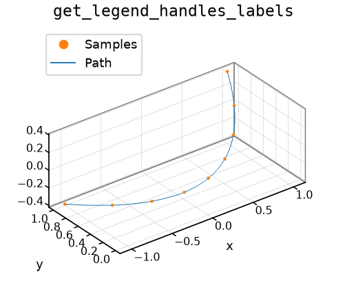

[Source code](../examples/reference/get_legend_handles_labels.py).

### `legend`

```text
ax.legend(*args, **kwargs)
```

Draw a Matplotlib legend for the axes, including proxies for VTK plots.

**Parameters**

- __`*args`__ (optional positional arguments)

  Use no arguments for automatic labeled entries, or give explicit `handles` and `labels` to choose or reorder entries.

- __`**kwargs`__ (keyword arguments)

  Matplotlib legend options such as `handles`, `labels`, `loc`, `title`, `fontsize`, and `ncols`. See [`Axes.legend`](https://matplotlib.org/stable/api/_as_gen/matplotlib.axes.Axes.legend.html).

**Returns**

- **`legend`** (`matplotlib.legend.Legend`)

  The legend attached to the axes.

**Examples**

```python
fig, ax = new_scene()
ax.plot(t, np.sin(3*t), .6*np.cos(3*t), color="tab:blue", label="Candidate")
ax.plot(t, np.cos(3*t), .6*np.sin(3*t), color="tab:orange", label="Reference")
ax.legend(loc="upper left")
```


[Source code](../examples/reference/legend.py).

### `pixels`

```text
ax.pixels(width, height)
```

Render the VTK viewport into an RGBA image. Matplotlib ticks, labels, and other overlays are drawn by the full figure canvas.

**Parameters**

- **`width`** (int)

  Output width in pixels.

- **`height`** (int)

  Output height in pixels.

**Returns**

- **`rgba`** (ndarray of uint8)

  Image of shape `(height, width, 4)` whose first row is the bottom of the viewport. Copy it before editing a cached frame.

**Examples**

```python
source, ax = new_scene()
ax.set_axis_off()
sample(ax, cmap="plasma")
mpl3d_vtk.ax_setting(ax)
source.canvas.draw()
rgba = ax.pixels(240, 180)

fig, preview = plt.subplots()
preview.imshow(rgba, origin="lower")
preview.set(title=f"RGBA snapshot: {rgba.shape[1]} × {rgba.shape[0]} pixels",
            xticks=[], yticks=[])
```

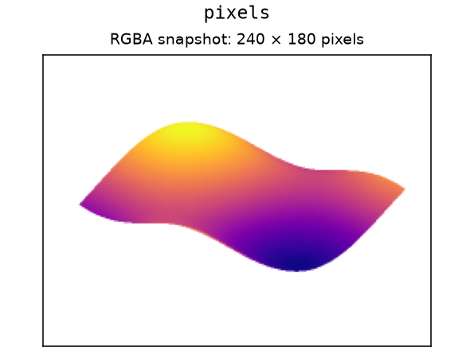

[Source code](../examples/reference/pixels.py).

## Streaming lines and lights

[`add_streaming_line`](#add_streaming_line) · [`append`](#append) · [`get_points`](#get_points) · [`clear_points`](#clear_points) · [`add_light`](#add_light)

### `add_streaming_line`

```text
ax.add_streaming_line(*, max_points=None, **style)
```

Create a line that accepts incremental updates. Pending points are combined on the next draw.

**Parameters**

- **`max_points`** (int or `None`, default `None`)

  Positive capacity for the latest points. `None` keeps the full history.

- __`**style`__ (keyword arguments)

  See [common style options](api.md#common-style-options). The default line color comes from the axes cycle.

**Returns**

- **`line`** ([`StreamingLine`](#streaming-lines-and-lights))

  The streaming artist, with `append()`, `get_points()`, and `clear_points()`.

**Examples**

```python
fig, ax = new_scene()
line = ax.add_streaming_line(max_points=31, color="tab:blue", linewidth=3)
line.append(t, np.sin(4*t), np.cos(4*t))
ax.set_title("Latest 31 points")
```

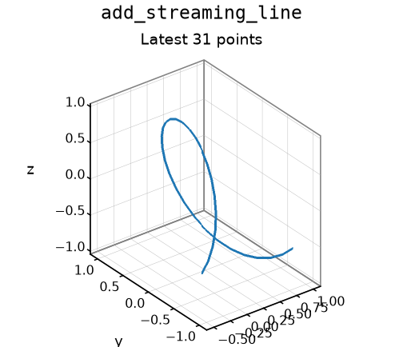

[Source code](../examples/reference/add_streaming_line.py).

### `append`

```text
line.append(x, y, z=0)
```

Queue coordinates on a streaming line. A draw or `get_points()` applies the pending records.

**Parameters**

- **`x`** (scalar or `array_like`)

  X coordinates of new points.

- **`y`** (scalar or `array_like`)

  Y coordinates. Inputs must broadcast to a common shape.

- **`z`** (scalar or `array_like`, default `0`)

  Z coordinates. A scalar broadcasts across all new points.

**Returns**

`None`

**Examples**

```python
fig, ax = new_scene()
line = ax.add_streaming_line(color="tab:blue", linewidth=2.5)
line.append(t[:20], t[:20]**2, 0)
line.append(t[20:], t[20:]**2, 0)
ax.set(zlim=(-.4, .4))
ax.scatter(t[20], t[20]**2, 0, c="tab:orange", s=35, label="New batch")
ax.legend(loc="upper left")
```


[Source code](../examples/reference/append.py).

### `get_points`

```text
line.get_points()
```

Read all points currently stored by the streaming line.

**Returns**

- **`x`, `y`, `z`** (tuple of ndarray)

  Copies of the three coordinate arrays in XYZ order, after pending points are applied.

**Examples**

```python
fig, ax = new_scene()
line = ax.add_streaming_line(color="tab:blue", linewidth=2)
line.append(t, np.sin(4*t), np.cos(4*t))
points = line.get_points()
ax.scatter(*(v[::8] for v in points), c="tab:orange", s=32, label="Returned samples")
ax.legend(loc="upper left")
```


[Source code](../examples/reference/get_points.py).

### `clear_points`

```text
line.clear_points()
```

Discard the visible points and pending updates. The line handle keeps its style and accepts new points.

**Returns**

`None`

**Examples**

```python
fig, (before, after) = new_scene(2)
for ax in (before, after):
    line = ax.add_streaming_line(color="tab:purple", linewidth=2)
    line.append(t, np.sin(4*t), np.cos(4*t))
    mpl3d_vtk.ax_setting(ax, (-1, 1), (-1, 1), (-1, 1))
before.set_title("Old path")
line.clear_points()
line.append(t, t, 0)
after.set_title("Replacement points")
```


[Source code](../examples/reference/clear_points.py).

### `add_light`

```text
ax.add_light(position, *, focal_point=(0., 0., 0.), color="white", positional=False)
```

Add a VTK light in world coordinates. Set lighting on a plot to use the light.

**Parameters**

- **`position`** (three floats)

  XYZ position of the light.

- **`focal_point`** (three floats, default `(0., 0., 0.)`)

  XYZ point the light is aimed at. The vector from position to focal point determines the direction.

- **`color`** (Matplotlib color, default `"white"`)

  Color of the illumination.

- **`positional`** (bool, default `False`)

  `False` uses a directional light. `True` uses a positional light.

**Returns**

- **`light`** (`vtkLight`)

  The native VTK light. Set its intensity and other native properties through this object.

**Examples**

```python
fig, (left, right) = new_scene(2)
sample(left, color="tab:blue", lighting=True)
sample(right, color="tab:blue", lighting=True)
left.set_title("Default light")
light = right.add_light((3, -4, 5), color="wheat")
light.SetIntensity(.85)
right.set_title("Directional light")
```


[Source code](../examples/reference/add_light.py).

## Graphic handles

[`Graphic`](#graphic) · [`vertices`](#vertices) · [`faces`](#faces) · [`get_array`](#get_array) · [`get_cmap`](#get_cmap) · [`get_clim`](#get_clim)

### `Graphic`

```text
mpl3d_vtk.Graphic(ax, data, values=None, *, association="point", mapper=None, **style)
```

A Matplotlib artist and scalar mappable that owns a VTK actor. Plotting methods typically construct it for you.

**Parameters**

- **`ax`** (`VtkAxes`)

  Axes that receives the artist and its VTK actor.

- **`data`** (`vtkPolyData`)

  Geometry containing the points and cells.

- **`values`** (`array_like` or `None`, default `None`)

  Scalar or RGB(A) values indexed by `association`. Existing active point scalars are used if omitted with point association.

- **`association`** (str, default `"point"`)

  Index color values by vertices with `"point"` or by cells with `"cell"`. See [mesh color interpolation](function_reference.md#mesh-color-interpolation).

- **`mapper`** (VTK mapper or `None`, default `None`)

  Custom mapper that accepts `data`. The default is `vtkPolyDataMapper`.

- __`**style`__ (keyword arguments)

  All [common style options](api.md#common-style-options), whose defaults are listed there.

**Attributes**

- **`data`** (vtkPolyData)

  Source geometry.

- **`mapper`** (VTK mapper)

  Maps the geometry and its associated values.

- **`actor`** (vtkActor)

  Renderable actor for this handle.

**Notes**

Call `Modified()` on any native VTK object that you change directly.

**Examples**

```python
import vtk

fig, ax = new_scene()
sphere = vtk.vtkSphereSource()
sphere.SetThetaResolution(30)
sphere.SetPhiResolution(30)
sphere.Update()
handle = mpl3d_vtk.Graphic(ax, sphere.GetOutput(), color="tab:blue", lighting=True)
```


[Source code](../examples/reference/graphic.py).

### `vertices`

```text
handle.vertices
```

Coordinates of the handle's geometry.

**Returns**

- **`vertices`** (ndarray)

  Copy of the geometry's XYZ coordinates with shape `(n_vertices, 3)`.

**Examples**

```python
fig, ax = new_scene()
handle = ax.plot_mesh([[0,0,0], [1,0,0], [0,1,1]], [[0,1,2]], color="tab:blue", alpha=.35)
ax.scatter(*handle.vertices.T, c="tab:orange", s=45, label="Returned vertices")
ax.legend(loc="upper left")
```


[Source code](../examples/reference/vertices.py).

### `faces`

```text
handle.faces
```

Connectivity of the polygon geometry.

**Returns**

- **`faces`** (ndarray or list of ndarray)

  Copies of zero-based face indices. Equal-size faces use a 2D array, mixed polygon sizes use a list of rows.

**Examples**

```python
fig, ax = new_scene()
handle = ax.plot_mesh([[0,0,0], [1,0,0], [0,1,1], [1,1,0]], [[0,1,2], [1,3,2]],
                      color="tab:blue", alpha=.35, edgecolor="tab:blue")
for number, face in enumerate(handle.faces):
    ax.text(*handle.vertices[face].mean(axis=0), str(number), color="black")
```


[Source code](../examples/reference/faces.py).

### `get_array`

```text
handle.get_array()
```

Get the scalar data associated with the mappable.

**Returns**

- **`values`** (array or `None`)

  The scalar array passed to the normalization. Direct RGB(A) colors do not populate this array.

**Examples**

```python
fig, panels = plt.subplots(1, 2, figsize=(6.5, 3.1),
                            subplot_kw={"projection": "vtk3d"})
surface, values = panels
handle = sample(surface, cmap="coolwarm", vmin=-1, vmax=1)
handle.set_array(x.ravel())
values.remove()
histogram = fig.add_subplot(122)
histogram.hist(handle.get_array(), bins=11, color="tab:blue")
histogram.set(xlabel="Scalar value", ylabel="Count", title="Returned array")
```


[Source code](../examples/reference/get_array.py).

### `get_cmap`

```text
handle.get_cmap()
```

Get the colormap associated with the handle.

**Returns**

- **`cmap`** (`matplotlib.colors.Colormap`)

  The current colormap, including when the handle uses a fixed color.

**Examples**

```python
fig, ax = new_scene()
first = sample(ax, cmap="magma")
ax.scatter(t[::4], .8, .65*t[::4], c=t[::4], s=40, cmap=first.get_cmap())
ax.set_title(f"Shared {first.get_cmap().name} colormap")
```


[Source code](../examples/reference/get_cmap.py).

### `get_clim`

```text
handle.get_clim()
```

Get the active scalar color limits.

**Returns**

- **`vmin`, `vmax`** (tuple of float or `None`)

  Current lower and upper mapping bounds. An uninitialized bound can be `None`.

**Examples**

```python
fig, ax = new_scene()
handle = sample(ax, cmap="coolwarm", vmin=-.5, vmax=.5)
limits = handle.get_clim()
fig.colorbar(handle, ax=ax, shrink=.65, ticks=[limits[0], 0, limits[1]])
ax.set_title(f"Color limits: {limits[0]:.1f} to {limits[1]:.1f}")
```


[Source code](../examples/reference/get_clim.py).

## Update data and colors

[`set_heights`](#set_heights) · [`set_values`](#set_values) · [`set_array`](#set_array) · [`set_cmap`](#set_cmap) · [`set_clim`](#set_clim)

### `set_heights`

```text
handle.set_heights(z)
```

Update Z coordinates in place on a gridded surface. Connectivity is adjusted when vertex validity changes. Colors originally derived from heights follow the new data.

**Parameters**

- **`z`** (2D array)

  Replacement heights of exactly the same shape as the original rendered grid, after any row/column sampling.

**Returns**

- **`handle`** ([`Graphic`](#graphic))

  The same handle, with updated coordinates.

**Raises**

- **`ValueError`**

  If the handle is not a gridded surface or the replacement heights have the wrong shape.

**Examples**

```python
fig, (before, after) = new_scene(2)
for ax in (before, after):
    handle = sample(ax, cmap="viridis", vmin=-.6, vmax=.6)
    mpl3d_vtk.ax_setting(ax, zlim=(-.7, .7))
before.set_title("Initial height")
handle.set_heights(-z)
after.set_title("Inverted height")
```


[Source code](../examples/reference/set_heights.py).

### `set_values`

```text
handle.set_values(values)
```

Replace the color data on a geometry handle.

**Parameters**

- **`values`** (`array_like` or `None`)

  One scalar or RGB(A) row per vertex or cell as selected at construction. Pass `None` to clear the color data of ordinary geometry. For textured planes, see [`ImageGraphic.set_values`](#imagegraphicset_values).

**Returns**

- **`handle`** ([`Graphic`](#graphic))

  The same handle, with updated colors.

**Raises**

- **`ValueError`**

  If the scalar or RGB(A) data does not match the handle's associated geometry.

**Examples**

```python
fig, (before, after) = new_scene(2)
for ax in (before, after):
    handle = sample(ax, cmap="viridis", vmin=-1, vmax=1)
before.set_title("Height colors")
handle.set_values(y)
after.set_title("Colors from Y")
```


[Source code](../examples/reference/set_values.py).

### `set_array`

```text
handle.set_array(values)
```

Set the Matplotlib scalar array used for normalization and colorbars.

**Parameters**

- **`values`** (`array_like` or `None`)

  One scalar per vertex or cell according to the handle's association. `None` clears the scalar data. Use [`set_values`](#set_values) for RGB(A).

**Returns**

`None`

**Raises**

- **`ValueError`**

  If the number of scalars does not match the associated vertices or cells.

**Examples**

```python
fig, ax = new_scene()
handle = sample(ax, cmap="coolwarm", vmin=-1, vmax=1)
handle.set_array(x.ravel())
fig.colorbar(handle, ax=ax, shrink=.65, label="X coordinate")
```


[Source code](../examples/reference/set_array.py).

### `set_cmap`

```text
handle.set_cmap(cmap)
```

Replace the colormap and update any attached colorbars.

**Parameters**

- **`cmap`** (Matplotlib colormap, str, or `None`)

  Colormap object, registered colormap name, or `None` for the Matplotlib default.

**Returns**

`None`

**Examples**

```python
fig, (before, after) = new_scene(2)
for ax in (before, after):
    handle = sample(ax, cmap="viridis")
before.set_title("Viridis")
handle.set_cmap("plasma")
after.set_title("Plasma")
```


[Source code](../examples/reference/set_cmap.py).

### `set_clim`

```text
handle.set_clim(vmin=None, vmax=None)
```

Change the scalar mapping limits and update attached colorbars.

**Parameters**

- **`vmin`** (float or `None`, default `None`)

  New lower limit. `None` preserves the current lower limit. A two-element pair can supply both limits as the first argument.

- **`vmax`** (float or `None`, default `None`)

  New upper limit. `None` preserves the current upper limit.

**Returns**

`None`

**Examples**

```python
fig, (before, after) = new_scene(2)
for ax in (before, after):
    handle = sample(ax, cmap="coolwarm", vmin=-1, vmax=1)
before.set_title("Range −1 to 1")
handle.set_clim(-.2, .2)
after.set_title("Range −0.2 to 0.2")
```


[Source code](../examples/reference/set_clim.py).

## Style and visibility

[`Graphic.set`](#graphicset) · [`set_color`](#set_color) · [`set_facecolor`](#set_facecolor) · [`set_edgecolor`](#set_edgecolor) · [`set_alpha`](#set_alpha) · [`set_visible`](#set_visible) · [`set_linewidth`](#set_linewidth) · [`set_linestyle`](#set_linestyle) · [`set_lighting`](#set_lighting) · [`Graphic.remove`](#graphicremove)

### `Graphic.set`

```text
handle.set(**properties)
```

Update several properties in one call.

**Parameters**

- __`**properties`__ (keyword arguments)

  One keyword per supported `set_*` method. See [handle property keywords](#handle-property-keywords).

**Returns**

- **`results`** (list)

  The results from the selected setters.

**Examples**

```python
fig, ax = new_scene()
handle = sample(ax, color="tab:blue", rstride=8, cstride=8)
handle.set(facecolor="#eaa85e", edgecolor="#563610", linewidth=2, alpha=.75)
ax.set_title("Face, edges, width, and opacity")
```


[Source code](../examples/reference/graphic_set.py).

### `set_color`

```text
handle.set_color(color)
```

Give the geometry a fixed color.

**Parameters**

- **`color`** (Matplotlib color or `None`)

  Uniform fill or line color. `None` clears the fixed color and allows mapped colors to show again.

**Returns**

`None`

**Examples**

```python
fig, (before, after) = new_scene(2)
for ax in (before, after):
    handle = sample(ax, cmap="viridis")
before.set_title("Scalar colors")
handle.set_color("tab:orange")
after.set_title("Fixed orange color")
```


[Source code](../examples/reference/set_color.py).

### `set_facecolor`

```text
handle.set_facecolor(color)
```

Set the face fill color.

**Parameters**

- **`color`** (Matplotlib color, `"none"`, or `None`)

  Fill color that takes priority over mapped and fixed colors. `"none"` switches to wireframe rendering. `None` restores the handle's underlying color choice.

**Returns**

`None`

**Examples**

```python
fig, (before, after) = new_scene(2)
for ax in (before, after):
    handle = sample(ax, color="tab:blue", edgecolor="#18394e", rstride=8, cstride=8)
before.set_title("Blue faces")
handle.set_facecolor("#eaa85e")
after.set_title("Orange faces")
```


[Source code](../examples/reference/set_facecolor.py).

### `set_edgecolor`

```text
handle.set_edgecolor(color)
```

Set the polygon boundary color.

**Parameters**

- **`color`** (Matplotlib color, `"none"`, or `None`)

  A color shows the polygon edges. `"none"` or `None` hides them.

**Returns**

`None`

**Examples**

```python
fig, (before, after) = new_scene(2)
for ax in (before, after):
    handle = sample(ax, color="#aacfe4", rstride=8, cstride=8)
before.set_title("Edges hidden")
handle.set_edgecolor("#204865")
after.set_title("Edges visible")
```


[Source code](../examples/reference/set_edgecolor.py).

### `set_alpha`

```text
handle.set_alpha(alpha)
```

Set overall actor opacity.

**Parameters**

- **`alpha`** (float or `None`)

  A value from 0 to 1. `None` restores full actor opacity. Local vertex or face alpha can still vary.

**Returns**

`None`

**Examples**

```python
fig, (before, after) = new_scene(2)
for ax in (before, after):
    ax.scatter(t[::4], 0, -.35, c="tab:orange", s=45)
    handle = sample(ax, color="tab:blue", shade=False)
before.set_title("Opaque")
handle.set_alpha(.35)
after.set_title("Opacity 0.35")
```

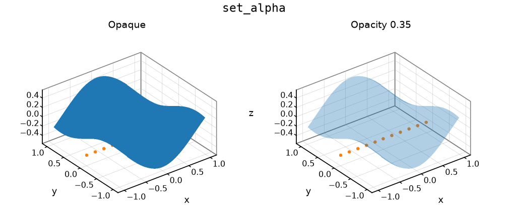

[Source code](../examples/reference/set_alpha.py).

### `set_visible`

```text
handle.set_visible(visible)
```

Control the visibility of a `Graphic` and its companion artists.

**Parameters**

- **`visible`** (bool)

  `True` shows the handle and its dependents. `False` hides them while retaining the handle.

**Returns**

`None`

**Examples**

```python
fig, (before, after) = new_scene(2)
for ax in (before, after):
    ax.scatter(t[::4], .4, .35, c="tab:orange", s=45)
    handle = sample(ax, color="tab:blue")
before.set_title("Surface shown")
handle.set_visible(False)
after.set_title("Surface hidden")
```


[Source code](../examples/reference/set_visible.py).

### `set_linewidth`

```text
handle.set_linewidth(width)
```

Change line or edge thickness.

**Parameters**

- **`width`** (float)

  Nominal line width in output pixels.

**Returns**

`None`

**Examples**

```python
fig, (before, after) = new_scene(2)
for ax in (before, after):
    line, = ax.plot(t, np.sin(4*t), np.cos(4*t), linewidth=1, color="tab:blue")
before.set_title("1 px")
line.set_linewidth(5)
after.set_title("5 px")
```


[Source code](../examples/reference/set_linewidth.py).

### `set_linestyle`

```text
handle.set_linestyle(style)
```

Set the line stipple pattern.

**Parameters**

- **`style`** (str)

  One of `"-"`, `"--"`, `":"`, `"-."`, or `"none"`.

**Returns**

`None`

**Raises**

- **`ValueError`**

  If the line pattern is unsupported.

**Notes**

VTK line stipple support depends on the rendering backend. This example shows the requested style in a Matplotlib legend proxy.

**Examples**

```python
from matplotlib.lines import Line2D

fig, ax = new_scene()
line, = ax.plot(t, np.sin(4*t), np.cos(4*t), linewidth=2, color="tab:blue")
style = "--"
line.set_linestyle(style)
proxy = Line2D([], [], color="tab:blue", linestyle=style, label="Requested dashes")
ax.legend(handles=[proxy], loc="upper left")
```

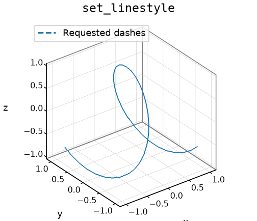

[Source code](../examples/reference/set_linestyle.py).

### `set_lighting`

```text
handle.set_lighting(lighting)
```

Select how the actor responds to scene lights.

**Parameters**

- **`lighting`** (bool or str)

  `False` disables lighting and `True` uses Phong lighting. Strings `"flat"`, `"gouraud"`, and `"phong"` select the interpolation mode. Smooth lighting needs point normals.

**Returns**

`None`

**Raises**

- **`ValueError`**

  If the lighting interpolation name is unsupported.

**Examples**

```python
fig, (before, after) = new_scene(2)
for ax in (before, after):
    handle = sample(ax, color="tab:blue", shade=False)
before.set_title("Lighting off")
handle.set_lighting("phong")
after.set_title("Phong lighting")
```


[Source code](../examples/reference/set_lighting.py).

### `Graphic.remove`

```text
handle.remove()
```

Remove the Graphic and its dependent artists while keeping the axes and other plots.

**Returns**

`None`

**Examples**

```python
fig, (before, after) = new_scene(2)
for ax in (before, after):
    sample(ax, color="tab:blue")
    line, = ax.plot(t, np.zeros_like(t), .66, linewidth=3, color="tab:orange")
before.set_title("Line and surface")
line.remove()
after.set_title("Surface retained")
```


[Source code](../examples/reference/graphic_remove.py).

## Matplotlib controls

[`view_init`](#view_init) · [`set_proj_type`](#set_proj_type) · [`Figure.colorbar`](#figurecolorbar) · [`grid`](#grid) · [`text`](#text) · [`tick_params`](#tick_params) · [`set_norm`](#set_norm) · [`set_label`](#set_label)

### `view_init`

```text
ax.view_init(elev=None, azim=None, roll=None, vertical_axis="z", share=False)
```

Set the Matplotlib camera angles.

**Parameters**

- **`elev`** (float or `None`, default `None`)

  Elevation in degrees. `None` restores the construction value.

- **`azim`** (float or `None`, default `None`)

  Azimuth in degrees. `None` restores the construction value.

- **`roll`** (float or `None`, default `None`)

  Roll in degrees around the viewing direction. `None` restores the construction value.

- **`vertical_axis`** (str, default `"z"`)

  Direction used as the vertical axis, one of `"x"`, `"y"`, or `"z"`.

- **`share`** (bool, default `False`)

  Apply the new view to other axes sharing this view.

**Returns**

`None`

**Examples**

```python
fig, (front, side) = new_scene(2)
for ax in (front, side):
    sample(ax, cmap="viridis")
    mpl3d_vtk.ax_setting(ax)
front.set_title("Styled view")
side.view_init(elev=54, azim=25, roll=8)
side.set_title("Rotated view")
```


[Source code](../examples/reference/view_init.py).

### `set_proj_type`

```text
ax.set_proj_type(proj_type, focal_length=None)
```

Set the camera's projection model.

**Parameters**

- **`proj_type`** (str)

  `"ortho"` is orthographic. `"persp"` is perspective.

- **`focal_length`** (float or `None`, default `None`)

  Positive focal length in perspective mode, defaulting to `1`. Orthographic mode uses `None` or `np.inf`.

**Returns**

`None`

**Examples**

```python
fig, (ortho, perspective) = new_scene(2)
fig.get_layout_engine().set(h_pad=.14)
for ax in (ortho, perspective):
    sample(ax, color="tab:blue", edgecolor="#264e6c", rstride=8, cstride=8)
    mpl3d_vtk.ax_setting(ax)
ortho.set_title("Orthographic")
perspective.set_proj_type("persp", focal_length=.25)
perspective.set_title("Perspective")
```


[Source code](../examples/reference/set_proj_type.py).

### `Figure.colorbar`

```text
fig.colorbar(mappable, cax=None, ax=None, use_gridspec=True, **kwargs)
```

Show the scalar mapping associated with a plot handle.

**Parameters**

- **`mappable`** (Matplotlib color mappable)

  Plot handle with scalar data, such as a surface, volume, or scalar image.

- **`cax`** (Matplotlib axes or `None`, default `None`)

  Existing axes in which to draw the colorbar. If omitted, Matplotlib creates axes.

- **`ax`** (axes, sequence of axes, or `None`, default `None`)

  Axes supplying space for a new colorbar. Defaults to the mappable's axes.

- **`use_gridspec`** (bool, default `True`)

  Use the parent subplot specification to position a newly created colorbar where available.

- __`**kwargs`__ (keyword arguments)

  Matplotlib placement and style, including `location`, `orientation`, `shrink`, `pad`, `ticks`, `format`, `extend`, and `label`. See [`Figure.colorbar`](https://matplotlib.org/stable/api/_as_gen/matplotlib.figure.Figure.colorbar.html).

**Returns**

- **`colorbar`** (`matplotlib.colorbar.Colorbar`)

  The colorbar attached to the figure.

**Examples**

```python
fig, ax = new_scene()
surface = sample(ax, cmap="plasma", vmin=-.6, vmax=.6)
fig.colorbar(surface, ax=ax, shrink=.7, label="Height", ticks=[-.6, 0, .6])
```

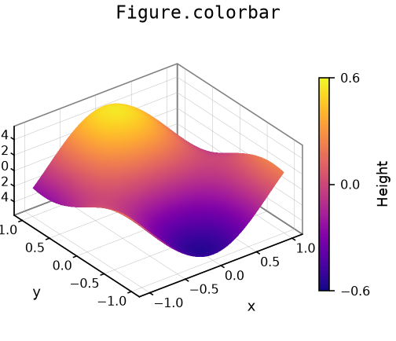

[Source code](../examples/reference/figure_colorbar.py).

### `grid`

```text
ax.grid(visible=True, **kwargs)
```

Control the Matplotlib grid around the VTK scene.

**Parameters**

- **`visible`** (bool or `None`, default `True`)

  Show grid lines with `True`. Pass `False` or `None` to hide them when no keywords are supplied.

- __`**kwargs`__ (keyword arguments)

  In Matplotlib 3.11, supplying additional keywords enables the 3D grid. The method uses the native 3D grid style.

**Returns**

`None`

**Examples**

```python
fig, (with_grid, without_grid) = new_scene(2)
for ax in (with_grid, without_grid):
    sample(ax, color="tab:blue")
with_grid.grid(True)
with_grid.set_title("Grid visible")
without_grid.grid(False)
without_grid.set_title("Grid hidden")
```


[Source code](../examples/reference/grid.py).

### `text`

```text
ax.text(x, y, z, s, zdir=None, *, axlim_clip=False, **kwargs)
```

Place a Matplotlib text annotation in the 3D scene.

**Parameters**

- **`x`** (float)

  X anchor coordinate.

- **`y`** (float)

  Y anchor coordinate.

- **`z`** (float)

  Z anchor coordinate.

- **`s`** (str)

  Text to display. Matplotlib math text is supported.

- **`zdir`** (str, three floats, or `None`, default `None`)

  Text orientation direction. Use `None` for camera-facing text, an axis name, or an explicit direction vector.

- **`axlim_clip`** (bool, default `False`)

  Hide text if its anchor falls outside the axes limits.

- __`**kwargs`__ (keyword arguments)

  Matplotlib text properties such as `fontsize`, `color`, `ha`, and `va`. See [`Text`](https://matplotlib.org/stable/api/text_api.html).

**Returns**

- **`annotation`** (`Text3D`)

  The annotation attached to the axes.

**Examples**

```python
fig, ax = new_scene()
sample(ax, cmap="viridis")
ax.text(.2, .65, .58, "Sample region", color="black")
```


[Source code](../examples/reference/text.py).

### `tick_params`

```text
ax.tick_params(axis='both', **kwargs)
```

Style native Matplotlib ticks and tick labels.

**Parameters**

- **`axis`** (str, default `"both"`)

  Select `"x"`, `"y"`, `"z"`, or use `"both"` to apply settings to the axes together.

- __`**kwargs`__ (keyword arguments)

  Matplotlib options such as `which`, `reset`, `direction`, `pad`, `colors`, and `labelsize`. See [`Axes.tick_params`](https://matplotlib.org/stable/api/_as_gen/matplotlib.axes.Axes.tick_params.html).

**Returns**

`None`

**Examples**

```python
fig, ax = new_scene()
sample(ax, color="#8ac6dc")
mpl3d_vtk.ax_setting(ax, zticks=[-.4, 0, .4])
ax.tick_params(axis="z", colors="darkred", labelsize=13)
ax.set_title("Styled Z ticks")
```


[Source code](../examples/reference/tick_params.py).

### `set_norm`

```text
handle.set_norm(norm)
```

Replace the mapping from scalar values to colormap positions.

**Parameters**

- **`norm`** (Matplotlib normalization, scale name, or `None`)

  For example `Normalize` for linear mapping, `LogNorm` for a positive logarithmic range, or `None` for a new default linear normalization.

**Returns**

`None`

**Examples**

```python
from matplotlib.colors import LogNorm

fig, (linear, logarithmic) = new_scene(2)
values = np.exp(3*x)
sample(linear, values=values, cmap="plasma")
linear.set_title("Linear colors")
handle = sample(logarithmic, values=values, cmap="plasma")
handle.set_norm(LogNorm(vmin=values.min(), vmax=values.max()))
logarithmic.set_title("Logarithmic colors")
```


[Source code](../examples/reference/set_norm.py).

### `set_label`

```text
handle.set_label(s)
```

Set the Matplotlib label used when building a legend.

**Parameters**

- **`s`** (object or `None`)

  New label, converted with `str()`. `None` clears it. A label starting with an underscore is skipped by automatic legend selection.

**Returns**

`None`

**Examples**

```python
fig, ax = new_scene()
line, = ax.plot(t, np.sin(4*t), np.cos(4*t), color="tab:purple", linewidth=2)
line.set_label("Measured path")
ax.legend(loc="upper left")
```


[Source code](../examples/reference/set_label.py).

## Specialized handles

[`VolumeGraphic.set_visible`](#volumegraphicset_visible) · [`VolumeGraphic.remove`](#volumegraphicremove) · [`VolumeGraphic.draw`](#volumegraphicdraw) · [`VolumeGraphic.set`](#volumegraphicset) · [`ImageGraphic.set_values`](#imagegraphicset_values) · [`ImageGraphic.set_array`](#imagegraphicset_array) · [`ImageGraphic.set`](#imagegraphicset) · [`StreamingLine.set`](#streaminglineset)

### `VolumeGraphic.set_visible`

```text
cloud.set_visible(visible)
```

Show or hide a volume returned by [`plot_volume`](function_reference.md#plot_volume).

**Parameters**

- **`visible`** (bool)

  `True` shows the volume. `False` hides it while retaining the VTK volume for later use.

**Returns**

`None`

**Examples**

```python
fig, (before, after) = new_scene(2)
coordinates = np.linspace(-1, 1, 25)
a, b, c = np.meshgrid(coordinates, coordinates, coordinates, sparse=True)
values = np.exp(-5*(a*a+b*b+c*c))
for ax in (before, after):
    cloud = ax.plot_volume(values, coordinates=(coordinates,)*3,
                           cmap="magma", blend_mode="maximum")
    ax.scatter([.65], [.65], [.65], c="tab:blue", s=35)
    mpl3d_vtk.ax_setting(ax, (-1, 1), (-1, 1), (-1, 1))
before.set_title("Volume shown")
cloud.set_visible(False)
after.set_title("Volume hidden")
```

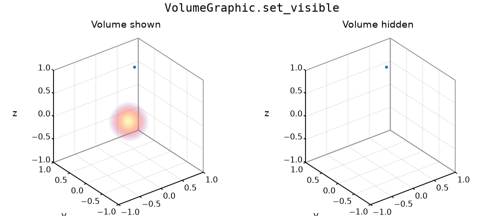

[Source code](../examples/reference/volume_set_visible.py).

### `VolumeGraphic.remove`

```text
cloud.remove()
```

Remove the volume from both the Matplotlib axes and the VTK renderer. Other artists stay on the subplot.

**Returns**

`None`

**Examples**

```python
fig, (before, after) = new_scene(2)
coordinates = np.linspace(-1, 1, 25)
a, b, c = np.meshgrid(coordinates, coordinates, coordinates, sparse=True)
values = np.exp(-5*(a*a+b*b+c*c))
for ax in (before, after):
    cloud = ax.plot_volume(values, coordinates=(coordinates,)*3,
                           cmap="viridis", blend_mode="maximum")
    ax.plot(t, np.zeros_like(t), -.65, color="tab:orange", linewidth=2)
    mpl3d_vtk.ax_setting(ax, (-1, 1), (-1, 1), (-1, 1))
before.set_title("Volume and line")
cloud.remove()
after.set_title("Line retained")
```


[Source code](../examples/reference/volume_remove.py).

### `VolumeGraphic.draw`

```text
cloud.draw(renderer)
```

Matplotlib calls this artist hook on a figure draw. The viewport composites the native volume into the full scene.

**Parameters**

- **`renderer`** (Matplotlib renderer)

  Backend renderer for the current figure draw, usually provided by Matplotlib itself.

**Returns**

`None`

**Examples**

```python
fig, ax = new_scene()
coordinates = np.linspace(-1, 1, 29)
a, b, c = np.meshgrid(coordinates, coordinates, coordinates, sparse=True)
values = np.exp(-8*((a-.3)**2+b*b+c*c))
cloud = ax.plot_volume(values, coordinates=(coordinates,)*3, cmap="magma",
                       blend_mode="maximum")
fig.canvas.draw()
cloud.draw(fig.canvas.get_renderer())
```


[Source code](../examples/reference/volume_draw.py).

### `VolumeGraphic.set`

```text
cloud.set(**properties)
```

Update properties of the volume's Matplotlib artist and scalar mappable.

**Parameters**

- __`**properties`__ (keyword arguments)

  Includes `visible`, `label`, `array`, `cmap`, `clim`, and `norm`, plus compatible [artist properties](#handle-property-keywords). Set the VTK opacity transfer function via [`plot_volume`](function_reference.md#plot_volume).

  Use `array` or `cloud.set_array(values)` to replace the voxel values with a finite array of the original shape.

**Returns**

- **`results`** (list)

  The results from the selected setters.

**Examples**

```python
fig, ax = new_scene()
coordinates = np.linspace(-1, 1, 25)
a, b, c = np.meshgrid(coordinates, coordinates, coordinates, sparse=True)
values = np.exp(-6*(a*a+b*b+c*c))
cloud = ax.plot_volume(values, coordinates=(coordinates,)*3, cmap="plasma",
                       blend_mode="maximum")
cloud.set(label="Scalar volume", visible=True)
ax.legend(loc="upper left")
```

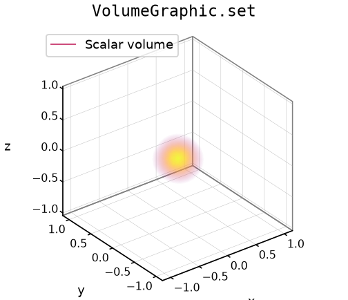

[Source code](../examples/reference/volume_set.py).

### `ImageGraphic.set_values`

```text
image.set_values(values)
```

Update texture pixels while retaining the geometry, extent, and existing pixel-alpha multiplier.

**Parameters**

- **`values`** (`array_like`)

  New scalar `(ny, nx)` or RGB(A) `(ny, nx, 3)` or `(ny, nx, 4)` pixels. Height and width must match the image at construction.

**Returns**

- **`image`** (`ImageGraphic`)

  The same textured plane, with updated pixels.

**Raises**

- **`ValueError`**

  If the pixel format or dimensions do not match the original image.

**Examples**

```python
fig, (before, after) = new_scene(2)
for ax in (before, after):
    image = ax.plot_image_plane(np.sin(5*x), extent=(-1, 1, -1, 1),
                                cmap="coolwarm", vmin=-1, vmax=1)
    ax.set(zlim=(-.4, .4))
before.set_title("Vertical bands")
image.set_values(np.cos(5*y))
after.set_title("Horizontal bands")
```


[Source code](../examples/reference/image_set_values.py).

### `ImageGraphic.set_array`

```text
image.set_array(values)
```

Set the pixel values through the Matplotlib mappable interface.

**Parameters**

- **`values`** (`array_like`)

  Same dimensions and formats as [`ImageGraphic.set_values`](#imagegraphicset_values). Scalar images support normalization and colorbars.

**Returns**

`None`

**Raises**

- **`ValueError`**

  If the pixel format or dimensions do not match the original image.

**Examples**

```python
fig, ax = new_scene()
image = ax.plot_image_plane(z, extent=(-1, 1, -1, 1), cmap="viridis", vmin=0, vmax=2)
image.set_array(x*x+y*y)
ax.set(zlim=(-.4, .4))
fig.colorbar(image, ax=ax, shrink=.7, label="Radial value")
```


[Source code](../examples/reference/image_set_array.py).

### `ImageGraphic.set`

```text
image.set(**properties)
```

Set properties on the textured plane in one call.

**Parameters**

- __`**properties`__ (keyword arguments)

  See [handle property keywords](#handle-property-keywords). Examples include `alpha`, `label`, `values`, and `visible`.

**Returns**

- **`results`** (list)

  The results from the selected setters.

**Examples**

```python
fig, ax = new_scene()
image = ax.plot_image_plane(z, extent=(-1, 1, -1, 1), z=.1, cmap="plasma")
ax.plot(t, t, -.05, color="tab:blue", linewidth=3)
image.set(alpha=.45, label="Texture")
ax.set(zlim=(-.4, .4))
ax.legend(loc="upper left")
```


[Source code](../examples/reference/image_set.py).

### `StreamingLine.set`

```text
line.set(**properties)
```

Change the streaming line's style and artist properties.

**Parameters**

- __`**properties`__ (keyword arguments)

  See [handle property keywords](#handle-property-keywords). Examples include `color`, `linewidth`, `label`, and `visible`. Use `append()` to add geometry.

**Returns**

- **`results`** (list)

  The results from the selected setters.

**Examples**

```python
fig, ax = new_scene()
line = ax.add_streaming_line()
line.append(t, np.sin(4*t), np.cos(4*t))
line.set(color="tab:purple", linewidth=4, label="Streaming path")
ax.legend(loc="upper left")
```


[Source code](../examples/reference/streaming_line_set.py).

## Renderer integration

[`VtkAxes.draw`](#vtkaxesdraw) · [`Graphic.draw`](#graphicdraw) · [`add_collection3d`](#add_collection3d)

### `VtkAxes.draw`

```text
ax.draw(renderer)
```

Draw the native axes and composite the VTK viewport. Use `fig.canvas.draw()` for a synchronous full figure draw.

**Parameters**

- **`renderer`** (Matplotlib renderer)

  Backend renderer receiving the axes and VTK image.

**Returns**

`None`

**Examples**

```python
from matplotlib.backends.backend_agg import FigureCanvasAgg

fig, ax = new_scene()
sample(ax, cmap="viridis")
FigureCanvasAgg(fig)
fig.canvas.draw()
ax.draw(fig.canvas.get_renderer())
```


[Source code](../examples/reference/axes_draw.py).

### `Graphic.draw`

```text
handle.draw(renderer)
```

Process this artist during a Matplotlib figure draw.

**Parameters**

- **`renderer`** (Matplotlib renderer)

  Backend renderer passed by the figure draw to the artist hook.

**Returns**

`None`

**Notes**

The VTK viewport composites all Graphic actors into one shared depth buffer.

**Examples**

```python
from matplotlib.backends.backend_agg import FigureCanvasAgg

fig, ax = new_scene()
handle = sample(ax, color="tab:blue", alpha=.7)
ax.plot(t, np.zeros_like(t), .65, color="tab:orange", linewidth=3)
FigureCanvasAgg(fig)
fig.canvas.draw()
handle.draw(fig.canvas.get_renderer())
```

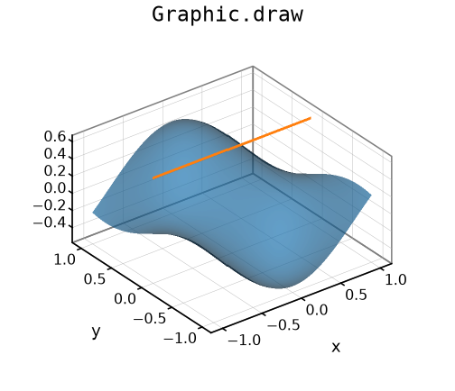

[Source code](../examples/reference/graphic_draw.py).

### `add_collection3d`

```text
ax.add_collection3d(*args, **kwargs)
```

Reject insertion of Matplotlib 3D collections.

**Parameters**

- __`*args`__ (positional arguments)

  Matplotlib collection inputs are unsupported here.

- __`**kwargs`__ (keyword arguments)

  Matplotlib collection options are unsupported here.

**Raises**

- **`NotImplementedError`**

  Always raised for this Matplotlib collection entry point.

**Notes**

Add polygons with [`plot_mesh`](function_reference.md#plot_mesh) or lines with [`plot`](api.md#plot) to include them in the VTK depth buffer.

**Examples**

```python
from mpl_toolkits.mplot3d.art3d import Poly3DCollection

fig, ax = new_scene()
triangle = [[0,0,0], [1,0,0], [0,1,1]]
try:
    ax.add_collection3d(Poly3DCollection([triangle]))
except NotImplementedError:
    ax.plot_mesh(triangle, [[0,1,2]], color="tab:blue")
ax.set_title("Equivalent polygon with plot_mesh")
```

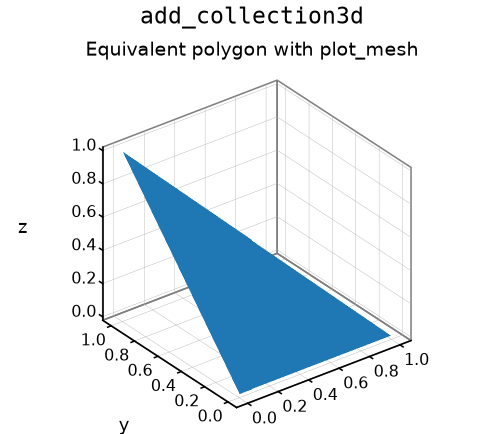

[Source code](../examples/reference/add_collection3d.py).

## Axes property keywords

Pass these properties to `VtkAxes.set()`. Omitted properties keep their current values. The method also accepts the [Matplotlib artist properties](#artist-properties).

- **`adjustable`** (str)

  The aspect adjustment method, either `"box"` or `"datalim"`.

- **`aspect`** (str)

  The data aspect mode. See [`set_aspect`](#set_aspect).

- **`box_aspect`** (three floats or `None`)

  Display-length ratios for the XYZ axes. See [`set_box_aspect`](#set_box_aspect).

- **`anchor`** (str or pair of floats)

  Where to place the axes inside its allocated rectangle.

- **`antialiasing`** (int)

  VTK supersampling factor per output dimension. See [`set_antialiasing`](#set_antialiasing).

- **`proj_type`** (str)

  Orthographic or perspective camera model. See [`set_proj_type`](#set_proj_type).

- **`autoscale_on`** (bool)

  Enable autoscaling for all three coordinates.

- **`title`** (str)

  Subplot title.

- **`prop_cycle`** (`cycler.Cycler` or `None`)

  Property cycle for newly added plots. `None` restores Matplotlib defaults.

- **`axisbelow`** (bool or `"line"`)

  Native ordering of axis ticks and grid relative to other Matplotlib artists.

- **`facecolor`** (Matplotlib color)

  Axes background fill.

- **`rasterization_zorder`** (number or `None`)

  Order below which Matplotlib rasterizes supported artists for vector output.

- **`position`** (four floats or `Bbox`)

  Rectangle of the axes in figure coordinates.

- **`axes_locator`** (callable or `None`)

  Layout function taking the axes and its renderer and returning a bounding box.

- **`subplotspec`** (`SubplotSpec`)

  GridSpec cell or span assigned to this subplot.

- **`forward_navigation_events`** (bool or `"auto"`)

  Whether navigation events pass through to axes underneath.

- **`navigate`** (bool)

  Whether the axes participates in toolbar navigation.

- **`autoscalex_on`** (bool)

  Enable autoscaling for the X coordinate.

- **`xbound`** (pair of floats)

  Lower and upper X bounds, keeping the current inversion state.

- **`xlim`** (pair of floats)

  X view limits in data units. A reversed pair inverts the axis.

- **`xinverted`** (bool)

  Set the inversion state of the X axis.

- **`xlabel`** (str)

  Label for the X axis.

- **`xmargin`** (float)

  Fraction of the X data range used as an autoscaling margin.

- **`xscale`** (str or Matplotlib scale)

  Scale for the X axis. Volume rendering requires linear scales.

- **`xticks`** (array_like)

  Major tick positions on the X axis.

- **`xticklabels`** (sequence of str)

  Text for X ticks. Set fixed tick positions first.

- **`autoscaley_on`** (bool)

  Enable autoscaling for the Y coordinate.

- **`ybound`** (pair of floats)

  Lower and upper Y bounds, keeping the current inversion state.

- **`ylim`** (pair of floats)

  Y view limits in data units. A reversed pair inverts the axis.

- **`yinverted`** (bool)

  Set the inversion state of the Y axis.

- **`ylabel`** (str)

  Label for the Y axis.

- **`ymargin`** (float)

  Fraction of the Y data range used as an autoscaling margin.

- **`yscale`** (str or Matplotlib scale)

  Scale for the Y axis. Volume rendering requires linear scales.

- **`yticks`** (array_like)

  Major tick positions on the Y axis.

- **`yticklabels`** (sequence of str)

  Text for Y ticks. Set fixed tick positions first.

- **`autoscalez_on`** (bool)

  Enable autoscaling for the Z coordinate.

- **`zbound`** (pair of floats)

  Lower and upper Z bounds, keeping the current inversion state.

- **`zlim`** (pair of floats)

  Z view limits in data units. A reversed pair inverts the axis.

- **`zinverted`** (bool)

  Set the inversion state of the Z axis.

- **`zlabel`** (str)

  Label for the Z axis.

- **`zmargin`** (float)

  Fraction of the Z data range used as an autoscaling margin.

- **`zscale`** (str or Matplotlib scale)

  Scale for the Z axis. Volume rendering requires linear scales.

- **`zticks`** (array_like)

  Major tick positions on the Z axis.

- **`zticklabels`** (sequence of str)

  Text for Z ticks. Set fixed tick positions first.

## Handle property keywords

Pass these properties to `Graphic.set()` or a specialized handle's `set()` method. Each name selects the corresponding setter. Availability depends on the handle. The methods also accept compatible [Matplotlib artist properties](#artist-properties).

- **`array`** (array_like or `None`)

  Replacement scalar mapping data. See [`set_array`](#set_array).

- **`values`** (array_like or `None`)

  Replacement scalar or RGB(A) colors, with the shape required by [`set_values`](#set_values).

- **`heights`** (2D array)

  Replacement surface heights. See [`set_heights`](#set_heights).

- **`cmap`** (colormap, str, or `None`)

  Colormap for scalar values. See [`set_cmap`](#set_cmap).

- **`clim`** (pair of floats)

  Lower and upper color bounds, following [`set_clim`](#set_clim).

- **`norm`** (normalization, str, or `None`)

  Scalar-to-colormap mapping. See [`set_norm`](#set_norm).

- **`color`** (Matplotlib color or `None`)

  Uniform object color. See [`set_color`](#set_color).

- **`facecolor`** (Matplotlib color or `None`)

  Fixed polygon fill. See [`set_facecolor`](#set_facecolor).

- **`edgecolor`** (Matplotlib color or `None`)

  Polygon edge color. See [`set_edgecolor`](#set_edgecolor).

- **`lighting`** (bool or str)

  Lighting state or interpolation mode. See [`set_lighting`](#set_lighting).

- **`linestyle`** (str)

  Line stipple pattern. See [`set_linestyle`](#set_linestyle).

- **`linewidth`** (float)

  Nominal line width in output pixels. See [`set_linewidth`](#set_linewidth).

- **`alpha`** (float or `None`)

  Overall actor opacity where the handle implements it. See [`set_alpha`](#set_alpha).

- **`label`** (object or `None`)

  Legend label. See [`set_label`](#set_label).

- **`visible`** (bool)

  Whether the individual handle is drawn.

### Artist properties

These properties apply to native Matplotlib rendering and metadata where supported. Use the VTK plot and handle options for the appearance of VTK geometry.

- **`agg_filter`** (callable or `None`)

  Optional Agg image filter for the artist.

- **`alpha`** (float or `None`)

  Opacity in `[0, 1]`. `None` uses the default opacity.

- **`animated`** (bool)

  Include the artist in explicit animation draws outside ordinary static drawing.

- **`clip_box`** (`Bbox` or `None`)

  Bounding rectangle for Matplotlib clipping.

- **`clip_on`** (bool)

  Enable Matplotlib clipping for the artist.

- **`clip_path`** (path, patch, or `None`)

  Path or patch providing a native clipping region.

- **`gid`** (str or `None`)

  Group identifier used by supporting backends.

- **`in_layout`** (bool)

  Include the artist in figure layout calculations.

- **`label`** (object or `None`)

  Label stored on the artist.

- **`mouseover`** (bool)

  Include the artist in cursor data handling.

- **`path_effects`** (sequence)

  Matplotlib path effects for supported drawing operations.

- **`picker`** (bool, float, callable, or `None`)

  Picking behavior. A number sets a tolerance where supported.

- **`rasterized`** (bool)

  Rasterize this supported artist on vector backends.

- **`sketch_params`** (three floats or `None`)

  Scale, wavelength, and randomness of a sketch effect.

- **`snap`** (bool or `None`)

  Align supported geometry to pixel boundaries. `None` permits automatic snapping.

- **`transform`** (Matplotlib transform)

  Coordinate transform used by the native artist.

- **`url`** (str or `None`)

  Link metadata used by supporting backends.

- **`visible`** (bool)

  Whether to draw the artist.

- **`zorder`** (float)

  Drawing order relative to other Matplotlib artists.

See [Matplotlib's Artist reference](https://matplotlib.org/stable/api/_as_gen/matplotlib.artist.Artist.html) for backend details.
