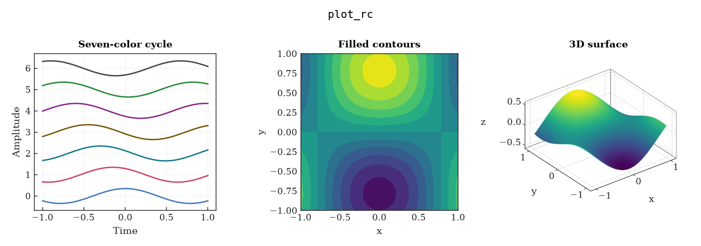
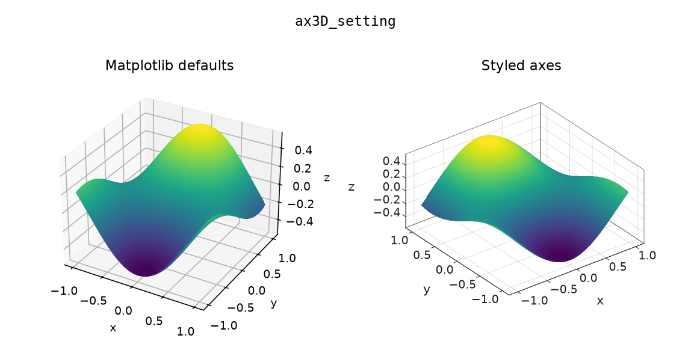

# Styles and plot handles

Call [`plot_rc`](#plot_rc) before creating figures to set typography, export defaults, and 2D styling. Call [`ax3D_setting`](#ax3d_setting) on each 3D subplot to set its view, panes, grid, and ticks. Both are optional.

## Run the examples

Run the shared setup, then run the code under the method you want to try.

```python
import matplotlib.pyplot as plt
import numpy as np
import mpl_depth_style

t = np.linspace(-1, 1, 41)
x, y = np.meshgrid(t, t)
z = .55 * np.cos(2*x) * np.sin(2*y)


def new_scene(columns=1):
    fig, axes = plt.subplots(1, columns, figsize=(3.8*columns, 3.65), layout="constrained",
                             subplot_kw={"projection": "vtk3d"})
    for ax in np.atleast_1d(axes):
        ax.set(xlabel="x", ylabel="y", zlabel="z")
    return fig, axes


def sample(ax, **style):
    return ax.plot_surface(x, y, z, **style)
```

## Style helpers

### `plot_rc`

```text
mpl_depth_style.plot_rc(grid=False, tick_direction="in", tick_right=False, tick_top=False,
                  save_dpi=300, save_bbox="tight", save_pad_inches=0.05,
                  font_family="serif",
                  font_serif=("Arial", "Helvetica", "DejaVu Sans"))
```

Apply a figure style before creating a figure. The preset uses the my-mpl-style font families, Computer Modern math, and export settings. [my-mpl-style](https://github.com/guessable/my-mpl-style#plot_rc)

| Element | Default |
| --- | --- |
| Tick labels | 10 pt, normal weight |
| Axis labels | 11 pt, normal weight |
| Axes titles | 11 pt, bold |
| Legend | 9 pt, upper right, white background, square frame |
| 2D axes | Four dark gray spines with inward bottom and left ticks |
| 2D major grid | Matplotlib's standard gray, 0.5 pt as in my-mpl-style, 20% opacity |

Matplotlib controls the widths of 2D spines and legend frames. Its standard defaults are 0.8 pt and 1 pt respectively.

The seven series colors are `#4477BB`, `#CC4466`, `#117788`, `#775500`, `#882288`, `#228833`, and `#444444`, in that order. They come from Paul Tol's dark palette, which is designed to provide contrast on white. Matplotlib's `lines.linewidth` controls native data curves, and scalar plots use their active colormap. [Paul Tol's palette](https://sronpersonalpages.nl/~pault/)

Call [`ax3D_setting`](#ax3d_setting) on a `3d` or `vtk3d` subplot for the orthographic camera, transparent panes with gray back outlines, and outward projected ticks. To use 9-point text on an individual colorbar, call `colorbar.ax.tick_params(labelsize=9)` after creating it.

**Parameters**

- **`grid`** (bool, default `False`)

  Draw the major grid on 2D axes.

- **`tick_direction`** (`"in"` or `"out"`, default `"in"`)

  Direction of the 2D tick marks.

- **`tick_right`** (bool, default `False`)

  Add ticks and tick labels to the right Y spine on 2D axes.

- **`tick_top`** (bool, default `False`)

  Add ticks and tick labels to the top X spine on 2D axes.

- **`save_dpi`** (float, default `300`)

  Default output resolution in dots per inch.

- **`save_bbox`** (`"tight"` or `"standard"`, default `"tight"`)

  Use `"tight"` to crop to the plotted artists, or `"standard"` to export the whole figure canvas.

- **`save_pad_inches`** (float, default `0.05`)

  Padding in inches around a tight export.

- **`font_family`** (str, default `"serif"`)

  Matplotlib font family passed to my-mpl-style.

- **`font_serif`** (sequence of str, default `("Arial", "Helvetica", "DejaVu Sans")`)

  Font candidates used when the font family is serif.

**Returns**

`None`. The function updates Matplotlib's `rcParams`. Use `with plt.rc_context():` to limit the style to one figure.

**Examples**

```python
with plt.rc_context():
    mpl_depth_style.plot_rc(grid=True)
    fig = plt.figure(figsize=(10.8, 3.8), layout="constrained")
    fig.get_layout_engine().set(wspace=.16)
    curves = fig.add_subplot(131)
    for i in range(7):
        curves.plot(t, i + .35 * np.cos(4 * t + i * .6))
    curves.set(xlabel="Time", ylabel="Amplitude", title="Seven-color cycle")

    contours = fig.add_subplot(132)
    contours.contourf(x, y, z, levels=12)
    contours.set(xlabel="x", ylabel="y", aspect="equal", title="Filled contours")

    ax = fig.add_subplot(133, projection="vtk3d")
    sample(ax, cmap="viridis")
    mpl_depth_style.ax3D_setting(ax, xticks=[-1, 0, 1], yticks=[-1, 0, 1], zticks=[-.5, 0, .5])
    ax.set(xlabel="x", ylabel="y", zlabel="z", title="3D surface")
```



[Source code](../examples/reference/plot_rc.py).

### `ax3D_setting`

```text
mpl_depth_style.ax3D_setting(ax=None, xlim=None, ylim=None, zlim=None, *,
                     xticks=None, yticks=None, zticks=None, aspect="equal",
                     box_aspect=None, xticks_pad=-5, yticks_pad=-5,
                     zticks_pad=0, box_on=False, xtick_length=0.025,
                     ytick_length=0.025, ztick_length=0.025, grid=None)
```

Use an orthographic view at elevation 30° and azimuth −127.5°. The three back panes have transparent faces and gray outlines. The axes, outlines, ticks, and grid lines default to 0.5 pt and respect custom widths. Grid opacity is 15%. Outward ticks are 2.5% as long as the longest projected axis.

Tick labels and scientific notation offsets use 10 pt regular text. Axis labels use 11 pt regular text. [my-mpl-style](https://github.com/guessable/my-mpl-style#3d-axes)

**Parameters**

- **`ax`** (`Axes3D` or `None`, default `None`)

  The `3d` or `vtk3d` subplot to style. Omit it to use the current pyplot axes, which must already be three-dimensional.

- **`xlim`, `ylim`, `zlim`** (two finite floats or `None`, default `None`)

  Axis bounds in data units. A pair sets manual limits. `None` uses the axis's current limits and preserves its autoscaling mode.

- **`xticks`, `yticks`, `zticks`** (one-dimensional array or `None`, default `None`)

  Tick locations in data units. `None` keeps the current locator. An empty sequence hides the ticks for that axis.

- **`aspect`** (`"auto"` or `"equal"`, default `"equal"`)

  `"equal"` gives each data unit the same display length in all three directions. `"auto"` uses the axes box proportions. Use `aspect="auto", box_aspect=(1, 1, 1)` for a cubic plot box.

- **`box_aspect`** (three positive floats or `None`, default `None`)

  Display-length ratios of the X, Y, and Z box edges. A triple overrides the box proportions set by `aspect`.

- **`xticks_pad`, `yticks_pad`** (float, default `-5`)

  Padding in points for the X and Y tick labels.

- **`zticks_pad`** (float, default `0`)

  Extra padding for Z tick labels beyond the 2-point gap from the tick endpoint. The total gap is clamped at zero.

- **`box_on`** (bool, default `False`)

  Draw the back pane outlines in gray by default. Use `True` to match their color to the axis lines.

- **`xtick_length`, `ytick_length`, `ztick_length`** (float, default `0.025`)

  Non-negative lengths of outward tick marks as fractions of the longest projected axis. Lengths adjust to the view and figure size.

- **`grid`** (bool or `None`, default `None`)

  Set the 3D grid visibility for this subplot. Pass `True` to show it, `False` to hide it, or `None` to keep its current visibility.

**Returns**

`None`. The selected axes is modified in place.

**Examples**

```python
fig, (native, styled) = new_scene(2)
fig.set_size_inches(8.2, 4.05)
fig.get_layout_engine().set(w_pad=.17, h_pad=.18, wspace=.12)
for ax in (native, styled):
    sample(ax, cmap="viridis")
native.set_title("Matplotlib defaults")
mpl_depth_style.ax3D_setting(styled)
styled.set_title("Styled axes")
```



[Source code](../examples/reference/ax3D_setting.py).

## Axes and export

Use Matplotlib methods such as `ax.set()`, `ax.view_init()`, `ax.set_aspect("equal")`, or `ax.legend()` on the `vtk3d` projection. For a scalar plot, pass its return value to `fig.colorbar(handle, ax=ax)`.

The projection keyword `antialiasing` is an integer supersampling factor from 1 through 4. The default is 2. Increasing it can smooth geometry edges and raises render time and memory use. [Export and cleanup](examples.md#export-and-cleanup)

## Graphic

The plotting methods return `Graphic` handles. `plot` returns a list because one call can draw multiple series or include marker handles.

| Operation | Handle interface |
| --- | --- |
| Inspect geometry | `vertices` and `faces` return copies of the coordinates and zero-based indices. |
| Update a regular surface | `set_heights(z)` takes an array of the same shape as the retained grid. Height colors follow the geometry if `values` was omitted. |
| Update colors | `set_values(values)` accepts scalars or RGB(A) rows matching the original point or cell association. |
| Adjust scalar mapping | `set_cmap(cmap)`, `set_norm(norm)`, and `set_clim(vmin, vmax)` update the mapping and attached colorbars. |
| Change appearance | `set(color=...)`, `set_alpha(alpha)`, or `set_visible(visible)` update the artist. |
| Remove a plot | `remove()` detaches the artist from the axes and releases it from the VTK scene. |

See the [common style options](api.md#common-style-options) for colors, opacity, and lighting.
